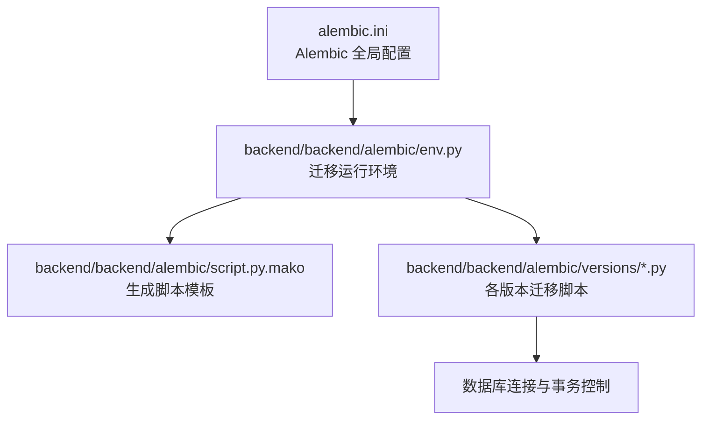
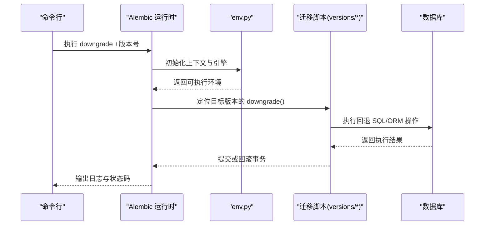
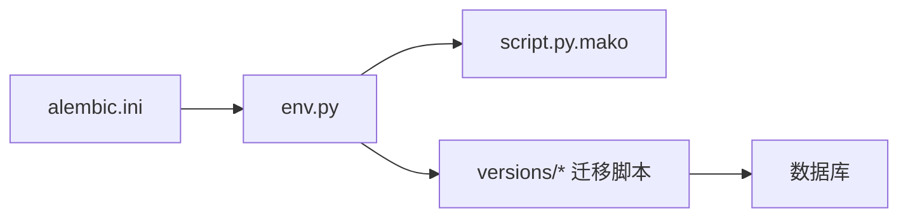

# 迁移降级操作

<cite>
**本文引用的文件**   
- [alembic.ini](file://backend/alembic.ini)
- [env.py](file://backend/backend/alembic/env.py)
- [script.py.mako](file://backend/backend/alembic/script.py.mako)
- [initial.py](file://backend/backend/alembic/versions/initial.py)
- [merge_heads.py](file://backend/backend/alembic/versions/merge_heads.py)
- [add_active_user_asset_identity_unique_index.py](file://backend/backend/alembic/versions/add_active_user_asset_identity_unique_index.py)
- [DATABASE_MIGRATION_GUIDE.md](file://DATABASE_MIGRATION_GUIDE.md)
</cite>

## 目录
1. [简介](#简介)
2. [项目结构](#项目结构)
3. [核心组件](#核心组件)
4. [架构总览](#架构总览)
5. [详细组件分析](#详细组件分析)
6. [依赖关系分析](#依赖关系分析)
7. [性能与事务特性](#性能与事务特性)
8. [故障排查指南](#故障排查指南)
9. [结论](#结论)
10. [附录](#附录)

## 简介
本文件面向小说创作代理系统的数据库迁移降级操作，聚焦于使用 alembic downgrade +版本号 命令回退到指定版本时的完整流程、风险控制与验证方法。内容涵盖：
- 降级命令的使用方式与适用场景
- 降级过程中的数据安全与完整性保护（事务回滚、一致性检查）
- 降级前的风险评估与数据备份策略
- 常见问题的识别与解决方案
- 降级后的验证步骤与系统状态检查

## 项目结构
本项目在 backend 目录下使用 Alembic 管理数据库迁移，关键位置如下：
- 迁移配置与脚本模板位于 backend/backend/alembic/
- 具体迁移脚本位于 backend/backend/alembic/versions/
- 根级配置文件 alembic.ini 用于全局参数与环境变量注入

图表来源
- [alembic.ini](file://backend/alembic.ini)
- [env.py](file://backend/backend/alembic/env.py)
- [script.py.mako](file://backend/backend/alembic/script.py.mako)
- [initial.py](file://backend/backend/alembic/versions/initial.py)
- [merge_heads.py](file://backend/backend/alembic/versions/merge_heads.py)
- [add_active_user_asset_identity_unique_index.py](file://backend/backend/alembic/versions/add_active_user_asset_identity_unique_index.py)

章节来源
- [DATABASE_MIGRATION_GUIDE.md](file://DATABASE_MIGRATION_GUIDE.md)

## 核心组件
- alembic.ini：定义数据库连接、目标目录、环境变量加载等基础配置
- env.py：构建 SQLAlchemy 引擎、设置上下文、执行 upgrade/downgrade 的生命周期钩子
- script.py.mako：生成迁移脚本的模板，决定 downgrade() 函数签名与默认行为
- versions/*：每个 .py 文件代表一个迁移版本，包含 uprev()/downrev() 或 upgrade()/downgrade() 的具体实现

章节来源
- [alembic.ini](file://backend/alembic.ini)
- [env.py](file://backend/backend/alembic/env.py)
- [script.py.mako](file://backend/backend/alembic/script.py.mako)
- [initial.py](file://backend/backend/alembic/versions/initial.py)
- [merge_heads.py](file://backend/backend/alembic/versions/merge_heads.py)
- [add_active_user_asset_identity_unique_index.py](file://backend/backend/alembic/versions/add_active_user_asset_identity_unique_index.py)

## 架构总览
下图展示了从命令行触发降级到数据库变更执行的端到端流程，以及 Alembic 内部组件之间的交互关系。

图表来源
- [env.py](file://backend/backend/alembic/env.py)
- [script.py.mako](file://backend/backend/alembic/script.py.mako)
- [initial.py](file://backend/backend/alembic/versions/initial.py)
- [merge_heads.py](file://backend/backend/alembic/versions/merge_heads.py)
- [add_active_user_asset_identity_unique_index.py](file://backend/backend/alembic/versions/add_active_user_asset_identity_unique_index.py)

## 详细组件分析

### 降级命令与版本选择
- 命令格式：alembic downgrade +版本号
- 作用：将数据库状态回退到指定版本，并执行该版本对应的 downgrade() 逻辑
- 版本定位：Alembic 根据版本号在 versions 目录中查找对应迁移脚本，确保 downgrade() 存在且可执行

注意事项
- 若目标版本不存在或脚本未实现 downgrade()，降级会失败
- 多分支头合并后，需确认当前 head 指向与目标版本路径一致

章节来源
- [alembic.ini](file://backend/alembic.ini)
- [env.py](file://backend/backend/alembic/env.py)
- [script.py.mako](file://backend/backend/alembic/script.py.mako)
- [merge_heads.py](file://backend/backend/alembic/versions/merge_heads.py)

### 事务回滚与数据一致性
- 默认事务：Alembic 在执行单个迁移脚本时通常包裹在一个事务中；若脚本内发生异常，整体回滚
- 跨脚本降级：每次 downgrade 仅作用于单个迁移脚本的事务边界；连续多个版本的降级由 Alembic 顺序调用各自的 downgrade()
- 一致性检查：建议在 downgrade() 中显式校验关键约束（如外键、唯一索引），并在必要时进行数据清理或补偿

风险点
- 非原子性：跨多个脚本的降级不是单一事务，任一脚本失败会导致后续脚本不执行
- 外部副作用：若 downgrade() 涉及外部系统（对象存储、缓存、消息队列），需保证幂等性与补偿机制

章节来源
- [env.py](file://backend/backend/alembic/env.py)
- [script.py.mako](file://backend/backend/alembic/script.py.mako)
- [initial.py](file://backend/backend/alembic/versions/initial.py)

### 降级适用场景
- 版本回退：生产或测试环境中发现新版本引入破坏性变更，需要快速回退到稳定版本
- 问题修复：迁移脚本存在缺陷导致数据不一致，通过降级恢复后再修正脚本
- 测试环境重置：在自动化测试中回退到基线版本，确保测试数据一致性

章节来源
- [DATABASE_MIGRATION_GUIDE.md](file://DATABASE_MIGRATION_GUIDE.md)

### 降级前风险评估与数据备份
评估要点
- 影响范围：哪些表、列、索引将被删除或修改
- 数据依赖：是否存在下游服务依赖该结构或数据
- 回退可行性：downgrade() 是否能完全还原结构与数据

备份策略
- 全量快照：对数据库进行冷/热备，确保可恢复到任意时间点
- 增量差异：记录本次升级引入的变更清单，便于回退时对照
- 外部资源：对关联的对象存储、向量库、缓存等进行同步备份或标记

章节来源
- [DATABASE_MIGRATION_GUIDE.md](file://DATABASE_MIGRATION_GUIDE.md)

### 降级过程常见问题与解决方案
- 缺少 downgrade()：为缺失的版本补充 downrev() 实现，确保可逆
- 依赖冲突：当多个分支头存在时，先合并分支再降级，避免路径歧义
- 数据丢失风险：在 downgrade() 中加入数据校验与补偿逻辑，必要时先导出关键数据
- 权限不足：确保迁移执行账号具备 DDL/DML 权限

章节来源
- [merge_heads.py](file://backend/backend/alembic/versions/merge_heads.py)
- [add_active_user_asset_identity_unique_index.py](file://backend/backend/alembic/versions/add_active_user_asset_identity_unique_index.py)

### 降级后的验证步骤与系统状态检查
验证清单
- 版本对齐：查询 alembic_version 表，确认当前版本等于目标版本
- 结构校验：检查关键表、列、索引是否按预期存在或缺失
- 数据一致性：抽样核对关键字段值、计数统计、外键约束
- 功能回归：运行核心 API 与业务用例，确保无报错
- 外部依赖：检查缓存、对象存储、消息队列等状态是否与降级后结构一致

章节来源
- [DATABASE_MIGRATION_GUIDE.md](file://DATABASE_MIGRATION_GUIDE.md)

## 依赖关系分析
Alembic 的运行依赖链如下：
- alembic.ini 提供数据库连接与基础配置
- env.py 负责创建引擎、会话与上下文，并暴露 upgrade/downgrade 生命周期
- script.py.mako 生成迁移脚本的骨架，包括 downgrade() 的默认实现
- versions/* 中的每个迁移脚本实现具体的 uprev()/downrev() 或 upgrade()/downgrade()

图表来源
- [alembic.ini](file://backend/alembic.ini)
- [env.py](file://backend/backend/alembic/env.py)
- [script.py.mako](file://backend/backend/alembic/script.py.mako)
- [initial.py](file://backend/backend/alembic/versions/initial.py)
- [merge_heads.py](file://backend/backend/alembic/versions/merge_heads.py)
- [add_active_user_asset_identity_unique_index.py](file://backend/backend/alembic/versions/add_active_user_asset_identity_unique_index.py)

章节来源
- [alembic.ini](file://backend/alembic.ini)
- [env.py](file://backend/backend/alembic/env.py)
- [script.py.mako](file://backend/backend/alembic/script.py.mako)
- [initial.py](file://backend/backend/alembic/versions/initial.py)
- [merge_heads.py](file://backend/backend/alembic/versions/merge_heads.py)
- [add_active_user_asset_identity_unique_index.py](file://backend/backend/alembic/versions/add_active_user_asset_identity_unique_index.py)

## 性能与事务特性
- 事务粒度：单脚本降级为一次事务；多次降级为多次事务，失败即停止
- 锁与并发：DDL 操作可能持有表级锁，应避免在高并发时段执行
- I/O 压力：大表结构变更可能引发长时间锁定与 IO 峰值，建议分批或低峰期执行
- 回滚成本：事务回滚时间与数据量相关，提前预估并准备回滚窗口

[本节为通用指导，不直接分析具体文件]

## 故障排查指南
常见问题定位
- 版本不一致：检查 alembic_version 与实际迁移脚本版本是否匹配
- 脚本错误：查看 Alembic 日志，定位具体失败的 downgrade() 行
- 权限问题：确认数据库用户具备必要的 DDL/DML 权限
- 依赖冲突：处理多分支头，确保 merge 后再降级

处置建议
- 先备份后降级，保留回滚能力
- 在测试环境先行演练，验证 downgrade() 的幂等性与数据一致性
- 对关键表增加审计字段或快照，便于问题回溯

章节来源
- [DATABASE_MIGRATION_GUIDE.md](file://DATABASE_MIGRATION_GUIDE.md)

## 结论
降级是数据库演进过程中不可或缺的“安全阀”。通过规范的命令使用、严格的事务与一致性保障、完善的备份与验证流程，可以在最小风险下完成版本回退与问题修复。建议在团队内建立降级操作的标准化流程与检查清单，确保每次降级都可追溯、可复现、可恢复。

[本节为总结性内容，不直接分析具体文件]

## 附录
- 常用命令参考：
  - 查看当前版本：alembic current
  - 查看历史版本：alembic history
  - 降级到指定版本：alembic downgrade +版本号
  - 回退一步：alembic downgrade -1
- 最佳实践：
  - 始终在降级前进行全量备份
  - 在测试环境预演降级流程
  - 对关键变更增加数据校验与补偿逻辑
  - 记录降级原因、影响范围与回滚方案

[本节为通用参考，不直接分析具体文件]