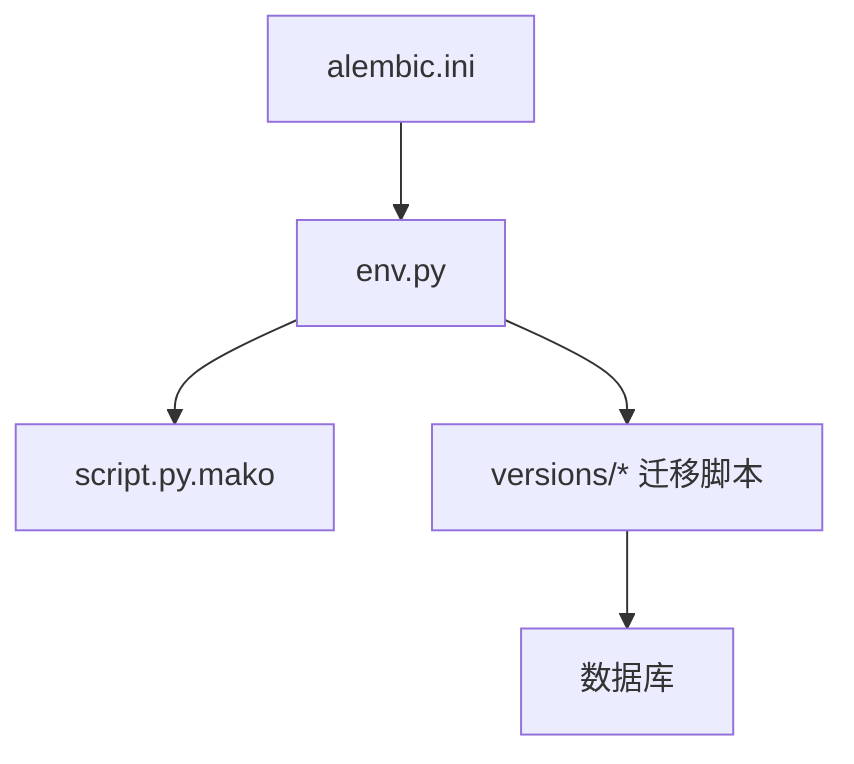
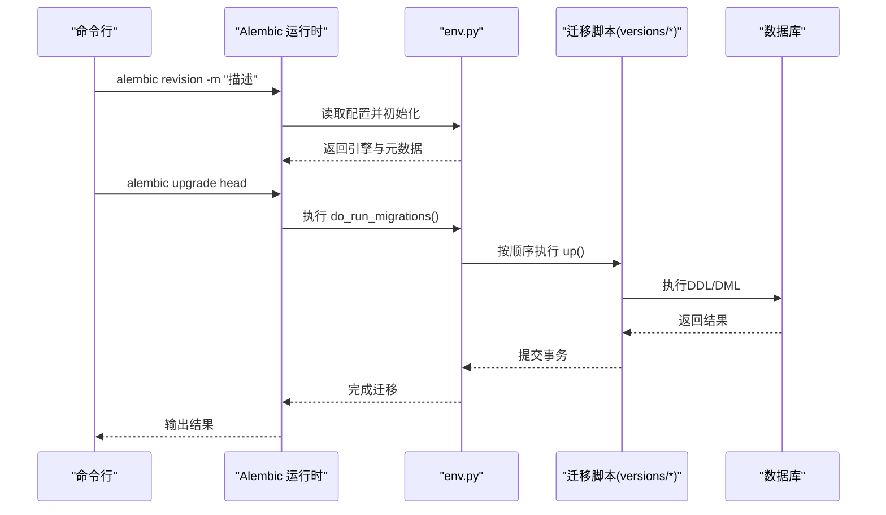
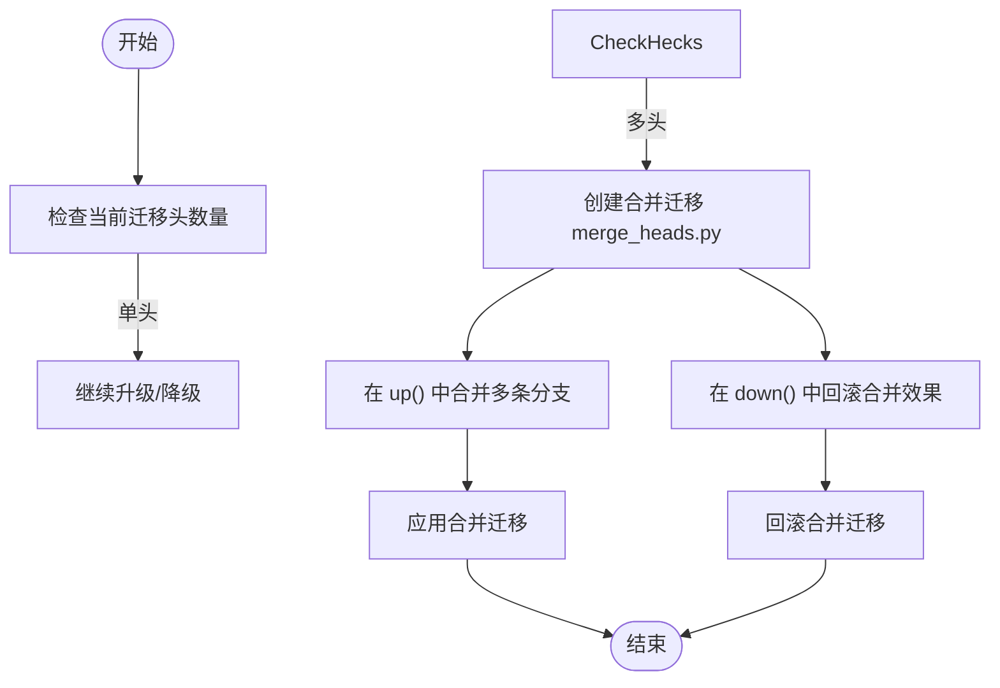
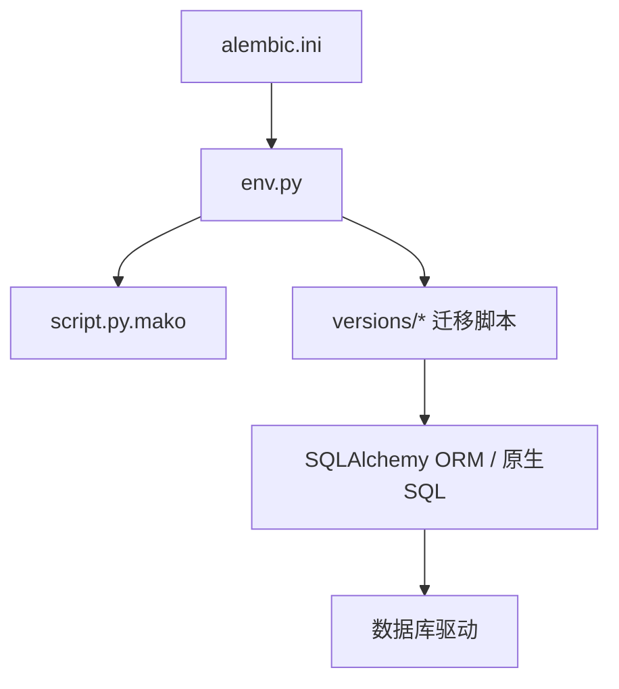

# 手动编写迁移脚本

<cite>
**本文档引用的文件**   
- [alembic.ini](file://backend/alembic.ini)
- [env.py](file://backend/alembic/env.py)
- [script.py.mako](file://backend/alembic/script.py.mako)
- [initial.py](file://backend/alembic/versions/initial.py)
- [add_admin_rbac.py](file://backend/alembic/versions/add_admin_rbac.py)
- [create_project_settings_table.py](file://backend/alembic/versions/create_project_settings_table.py)
- [add_chapter_summary_fields.py](file://backend/alembic/versions/add_chapter_summary_fields.py)
- [backfill_character_story_stance_from_text_evidence.py](file://backend/alembic/versions/backfill_character_story_stance_from_text_evidence.py)
- [cleanup_redundant_indexes.py](file://backend/alembic/versions/cleanup_redundant_indexes.py)
- [merge_heads.py](file://backend/alembic/versions/merge_heads.py)
</cite>

## 目录
1. [简介](#简介)
2. [项目结构](#项目结构)
3. [核心组件](#核心组件)
4. [架构总览](#架构总览)
5. [详细组件分析](#详细组件分析)
6. [依赖关系分析](#依赖关系分析)
7. [性能考虑](#性能考虑)
8. [故障排查指南](#故障排查指南)
9. [结论](#结论)
10. [附录](#附录)

## 简介
本文件面向小说创作代理系统的数据库迁移工作，提供“如何手动编写 Alembic 迁移脚本”的完整指南。内容涵盖：
- 使用 alembic revision 创建空迁移模板
- up() 与 down() 函数的实现规范（SQLAlchemy ORM 与原生 SQL）
- 常见数据操作场景：表结构变更、数据迁移、约束管理
- 在迁移中使用 alembic 上下文对象进行批量数据处理与错误处理
- 最佳实践与性能优化建议

## 项目结构
本项目将 Alembic 配置与迁移脚本集中在 backend/alembic 目录下：
- alembic.ini：Alembic 运行配置（数据库连接、版本目录等）
- env.py：迁移执行环境初始化（引擎、元数据、目标元数据加载）
- script.py.mako：迁移脚本生成模板（决定生成的迁移文件骨架）
- versions/*：所有已创建的迁移脚本

**图表来源** 
- [alembic.ini](file://backend/alembic.ini)
- [env.py](file://backend/alembic/env.py)
- [script.py.mako](file://backend/alembic/script.py.mako)

**章节来源**
- [alembic.ini](file://backend/alembic.ini)
- [env.py](file://backend/alembic/env.py)
- [script.py.mako](file://backend/alembic/script.py.mako)

## 核心组件
- alembic.ini：定义数据库 URL、版本目录、脚本位置、日志级别等关键参数。
- env.py：负责构建 SQLAlchemy 引擎、设置连接上下文、导入模型元数据、调用 do_run_migrations。
- script.py.mako：控制 alembic revision 生成的迁移文件模板，包含 up/down 占位符与注释说明。
- versions/*：每个迁移文件代表一次数据库状态变更，必须实现 up() 和 down()。

**章节来源**
- [alembic.ini](file://backend/alembic.ini)
- [env.py](file://backend/alembic/env.py)
- [script.py.mako](file://backend/alembic/script.py.mako)

## 架构总览
下图展示了从命令行到数据库的迁移执行流程，以及 Alembic 与环境配置的交互关系。

**图表来源** 
- [env.py](file://backend/alembic/env.py)
- [script.py.mako](file://backend/alembic/script.py.mako)
- [initial.py](file://backend/alembic/versions/initial.py)

## 详细组件分析

### 创建空迁移模板
- 命令：alembic revision --autogenerate=false -m "描述"
- 作用：在 versions/ 下生成一个空迁移文件，包含 up() 与 down() 占位函数与注释。
- 模板来源：script.py.mako 定义了生成文件的结构与默认注释。

**章节来源**
- [script.py.mako](file://backend/alembic/script.py.mako)

### up() 与 down() 的实现规范
- up()：正向迁移，执行表结构变更、数据填充或约束添加等。
- down()：反向迁移，撤销 up() 所做的变更，确保可回滚。
- 推荐做法：
  - 优先使用 SQLAlchemy ORM 表达跨库兼容的 DDL/DML；必要时使用 op.execute("原生SQL") 提升灵活性。
  - 对大表数据更新采用分批处理，避免长事务锁表。
  - 为每条重要变更添加清晰注释，说明目的与影响范围。
  - 保证 down() 与 up() 严格对称，确保可逆性。

示例参考路径（不展示代码内容）：
- 简单字段修改：[add_chapter_summary_fields.py](file://backend/alembic/versions/add_chapter_summary_fields.py)
- 新建表：[create_project_settings_table.py](file://backend/alembic/versions/create_project_settings_table.py)
- 复杂数据回填：[backfill_character_story_stance_from_text_evidence.py](file://backend/alembic/versions/backfill_character_story_stance_from_text_evidence.py)

**章节来源**
- [add_chapter_summary_fields.py](file://backend/alembic/versions/add_chapter_summary_fields.py)
- [create_project_settings_table.py](file://backend/alembic/versions/create_project_settings_table.py)
- [backfill_character_story_stance_from_text_evidence.py](file://backend/alembic/versions/backfill_character_story_stance_from_text_evidence.py)

### 常见数据操作场景

#### 表结构变更（CREATE TABLE、ALTER TABLE）
- 新增表：通过 ORM 定义模型后，使用 op.create_table 或 op.execute("CREATE TABLE ...")。
- 修改列：使用 op.add_column、op.alter_column、op.drop_column。
- 索引与约束：使用 op.create_index、op.create_primary_key、op.create_foreign_key、op.create_unique_constraint。

示例参考路径：
- 新建表：[create_project_settings_table.py](file://backend/alembic/versions/create_project_settings_table.py)
- 添加字段：[add_chapter_summary_fields.py](file://backend/alembic/versions/add_chapter_summary_fields.py)

**章节来源**
- [create_project_settings_table.py](file://backend/alembic/versions/create_project_settings_table.py)
- [add_chapter_summary_fields.py](file://backend/alembic/versions/add_chapter_summary_fields.py)

#### 数据迁移（INSERT、UPDATE、DELETE）
- 小量数据：直接 op.execute("INSERT/UPDATE/DELETE ...")。
- 大量数据：分批查询与写入，避免一次性加载导致内存溢出与锁表。
- 数据一致性：使用事务包裹批量操作，失败时整体回滚。

示例参考路径：
- 复杂回填逻辑：[backfill_character_story_stance_from_text_evidence.py](file://backend/alembic/versions/backfill_character_story_stance_from_text_evidence.py)

**章节来源**
- [backfill_character_story_stance_from_text_evidence.py](file://backend/alembic/versions/backfill_character_story_stance_from_text_evidence.py)

#### 约束管理（PRIMARY KEY、FOREIGN KEY、UNIQUE）
- 主键：op.create_primary_key
- 外键：op.create_foreign_key，注意级联策略（ON DELETE/UPDATE）
- 唯一约束：op.create_unique_constraint 或 unique=True

示例参考路径：
- RBAC 相关权限与角色约束：[add_admin_rbac.py](file://backend/alembic/versions/add_admin_rbac.py)

**章节来源**
- [add_admin_rbac.py](file://backend/alembic/versions/add_admin_rbac.py)

### 使用 alembic 上下文对象
- 获取连接：op.get_bind()
- 执行原生 SQL：op.execute("SQL语句")
- 批量处理：结合分页查询与分批写入，减少锁竞争与内存占用
- 错误处理：捕获异常并记录日志，必要时抛出异常触发回滚

示例参考路径：
- 清理冗余索引：[cleanup_redundant_indexes.py](file://backend/alembic/versions/cleanup_redundant_indexes.py)

**章节来源**
- [cleanup_redundant_indexes.py](file://backend/alembic/versions/cleanup_redundant_indexes.py)

### 迁移脚本示例（路径引用）
- 简单字段修改：[add_chapter_summary_fields.py](file://backend/alembic/versions/add_chapter_summary_fields.py)
- 新建表与初始数据：[create_project_settings_table.py](file://backend/alembic/versions/create_project_settings_table.py)
- 复杂数据转换与回填：[backfill_character_story_stance_from_text_evidence.py](file://backend/alembic/versions/backfill_character_story_stance_from_text_evidence.py)
- 约束与索引调整：[cleanup_redundant_indexes.py](file://backend/alembic/versions/cleanup_redundant_indexes.py)

**章节来源**
- [add_chapter_summary_fields.py](file://backend/alembic/versions/add_chapter_summary_fields.py)
- [create_project_settings_table.py](file://backend/alembic/versions/create_project_settings_table.py)
- [backfill_character_story_stance_from_text_evidence.py](file://backend/alembic/versions/backfill_character_story_stance_from_text_evidence.py)
- [cleanup_redundant_indexes.py](file://backend/alembic/versions/cleanup_redundant_indexes.py)

### 合并分支与头节点管理
当存在多个迁移头时，需要创建合并迁移以统一版本线。

**图表来源** 
- [merge_heads.py](file://backend/alembic/versions/merge_heads.py)

**章节来源**
- [merge_heads.py](file://backend/alembic/versions/merge_heads.py)

## 依赖关系分析
Alembic 的运行依赖配置文件与环境初始化，迁移脚本则依赖 SQLAlchemy 与数据库驱动。

**图表来源** 
- [alembic.ini](file://backend/alembic.ini)
- [env.py](file://backend/alembic/env.py)
- [script.py.mako](file://backend/alembic/script.py.mako)

**章节来源**
- [alembic.ini](file://backend/alembic.ini)
- [env.py](file://backend/alembic/env.py)
- [script.py.mako](file://backend/alembic/script.py.mako)

## 性能考虑
- 分批处理：对大表 UPDATE/DELETE 使用分页游标，限制每批大小（如 1000~5000 行）。
- 索引策略：在大批量写入前临时删除非必需索引，完成后重建以提升写入速度。
- 事务边界：尽量缩短事务时间，避免长时间持有锁。
- 并发控制：在高并发环境下，使用行级锁或队列机制避免冲突。
- 监控与日志：记录批次进度、耗时与异常，便于定位瓶颈。

[本节为通用指导，不直接分析具体文件]

## 故障排查指南
- 常见问题：
  - 迁移头不一致：使用 alembic heads 查看，必要时创建合并迁移。
  - 回滚失败：检查 down() 是否覆盖 up() 的所有变更。
  - 长事务锁表：拆分批量操作，增加事务提交频率。
  - 原生 SQL 语法差异：根据数据库方言调整语句或使用 ORM。
- 调试步骤：
  - 使用 alembic current 查看当前版本
  - 使用 alembic history 查看迁移历史
  - 使用 alembic upgrade/ downgrade 逐步验证
  - 在迁移中加入日志输出与异常捕获

**章节来源**
- [merge_heads.py](file://backend/alembic/versions/merge_heads.py)
- [cleanup_redundant_indexes.py](file://backend/alembic/versions/cleanup_redundant_indexes.py)

## 结论
通过遵循本指南，你可以安全、高效地手动编写 Alembic 迁移脚本。关键在于：
- 明确 up()/down() 的对称性与可逆性
- 合理使用 ORM 与原生 SQL 的平衡
- 对大数据量操作进行分批与事务控制
- 保持迁移脚本的可读性与可维护性

[本节为总结性内容，不直接分析具体文件]

## 附录

### 常用命令速查
- 创建空迁移：alembic revision --autogenerate=false -m "描述"
- 查看当前版本：alembic current
- 查看迁移历史：alembic history
- 升级到最新版本：alembic upgrade head
- 回滚一步：alembic downgrade -1
- 查看迁移头：alembic heads

[本节为通用指导，不直接分析具体文件]