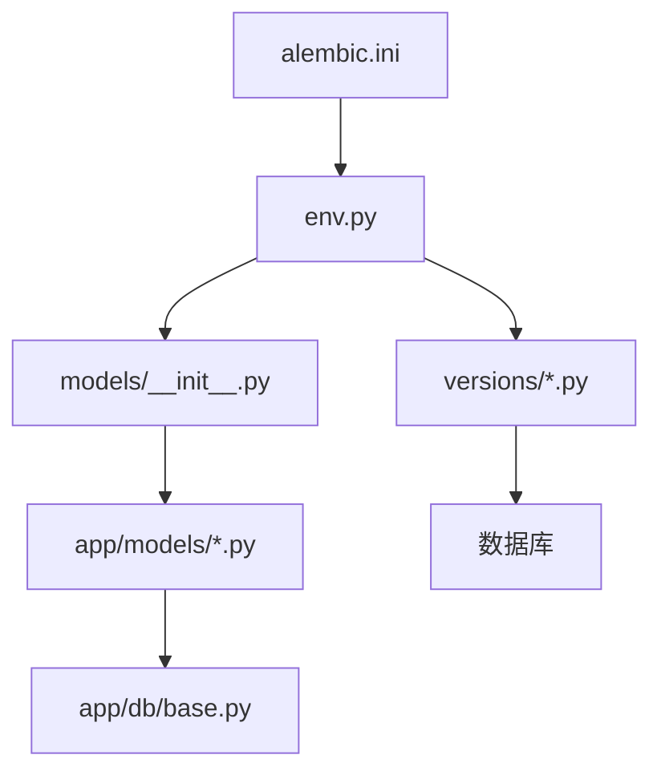
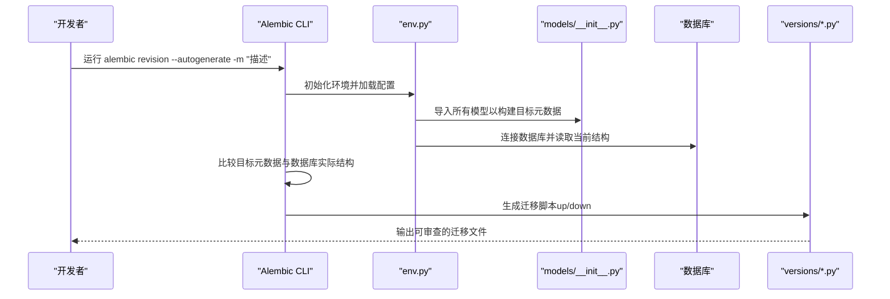
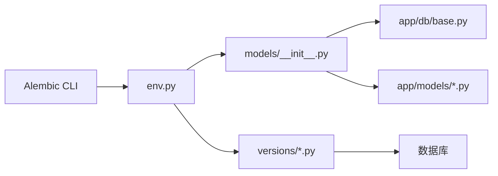

# 自动生成迁移文件

<cite>
**本文引用的文件**   
- [alembic.ini](file://backend/alembic.ini)
- [env.py](file://backend/alembic/env.py)
- [script.py.mako](file://backend/alembic/script.py.mako)
- [initial.py](file://backend/alembic/versions/initial.py)
- [add_active_user_asset_identity_unique_index.py](file://backend/alembic/versions/add_active_user_asset_identity_unique_index.py)
- [add_admin_rbac.py](file://backend/alembic/versions/add_admin_rbac.py)
- [add_audio_config_to_projects.py](file://backend/alembic/versions/add_audio_config_to_projects.py)
- [add_audio_library_assets.py](file://backend/alembic/versions/add_audio_library_assets.py)
- [add_deleted_at_to_chapters.py](file://backend/alembic/versions/add_deleted_at_to_chapters.py)
- [merge_heads.py](file://backend/alembic/versions/merge_heads.py)
- [normalize_timezone_aware_timestamp_columns.py](file://backend/alembic/versions/normalize_timezone_aware_timestamp_columns.py)
- [base.py](file://backend/app/db/base.py)
- [__init__.py](file://backend/app/models/__init__.py)
- [project.py](file://backend/app/models/project.py)
- [user.py](file://backend/app/models/user.py)
- [audio_library_asset.py](file://backend/app/models/audio_library_asset.py)
- [DATABASE_MIGRATION_GUIDE.md](file://DATABASE_MIGRATION_GUIDE.md)
</cite>

## 目录
1. [简介](#简介)
2. [项目结构](#项目结构)
3. [核心组件](#核心组件)
4. [架构总览](#架构总览)
5. [详细组件分析](#详细组件分析)
6. [依赖关系分析](#依赖关系分析)
7. [性能考虑](#性能考虑)
8. [故障排除指南](#故障排除指南)
9. [结论](#结论)
10. [附录](#附录) 

## 简介
本文件面向小说创作代理系统的数据库迁移管理，重点说明如何使用 Alembic 的自动迁移能力生成迁移文件。内容涵盖：
- 使用 alembic revision --autogenerate 命令及其常用参数（如 -m/--message、--head、--base）
- 配置 Alembic 环境以正确检测 SQLAlchemy 模型变更（引擎配置、模型导入）
- 自动生成的迁移文件结构与 up()/down() 函数逻辑
- 常见数据模型变更场景的自动生成示例（新增表、修改字段类型、添加索引等）
- 自动生成失败的处理与手动修正方法
- 完整的命令行操作示例与故障排除

## 项目结构
本项目在 backend 目录下维护 Alembic 相关配置与迁移脚本，核心位置如下：
- 配置文件：backend/alembic.ini
- 运行环境：backend/alembic/env.py
- 模板：backend/alembic/script.py.mako
- 迁移版本：backend/alembic/versions/*.py
- 模型定义：backend/app/models/* 以及统一入口 backend/app/models/__init__.py
- 数据库基础：backend/app/db/base.py

图表来源 
- [alembic.ini](file://backend/alembic.ini)
- [env.py](file://backend/alembic/env.py)
- [__init__.py](file://backend/app/models/__init__.py)
- [base.py](file://backend/app/db/base.py)
- [initial.py](file://backend/alembic/versions/initial.py)

章节来源
- [alembic.ini](file://backend/alembic.ini)
- [env.py](file://backend/alembic/env.py)
- [__init__.py](file://backend/app/models/__init__.py)
- [base.py](file://backend/app/db/base.py)

## 核心组件
- alembic.ini：Alembic 全局配置，包含数据库连接 URL、脚本目录、目标元数据等关键项
- env.py：Alembic 运行时环境，负责加载配置、创建引擎、设置目标元数据、执行迁移上下文
- script.py.mako：迁移脚本模板，控制生成的迁移文件骨架（含 up()/down() 占位）
- versions/*.py：具体迁移脚本，每个文件代表一次数据库变更，包含 up() 和 down() 实现
- models/__init__.py：聚合所有 SQLAlchemy 模型，供 Alembic 自动检测差异时导入
- app/db/base.py：定义 Base 元数据及通用字段，确保 Alembic 能识别模型结构

章节来源
- [alembic.ini](file://backend/alembic.ini)
- [env.py](file://backend/alembic/env.py)
- [script.py.mako](file://backend/alembic/script.py.mako)
- [__init__.py](file://backend/app/models/__init__.py)
- [base.py](file://backend/app/db/base.py)

## 架构总览
下图展示了从模型变更到自动生成迁移文件的整体流程：

图表来源 
- [env.py](file://backend/alembic/env.py)
- [__init__.py](file://backend/app/models/__init__.py)
- [initial.py](file://backend/alembic/versions/initial.py)

## 详细组件分析

### Alembic 配置与环境（alembic.ini 与 env.py）
- alembic.ini
  - 指定数据库连接 URL（例如 PostgreSQL/MySQL），确保与后端服务一致
  - 指定脚本目录为 backend/alembic
  - 指定目标元数据对象（通常为 models 包中的 Base.metadata）
- env.py
  - 读取 alembic.ini 的配置
  - 创建 SQLAlchemy 引擎与连接池
  - 设置 target_metadata 为 models 包的元数据
  - 提供 run_migrations_offline() 与 run_migrations_online() 两种模式
  - 在离线模式下直接执行 SQL 脚本；在线模式下通过连接执行迁移

章节来源
- [alembic.ini](file://backend/alembic.ini)
- [env.py](file://backend/alembic/env.py)

### 模型聚合与导入（models/__init__.py 与 base.py）
- models/__init__.py
  - 聚合导入所有子模块中的模型类，确保 Alembic 扫描时可发现全部模型
  - 建议按功能域拆分模型文件并在 __init__.py 中集中导入
- base.py
  - 定义 Base 元数据与通用字段（如 id、时间戳等）
  - 保证所有模型继承自 Base，使 Alembic 能统一处理元数据

章节来源
- [__init__.py](file://backend/app/models/__init__.py)
- [base.py](file://backend/app/db/base.py)

### 迁移脚本模板（script.py.mako）
- 控制生成的迁移文件骨架，包括：
  - 头部注释与导入语句
  - 空迁移的 up() 与 down() 占位
  - 版本标识与依赖关系字段
- 可根据团队规范定制模板，例如增加审计字段或约束提示

章节来源
- [script.py.mako](file://backend/alembic/script.py.mako)

### 自动迁移生成流程与命令参数
- 基本命令
  - alembic revision --autogenerate -m "描述"
- 常用参数
  - -m/--message：迁移消息（必须填写，便于追踪变更）
  - --head：指定起始头版本（默认 latest）
  - --base：指定基线版本（用于合并分支或回滚起点）
  - --sql：仅输出 SQL 而不生成 Python 脚本（适合预览）
  - --compare-type：强制比较类型差异（某些方言需要）
- 典型工作流
  - 修改模型后，运行 alembic revision --autogenerate -m "描述"
  - 审查生成的 versions/*.py 文件
  - 确认 up() 与 down() 逻辑正确后，执行 alembic upgrade head

章节来源
- [env.py](file://backend/alembic/env.py)
- [script.py.mako](file://backend/alembic/script.py.mako)

### 自动生成的迁移文件结构与 up()/down() 逻辑
- 文件命名：版本号_描述.py（由 Alembic 自动生成）
- 关键字段
  - revision：唯一版本标识
  - down_revision：依赖的前一版本
  - branch_labels：分支标签（可选）
- 核心函数
  - up()：正向迁移，应用变更到数据库
  - down()：反向迁移，撤销变更（应尽可能完整）
- 常见生成行为
  - 新增表：create_table + 索引/约束
  - 修改字段：alter_column（类型、默认值、非空等）
  - 删除字段：drop_column
  - 新增索引：create_index/drop_index
  - 重命名列/表：rename_column/rename_table

章节来源
- [initial.py](file://backend/alembic/versions/initial.py)
- [add_audio_library_assets.py](file://backend/alembic/versions/add_audio_library_assets.py)
- [add_audio_config_to_projects.py](file://backend/alembic/versions/add_audio_config_to_projects.py)
- [add_deleted_at_to_chapters.py](file://backend/alembic/versions/add_deleted_at_to_chapters.py)
- [add_active_user_asset_identity_unique_index.py](file://backend/alembic/versions/add_active_user_asset_identity_unique_index.py)

### 常见数据模型变更场景与自动生成示例
- 新增表
  - 场景：新增“音频库资产”表
  - 自动生成：create_table、字段定义、默认值、约束
  - 参考：[add_audio_library_assets.py](file://backend/alembic/versions/add_audio_library_assets.py)
- 修改字段类型
  - 场景：将某字段从字符串改为 JSON
  - 自动生成：alter_column（类型转换）、必要时数据迁移
  - 参考：[add_audio_config_to_projects.py](file://backend/alembic/versions/add_audio_config_to_projects.py)
- 添加索引
  - 场景：为查询优化添加唯一索引
  - 自动生成：create_index/drop_index
  - 参考：[add_active_user_asset_identity_unique_index.py](file://backend/alembic/versions/add_active_user_asset_identity_unique_index.py)
- 添加软删除字段
  - 场景：为章节表添加 deleted_at 字段
  - 自动生成：alter_column（添加列、默认值）
  - 参考：[add_deleted_at_to_chapters.py](file://backend/alembic/versions/add_deleted_at_to_chapters.py)
- 合并多分支头
  - 场景：多个开发分支各自产生迁移头，需合并
  - 自动生成：merge 迁移，更新 down_revision
  - 参考：[merge_heads.py](file://backend/alembic/versions/merge_heads.py)
- 时区感知时间列规范化
  - 场景：统一时间列为带时区格式
  - 自动生成：alter_column（类型转换）、数据回填
  - 参考：[normalize_timezone_aware_timestamp_columns.py](file://backend/alembic/versions/normalize_timezone_aware_timestamp_columns.py)

章节来源
- [add_audio_library_assets.py](file://backend/alembic/versions/add_audio_library_assets.py)
- [add_audio_config_to_projects.py](file://backend/alembic/versions/add_audio_config_to_projects.py)
- [add_active_user_asset_identity_unique_index.py](file://backend/alembic/versions/add_active_user_asset_identity_unique_index.py)
- [add_deleted_at_to_chapters.py](file://backend/alembic/versions/add_deleted_at_to_chapters.py)
- [merge_heads.py](file://backend/alembic/versions/merge_heads.py)
- [normalize_timezone_aware_timestamp_columns.py](file://backend/alembic/versions/normalize_timezone_aware_timestamp_columns.py)

### 模型示例（project.py、user.py）
- project.py
  - 展示项目相关字段与关系，常用于演示字段类型变更与索引添加
- user.py
  - 展示用户相关字段与唯一约束，常用于演示唯一索引与校验规则

章节来源
- [project.py](file://backend/app/models/project.py)
- [user.py](file://backend/app/models/user.py)

## 依赖关系分析
- Alembic CLI 依赖 env.py 提供的运行环境与目标元数据
- env.py 依赖 models/__init__.py 聚合的模型元数据
- models/__init__.py 依赖各模型文件与 base.py 的 Base 元数据
- 迁移脚本 versions/*.py 依赖前一个版本的 down_revision，形成线性或分支化的版本链

图表来源 
- [env.py](file://backend/alembic/env.py)
- [__init__.py](file://backend/app/models/__init__.py)
- [base.py](file://backend/app/db/base.py)
- [initial.py](file://backend/alembic/versions/initial.py)

章节来源
- [env.py](file://backend/alembic/env.py)
- [__init__.py](file://backend/app/models/__init__.py)
- [base.py](file://backend/app/db/base.py)

## 性能考虑
- 大型数据库上自动比对可能耗时较长，建议在低峰期执行
- 避免频繁提交微小变更，减少迁移数量
- 对复杂类型转换（如字符串到 JSON）进行预检查与数据备份
- 合理使用索引与约束，避免迁移过程中锁表过久

## 故障排除指南
- 无法检测到模型变更
  - 检查 env.py 是否正确设置 target_metadata 指向 models 包的元数据
  - 确认 models/__init__.py 已导入所有模型文件
  - 确保 alembic.ini 的数据库 URL 与后端一致
- 自动生成失败或生成不正确
  - 使用 --sql 预览 SQL 语句，核对是否符合预期
  - 手动修正 versions/*.py 中的 up()/down() 逻辑
  - 对于复杂类型转换，可能需要编写自定义迁移逻辑
- 版本冲突或多头问题
  - 使用 merge 迁移合并分支头，确保 down_revision 正确
  - 参考 [merge_heads.py](file://backend/alembic/versions/merge_heads.py) 的合并策略
- 时区与时间列不一致
  - 参考 [normalize_timezone_aware_timestamp_columns.py](file://backend/alembic/versions/normalize_timezone_aware_timestamp_columns.py) 的规范化方式
- 回滚与验证
  - 执行 alembic downgrade -n 1 回滚最近一次迁移
  - 使用 alembic current 查看当前版本
  - 使用 alembic history 查看迁移历史

章节来源
- [env.py](file://backend/alembic/env.py)
- [__init__.py](file://backend/app/models/__init__.py)
- [merge_heads.py](file://backend/alembic/versions/merge_heads.py)
- [normalize_timezone_aware_timestamp_columns.py](file://backend/alembic/versions/normalize_timezone_aware_timestamp_columns.py)

## 结论
通过合理配置 Alembic 环境与模型聚合，结合 alembic revision --autogenerate 命令，可以高效、可靠地生成数据库迁移文件。遵循本文的流程与最佳实践，能够降低人为错误、提升团队协作效率，并确保数据库结构的稳定演进。

## 附录
- 完整命令行示例
  - 生成迁移：alembic revision --autogenerate -m "新增音频库资产表"
  - 预览 SQL：alembic revision --autogenerate --sql -m "预览SQL"
  - 指定头版本：alembic revision --autogenerate --head <revision_id> -m "指定头"
  - 指定基线：alembic revision --autogenerate --base <revision_id> -m "指定基线"
  - 升级：alembic upgrade head
  - 回滚：alembic downgrade -n 1
  - 查看当前版本：alembic current
  - 查看历史：alembic history
- 参考文档
  - DATABASE_MIGRATION_GUIDE.md：项目级迁移指南与注意事项

章节来源
- [DATABASE_MIGRATION_GUIDE.md](file://DATABASE_MIGRATION_GUIDE.md)