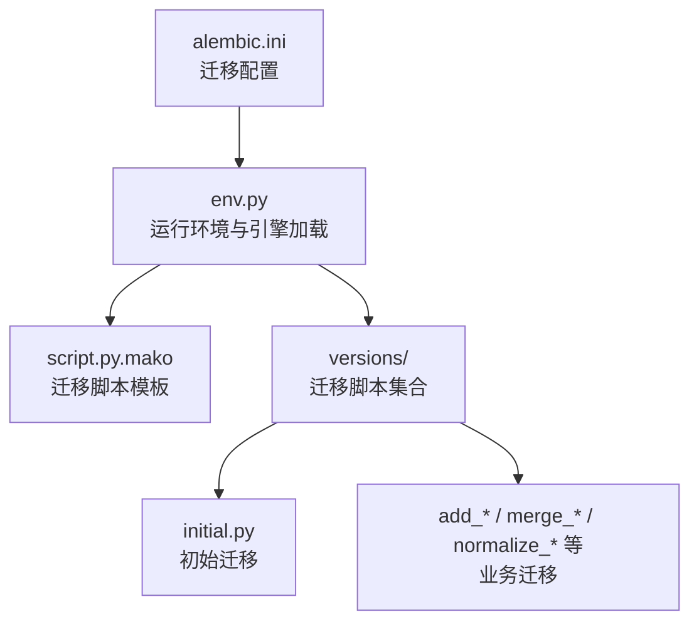
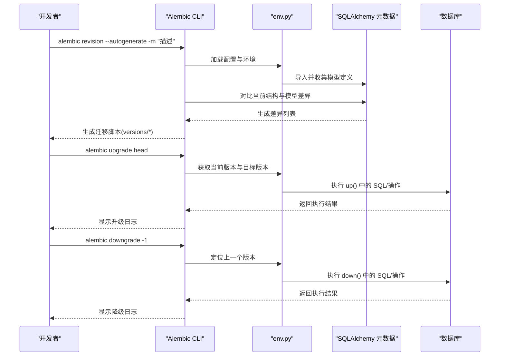
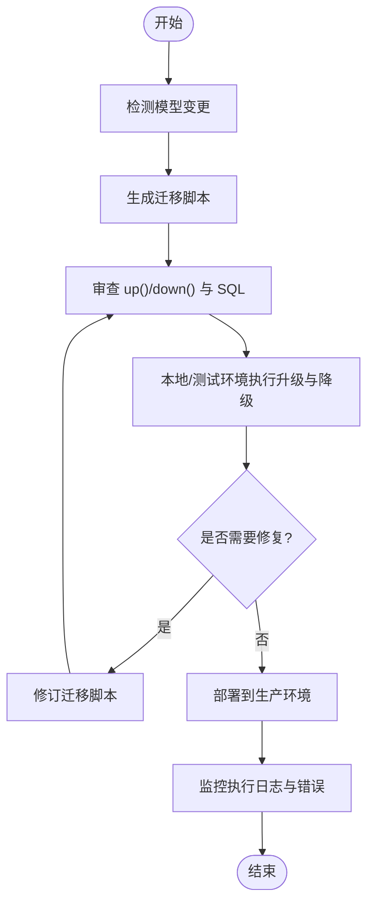
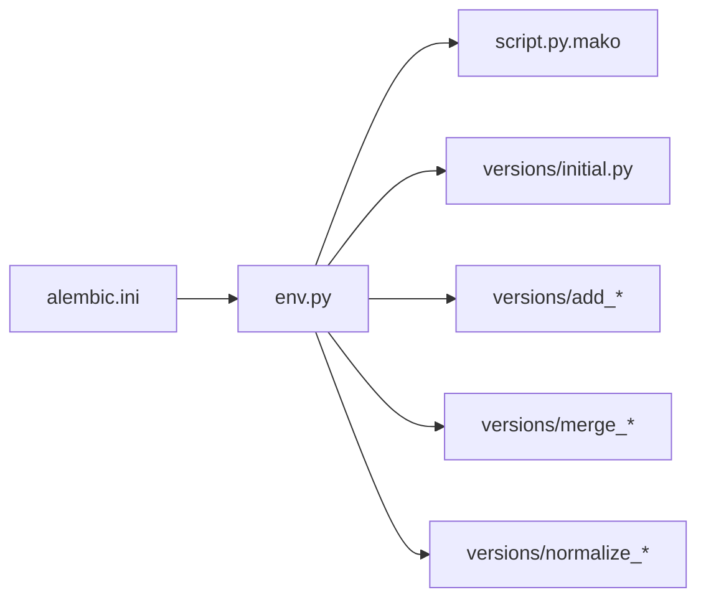

# 迁移文件生成

<cite>
**本文引用的文件**   
- [alembic.ini](file://backend/alembic.ini)
- [env.py](file://backend/alembic/env.py)
- [script.py.mako](file://backend/alembic/script.py.mako)
- [initial.py](file://backend/alembic/versions/initial.py)
- [add_active_user_asset_identity_unique_index.py](file://backend/alembic/versions/add_active_user_asset_identity_unique_index.py)
- [add_admin_rbac.py](file://backend/alembic/versions/add_admin_rbac.py)
- [add_audio_config_to_projects.py](file://backend/alembic/versions/add_audio_config_to_projects.py)
- [add_deleted_at_to_chapters.py](file://backend/alembic/versions/add_deleted_at_to_chapters.py)
- [merge_heads.py](file://backend/alembic/versions/merge_heads.py)
- [normalize_timezone_aware_timestamp_columns.py](file://backend/alembic/versions/normalize_timezone_aware_timestamp_columns.py)
- [PROJECT.md](file://README.md)
</cite>

## 目录
1. [简介](#简介)
2. [项目结构](#项目结构)
3. [核心组件](#核心组件)
4. [架构总览](#架构总览)
5. [详细组件分析](#详细组件分析)
6. [依赖关系分析](#依赖关系分析)
7. [性能注意事项](#性能注意事项)
8. [故障排查指南](#故障排查指南)
9. [结论](#结论)
10. [附录](#附录)

## 简介
本文件面向小说创作代理系统的数据库迁移管理，聚焦于使用 Alembic 自动生成与手动编写迁移文件的完整流程。内容涵盖：
- 如何使用 alembic revision --autogenerate 自动检测模型变更并生成迁移脚本
- 如何手动编写迁移脚本（up() 与 down() 函数、SQL 语句、数据操作注意事项）
- 数据模型变更的处理流程（新增表、修改字段、添加约束、删除列等）
- 迁移文件命名规范与版本管理策略
- 结合本项目现有迁移示例的最佳实践

## 项目结构
后端采用 Alembic 进行数据库迁移，相关配置与模板位于 backend/alembic 目录，迁移脚本存放于 backend/alembic/versions。Alembic 的配置文件为 backend/alembic.ini，环境初始化脚本为 env.py，迁移脚本模板为 script.py.mako。

图表来源 
- [alembic.ini](file://backend/alembic.ini)
- [env.py](file://backend/alembic/env.py)
- [script.py.mako](file://backend/alembic/script.py.mako)
- [initial.py](file://backend/alembic/versions/initial.py)
- [add_active_user_asset_identity_unique_index.py](file://backend/alembic/versions/add_active_user_asset_identity_unique_index.py)
- [add_admin_rbac.py](file://backend/alembic/versions/add_admin_rbac.py)
- [add_audio_config_to_projects.py](file://backend/alembic/versions/add_audio_config_to_projects.py)
- [add_deleted_at_to_chapters.py](file://backend/alembic/versions/add_deleted_at_to_chapters.py)
- [merge_heads.py](file://backend/alembic/versions/merge_heads.py)
- [normalize_timezone_aware_timestamp_columns.py](file://backend/alembic/versions/normalize_timezone_aware_timestamp_columns.py)

章节来源
- [alembic.ini](file://backend/alembic.ini)
- [env.py](file://backend/alembic/env.py)
- [script.py.mako](file://backend/alembic/script.py.mako)
- [initial.py](file://backend/alembic/versions/initial.py)

## 核心组件
- alembic.ini：定义数据库连接、目标元数据路径、脚本目录、升级/降级命令行为等。
- env.py：在运行时加载 SQLAlchemy 元数据、构建引擎、设置上下文，供 alembic 命令执行迁移时使用。
- script.py.mako：迁移脚本的模板，控制生成的 up()/down() 骨架与导入语句。
- versions/*：每个迁移文件代表一次数据库变更，包含 up()（正向）和 down()（回滚）实现。

章节来源
- [alembic.ini](file://backend/alembic.ini)
- [env.py](file://backend/alembic/env.py)
- [script.py.mako](file://backend/alembic/script.py.mako)

## 架构总览
下图展示从命令行到数据库的迁移执行链路，以及自动迁移生成时模型到 SQL 的转换过程。

图表来源 
- [alembic.ini](file://backend/alembic.ini)
- [env.py](file://backend/alembic/env.py)
- [script.py.mako](file://backend/alembic/script.py.mako)
- [initial.py](file://backend/alembic/versions/initial.py)

## 详细组件分析

### 自动迁移生成（alembic revision --autogenerate）
- 基本用法
  - 在项目根或 alembic.ini 所在目录执行：alembic revision --autogenerate -m "简短描述"
  - 该命令会读取 alembic.ini 的配置，通过 env.py 加载 SQLAlchemy 元数据，并与数据库当前结构对比，生成差异化的迁移脚本。
- 常用参数
  - -m/--message：迁移消息（建议语义化，如“为章节表增加软删除字段”）
  - --head：指定目标头版本（默认 head）
  - --base：指定基版本（用于分支合并场景）
  - --sql：仅输出 SQL 而不生成 Python 脚本（适合审查）
  - --template：自定义模板（通常使用默认 script.py.mako）
- 生成后检查要点
  - 确认 up() 中是否包含预期的 DDL/DML
  - 确认 down() 是否能安全回滚
  - 对复杂变更（如重命名列、类型转换）需人工修正自动生成的代码

章节来源
- [alembic.ini](file://backend/alembic.ini)
- [env.py](file://backend/alembic/env.py)
- [script.py.mako](file://backend/alembic/script.py.mako)

### 手动编写迁移脚本（up/down 与 SQL）
- up() 函数
  - 负责将数据库升级到新版本，包括创建表、添加列、修改类型、添加索引/约束、数据回填等。
  - 对于大表的数据更新，建议使用批处理与事务边界控制，避免长时间锁表。
- down() 函数
  - 负责回滚 up() 的操作，确保可逆性。若无法完全回滚，需在注释中说明风险与影响。
- SQL 语句编写注意事项
  - 优先使用 Alembic 提供的 op.* API（如 create_table、alter_column、create_index），便于跨方言兼容。
  - 需要执行原生 SQL 时使用 op.execute()，但应尽量避免，除非必要。
  - 对生产库执行 DDL 前，务必先在测试环境验证，必要时分批执行。
- 数据操作注意事项
  - 涉及大量数据写入/更新时，拆分为小批次，减少锁竞争与超时风险。
  - 对必填字段回填时，先允许空值再逐步填充，最后加 NOT NULL 约束。
  - 对索引/外键的增删，注意顺序以避免依赖冲突。

章节来源
- [script.py.mako](file://backend/alembic/script.py.mako)

### 数据模型变更的处理流程
- 新增表
  - 在 up() 中使用 create_table 定义表结构；down() 中 drop_table。
- 修改字段
  - 使用 alter_column 修改类型、默认值、是否允许空等；必要时分步执行（先改类型，再改默认值）。
- 添加约束
  - 使用 create_unique_constraint、create_foreign_key、create_check_constraint 等；down() 中对应 drop。
- 删除列
  - 使用 drop_column；down() 中重新 add_column 并回填数据（如有历史数据）。
- 复杂数据转换
  - 使用 op.execute() 执行批量 UPDATE/INSERT；建议分批提交，记录进度。
  - 对时间戳、时区等规范化操作，参考 normalize_timezone_aware_timestamp_columns.py 的模式。

章节来源
- [add_audio_config_to_projects.py](file://backend/alembic/versions/add_audio_config_to_projects.py)
- [add_deleted_at_to_chapters.py](file://backend/alembic/versions/add_deleted_at_to_chapters.py)
- [normalize_timezone_aware_timestamp_columns.py](file://backend/alembic/versions/normalize_timezone_aware_timestamp_columns.py)

### 迁移文件命名规范与版本管理策略
- 命名规范
  - 文件名以短横线分隔的描述性名称开头，如 add_xxx、remove_yyy、merge_heads、normalize_zzz。
  - 版本号由 Alembic 自动生成（哈希串），人类可读的描述通过 -m 参数提供。
- 版本管理策略
  - 保持线性主链，遇到并行开发分支时使用 merge 迁移合并头版本（参考 merge_heads.py）。
  - 对破坏性变更（如删除列）必须提供可靠的 down() 回滚逻辑。
  - 对大型数据回填任务，建议在迁移中拆分步骤并加入幂等保护。

章节来源
- [merge_heads.py](file://backend/alembic/versions/merge_heads.py)
- [add_active_user_asset_identity_unique_index.py](file://backend/alembic/versions/add_active_user_asset_identity_unique_index.py)
- [add_admin_rbac.py](file://backend/alembic/versions/add_admin_rbac.py)

### 典型迁移示例与最佳实践
- 简单表结构变更
  - 新增列与默认值：参考 add_audio_config_to_projects.py
  - 软删除字段：参考 add_deleted_at_to_chapters.py
- 复杂数据转换
  - 时间戳规范化：参考 normalize_timezone_aware_timestamp_columns.py
  - 多分支合并：参考 merge_heads.py
- 索引与唯一约束
  - 添加唯一索引：参考 add_active_user_asset_identity_unique_index.py

章节来源
- [add_audio_config_to_projects.py](file://backend/alembic/versions/add_audio_config_to_projects.py)
- [add_deleted_at_to_chapters.py](file://backend/alembic/versions/add_deleted_at_to_chapters.py)
- [normalize_timezone_aware_timestamp_columns.py](file://backend/alembic/versions/normalize_timezone_aware_timestamp_columns.py)
- [merge_heads.py](file://backend/alembic/versions/merge_heads.py)
- [add_active_user_asset_identity_unique_index.py](file://backend/alembic/versions/add_active_user_asset_identity_unique_index.py)

### 概念性概览
下图给出一个通用的迁移工作流，帮助理解从模型变更到数据库升级的全过程。

[本图为概念性流程图，不直接映射具体源码文件]

## 依赖关系分析
Alembic 的运行依赖 alembic.ini 的配置与 env.py 的环境初始化。迁移脚本通过模板 script.py.mako 生成，并在 versions 目录下按版本顺序执行。

图表来源 
- [alembic.ini](file://backend/alembic.ini)
- [env.py](file://backend/alembic/env.py)
- [script.py.mako](file://backend/alembic/script.py.mako)
- [initial.py](file://backend/alembic/versions/initial.py)
- [merge_heads.py](file://backend/alembic/versions/merge_heads.py)
- [normalize_timezone_aware_timestamp_columns.py](file://backend/alembic/versions/normalize_timezone_aware_timestamp_columns.py)

章节来源
- [alembic.ini](file://backend/alembic.ini)
- [env.py](file://backend/alembic/env.py)
- [script.py.mako](file://backend/alembic/script.py.mako)

## 性能注意事项
- 大表 DDL 与数据更新
  - 避免长事务与全表锁，使用分批更新与增量提交。
  - 对索引重建与约束添加，尽量在非高峰时段执行。
- 迁移执行顺序
  - 明确依赖关系，避免循环依赖；必要时拆分为多个小迁移。
- 回滚成本
  - down() 中避免昂贵操作，必要时提供部分回滚或不可回滚的说明。

[本节为通用指导，无需特定文件引用]

## 故障排查指南
- 常见问题
  - 自动迁移未检测到变更：检查 env.py 是否正确导入模型元数据。
  - 迁移失败：查看数据库日志与 Alembic 输出，定位具体 SQL 错误。
  - 版本不一致：使用 alembic current 与 alembic history 核对当前版本与期望版本。
- 调试技巧
  - 使用 alembic upgrade --sql 预览将要执行的 SQL。
  - 在测试库上先行演练，确认 up()/down() 均可成功。
  - 对复杂数据回填，先在小样本上验证逻辑后再全量执行。

章节来源
- [alembic.ini](file://backend/alembic.ini)
- [env.py](file://backend/alembic/env.py)

## 结论
通过合理配置 Alembic、遵循规范的迁移命名与版本管理策略，并结合自动与手动迁移相结合的方式，可以高效、安全地管理小说创作代理系统的数据库演进。建议在团队内统一迁移编写规范，强化审查与测试流程，确保生产环境的稳定性与可回滚性。

[本节为总结性内容，无需特定文件引用]

## 附录
- 快速命令清单
  - 生成迁移：alembic revision --autogenerate -m "描述"
  - 升级：alembic upgrade head
  - 降级：alembic downgrade -1
  - 查看当前版本：alembic current
  - 查看历史：alembic history
- 参考文档
  - 项目 README 中对数据库与部署的说明可作为补充背景信息。

章节来源
- [PROJECT.md](file://README.md)