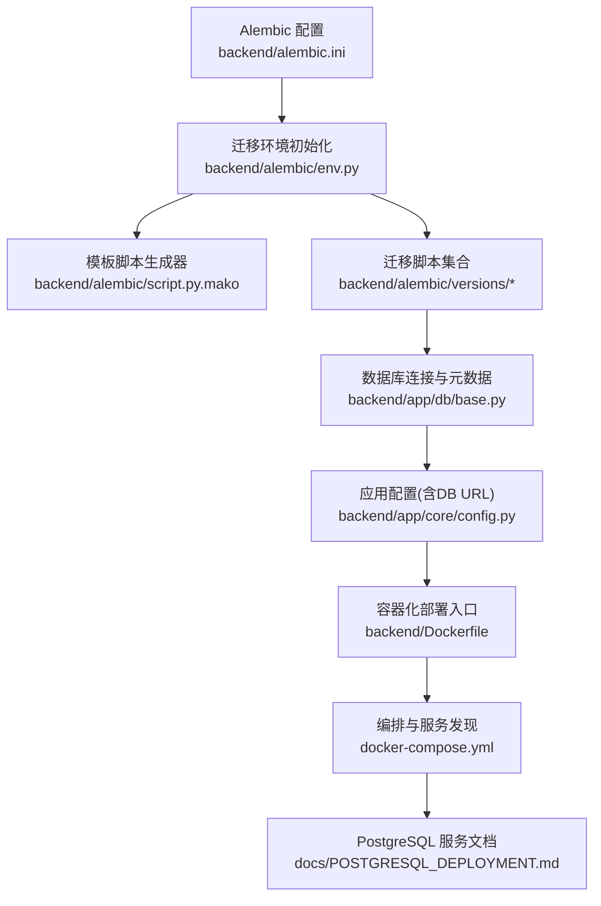
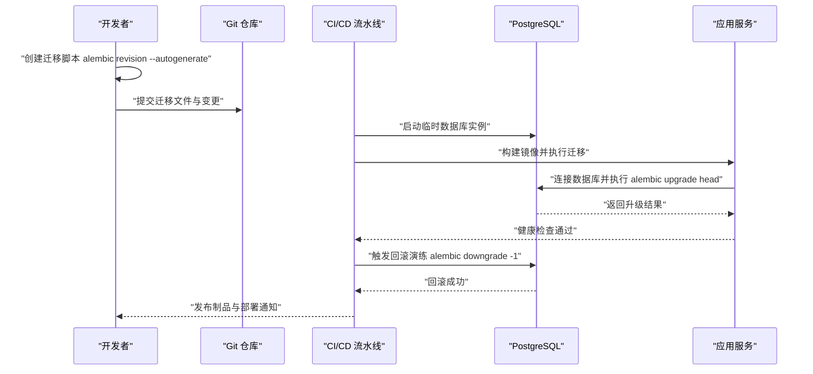
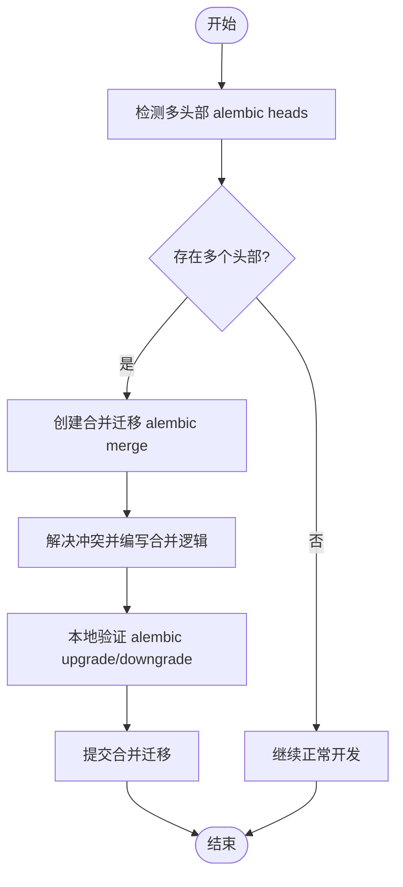
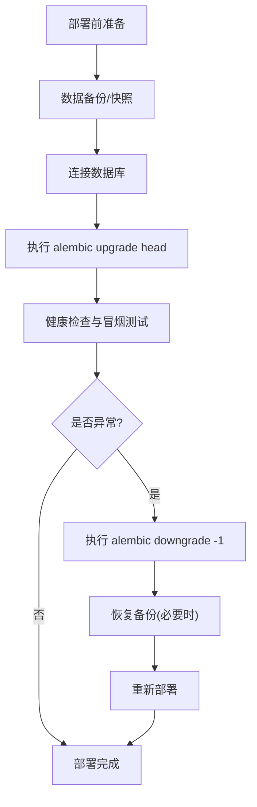
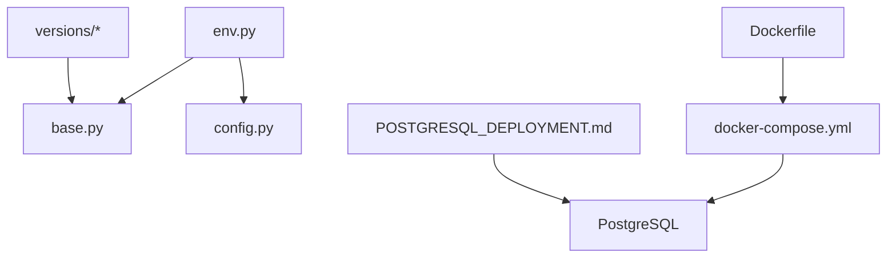

# 迁移版本管理策略

<cite>
**本文引用的文件**   
- [backend/alembic.ini](file://backend/alembic.ini)
- [backend/alembic/env.py](file://backend/alembic/env.py)
- [backend/alembic/script.py.mako](file://backend/alembic/script.py.mako)
- [backend/alembic/versions/initial.py](file://backend/alembic/versions/initial.py)
- [backend/alembic/versions/merge_heads.py](file://backend/alembic/versions/merge_heads.py)
- [backend/alembic/versions/d1d5ec080e06_merge_multiple_heads.py](file://backend/alembic/versions/d1d5ec080e06_merge_multiple_heads.py)
- [backend/alembic/versions/merge_effective_heads_after_model_catalog.py](file://backend/alembic/versions/merge_effective_heads_after_model_catalog.py)
- [backend/app/db/base.py](file://backend/app/db/base.py)
- [backend/app/core/config.py](file://backend/app/core/config.py)
- [backend/Dockerfile](file://backend/Dockerfile)
- [docker-compose.yml](file://docker-compose.yml)
- [POSTGRESQL_DEPLOYMENT.md](file://docs/POSTGRESQL_DEPLOYMENT.md)
- [DATABASE_MIGRATION_GUIDE.md](file://DATABASE_MIGRATION_GUIDE.md)
</cite>

## 目录
1. [简介](#简介)
2. [项目结构](#项目结构)
3. [核心组件](#核心组件)
4. [架构总览](#架构总览)
5. [详细组件分析](#详细组件分析)
6. [依赖分析](#依赖分析)
7. [性能考虑](#性能考虑)
8. [故障排查指南](#故障排查指南)
9. [结论](#结论)
10. [附录](#附录)

## 简介
本文件为小说创作代理系统的 Alembic 迁移版本管理策略提供完整规范与实践指南。内容涵盖：
- 迁移文件命名规范与版本控制最佳实践（版本号格式、分支合并策略）
- 并发开发中的迁移冲突处理（解决方法与工具使用）
- 生产环境部署的迁移执行流程（回滚策略与数据备份方案）
- 大型项目的迁移历史管理（清理与归档策略）
- 团队协作规范（代码审查要求与测试验证流程）
- 完整的版本管理流程图与常见问题解决方案

## 项目结构
本项目采用后端集中式 Alembic 管理，迁移脚本位于 backend/alembic/versions，配置与环境初始化由 alembic.ini 与 env.py 负责，模型定义在 backend/app/models 并通过 backend/app/db/base.py 统一注册。

**图示来源** 
- [backend/alembic.ini](file://backend/alembic.ini)
- [backend/alembic/env.py](file://backend/alembic/env.py)
- [backend/alembic/script.py.mako](file://backend/alembic/script.py.mako)
- [backend/alembic/versions/initial.py](file://backend/alembic/versions/initial.py)
- [backend/app/db/base.py](file://backend/app/db/base.py)
- [backend/app/core/config.py](file://backend/app/core/config.py)
- [backend/Dockerfile](file://backend/Dockerfile)
- [docker-compose.yml](file://docker-compose.yml)
- [POSTGRESQL_DEPLOYMENT.md](file://docs/POSTGRESQL_DEPLOYMENT.md)

**章节来源**
- [backend/alembic.ini](file://backend/alembic.ini)
- [backend/alembic/env.py](file://backend/alembic/env.py)
- [backend/alembic/script.py.mako](file://backend/alembic/script.py.mako)
- [backend/alembic/versions/initial.py](file://backend/alembic/versions/initial.py)
- [backend/app/db/base.py](file://backend/app/db/base.py)
- [backend/app/core/config.py](file://backend/app/core/config.py)
- [backend/Dockerfile](file://backend/Dockerfile)
- [docker-compose.yml](file://docker-compose.yml)
- [POSTGRESQL_DEPLOYMENT.md](file://docs/POSTGRESQL_DEPLOYMENT.md)

## 核心组件
- Alembic 配置与环境
  - alembic.ini：定义迁移仓库根目录、目标数据库URL、日志级别等。
  - env.py：构建 SQLAlchemy 引擎、加载模型元数据、设置上下文运行参数。
  - script.py.mako：迁移脚本模板，用于自动生成标准骨架。
- 迁移脚本集合
  - versions/*：按时间顺序与主题划分的迁移文件，包含 up() 与 down() 方法。
- 模型与连接
  - base.py：统一导入并注册所有模型，供 Alembic 读取当前元数据。
  - config.py：提供数据库连接字符串与连接池参数。
- 部署与编排
  - Dockerfile：构建镜像时安装依赖、准备迁移执行环境。
  - docker-compose.yml：编排数据库与应用服务，确保迁移前数据库可用。
  - POSTGRESQL_DEPLOYMENT.md：数据库部署与网络连通性说明。

**章节来源**
- [backend/alembic.ini](file://backend/alembic.ini)
- [backend/alembic/env.py](file://backend/alembic/env.py)
- [backend/alembic/script.py.mako](file://backend/alembic/script.py.mako)
- [backend/alembic/versions/initial.py](file://backend/alembic/versions/initial.py)
- [backend/app/db/base.py](file://backend/app/db/base.py)
- [backend/app/core/config.py](file://backend/app/core/config.py)
- [backend/Dockerfile](file://backend/Dockerfile)
- [docker-compose.yml](file://docker-compose.yml)
- [POSTGRESQL_DEPLOYMENT.md](file://docs/POSTGRESQL_DEPLOYMENT.md)

## 架构总览
下图展示从开发者创建迁移到生产环境执行的端到端流程，包括版本生成、合并头、回滚与部署集成。

**图示来源** 
- [backend/alembic/env.py](file://backend/alembic/env.py)
- [backend/Dockerfile](file://backend/Dockerfile)
- [docker-compose.yml](file://docker-compose.yml)
- [POSTGRESQL_DEPLOYMENT.md](file://docs/POSTGRESQL_DEPLOYMENT.md)

## 详细组件分析

### 迁移文件命名与版本控制规范
- 文件名规范
  - 推荐格式：<短描述>.py，例如 add_audio_library_assets.py。
  - 自动生成的迁移会附带哈希ID（如 d1d5ec080e06_merge_multiple_heads.py），保留该ID用于版本追踪。
- 版本控制最佳实践
  - 每个功能或修复对应一个独立迁移，避免大杂烩。
  - 迁移必须幂等且可逆（实现 down()）。
  - 禁止修改已发布的迁移；如需修正，新增“修复型”迁移。
- 分支合并策略
  - 主分支保持线性历史，特性分支合入前需解决迁移冲突。
  - 当出现多头部（multiple heads）时，创建合并迁移以收敛历史。

**章节来源**
- [backend/alembic/versions/initial.py](file://backend/alembic/versions/initial.py)
- [backend/alembic/versions/merge_heads.py](file://backend/alembic/versions/merge_heads.py)
- [backend/alembic/versions/d1d5ec080e06_merge_multiple_heads.py](file://backend/alembic/versions/d1d5ec080e06_merge_multiple_heads.py)
- [backend/alembic/versions/merge_effective_heads_after_model_catalog.py](file://backend/alembic/versions/merge_effective_heads_after_model_catalog.py)

### 并发开发与迁移冲突处理
- 常见冲突场景
  - 同一表被多个分支同时修改导致多头部。
  - 字段重命名/删除在不同分支产生不一致。
- 解决方法
  - 使用 alembic merge 创建合并迁移，将多个头部收敛为一个。
  - 在合并迁移中明确变更顺序，保证幂等性与可回滚。
- 工具使用建议
  - 本地先执行 alembic current 与 alembic history 确认状态。
  - 使用 alembic heads 查看头部，再执行 alembic merge <head1> <head2>。
  - 在CI中校验 alembic check 与 alembic upgrade --sql 预览变更。

**图示来源** 
- [backend/alembic/versions/merge_heads.py](file://backend/alembic/versions/merge_heads.py)
- [backend/alembic/versions/d1d5ec080e06_merge_multiple_heads.py](file://backend/alembic/versions/d1d5ec080e06_merge_multiple_heads.py)
- [backend/alembic/versions/merge_effective_heads_after_model_catalog.py](file://backend/alembic/versions/merge_effective_heads_after_model_catalog.py)

**章节来源**
- [backend/alembic/versions/merge_heads.py](file://backend/alembic/versions/merge_heads.py)
- [backend/alembic/versions/d1d5ec080e06_merge_multiple_heads.py](file://backend/alembic/versions/d1d5ec080e06_merge_multiple_heads.py)
- [backend/alembic/versions/merge_effective_heads_after_model_catalog.py](file://backend/alembic/versions/merge_effective_heads_after_model_catalog.py)

### 生产环境部署与回滚策略
- 部署前准备
  - 确保数据库可用且网络连通（参考部署文档）。
  - 对关键数据进行快照或备份（全量或增量）。
- 迁移执行流程
  - 在应用启动前执行 alembic upgrade head。
  - 执行后运行健康检查与冒烟测试。
- 回滚策略
  - 支持单步回滚 alembic downgrade -1 或多步回滚 alembic downgrade <target>。
  - 回滚前评估数据一致性风险，必要时先恢复备份。
- 部署集成
  - 在 Dockerfile 中准备迁移命令与依赖。
  - 在 docker-compose.yml 中编排数据库与应用启动顺序。

**图示来源** 
- [backend/Dockerfile](file://backend/Dockerfile)
- [docker-compose.yml](file://docker-compose.yml)
- [POSTGRESQL_DEPLOYMENT.md](file://docs/POSTGRESQL_DEPLOYMENT.md)

**章节来源**
- [backend/Dockerfile](file://backend/Dockerfile)
- [docker-compose.yml](file://docker-compose.yml)
- [POSTGRESQL_DEPLOYMENT.md](file://docs/POSTGRESQL_DEPLOYMENT.md)

### 大型项目迁移历史管理
- 清理策略
  - 仅归档不可再回滚的旧迁移，保留最近N个版本的 down() 能力。
  - 对历史迁移进行只读归档，禁止再次修改。
- 归档策略
  - 将旧迁移移动到 archive 目录并在 alembic.ini 中更新版本目录映射。
  - 维护迁移索引与变更记录，便于审计与回溯。
- 版本收敛
  - 定期创建合并迁移以减少头部数量，提升可维护性。

**章节来源**
- [backend/alembic/versions/merge_effective_heads_after_model_catalog.py](file://backend/alembic/versions/merge_effective_heads_after_model_catalog.py)

### 团队协作规范
- 代码审查要求
  - 迁移变更需经过至少一名资深成员审查。
  - 审查重点：幂等性、可回滚性、对现有数据的兼容性。
- 测试验证流程
  - 本地执行 alembic upgrade/downgrade 验证双向迁移。
  - 在CI中执行 SQL 预览与自动化测试用例。
  - 针对关键表与字段增加回归测试。

**章节来源**
- [DATABASE_MIGRATION_GUIDE.md](file://DATABASE_MIGRATION_GUIDE.md)

## 依赖分析
- 组件耦合关系
  - env.py 依赖 base.py 提供的模型元数据与 config.py 提供的数据库URL。
  - 迁移脚本依赖 base.py 的模型定义，确保与运行时一致。
  - Dockerfile 与 docker-compose.yml 确保迁移执行环境与数据库服务协调。
- 外部依赖
  - PostgreSQL 作为数据存储，需要正确的网络与权限配置。
  - Alembic 与 SQLAlchemy 的版本兼容性需保持一致。

**图示来源** 
- [backend/alembic/env.py](file://backend/alembic/env.py)
- [backend/app/db/base.py](file://backend/app/db/base.py)
- [backend/app/core/config.py](file://backend/app/core/config.py)
- [backend/Dockerfile](file://backend/Dockerfile)
- [docker-compose.yml](file://docker-compose.yml)
- [POSTGRESQL_DEPLOYMENT.md](file://docs/POSTGRESQL_DEPLOYMENT.md)

**章节来源**
- [backend/alembic/env.py](file://backend/alembic/env.py)
- [backend/app/db/base.py](file://backend/app/db/base.py)
- [backend/app/core/config.py](file://backend/app/core/config.py)
- [backend/Dockerfile](file://backend/Dockerfile)
- [docker-compose.yml](file://docker-compose.yml)
- [POSTGRESQL_DEPLOYMENT.md](file://docs/POSTGRESQL_DEPLOYMENT.md)

## 性能考虑
- 迁移执行优化
  - 批量DDL操作，减少锁竞争。
  - 对大表变更分阶段执行，避免长时间阻塞。
- 连接池与超时
  - 合理配置连接池大小与超时，避免迁移期间连接耗尽。
- 监控与日志
  - 记录迁移执行时间与错误信息，便于定位瓶颈。

[本节为通用指导，不直接分析具体文件]

## 故障排查指南
- 常见问题
  - 多头部冲突：使用 alembic merge 合并。
  - 迁移失败：检查 SQL 语法与数据约束，必要时回滚。
  - 连接失败：确认数据库地址、端口、用户名与密码。
- 诊断步骤
  - 执行 alembic current 查看当前版本。
  - 执行 alembic history 对比期望版本。
  - 使用 alembic upgrade --sql 预览SQL变更。
- 回滚与恢复
  - 优先尝试 alembic downgrade -1。
  - 若数据损坏，恢复备份并重新执行迁移。

**章节来源**
- [DATABASE_MIGRATION_GUIDE.md](file://DATABASE_MIGRATION_GUIDE.md)

## 结论
本策略为小说创作代理系统提供了完整的 Alembic 迁移版本管理规范，覆盖命名、合并、冲突处理、生产部署、回滚、历史管理与团队协作等方面。遵循本策略可显著提升数据库变更的可控性与可维护性，降低协作与部署风险。

[本节为总结性内容，不直接分析具体文件]

## 附录
- 常用命令速查
  - 生成迁移：alembic revision --autogenerate -m "描述"
  - 升级：alembic upgrade head
  - 回滚：alembic downgrade -1 或 alembic downgrade <target>
  - 查看状态：alembic current / alembic history / alembic heads
- 参考文档
  - DATABASE_MIGRATION_GUIDE.md：迁移指南与最佳实践
  - POSTGRESQL_DEPLOYMENT.md：数据库部署与连通性说明

[本节为补充信息，不直接分析具体文件]