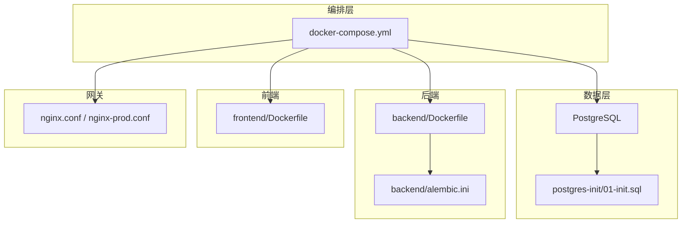
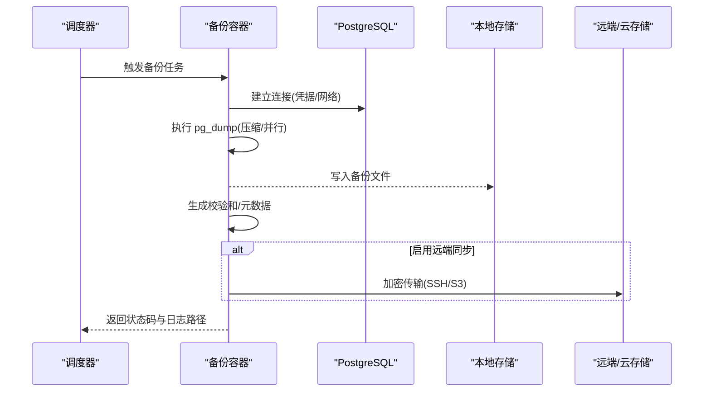
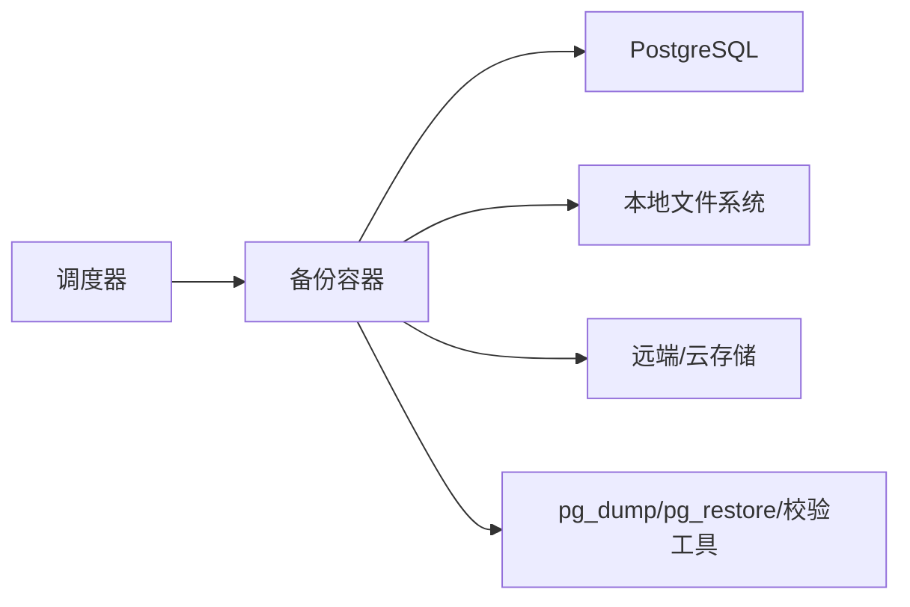

# 全量备份方案

<cite>
**本文引用的文件**   
- [docker-compose.yml](file://docker-compose.yml)
- [POSTGRESQL_DEPLOYMENT.md](file://docs/POSTGRESQL_DEPLOYMENT.md)
- [backend/Dockerfile](file://backend/Dockerfile)
- [frontend/Dockerfile](file://frontend/Dockerfile)
- [nginx.conf](file://nginx.conf)
- [nginx-prod.conf](file://nginx-prod.conf)
- [alembic.ini](file://alembic.ini)
- [backend/alembic.ini](file://backend/alembic.ini)
- [postgres-init/01-init.sql](file://postgres-init/01-init.sql)
</cite>

## 目录
1. [简介](#简介)
2. [项目结构](#项目结构)
3. [核心组件](#核心组件)
4. [架构总览](#架构总览)
5. [详细组件分析](#详细组件分析)
6. [依赖关系分析](#依赖关系分析)
7. [性能考虑](#性能考虑)
8. [故障排查指南](#故障排查指南)
9. [结论](#结论)
10. [附录](#附录)

## 简介
本方案面向小说创作代理系统，提供基于 PostgreSQL 的 pg_dump 全量备份与恢复策略。内容覆盖：
- pg_dump 完整导出、压缩格式选择与并行优化
- 备份文件存储策略（本地目录结构、命名规范、版本管理）
- 异地备份配置（远程同步、云存储上传、加密传输）
- 完整的备份脚本示例（错误处理、日志记录、状态检查）
- 备份验证机制（完整性校验、恢复测试、可用性检测）
- Docker 环境下的备份容器与自动化任务设置

## 项目结构
本项目采用前后端分离与多服务编排模式，数据库通过 docker-compose 统一管理，PostgreSQL 初始化脚本位于 postgres-init 目录，应用使用 Alembic 进行迁移。备份方案围绕这些基础设施展开。

图表来源
- [docker-compose.yml](file://docker-compose.yml)
- [backend/Dockerfile](file://backend/Dockerfile)
- [frontend/Dockerfile](file://frontend/Dockerfile)
- [nginx.conf](file://nginx.conf)
- [nginx-prod.conf](file://nginx-prod.conf)
- [alembic.ini](file://alembic.ini)
- [backend/alembic.ini](file://backend/alembic.ini)
- [postgres-init/01-init.sql](file://postgres-init/01-init.sql)

章节来源
- [docker-compose.yml](file://docker-compose.yml)
- [POSTGRESQL_DEPLOYMENT.md](file://docs/POSTGRESQL_DEPLOYMENT.md)

## 核心组件
- 数据库服务：PostgreSQL，由 docker-compose 管理，包含初始化脚本与迁移工具 Alembic。
- 备份工具：pg_dump/pg_restore，用于逻辑备份与恢复。
- 存储与传输：本地目录、SSH/SFTP、云存储（如 S3/OSS），支持 gzip/zstd 压缩与 TLS 加密。
- 调度与监控：cron/systemd/celery 等任务调度器，结合日志与告警。
- 验证与演练：校验和生成、恢复演练、可用性探测。

章节来源
- [POSTGRESQL_DEPLOYMENT.md](file://docs/POSTGRESQL_DEPLOYMENT.md)
- [alembic.ini](file://alembic.ini)
- [backend/alembic.ini](file://backend/alembic.ini)

## 架构总览
下图展示备份流程在系统中的位置与交互：备份容器通过环境变量连接数据库，执行 pg_dump 并输出到本地或远端；可选地触发校验与上传任务。

图表来源
- [docker-compose.yml](file://docker-compose.yml)
- [POSTGRESQL_DEPLOYMENT.md](file://docs/POSTGRESQL_DEPLOYMENT.md)

## 详细组件分析

### 数据库与连接配置
- 数据库服务由 docker-compose 编排，端口、卷挂载、环境变量集中管理。
- 初始化脚本位于 postgres-init/01-init.sql，确保基础对象存在。
- 应用侧通过 Alembin 管理迁移，备份需与迁移版本一致。

建议要点
- 为备份容器单独定义网络与凭据，避免与应用共享敏感信息。
- 使用只读角色或最小权限账户执行 pg_dump。
- 明确数据库名、用户、密码、主机名、端口等环境变量。

章节来源
- [docker-compose.yml](file://docker-compose.yml)
- [postgres-init/01-init.sql](file://postgres-init/01-init.sql)
- [alembic.ini](file://alembic.ini)
- [backend/alembic.ini](file://backend/alembic.ini)

### pg_dump 使用方法
- 完整数据库导出：指定数据库名与目标文件路径。
- 压缩格式选择：优先使用 zstd/gzip 以平衡速度与体积。
- 并行备份优化：根据 CPU 核数与 IOPS 调整并发度，避免锁竞争。
- 一致性保证：建议在低峰期执行，必要时配合事务快照或只读模式。

注意事项
- 大库建议使用 --jobs 并行与 --format=custom 以便后续选择性恢复。
- 对包含大量 LOB 或扩展的库，需评估兼容性参数。

章节来源
- [POSTGRESQL_DEPLOYMENT.md](file://docs/POSTGRESQL_DEPLOYMENT.md)

### 备份文件存储策略
- 本地目录结构：按日期与版本号分层，便于检索与清理。
- 命名规范：包含数据库名、时间戳、压缩格式、哈希值。
- 版本管理：保留策略（如最近 N 份每日、M 份每周、K 份每月）。
- 元数据：记录 pg_dump 参数、运行环境、校验和、恢复说明。

章节来源
- [POSTGRESQL_DEPLOYMENT.md](file://docs/POSTGRESQL_DEPLOYMENT.md)

### 异地备份配置
- 远程服务器同步：通过 SSH/SFTP 安全传输，密钥管理与访问控制。
- 云存储上传：S3/OSS 兼容接口，启用服务端加密与生命周期策略。
- 加密传输：TLS/SSH 通道，端到端加密（可选 GPG 签名）。
- 幂等与重试：断点续传、失败重试、去重与冲突处理。

章节来源
- [POSTGRESQL_DEPLOYMENT.md](file://docs/POSTGRESQL_DEPLOYMENT.md)

### 备份脚本示例（结构与行为）
以下为脚本应包含的关键步骤（不直接给出代码内容，仅描述行为）：
- 参数解析与校验：数据库连接、目标路径、压缩算法、并发度、是否上传。
- 前置检查：磁盘空间、网络连通性、数据库可达、权限验证。
- 执行备份：调用 pg_dump，输出压缩文件，记录耗时与退出码。
- 生成校验：计算 SHA-256/MD5，写入校验文件与元数据 JSON。
- 远端同步：可选上传至远端/云存储，失败重试与告警。
- 日志与状态：结构化日志、关键指标、成功/失败状态码。
- 清理策略：按保留策略删除过期备份，释放空间。

章节来源
- [POSTGRESQL_DEPLOYMENT.md](file://docs/POSTGRESQL_DEPLOYMENT.md)

### 备份验证机制
- 数据完整性校验：比对校验和、抽样行数/表计数、随机行对比。
- 恢复测试流程：在隔离环境重建数据库，执行 pg_restore，验证关键表与索引。
- 备份可用性检测：定期自动恢复演练，记录结果与差异报告。
- 回滚预案：若恢复失败，定位问题并回退到上一可用备份。

章节来源
- [POSTGRESQL_DEPLOYMENT.md](file://docs/POSTGRESQL_DEPLOYMENT.md)

### Docker 环境下的备份容器与自动化
- 备份容器：基于轻量镜像，安装 pg_dump/pg_restore 与必要工具（curl/wget/rsync/s3cmd 等）。
- 环境变量注入：数据库连接、存储路径、远端凭据、压缩与并发参数。
- 卷挂载：将备份目录挂载到宿主机或持久卷，确保跨重启可用。
- 任务调度：通过 cron/systemd/celery 定时触发，或外部编排平台（如 K8s CronJob）。
- 健康检查：容器启动后自检数据库连通性与基本读写能力。

章节来源
- [docker-compose.yml](file://docker-compose.yml)
- [backend/Dockerfile](file://backend/Dockerfile)
- [frontend/Dockerfile](file://frontend/Dockerfile)

## 依赖关系分析
- 备份容器依赖数据库服务与网络可达性。
- 远端同步依赖 SSH/云 SDK 与网络带宽。
- 校验与恢复依赖 pg_restore 与目标数据库实例。
- 调度器依赖操作系统或编排平台的任务管理能力。

图表来源
- [docker-compose.yml](file://docker-compose.yml)

## 性能考虑
- 并行度调优：根据 CPU 与 I/O 调整 --jobs，避免过度并发导致锁争用。
- 压缩算法：zstd 通常优于 gzip，兼顾速度与体积。
- 备份窗口：选择业务低峰时段，减少影响。
- 增量与差异：可结合 WAL 归档实现更细粒度恢复（如需）。
- 存储介质：使用高性能 SSD/NVMe 提升吞吐。

[本节为通用指导，不直接分析具体文件]

## 故障排查指南
常见问题与处理建议：
- 连接失败：检查网络、端口、用户名/密码、只读权限。
- 权限不足：授予 SELECT 与必要的扩展权限。
- 磁盘不足：清理旧备份或扩容存储。
- 传输失败：检查 SSH 密钥、网络连通、云存储凭据与配额。
- 恢复失败：核对迁移版本、扩展依赖、数据类型兼容性。
- 日志定位：查看备份容器日志、系统日志、数据库日志。

章节来源
- [POSTGRESQL_DEPLOYMENT.md](file://docs/POSTGRESQL_DEPLOYMENT.md)

## 结论
本方案围绕 pg_dump 构建稳定、可验证、可扩展的全量备份体系，覆盖本地与异地存储、压缩与并行优化、自动化与验证闭环。通过容器化与编排，可在生产环境中可靠落地，保障小说创作代理系统的核心数据安全。

[本节为总结性内容，不直接分析具体文件]

## 附录
- 术语：pg_dump、pg_restore、WAL、校验和、生命周期策略
- 参考文档：部署与运维指南、数据库迁移说明

[本节为补充信息，不直接分析具体文件]