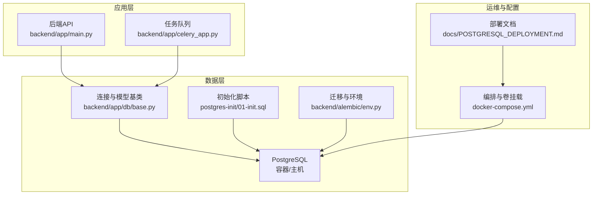
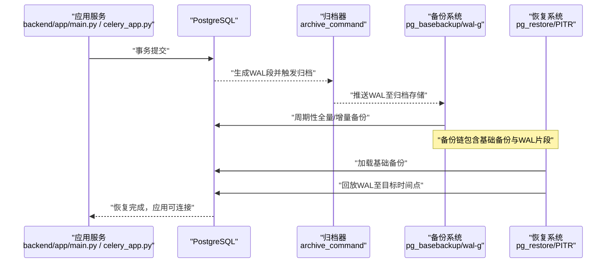
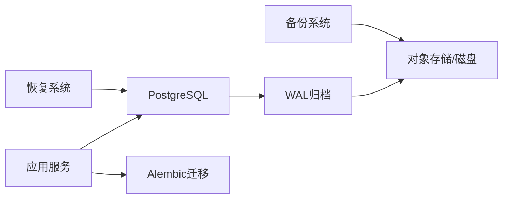

# 增量备份实现

<cite>
**本文档引用的文件**   
- [POSTGRESQL_DEPLOYMENT.md](file://docs/POSTGRESQL_DEPLOYMENT.md)
- [docker-compose.yml](file://docker-compose.yml)
- [postgres-init/01-init.sql](file://postgres-init/01-init.sql)
- [backend/app/main.py](file://backend/app/main.py)
- [backend/app/celery_app.py](file://backend/app/celery_app.py)
- [backend/app/core/config.py](file://backend/app/core/config.py)
- [backend/app/db/base.py](file://backend/app/db/base.py)
- [backend/alembic/env.py](file://backend/alembic/env.py)
- [scripts/rebuild_chroma_from_postgres.py](file://scripts/rebuild_chroma_from_postgres.py)
</cite>

## 目录
1. [简介](#简介)
2. [项目结构](#项目结构)
3. [核心组件](#核心组件)
4. [架构总览](#架构总览)
5. [详细组件分析](#详细组件分析)
6. [依赖关系分析](#依赖关系分析)
7. [性能考虑](#性能考虑)
8. [故障恢复指南](#故障恢复指南)
9. [结论](#结论)
10. [附录](#附录)

## 简介
本文件面向小说创作代理系统的数据库与数据持久层，提供一套完整的增量备份实现方案。重点覆盖：
- PostgreSQL WAL 日志归档与连续归档模式配置
- 时间点恢复（PITR）技术：目标时间指定、事务一致性保证、回滚操作
- 增量备份策略：差异备份、基于时间的增量、基于WAL的增量
- 脚本示例要点：WAL 文件收集、增量快照创建、备份链维护
- 恢复流程：基础备份恢复、WAL 回放、时间点定位、数据验证
- 性能优化建议与常见故障恢复场景

本方案以 PostgreSQL 为核心，结合容器化部署与后端应用配置，确保在业务高可用前提下实现最小 RPO/RTO 的数据保护。

## 项目结构
本项目采用前后端分离与多服务编排方式，数据库相关的关键位置包括：
- 数据库初始化脚本位于 postgres-init/01-init.sql
- 容器编排与存储卷挂载通过 docker-compose.yml 管理
- 后端应用入口与任务调度分别由 backend/app/main.py 与 backend/app/celery_app.py 驱动
- 数据库连接与迁移由 backend/app/db/base.py 与 backend/alembic/env.py 管理
- 文档中关于 PostgreSQL 部署与配置的说明见 docs/POSTGRESQL_DEPLOYMENT.md

图表来源
- [docker-compose.yml](file://docker-compose.yml)
- [postgres-init/01-init.sql](file://postgres-init/01-init.sql)
- [backend/app/main.py](file://backend/app/main.py)
- [backend/app/celery_app.py](file://backend/app/celery_app.py)
- [backend/app/db/base.py](file://backend/app/db/base.py)
- [backend/alembic/env.py](file://backend/alembic/env.py)
- [docs/POSTGRESQL_DEPLOYMENT.md](file://docs/POSTGRESQL_DEPLOYMENT.md)

章节来源
- [docs/POSTGRESQL_DEPLOYMENT.md](file://docs/POSTGRESQL_DEPLOYMENT.md)
- [docker-compose.yml](file://docker-compose.yml)
- [postgres-init/01-init.sql](file://postgres-init/01-init.sql)
- [backend/app/main.py](file://backend/app/main.py)
- [backend/app/celery_app.py](file://backend/app/celery_app.py)
- [backend/app/db/base.py](file://backend/app/db/base.py)
- [backend/alembic/env.py](file://backend/alembic/env.py)

## 核心组件
- PostgreSQL 实例与存储卷：用于承载主库数据与 WAL 归档目录，需确保持久化与权限正确
- WAL 归档与连续归档：启用 archive_mode=on，配置 archive_command 将 WAL 安全落盘或远端存储
- 备份工具链：pg_basebackup 用于全量基础备份；wal-g/pgBackRest 等用于增量与归档管理（按团队选型）
- 恢复工具链：pg_restore/psql 用于基础备份恢复；pg_rewind 与 PITR 恢复流程配合 WAL 回放
- 应用侧集成：Alembic 迁移与数据库连接配置，确保备份/恢复后元数据一致

章节来源
- [docs/POSTGRESQL_DEPLOYMENT.md](file://docs/POSTGRESQL_DEPLOYMENT.md)
- [docker-compose.yml](file://docker-compose.yml)
- [backend/alembic/env.py](file://backend/alembic/env.py)
- [backend/app/db/base.py](file://backend/app/db/base.py)

## 架构总览
下图展示从应用写入到 WAL 归档、再到备份与恢复的整体链路。

图表来源
- [docker-compose.yml](file://docker-compose.yml)
- [docs/POSTGRESQL_DEPLOYMENT.md](file://docs/POSTGRESQL_DEPLOYMENT.md)

## 详细组件分析

### PostgreSQL 归档与连续归档配置
- 启用连续归档：设置 archive_mode=on，archive_command 指向可靠的归档脚本或工具
- WAL 文件管理：合理划分 wal_keep_segments/max_wal_size，避免磁盘爆满
- 归档目的地：本地磁盘或对象存储，需具备幂等性与断点续传能力
- 监控告警：归档失败、延迟、空间不足等关键指标纳入监控

章节来源
- [docs/POSTGRESQL_DEPLOYMENT.md](file://docs/POSTGRESQL_DEPLOYMENT.md)

### 时间点恢复（PITR）技术
- 目标时间指定：通过 restore_target_time 精确到秒级恢复
- 事务一致性：WAL 回放保证恢复到目标时刻的事务一致性
- 数据回滚操作：对误删/误改数据，使用 PITR 恢复到错误发生前的时间点

章节来源
- [docs/POSTGRESQL_DEPLOYMENT.md](file://docs/POSTGRESQL_DEPLOYMENT.md)

### 增量备份策略
- 差异备份：仅备份自上次全量以来的变化块，适合中等变更频率
- 基于时间的增量：按固定周期（如每小时/每天）生成增量快照，便于快速回滚到最近时间点
- 基于WAL的增量：利用 WAL 片段实现细粒度增量，支持更短 RPO

章节来源
- [docs/POSTGRESQL_DEPLOYMENT.md](file://docs/POSTGRESQL_DEPLOYMENT.md)

### 增量备份脚本示例要点
- WAL 文件收集：定期扫描归档目录，校验完整性并上传至远端
- 增量快照创建：调用 pg_basebackup 或 wal-g 生成增量标记与元数据
- 备份链维护：记录基础备份与增量序列，清理过期备份，保持链完整

章节来源
- [docs/POSTGRESQL_DEPLOYMENT.md](file://docs/POSTGRESQL_DEPLOYMENT.md)

### 恢复流程
- 基础备份恢复：加载最新基础备份到目标实例
- WAL 日志回放：按顺序回放 WAL 片段至目标时间点
- 时间点定位：根据 restore_target_time 或恢复标记定位恢复终点
- 数据验证：执行一致性检查与业务抽样验证，确认恢复成功

章节来源
- [docs/POSTGRESQL_DEPLOYMENT.md](file://docs/POSTGRESQL_DEPLOYMENT.md)

### 应用侧集成与迁移
- Alembic 环境：确保迁移脚本与备份版本一致，避免恢复后迁移冲突
- 数据库连接：统一通过 backend/app/db/base.py 管理连接参数与重试策略
- 任务调度：celery 任务在恢复后可自动触发重建索引或缓存预热

章节来源
- [backend/alembic/env.py](file://backend/alembic/env.py)
- [backend/app/db/base.py](file://backend/app/db/base.py)
- [backend/app/celery_app.py](file://backend/app/celery_app.py)

## 依赖关系分析
- 应用依赖数据库连接与迁移，需在备份/恢复后确保迁移状态一致
- 容器编排负责卷挂载与网络隔离，影响备份/恢复路径与权限
- 归档与备份工具依赖外部存储与网络稳定性

图表来源
- [docker-compose.yml](file://docker-compose.yml)
- [backend/alembic/env.py](file://backend/alembic/env.py)
- [backend/app/db/base.py](file://backend/app/db/base.py)

章节来源
- [docker-compose.yml](file://docker-compose.yml)
- [backend/alembic/env.py](file://backend/alembic/env.py)
- [backend/app/db/base.py](file://backend/app/db/base.py)

## 性能考虑
- WAL 归档吞吐：调整 wal_level、max_wal_size 与归档并行度，避免阻塞主库
- 备份窗口：选择低峰期进行全量备份，增量备份尽量缩短窗口
- I/O 与存储：WAL 与备份目录置于高性能磁盘，对象存储使用分片上传
- 恢复速度：预取 WAL 片段、并行回放，必要时使用 pg_rewind 减少重建成本

[本节为通用指导，不直接分析具体文件]

## 故障恢复指南
- 归档失败：检查 archive_command 权限与远端存储连通性，启用重试与告警
- 备份链断裂：校验基础备份与增量序列，必要时重新生成基础备份
- 恢复不一致：核对 Alembic 版本与应用 schema，必要时回滚迁移
- 数据验证：执行完整性校验与业务抽样，确保恢复后功能正常

章节来源
- [docs/POSTGRESQL_DEPLOYMENT.md](file://docs/POSTGRESQL_DEPLOYMENT.md)
- [backend/alembic/env.py](file://backend/alembic/env.py)

## 结论
通过启用 PostgreSQL 连续归档与完善的备份/恢复流程，小说创作代理系统可在高可用前提下实现最小 RPO/RTO 的数据保护。结合应用侧迁移管理与任务调度，确保恢复后的数据一致性与业务连续性。

[本节为总结性内容，不直接分析具体文件]

## 附录
- 常用命令参考：pg_basebackup、pg_restore、psql、pg_rewind、wal-g/pgBackRest（按选型）
- 监控指标：归档延迟、WAL 大小、备份成功率、恢复耗时
- 演练计划：定期执行恢复演练，验证备份有效性与恢复流程

[本节为补充信息，不直接分析具体文件]