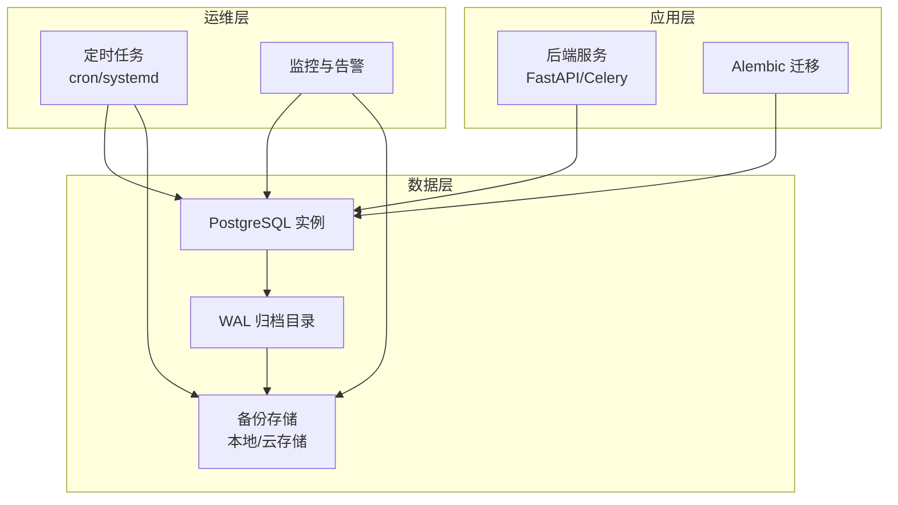
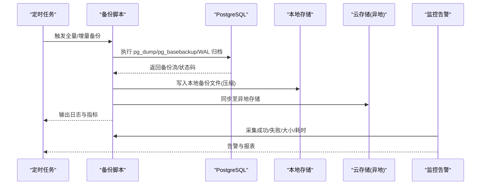
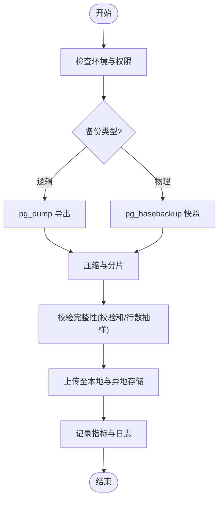
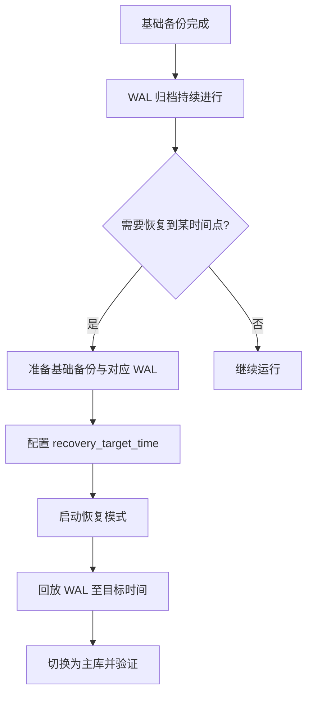
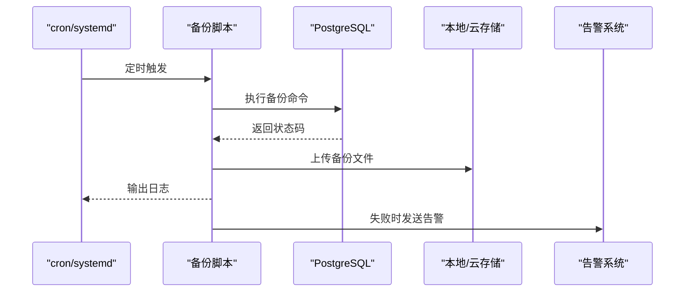
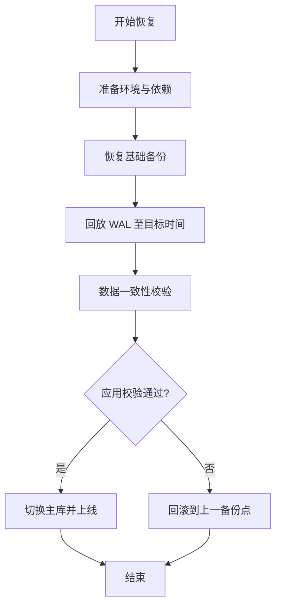
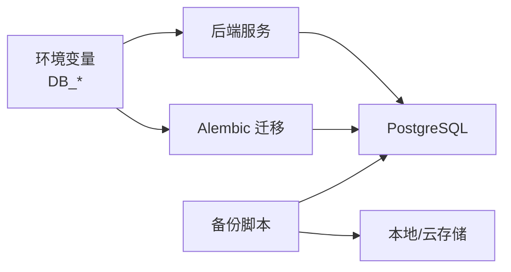

# 备份与恢复策略

<cite>
**本文引用的文件**   
- [docker-compose.yml](file://docker-compose.yml)
- [POSTGRESQL_DEPLOYMENT.md](file://docs/POSTGRESQL_DEPLOYMENT.md)
- [alembic.ini](file://backend/alembic.ini)
- [env.py](file://backend/alembic/env.py)
- [main.py](file://backend/app/main.py)
- [config.py](file://backend/app/core/config.py)
- [base.py](file://backend/app/db/base.py)
- [postgres-init/01-init.sql](file://postgres-init/01-init.sql)
</cite>

## 目录
1. [简介](#简介)
2. [项目结构](#项目结构)
3. [核心组件](#核心组件)
4. [架构总览](#架构总览)
5. [详细组件分析](#详细组件分析)
6. [依赖关系分析](#依赖关系分析)
7. [性能考量](#性能考量)
8. [故障排查指南](#故障排查指南)
9. [结论](#结论)
10. [附录](#附录)

## 简介
本文件为小说创作代理系统的数据库备份与恢复策略提供完整方案，覆盖全量备份、增量备份（WAL 归档与时间点恢复）、定时任务与自动化脚本、灾难恢复流程、存储策略与生命周期管理，以及监控告警配置。文档面向运维与研发人员，兼顾可操作性与可审计性。

## 项目结构
本项目通过容器编排部署，PostgreSQL 作为核心持久化存储，Alembic 负责数据库迁移，应用通过环境变量加载数据库连接参数。备份与恢复需要围绕 PostgreSQL 的 pg_dump、pg_basebackup、WAL 归档机制进行设计，并结合容器环境实现自动化与可观测性。

图表来源
- [docker-compose.yml](file://docker-compose.yml)
- [POSTGRESQL_DEPLOYMENT.md](file://docs/POSTGRESQL_DEPLOYMENT.md)

章节来源
- [docker-compose.yml](file://docker-compose.yml)
- [POSTGRESQL_DEPLOYMENT.md](file://docs/POSTGRESQL_DEPLOYMENT.md)

## 核心组件
- PostgreSQL 数据库：承载业务数据与元数据，需开启 WAL 归档以支持增量备份与时间点恢复。
- Alembic 迁移：用于数据库版本管理与一致性校验，在恢复后需执行迁移验证。
- 容器编排：统一管理服务、数据库、备份工具与存储卷挂载。
- 备份工具链：pg_dump（逻辑全量）、pg_basebackup（物理基础备份）、WAL 归档（增量）。
- 定时与自动化：系统级 cron 或 systemd timer 触发备份脚本，并执行完整性校验与上传。
- 监控与告警：对备份成功率、大小、延迟、存储空间与恢复演练结果进行监控。

章节来源
- [alembic.ini](file://backend/alembic.ini)
- [env.py](file://backend/alembic/env.py)
- [main.py](file://backend/app/main.py)
- [config.py](file://backend/app/core/config.py)
- [base.py](file://backend/app/db/base.py)

## 架构总览
下图展示备份与恢复的整体架构，包括全量备份、增量备份、异地复制、恢复演练与监控告警闭环。

图表来源
- [docker-compose.yml](file://docker-compose.yml)
- [POSTGRESQL_DEPLOYMENT.md](file://docs/POSTGRESQL_DEPLOYMENT.md)

## 详细组件分析

### 全量备份方案
- 工具选择
  - 逻辑备份：使用 pg_dump 导出 SQL 或自定义格式，适合跨版本迁移与细粒度恢复。
  - 物理备份：使用 pg_basebackup 获取一致的数据目录快照，适合快速恢复大库。
- 压缩与分片
  - 对导出文件进行 gzip/zstd 压缩；按时间分片（如每日一次），保留最近 N 份。
- 异地备份
  - 将备份文件同步到对象存储（如 S3/OSS/COS），启用版本控制与加密。
- 一致性保障
  - 逻辑备份建议在低峰期执行，必要时配合事务锁或只读副本。
  - 物理备份需确保 WAL 归档连续，以便恢复到任意时间点。

章节来源
- [POSTGRESQL_DEPLOYMENT.md](file://docs/POSTGRESQL_DEPLOYMENT.md)

### 增量备份与时间点恢复
- WAL 归档配置
  - 启用 archive_mode 与 archive_command，将 WAL 片段持续归档到可靠存储。
  - 设置 wal_level=replica 或更高，确保包含足够信息用于恢复。
- 增量备份策略
  - 每日基础备份 + 持续 WAL 归档，可实现 RPO 接近零（取决于归档频率）。
- 时间点恢复（PITR）
  - 基于基础备份回放 WAL 到指定时间点，保证数据一致性。
  - 恢复前需停止应用写入，恢复后校验数据一致性再重启。

章节来源
- [POSTGRESQL_DEPLOYMENT.md](file://docs/POSTGRESQL_DEPLOYMENT.md)

### 定时备份任务与自动化脚本
- 调度方式
  - 使用系统 cron 或 systemd timer 定期触发备份脚本。
  - 建议分离全量与增量任务，避免资源竞争。
- 自动化脚本要点
  - 参数化数据库连接（从环境变量读取）。
  - 生成带时间戳的文件名，便于版本管理与清理。
  - 执行完整性校验（如 pg_restore --list、校验和比对）。
  - 上传成功后更新元数据（JSON 清单），失败时重试与告警。
- 备份验证机制
  - 定期在隔离环境执行恢复演练，验证可恢复性与数据一致性。
  - 对比关键表行数与抽样数据，确保无丢失。

章节来源
- [docker-compose.yml](file://docker-compose.yml)

### 灾难恢复流程
- 恢复步骤
  - 准备干净环境，安装相同版本的 PostgreSQL 与依赖。
  - 拉取最新基础备份与所需 WAL 文件。
  - 配置 recovery 参数，启动恢复流程至目标时间点。
  - 切换为主库，启动应用服务。
- 数据一致性检查
  - 校验关键表结构与索引。
  - 抽样核对业务关键字段与关联关系。
  - 运行 Alembic 迁移校验（仅校验不变更）。
- 服务重启与回滚预案
  - 先以只读模式启动应用进行验证，确认无误后再开放写入。
  - 若发现问题，立即回滚到上一个已知良好的备份点。

章节来源
- [POSTGRESQL_DEPLOYMENT.md](file://docs/POSTGRESQL_DEPLOYMENT.md)

### 备份存储策略与生命周期管理
- 本地存储
  - 使用独立磁盘或 LVM 快照，避免与数据库同盘。
  - 保留策略：近期内高频保留（如 7 天），远期低频保留（如 30/90 天）。
- 云存储集成
  - 使用对象存储的加密与版本控制，设置跨区域复制。
  - 通过 IAM/访问密钥最小权限原则授权。
- 生命周期管理
  - 自动清理过期备份，保留至少一份“黄金备份”用于长期归档。
  - 定期下载部分备份到离线介质（磁带/冷存储）以防勒索软件。

章节来源
- [docker-compose.yml](file://docker-compose.yml)

### 监控与告警配置
- 监控指标
  - 备份任务状态（成功/失败）、持续时间、文件大小、传输速率。
  - 存储空间使用率、剩余空间阈值。
  - WAL 归档延迟、缺失片段数量。
- 告警规则
  - 备份失败立即告警（短信/邮件/IM）。
  - 存储空间不足阈值告警。
  - 恢复演练失败告警并触发复盘。
- 可视化与报表
  - 使用 Prometheus/Grafana 或云监控平台展示趋势与容量规划。

章节来源
- [docker-compose.yml](file://docker-compose.yml)

## 依赖关系分析
- 应用与数据库
  - 后端服务通过环境变量读取数据库连接参数，确保备份脚本与应用配置一致。
- 迁移与一致性
  - Alembic 配置文件与环境变量决定迁移行为，恢复后需执行迁移校验。
- 容器与存储
  - docker-compose 定义数据库与服务的关系，备份脚本需在具备数据库网络与存储权限的环境中运行。

图表来源
- [config.py](file://backend/app/core/config.py)
- [env.py](file://backend/alembic/env.py)
- [alembic.ini](file://backend/alembic.ini)
- [docker-compose.yml](file://docker-compose.yml)

章节来源
- [config.py](file://backend/app/core/config.py)
- [env.py](file://backend/alembic/env.py)
- [alembic.ini](file://backend/alembic.ini)
- [docker-compose.yml](file://docker-compose.yml)

## 性能考量
- 备份窗口
  - 全量备份安排在低峰时段，避免影响在线服务。
  - 增量备份尽量缩短 WAL 归档间隔，降低恢复时的回放时间。
- I/O 优化
  - 使用独立磁盘存放 WAL 与备份文件，减少争用。
  - 压缩算法选择 zstd（平衡速度与压缩比）。
- 并发与限流
  - 限制备份进程 CPU/IO 配额，避免影响业务查询。
  - 对 pg_dump 使用并行选项需谨慎评估锁与内存占用。

[本节为通用指导，无需引用具体文件]

## 故障排查指南
- 常见问题
  - 备份失败：检查数据库连接、权限、磁盘空间与网络连通性。
  - 恢复失败：确认基础备份与 WAL 连续性，检查 recovery 配置与目标时间。
  - 数据不一致：核对表结构与索引，抽样比对关键数据。
- 诊断手段
  - 查看备份脚本日志与系统日志，定位错误码与堆栈。
  - 使用 pg_isready、pg_stat_activity 检查数据库状态。
  - 在隔离环境执行恢复演练，复现问题并修复。

章节来源
- [POSTGRESQL_DEPLOYMENT.md](file://docs/POSTGRESQL_DEPLOYMENT.md)

## 结论
通过全量与增量相结合的备份策略、严格的异地存储与生命周期管理、完善的监控告警与恢复演练，可显著提升小说创作代理系统的容灾能力与数据安全性。建议定期评审策略有效性，并根据业务增长调整备份窗口与存储容量。

[本节为总结性内容，无需引用具体文件]

## 附录

### 备份脚本示例（路径参考）
- 全量备份脚本：建议使用 pg_dump 导出并压缩，上传至本地与云存储，记录元数据与指标。
- 增量备份脚本：使用 pg_basebackup 初始化基础备份，配合 WAL 归档实现 PITR。
- 恢复脚本：拉取基础备份与 WAL，配置恢复目标时间，执行恢复与一致性校验。

章节来源
- [docker-compose.yml](file://docker-compose.yml)
- [POSTGRESQL_DEPLOYMENT.md](file://docs/POSTGRESQL_DEPLOYMENT.md)

### 监控告警配置（路径参考）
- 指标采集：备份任务状态、时长、大小、WAL 归档延迟、存储空间使用率。
- 告警规则：失败立即告警、空间不足阈值、恢复演练失败告警。
- 可视化：Grafana 面板展示趋势与容量规划。

章节来源
- [docker-compose.yml](file://docker-compose.yml)

### 数据库初始化与迁移（路径参考）
- 初始化 SQL：postgres-init/01-init.sql 用于初始建库与基础对象。
- 迁移配置：backend/alembic.ini 与 backend/alembic/env.py 定义迁移行为与环境变量绑定。

章节来源
- [postgres-init/01-init.sql](file://postgres-init/01-init.sql)
- [alembic.ini](file://backend/alembic.ini)
- [env.py](file://backend/alembic/env.py)