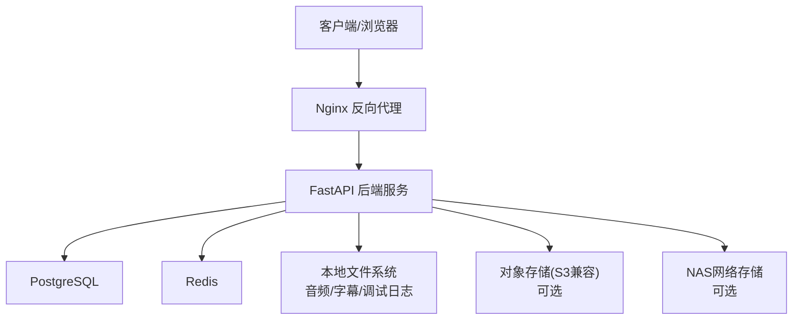
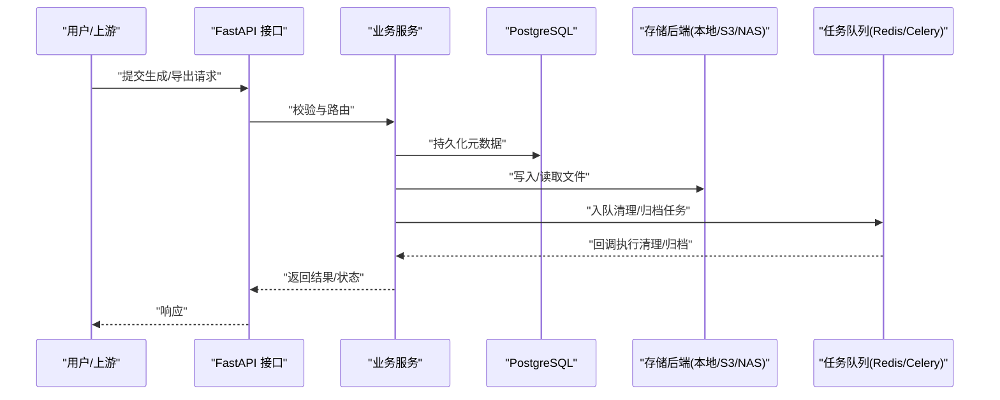
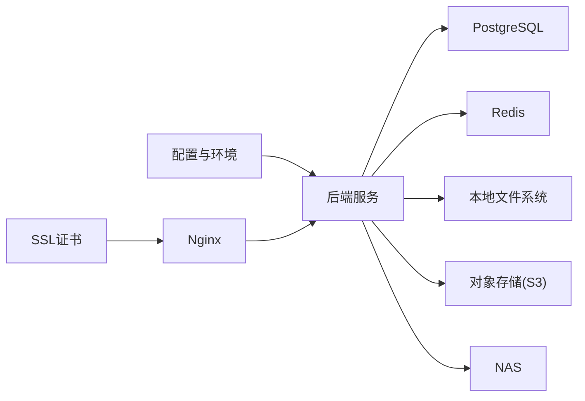

# 备份存储策略

<cite>
**本文引用的文件**   
- [README.md](file://README.md)
- [config.py](file://config.py)
- [core/config.py](file://core/config.py)
- [backend/app/core/config.py](file://backend/app/core/config.py)
- [backend/app/core/env_loader.py](file://backend/app/core/env_loader.py)
- [backend/app/main.py](file://backend/app/main.py)
- [docker-compose.yml](file://docker-compose.yml)
- [nginx.conf](file://nginx.conf)
- [nginx-prod.conf](file://nginx-prod.conf)
- [ssl/README.md](file://ssl/README.md)
- [POSTGRESQL_DEPLOYMENT.md](file://POSTGRESQL_DEPLOYMENT.md)
- [deploy_config.json](file://deploy_config.json)
- [backend/data/audio_library/sfx_candidates.jsonl](file://backend/data/audio_library/sfx_candidates.jsonl)
- [backend/data/audio_library/sfx_candidates_wikimedia_cc0_pd_continued2_20260511.json](file://backend/data/audio_library/sfx_candidates_wikimedia_cc0_pd_continued2_20260511.json)
- [backend/data/audio_library/sfx_import_manifest_cc0_environment_expansion_20260511.jsonl](file://backend/data/audio_library/sfx_import_manifest_cc0_environment_expansion_20260511.jsonl)
- [backend/data/tts_debug/chapter_74](file://backend/data/tts_debug/chapter_74)
- [backend/audiobooks/project_1/chapter_001.ass](file://backend/audiobooks/project_1/chapter_001.ass)
- [backend/audiobooks/project_3](file://backend/audiobooks/project_3)
- [backend/services/ai_trace_storage.py](file://backend/services/ai_trace_storage.py)
- [backend/tests/test_ai_trace_storage_safety.py](file://backend/tests/test_ai_trace_storage_safety.py)
- [backend/tests/test_audio_library_cloud_storage.py](file://backend/tests/test_audio_library_cloud_storage.py)
- [backend/tests/test_audio_library_source_policy.py](file://backend/tests/test_audio_library_source_policy.py)
- [backend/tests/test_workflow_generated_chapter_persistence.py](file://backend/tests/test_workflow_generated_chapter_persistence.py)
- [backend/tests/test_audiobook_project_exporter.py](file://backend/tests/test_audiobook_project_exporter.py)
</cite>

## 目录
1. [引言](#引言)
2. [项目结构](#项目结构)
3. [核心组件](#核心组件)
4. [架构总览](#架构总览)
5. [详细组件分析](#详细组件分析)
6. [依赖关系分析](#依赖关系分析)
7. [性能考虑](#性能考虑)
8. [故障排查指南](#故障排查指南)
9. [结论](#结论)
10. [附录](#附录)

## 引言
本文件为小说创作代理系统的“备份存储策略”提供完整、可落地的设计与实施指南。内容覆盖本地存储配置（磁盘空间管理、文件系统组织、权限控制）、云存储集成（对象存储服务配置、API密钥管理、传输加密）、备份生命周期管理（保留策略、自动清理、容量优化）、多存储后端支持（本地文件系统、S3兼容、NAS网络存储），以及监控与维护（容量预警、性能监控、故障转移）。同时给出成本优化、访问权限控制与合规性要求，确保系统在高可用、安全合规的前提下稳定运行。

## 项目结构
系统采用前后端分离与微服务化思路：后端基于Python/FastAPI，使用PostgreSQL作为主数据库，Redis用于缓存与任务队列，Nginx作为反向代理与静态资源入口；媒体与素材数据以本地文件为主，并通过测试与文档体现对云对象存储的扩展能力。部署层面通过Docker Compose编排，SSL证书由专用脚本或工具管理。

图表来源
- [docker-compose.yml](file://docker-compose.yml)
- [nginx.conf](file://nginx.conf)
- [backend/app/main.py](file://backend/app/main.py)
- [POSTGRESQL_DEPLOYMENT.md](file://POSTGRESQL_DEPLOYMENT.md)

章节来源
- [README.md](file://README.md)
- [docker-compose.yml](file://docker-compose.yml)
- [nginx.conf](file://nginx.conf)
- [POSTGRESQL_DEPLOYMENT.md](file://POSTGRESQL_DEPLOYMENT.md)

## 核心组件
- 配置与环境加载
  - 应用级配置与运行时环境变量解析，支撑不同环境下的存储后端切换与参数注入。
- 数据存储层
  - 结构化数据：PostgreSQL（含迁移脚本与初始化SQL）。
  - 非结构化数据：本地文件系统（音频、字幕、调试日志等）与可选的对象存储/NAS。
- 任务与异步处理
  - 基于Celery/Redis的任务队列，支撑批量导出、转码、清理等耗时操作。
- 安全与传输
  - Nginx终止TLS，内部服务间通信可通过内网加密或mTLS（按需）。
- 监控与可观测性
  - 指标采集、日志聚合、告警规则（容量、错误率、延迟）。

章节来源
- [backend/app/core/config.py](file://backend/app/core/config.py)
- [backend/app/core/env_loader.py](file://backend/app/core/env_loader.py)
- [POSTGRESQL_DEPLOYMENT.md](file://POSTGRESQL_DEPLOYMENT.md)
- [docker-compose.yml](file://docker-compose.yml)

## 架构总览
下图展示备份与存储相关的关键交互：应用将元数据写入数据库，将大文件落盘到本地或对象存储，并通过任务队列执行周期性清理与归档。

图表来源
- [backend/app/main.py](file://backend/app/main.py)
- [backend/app/core/config.py](file://backend/app/core/config.py)
- [docker-compose.yml](file://docker-compose.yml)

## 详细组件分析

### 本地存储配置与文件系统组织
- 目录规划建议
  - 项目资产：按项目ID分目录，子目录包含章节、音频、字幕、中间产物。
  - 公共库：音效库、音色样本、索引文件集中存放。
  - 调试与临时：TTS调试、中间态文件、失败重试快照隔离存放。
  - 备份与归档：增量快照、全量归档、校验和清单。
- 磁盘空间管理
  - 设置阈值告警（如使用率>80%触发扩容或清理）。
  - 定期扫描大文件与孤儿文件，结合引用计数进行回收。
  - 冷热分层：热数据SSD，冷数据HDD或归档介质。
- 权限控制
  - 最小权限原则：应用进程仅拥有必要读写路径。
  - 目录ACL/SELinux策略限制越权访问。
  - 备份目录只读挂载给归档服务。

章节来源
- [backend/data/audio_library](file://backend/data/audio_library)
- [backend/data/tts_debug/chapter_74](file://backend/data/tts_debug/chapter_74)
- [backend/audiobooks/project_1/chapter_001.ass](file://backend/audiobooks/project_1/chapter_001.ass)
- [backend/audiobooks/project_3](file://backend/audiobooks/project_3)

### 云存储集成方案（S3兼容）
- 配置项
  - 端点URL、Bucket名称、区域、访问密钥、密钥口令、传输协议、签名版本。
  - 连接池大小、超时、重试策略、分块上传大小。
- 密钥管理
  - 通过环境变量或密钥管理服务注入，禁止硬编码。
  - 轮换策略与最小权限IAM策略。
- 传输加密
  - 强制HTTPS/TLS，服务端启用HSTS。
  - 可选服务端加密（SSE-KMS）与客户端加密（KMS托管密钥）。
- 一致性模型
  - 先写元数据后写对象，或使用事务性命名约定保证原子性。
  - 校验和（MD5/SHA256）与清单文件保障完整性。

章节来源
- [backend/tests/test_audio_library_cloud_storage.py](file://backend/tests/test_audio_library_cloud_storage.py)
- [backend/tests/test_audio_library_source_policy.py](file://backend/tests/test_audio_library_source_policy.py)

### 备份生命周期管理
- 保留策略
  - 按时间维度（最近N天/周/月）与数量维度（最多M份）组合。
  - 按项目/租户维度独立保留策略。
- 自动清理
  - 定时任务扫描过期快照，删除孤儿文件并更新索引。
  - 清理前生成审计日志与恢复清单。
- 容量优化
  - 去重与增量备份，压缩与格式转换（如音频转Opus/MP3）。
  - 冷热分层与归档至低成本介质（Glacier/Archive Tier）。

章节来源
- [backend/tests/test_workflow_generated_chapter_persistence.py](file://backend/tests/test_workflow_generated_chapter_persistence.py)
- [backend/tests/test_audiobook_project_exporter.py](file://backend/tests/test_audiobook_project_exporter.py)

### 多存储后端支持
- 本地文件系统
  - 适合开发/小规模生产，I/O简单直接，易于排障。
- S3兼容对象存储
  - 高可用、弹性扩展，适合大规模媒体资产与跨地域复制。
- NAS网络存储
  - 共享文件协议（NFS/SMB），适合多节点并发读写场景。
- 后端抽象
  - 统一接口封装读写、列举、删除、元数据操作，便于动态切换。

章节来源
- [backend/tests/test_audio_library_cloud_storage.py](file://backend/tests/test_audio_library_cloud_storage.py)
- [backend/tests/test_audio_library_source_policy.py](file://backend/tests/test_audio_library_source_policy.py)

### 存储监控与维护
- 容量预警
  - 磁盘使用率、inode使用率、对象数量、带宽利用率。
- 性能监控
  - IOPS、吞吐、延迟分布、错误率、重试次数。
- 故障转移
  - 多副本与跨区域复制，自动故障切换与回滚。
  - 健康检查与熔断降级（只读模式）。

章节来源
- [docker-compose.yml](file://docker-compose.yml)
- [nginx.conf](file://nginx.conf)
- [ssl/README.md](file://ssl/README.md)

### 成本优化策略
- 存储分级：热/温/冷分层，自动生命周期策略。
- 压缩与转码：在保证质量前提下降低体积。
- 去重与增量：减少重复数据与传输开销。
- 计费模型选择：预留实例、竞价实例、归档存储。

[本节为通用指导，不直接分析具体文件]

### 访问权限控制与合规性
- 身份与授权：RBAC、最小权限、细粒度ACL。
- 审计与合规：访问日志、数据脱敏、留存周期、跨境传输合规。
- 加密：传输TLS、静态加密（KMS）、密钥轮换。

[本节为通用指导，不直接分析具体文件]

## 依赖关系分析
- 配置依赖：应用启动时加载配置与环境变量，决定存储后端与连接参数。
- 数据依赖：PostgreSQL承载元数据与任务状态，Redis承载队列与缓存。
- 外部依赖：对象存储SDK、NAS客户端、Nginx反向代理、SSL证书。

图表来源
- [backend/app/core/config.py](file://backend/app/core/config.py)
- [backend/app/core/env_loader.py](file://backend/app/core/env_loader.py)
- [docker-compose.yml](file://docker-compose.yml)
- [nginx.conf](file://nginx.conf)
- [ssl/README.md](file://ssl/README.md)

章节来源
- [backend/app/core/config.py](file://backend/app/core/config.py)
- [backend/app/core/env_loader.py](file://backend/app/core/env_loader.py)
- [docker-compose.yml](file://docker-compose.yml)

## 性能考虑
- 并发与缓冲：合理设置线程池、连接池与缓冲区大小。
- 批处理：批量写入与合并小文件，减少元数据压力。
- 缓存热点：常用元数据与索引缓存，降低IO压力。
- 网络优化：就近接入点、CDN加速静态资源、HTTP/2与Keep-Alive。

[本节为通用指导，不直接分析具体文件]

## 故障排查指南
- 常见问题定位
  - 磁盘满：检查配额与清理任务是否执行，查看告警与日志。
  - 权限错误：核对目录ACL与应用进程用户，验证只读挂载。
  - 网络异常：检查对象存储连通性、DNS、代理与证书有效性。
  - 数据不一致：比对校验和与清单，修复损坏对象。
- 诊断工具
  - 日志聚合与检索、指标看板、链路追踪。
  - 备份恢复演练与沙箱验证。

章节来源
- [backend/tests/test_ai_trace_storage_safety.py](file://backend/tests/test_ai_trace_storage_safety.py)
- [backend/services/ai_trace_storage.py](file://backend/services/ai_trace_storage.py)

## 结论
通过统一的存储抽象、严格的权限与加密、完善的生命周期管理与监控体系，本系统可在本地、对象存储与NAS之间灵活切换，满足小说创作代理在数据安全、性能与成本上的综合需求。建议在生产环境优先采用对象存储+本地缓存的组合，配合自动化备份与恢复演练，确保业务连续性与合规性。

[本节为总结性内容，不直接分析具体文件]

## 附录
- 部署与运维参考
  - Docker Compose编排、Nginx配置、SSL证书管理。
  - PostgreSQL部署与迁移说明。
- 示例数据与素材
  - 音效候选、导入清单、调试输出等样例文件位置。

章节来源
- [docker-compose.yml](file://docker-compose.yml)
- [nginx.conf](file://nginx.conf)
- [nginx-prod.conf](file://nginx-prod.conf)
- [ssl/README.md](file://ssl/README.md)
- [POSTGRESQL_DEPLOYMENT.md](file://POSTGRESQL_DEPLOYMENT.md)
- [backend/data/audio_library/sfx_candidates.jsonl](file://backend/data/audio_library/sfx_candidates.jsonl)
- [backend/data/audio_library/sfx_candidates_wikimedia_cc0_pd_continued2_20260511.json](file://backend/data/audio_library/sfx_candidates_wikimedia_cc0_pd_continued2_20260511.json)
- [backend/data/audio_library/sfx_import_manifest_cc0_environment_expansion_20260511.jsonl](file://backend/data/audio_library/sfx_import_manifest_cc0_environment_expansion_20260511.jsonl)
- [backend/data/tts_debug/chapter_74](file://backend/data/tts_debug/chapter_74)
- [backend/audiobooks/project_1/chapter_001.ass](file://backend/audiobooks/project_1/chapter_001.ass)
- [backend/audiobooks/project_3](file://backend/audiobooks/project_3)
- [deploy_config.json](file://deploy_config.json)