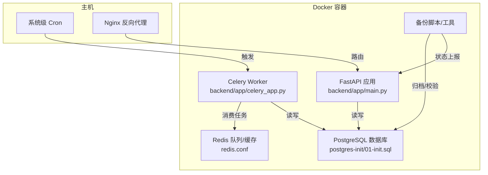
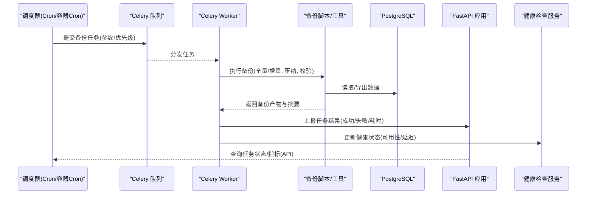
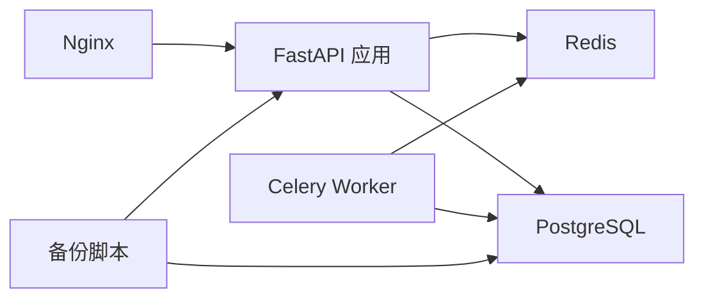

# 定时备份任务

<cite>
**本文引用的文件**   
- [docker-compose.yml](file://docker-compose.yml)
- [backend/app/celery_app.py](file://backend/app/celery_app.py)
- [backend/app/main.py](file://backend/app/main.py)
- [backend/requirements.txt](file://backend/requirements.txt)
- [backend/Dockerfile](file://backend/Dockerfile)
- [nginx.conf](file://nginx.conf)
- [nginx-prod.conf](file://nginx-prod.conf)
- [redis.conf](file://redis.conf)
- [postgres-init/01-init.sql](file://postgres-init/01-init.sql)
- [backend/alembic.ini](file://backend/alembic.ini)
- [backend/app/core/config.py](file://backend/app/core/config.py)
- [backend/app/services/monitoring/health_check.py](file://backend/app/services/monitoring/health_check.py)
- [backend/app/api/v1/monitoring.py](file://backend/app/api/v1/monitoring.py)
</cite>

## 目录
1. [简介](#简介)
2. [项目结构](#项目结构)
3. [核心组件](#核心组件)
4. [架构总览](#架构总览)
5. [详细组件分析](#详细组件分析)
6. [依赖关系分析](#依赖关系分析)
7. [性能考虑](#性能考虑)
8. [故障排查指南](#故障排查指南)
9. [结论](#结论)
10. [附录](#附录)

## 简介
本文件为小说创作代理系统的“定时备份任务”提供完整的技术与运维文档。内容涵盖：
- Cron 作业配置（系统级、容器内、Celery 异步）
- 自动化脚本设计（执行流程、参数传递、环境变量管理）
- 备份验证机制（完整性检查、恢复演练、健康监控）
- 任务监控与告警（日志收集、失败通知、性能指标）
- 任务优先级、资源限制与异常处理策略

本方案以现有后端服务（FastAPI + Celery + Redis + PostgreSQL）为基础，结合 Docker Compose 编排，提供可落地的部署与运维实践。

## 项目结构
本项目采用前后端分离与多服务编排：
- 后端服务：FastAPI 应用、Celery Worker、Alembic 迁移
- 中间件：Redis（缓存/消息队列）、PostgreSQL（持久化）
- 反向代理：Nginx（对外暴露 API）
- 容器编排：Docker Compose（统一启动与依赖管理）

图示来源
- [docker-compose.yml](file://docker-compose.yml)
- [backend/app/main.py](file://backend/app/main.py)
- [backend/app/celery_app.py](file://backend/app/celery_app.py)
- [redis.conf](file://redis.conf)
- [postgres-init/01-init.sql](file://postgres-init/01-init.sql)

章节来源
- [docker-compose.yml](file://docker-compose.yml)
- [backend/app/main.py](file://backend/app/main.py)
- [backend/app/celery_app.py](file://backend/app/celery_app.py)
- [nginx.conf](file://nginx.conf)
- [nginx-prod.conf](file://nginx-prod.conf)
- [redis.conf](file://redis.conf)
- [postgres-init/01-init.sql](file://postgres-init/01-init.sql)

## 核心组件
- FastAPI 应用：提供 API 与内部健康检查接口，用于备份任务的状态上报与查询。
- Celery Worker：执行异步备份任务，支持重试、超时、优先级队列。
- Redis：作为任务队列与缓存，保障高并发下的稳定性。
- PostgreSQL：业务数据与元数据存储，备份目标之一。
- Nginx：对外暴露 API，便于外部监控系统访问健康与指标接口。
- 备份脚本/工具：封装备份执行、校验、清理与上报逻辑。

章节来源
- [backend/app/main.py](file://backend/app/main.py)
- [backend/app/celery_app.py](file://backend/app/celery_app.py)
- [backend/app/api/v1/monitoring.py](file://backend/app/api/v1/monitoring.py)
- [backend/app/services/monitoring/health_check.py](file://backend/app/services/monitoring/health_check.py)
- [backend/requirements.txt](file://backend/requirements.txt)
- [backend/Dockerfile](file://backend/Dockerfile)

## 架构总览
下图展示定时备份任务的端到端流程：系统级或容器内调度器触发任务，通过 Celery 入队并交由 Worker 执行；Worker 调用备份脚本完成数据导出、校验与归档，并将结果上报至应用层与健康检查模块。

图示来源
- [backend/app/celery_app.py](file://backend/app/celery_app.py)
- [backend/app/main.py](file://backend/app/main.py)
- [backend/app/services/monitoring/health_check.py](file://backend/app/services/monitoring/health_check.py)
- [postgres-init/01-init.sql](file://postgres-init/01-init.sql)

## 详细组件分析

### 调度与任务入口
- 系统级 Cron：在宿主机设置 cron 表达式，按频率触发容器内的备份命令或 Celery 任务。
- 容器内 Cron：在镜像中安装 cron，使用 crontab 定义任务，避免宿主权限问题。
- Celery 周期任务：通过 Celery Beat 或应用内调度器注册周期性任务，适合复杂参数与重试策略。

建议：
- 将高频、轻量任务放入 Celery（如增量备份、校验），低频重任务由系统级 Cron 触发（如全量备份）。
- 所有调度需显式指定时区，避免跨时区环境导致的时间偏差。

章节来源
- [docker-compose.yml](file://docker-compose.yml)
- [backend/app/celery_app.py](file://backend/app/celery_app.py)
- [backend/app/main.py](file://backend/app/main.py)

### 备份执行流程与参数传递
典型流程：
- 接收参数：备份类型（全量/增量）、保留策略（天数/数量）、目标存储路径、压缩选项、校验开关。
- 准备环境：加载环境变量（数据库连接、存储凭证、日志级别、时区）。
- 执行备份：连接数据库导出、生成校验摘要、压缩归档、上传到目标存储（本地/对象存储）。
- 清理与上报：删除过期备份、记录执行日志、上报任务结果与健康状态。

参数与环境变量管理：
- 使用统一的配置模块加载环境变量，确保敏感信息不硬编码。
- 对关键参数进行校验与默认值回退，保证任务鲁棒性。

章节来源
- [backend/app/core/config.py](file://backend/app/core/config.py)
- [backend/app/celery_app.py](file://backend/app/celery_app.py)
- [backend/app/main.py](file://backend/app/main.py)

### 备份验证机制
- 完整性检查：对备份产物计算哈希（如 SHA-256），并与元数据比对。
- 恢复测试：定期抽取备份进行沙箱恢复，验证结构与可读性。
- 健康状态监控：通过健康检查接口输出可用性与延迟指标，供外部监控系统采集。

建议：
- 将校验与恢复测试作为独立任务运行，避免阻塞主备份流程。
- 对失败的校验与恢复任务立即告警，并自动触发重试或降级策略。

章节来源
- [backend/app/services/monitoring/health_check.py](file://backend/app/services/monitoring/health_check.py)
- [backend/app/api/v1/monitoring.py](file://backend/app/api/v1/monitoring.py)

### 任务监控与告警
- 执行日志收集：集中化日志（容器标准输出/文件），配合日志采集器（如 Filebeat/Fluent Bit）汇聚。
- 失败通知：基于 Celery 事件与 Webhook 推送失败告警（邮件/IM/短信）。
- 性能指标监控：暴露 Prometheus 指标（任务时长、成功率、队列长度、错误率），接入 Grafana 可视化。

建议：
- 为每个备份任务分配唯一追踪 ID，便于链路追踪与问题定位。
- 设置阈值告警（如连续失败次数、平均耗时超阈、队列积压）。

章节来源
- [backend/app/api/v1/monitoring.py](file://backend/app/api/v1/monitoring.py)
- [backend/app/celery_app.py](file://backend/app/celery_app.py)

### 任务优先级管理与资源限制
- 优先级队列：区分高/中/低优先级队列，重要任务优先执行。
- 资源限制：为 Worker 设置并发数、内存上限、CPU 配额，防止资源争用。
- 超时与重试：配置任务最大运行时间与重试次数，避免长时间占用资源。

建议：
- 全量备份使用低优先级队列，增量与校验使用中高优先级。
- 根据容器规格动态调整 Worker 并发与内存限制。

章节来源
- [backend/app/celery_app.py](file://backend/app/celery_app.py)
- [docker-compose.yml](file://docker-compose.yml)

### 异常处理策略
- 幂等性：备份任务支持断点续传与去重，避免重复执行造成不一致。
- 回滚与清理：失败时清理临时文件与部分产物，保持环境整洁。
- 降级与熔断：当依赖服务不可用时，切换只读模式或跳过非关键步骤。

建议：
- 对数据库连接、网络请求增加超时与重试，捕获异常并记录上下文。
- 对关键路径增加保护锁，防止并发冲突。

章节来源
- [backend/app/celery_app.py](file://backend/app/celery_app.py)
- [backend/app/core/config.py](file://backend/app/core/config.py)

## 依赖关系分析
- FastAPI 应用依赖 Redis（缓存/会话）与 PostgreSQL（数据）。
- Celery Worker 依赖 Redis（队列）与 PostgreSQL（数据）。
- Nginx 反向代理对外暴露 API，屏蔽内部服务细节。
- 备份脚本依赖数据库客户端与对象存储 SDK（可选）。

图示来源
- [docker-compose.yml](file://docker-compose.yml)
- [backend/app/main.py](file://backend/app/main.py)
- [backend/app/celery_app.py](file://backend/app/celery_app.py)
- [redis.conf](file://redis.conf)
- [postgres-init/01-init.sql](file://postgres-init/01-init.sql)

章节来源
- [docker-compose.yml](file://docker-compose.yml)
- [backend/requirements.txt](file://backend/requirements.txt)
- [backend/Dockerfile](file://backend/Dockerfile)

## 性能考虑
- 分片与并行：大库备份采用分片导出与并行压缩，缩短整体时间。
- I/O 优化：将备份产物写入高性能磁盘或对象存储，减少本地 I/O 压力。
- 资源隔离：为备份任务分配独立 CPU/内存配额，避免影响在线服务。
- 缓存与预热：对频繁访问的元数据进行缓存，降低数据库负载。

[本节为通用指导，无需特定文件引用]

## 故障排查指南
常见问题与处理：
- 任务未执行：检查 Cron 表达式与时区设置，确认容器内 cron 服务运行。
- 任务失败：查看 Celery Worker 日志与任务追踪 ID，定位具体错误。
- 备份不完整：校验哈希与元数据，必要时重新执行恢复测试。
- 资源不足：调整 Worker 并发与容器资源限制，观察队列积压情况。

建议：
- 启用结构化日志与指标上报，便于快速定位问题。
- 建立告警规则与应急预案，确保故障及时响应。

章节来源
- [backend/app/api/v1/monitoring.py](file://backend/app/api/v1/monitoring.py)
- [backend/app/services/monitoring/health_check.py](file://backend/app/services/monitoring/health_check.py)
- [backend/app/celery_app.py](file://backend/app/celery_app.py)

## 结论
本方案围绕 FastAPI + Celery + Redis + PostgreSQL 的既有架构，构建了稳定、可扩展的定时备份体系。通过明确的调度策略、严格的验证机制与完善的监控告警，确保备份数据的完整性与可恢复性。建议在上线前完成恢复演练与压测，持续优化任务性能与资源利用率。

[本节为总结性内容，无需特定文件引用]

## 附录

### 定时任务配置示例
- 系统级 Cron（Linux）
  - 每日凌晨 2:00 执行全量备份（容器内命令）
  - 每 6 小时执行增量备份与校验
  - 注意设置 TZ 环境变量与正确的时区

- 容器内 Cron（Docker）
  - 在镜像中安装 cron，编写 crontab 文件
  - 使用 docker-compose 挂载 crontab 与日志目录

- Celery 周期任务（Beat）
  - 注册周期任务，定义执行频率与参数
  - 使用优先级队列区分任务重要性

章节来源
- [docker-compose.yml](file://docker-compose.yml)
- [backend/app/celery_app.py](file://backend/app/celery_app.py)

### 环境变量与配置清单
- 数据库连接：主机、端口、用户名、密码、库名
- 存储凭证：对象存储 AK/SK、桶名、路径
- 日志级别：DEBUG/INFO/WARNING/ERROR
- 时区：Asia/Shanghai 或其他目标时区
- 资源限制：Worker 并发、内存上限、CPU 配额

章节来源
- [backend/app/core/config.py](file://backend/app/core/config.py)
- [redis.conf](file://redis.conf)
- [postgres-init/01-init.sql](file://postgres-init/01-init.sql)

### 健康检查与监控接口
- 健康检查：返回服务可用性、依赖状态、延迟指标
- 监控指标：任务成功率、平均耗时、队列长度、错误率
- 日志采集：集中化日志格式与字段规范

章节来源
- [backend/app/api/v1/monitoring.py](file://backend/app/api/v1/monitoring.py)
- [backend/app/services/monitoring/health_check.py](file://backend/app/services/monitoring/health_check.py)