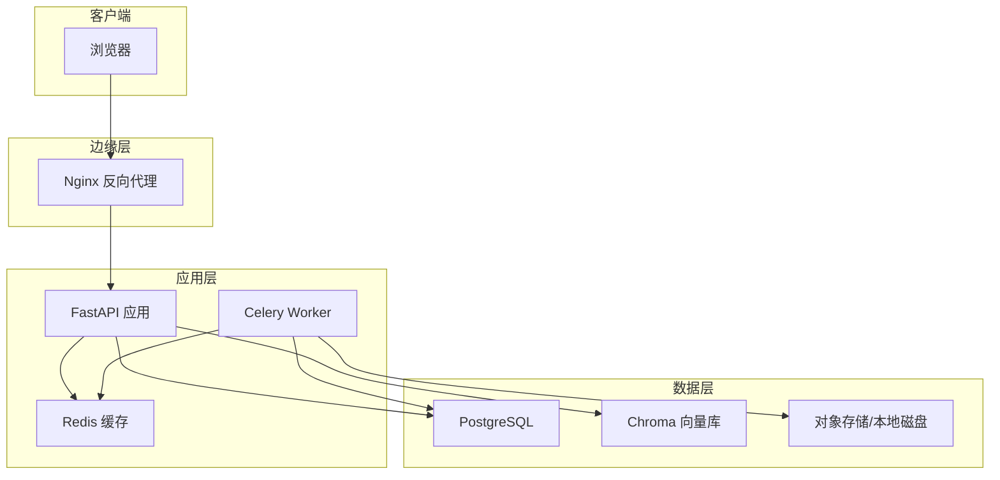
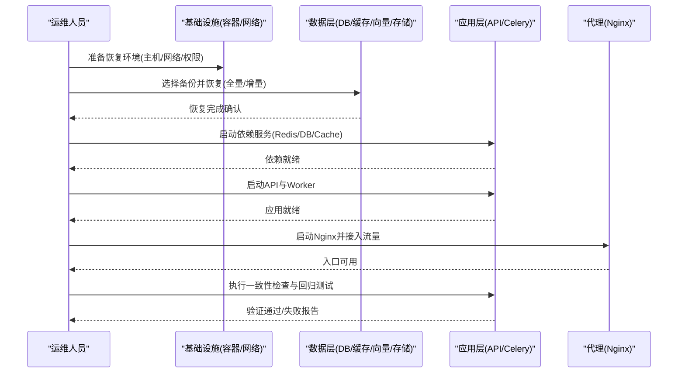
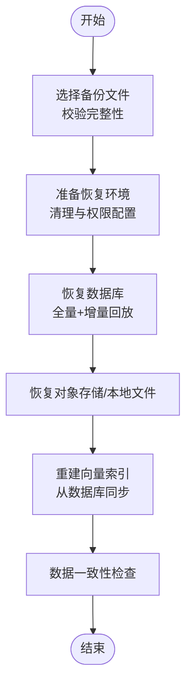
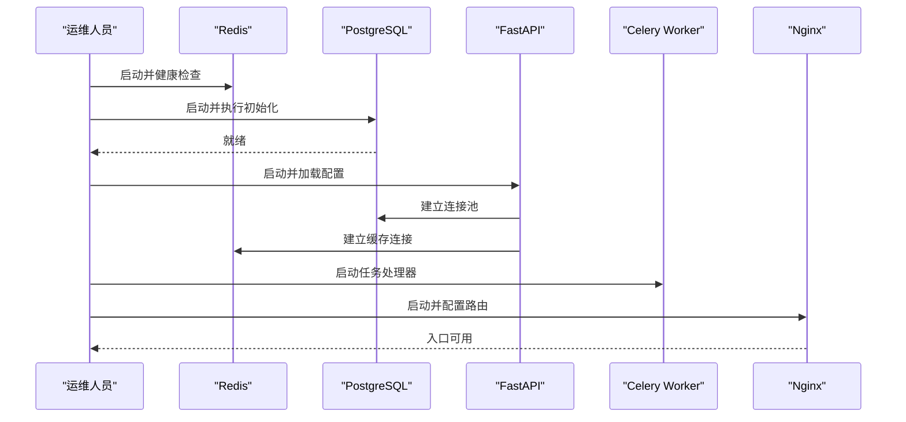
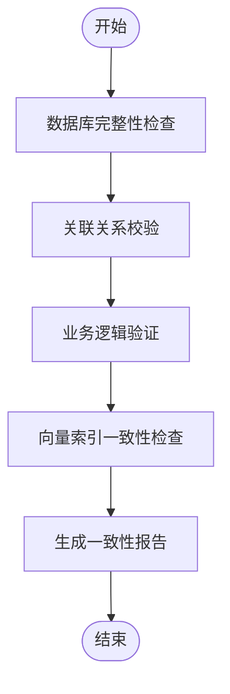
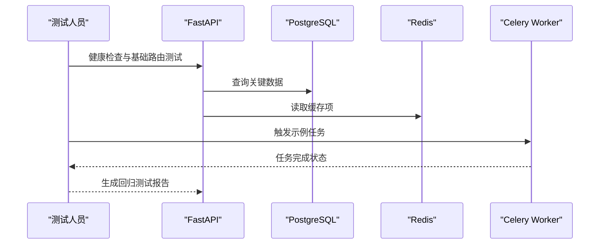
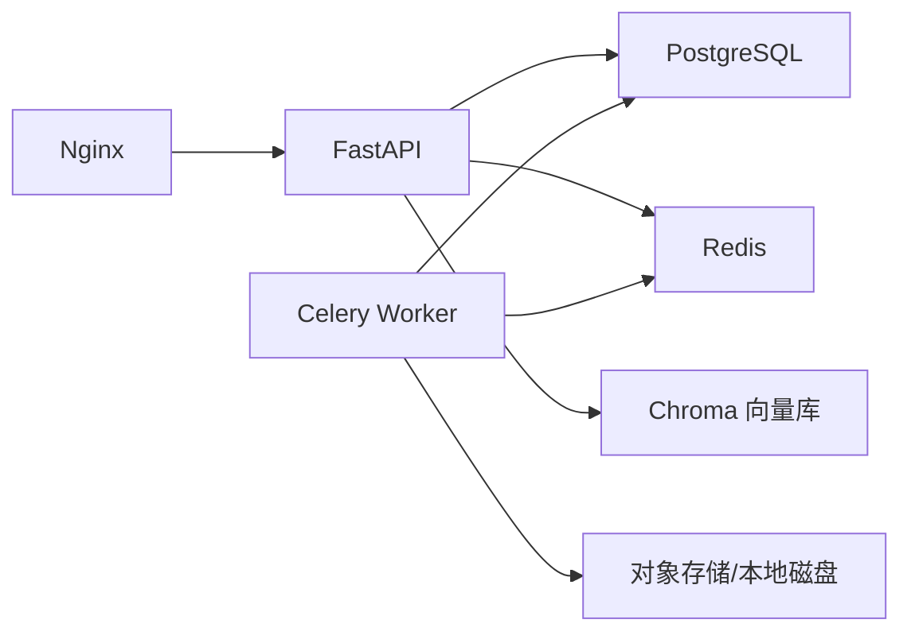

# 灾难恢复流程

<cite>
**本文引用的文件**   
- [docker-compose.yml](file://docker-compose.yml)
- [backend/Dockerfile](file://backend/Dockerfile)
- [backend/alembic.ini](file://backend/alembic.ini)
- [backend/alembic/env.py](file://backend/alembic/env.py)
- [backend/app/main.py](file://backend/app/main.py)
- [backend/app/celery_app.py](file://backend/app/celery_app.py)
- [backend/app/core/config.py](file://backend/app/core/config.py)
- [backend/app/core/env_loader.py](file://backend/app/core/env_loader.py)
- [backend/app/db/base.py](file://backend/app/db/base.py)
- [backend/app/services/cache_system.py](file://backend/app/services/cache_system.py)
- [nginx-prod.conf](file://nginx-prod.conf)
- [nginx.conf](file://nginx.conf)
- [redis.conf](file://redis.conf)
- [postgres-init/01-init.sql](file://postgres-init/01-init.sql)
- [scripts/rebuild_chroma_from_db.py](file://scripts/rebuild_chroma_from_db.py)
- [scripts/rebuild_chroma_from_postgres.py](file://scripts/rebuild_chroma_from_postgres.py)
- [scripts/verify_all_adapters.py](file://scripts/verify_all_adapters.py)
- [scripts/test_all_models.py](file://scripts/test_all_models.py)
- [scripts/check_model_integration.py](file://scripts/check_model_integration.py)
- [scripts/create_test_fixtures.py](file://scripts/create_test_fixtures.py)
</cite>

## 目录
1. [简介](#简介)
2. [项目结构](#项目结构)
3. [核心组件](#核心组件)
4. [架构总览](#架构总览)
5. [详细组件分析](#详细组件分析)
6. [依赖关系分析](#依赖关系分析)
7. [性能考虑](#性能考虑)
8. [故障排查指南](#故障排查指南)
9. [结论](#结论)
10. [附录](#附录)

## 简介
本文件为小说创作代理系统的灾难恢复（DR）流程文档，覆盖数据恢复、服务重启、数据一致性检查、多类灾难场景的恢复方案、恢复验证以及RTO/RPO目标与优化策略。系统采用容器化部署，后端基于Python FastAPI应用，使用Alembic进行数据库迁移，Celery作为异步任务队列，Redis用于缓存与会话，Nginx作为反向代理，PostgreSQL作为主存储，Chroma作为向量索引。

## 项目结构
- 前端：React/Vite构建，由Nginx提供静态资源服务
- 后端：FastAPI应用，包含API路由、业务服务、模型定义、Alembic迁移、Celery任务
- 基础设施：Docker Compose编排，Nginx反向代理，Redis缓存，PostgreSQL数据库，Chroma向量库
- 脚本：运维与验证脚本，包括适配器校验、模型集成测试、向量库重建等

**图表来源** 
- [docker-compose.yml](file://docker-compose.yml)
- [nginx-prod.conf](file://nginx-prod.conf)
- [backend/app/main.py](file://backend/app/main.py)
- [backend/app/celery_app.py](file://backend/app/celery_app.py)
- [backend/app/db/base.py](file://backend/app/db/base.py)
- [backend/app/services/cache_system.py](file://backend/app/services/cache_system.py)

**章节来源**
- [docker-compose.yml](file://docker-compose.yml)
- [nginx-prod.conf](file://nginx-prod.conf)
- [backend/app/main.py](file://backend/app/main.py)
- [backend/app/celery_app.py](file://backend/app/celery_app.py)

## 核心组件
- 配置与环境加载：集中式配置与环境变量加载，支持运行时注入
- 数据库连接与迁移：Alembic管理迁移，应用启动时确保Schema一致
- 缓存与会话：Redis提供会话、限流、缓存能力
- 任务队列：Celery处理异步任务（如音频生成、视频处理）
- 向量索引：Chroma维护语义检索索引
- 外部适配器：LLM/TTS/图像/视频等多模态适配器，需健康检查与回退

**章节来源**
- [backend/app/core/config.py](file://backend/app/core/config.py)
- [backend/app/core/env_loader.py](file://backend/app/core/env_loader.py)
- [backend/alembic.ini](file://backend/alembic.ini)
- [backend/alembic/env.py](file://backend/alembic/env.py)
- [backend/app/db/base.py](file://backend/app/db/base.py)
- [backend/app/services/cache_system.py](file://backend/app/services/cache_system.py)
- [backend/app/celery_app.py](file://backend/app/celery_app.py)

## 架构总览
灾难恢复的关键在于“先数据、后服务、再验证”的顺序。数据层优先恢复（PostgreSQL、对象存储、向量库），随后按依赖顺序启动服务（Redis→DB→Cache→API→Worker→Nginx），最后执行一致性检查与功能回归。

**图表来源** 
- [docker-compose.yml](file://docker-compose.yml)
- [backend/app/main.py](file://backend/app/main.py)
- [backend/app/celery_app.py](file://backend/app/celery_app.py)
- [nginx-prod.conf](file://nginx-prod.conf)

## 详细组件分析

### 数据恢复流程
- 备份文件选择
  - 数据库：优先选择最近的全量备份；若需恢复到特定时间点，选择对应时间点的增量日志或快照
  - 对象存储/本地磁盘：根据项目ID与时间戳选择最新归档包
  - 向量索引：可选择从数据库重建（推荐）或直接恢复快照
- 恢复环境准备
  - 清理旧实例与卷挂载，确保端口与路径可用
  - 校验备份完整性（哈希校验）
  - 准备环境变量与密钥（数据库连接、缓存、外部服务凭据）
- 数据导入执行
  - 数据库恢复：导入全量SQL/快照，必要时回放增量日志
  - 对象存储恢复：解压归档到指定目录，设置权限与访问策略
  - 向量索引重建：执行重建脚本，确保与数据库状态一致

**图表来源** 
- [postgres-init/01-init.sql](file://postgres-init/01-init.sql)
- [scripts/rebuild_chroma_from_db.py](file://scripts/rebuild_chroma_from_db.py)
- [scripts/rebuild_chroma_from_postgres.py](file://scripts/rebuild_chroma_from_postgres.py)

**章节来源**
- [postgres-init/01-init.sql](file://postgres-init/01-init.sql)
- [scripts/rebuild_chroma_from_db.py](file://scripts/rebuild_chroma_from_db.py)
- [scripts/rebuild_chroma_from_postgres.py](file://scripts/rebuild_chroma_from_postgres.py)

### 服务重启流程
- 依赖服务启动顺序
  - Redis：启动缓存服务，确保连接池与内存限制配置正确
  - PostgreSQL：启动数据库，执行必要初始化脚本
  - 应用服务：加载配置与环境变量，建立数据库连接池
  - Celery Worker：启动任务处理器，订阅队列
  - Nginx：启动反向代理，接入流量
- 配置加载与连接池重建
  - 读取环境变量与配置文件，注入运行时参数
  - 初始化数据库连接池、缓存连接、外部适配器客户端
  - 预热关键资源（如模型目录、TTS预览）

**图表来源** 
- [backend/app/core/config.py](file://backend/app/core/config.py)
- [backend/app/core/env_loader.py](file://backend/app/core/env_loader.py)
- [backend/app/db/base.py](file://backend/app/db/base.py)
- [backend/app/services/cache_system.py](file://backend/app/services/cache_system.py)
- [backend/app/celery_app.py](file://backend/app/celery_app.py)
- [nginx-prod.conf](file://nginx-prod.conf)

**章节来源**
- [backend/app/core/config.py](file://backend/app/core/config.py)
- [backend/app/core/env_loader.py](file://backend/app/core/env_loader.py)
- [backend/app/db/base.py](file://backend/app/db/base.py)
- [backend/app/services/cache_system.py](file://backend/app/services/cache_system.py)
- [backend/app/celery_app.py](file://backend/app/celery_app.py)
- [nginx-prod.conf](file://nginx-prod.conf)

### 数据一致性检查
- 完整性验证
  - 数据库表计数与约束检查（外键、唯一性、非空）
  - 对象存储文件清单与元数据校验
  - 向量索引条目与数据库实体映射一致性
- 关联关系检查
  - 项目-章节-资产之间的引用完整性
  - 用户资产记录与本地存储元数据一致性
- 业务逻辑验证
  - 关键工作流端到端测试（如章节生成、音频合成、视频编辑）
  - 适配器健康检查与回退策略验证

**图表来源** 
- [backend/app/db/base.py](file://backend/app/db/base.py)
- [scripts/verify_all_adapters.py](file://scripts/verify_all_adapters.py)
- [scripts/test_all_models.py](file://scripts/test_all_models.py)
- [scripts/check_model_integration.py](file://scripts/check_model_integration.py)

**章节来源**
- [backend/app/db/base.py](file://backend/app/db/base.py)
- [scripts/verify_all_adapters.py](file://scripts/verify_all_adapters.py)
- [scripts/test_all_models.py](file://scripts/test_all_models.py)
- [scripts/check_model_integration.py](file://scripts/check_model_integration.py)

### 不同灾难场景的恢复方案
- 单节点故障
  - 快速切换至备用节点，重新挂载数据卷，启动服务
  - 校验缓存与队列状态，必要时清空临时任务
- 数据损坏
  - 从最近有效备份恢复数据库与对象存储
  - 重建向量索引，执行一致性检查
- 存储介质失效
  - 迁移到新存储介质，恢复归档包，更新路径配置
  - 重新索引与校验
- 网络中断
  - 隔离问题网络段，恢复连通性
  - 重试外部适配器请求，启用回退策略

[本节为概念性内容，不直接分析具体文件]

### 恢复验证流程
- 应用层测试
  - 健康检查接口返回正常
  - 关键API路由可调用且响应符合预期
- 用户数据验证
  - 随机抽样检查项目、章节、资产数据
  - 用户资产记录与本地文件一致性
- 功能回归测试
  - 端到端工作流测试（文本生成、音频合成、视频编辑）
  - 适配器健康检查与回退策略验证

**图表来源** 
- [backend/app/main.py](file://backend/app/main.py)
- [backend/app/celery_app.py](file://backend/app/celery_app.py)
- [backend/app/services/cache_system.py](file://backend/app/services/cache_system.py)

**章节来源**
- [backend/app/main.py](file://backend/app/main.py)
- [backend/app/celery_app.py](file://backend/app/celery_app.py)
- [backend/app/services/cache_system.py](file://backend/app/services/cache_system.py)

## 依赖关系分析
- 容器编排：Docker Compose统一管理服务生命周期
- 反向代理：Nginx将外部请求转发至API
- 数据依赖：API依赖PostgreSQL与Redis，Worker依赖DB、Cache与对象存储
- 向量索引：Chroma与数据库保持同步，可通过脚本重建

**图表来源** 
- [docker-compose.yml](file://docker-compose.yml)
- [nginx-prod.conf](file://nginx-prod.conf)
- [backend/app/main.py](file://backend/app/main.py)
- [backend/app/celery_app.py](file://backend/app/celery_app.py)

**章节来源**
- [docker-compose.yml](file://docker-compose.yml)
- [nginx-prod.conf](file://nginx-prod.conf)
- [backend/app/main.py](file://backend/app/main.py)
- [backend/app/celery_app.py](file://backend/app/celery_app.py)

## 性能考虑
- 数据库连接池：合理设置最大连接数与超时，避免恢复期间连接风暴
- 缓存预热：在恢复后预热热点数据，减少冷启动延迟
- 任务队列：控制并发度，避免恢复期间积压任务导致雪崩
- I/O优化：对象存储恢复时使用并行解压与校验，提升吞吐

[本节为通用指导，不直接分析具体文件]

## 故障排查指南
- 常见问题定位
  - 数据库连接失败：检查环境变量、网络连通性与权限
  - 缓存不可用：验证Redis实例与密码配置
  - 任务堆积：检查Worker状态与队列消费速率
  - 适配器异常：执行适配器健康检查脚本，查看回退策略
- 诊断工具
  - 适配器校验脚本：验证各外部服务可用性
  - 模型集成测试：检查模型配置与推理链路
  - 向量库重建脚本：修复索引不一致问题

**章节来源**
- [scripts/verify_all_adapters.py](file://scripts/verify_all_adapters.py)
- [scripts/test_all_models.py](file://scripts/test_all_models.py)
- [scripts/check_model_integration.py](file://scripts/check_model_integration.py)
- [scripts/rebuild_chroma_from_db.py](file://scripts/rebuild_chroma_from_db.py)

## 结论
灾难恢复的核心在于明确的数据恢复顺序、严格的依赖启动顺序与全面的一致性检查。通过容器化编排与自动化脚本，可实现快速恢复与验证。建议定期演练恢复流程，优化RTO/RPO目标，确保系统在各类灾难场景下的稳定性与可用性。

## 附录
- RTO（恢复时间目标）与RPO（恢复点目标）设定建议
  - RTO：根据业务容忍度设定，通常目标为分钟级
  - RPO：根据数据变更频率设定，通常目标为秒级至分钟级
- 优化策略
  - 增量备份与快照：减少恢复时间与空间占用
  - 预启动与热备：关键服务保持热备状态，缩短启动时间
  - 自动化脚本：将恢复步骤脚本化，降低人为错误

[本节为概念性内容，不直接分析具体文件]