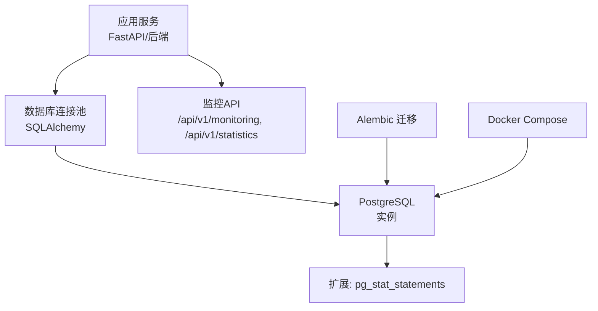
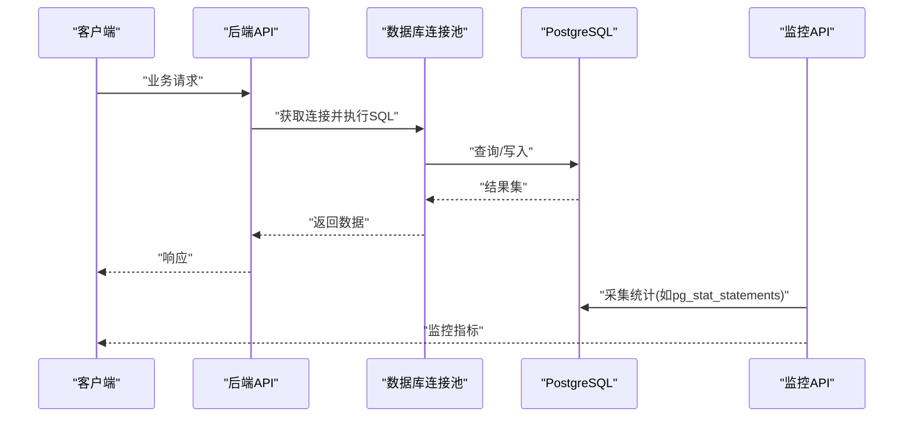
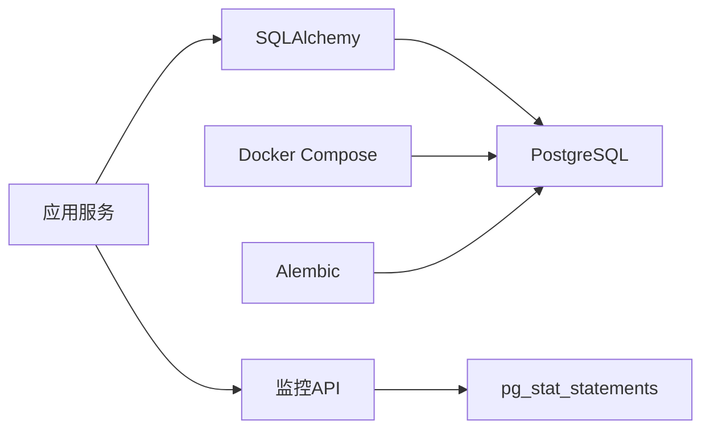

# 性能优化与监控

<cite>
**本文引用的文件**   
- [POSTGRESQL_DEPLOYMENT.md](file://docs/POSTGRESQL_DEPLOYMENT.md)
- [docker-compose.yml](file://docker-compose.yml)
- [alembic.ini](file://backend/alembic.ini)
- [env.py](file://backend/alembic/env.py)
- [base.py](file://backend/app/db/base.py)
- [schema_compat.py](file://backend/app/db/schema_compat.py)
- [initial.py](file://backend/alembic/versions/initial.py)
- [cleanup_redundant_indexes.py](file://backend/alembic/versions/cleanup_redundant_indexes.py)
- [add_active_user_asset_identity_unique_index.py](file://backend/alembic/versions/add_active_user_asset_identity_unique_index.py)
- [monitoring.py](file://backend/app/api/v1/monitoring.py)
- [statistics.py](file://backend/app/api/v1/statistics.py)
- [postgres-init.sql](file://postgres-init/01-init.sql)
</cite>

## 目录
1. [引言](#引言)
2. [项目结构](#项目结构)
3. [核心组件](#核心组件)
4. [架构总览](#架构总览)
5. [详细组件分析](#详细组件分析)
6. [依赖关系分析](#依赖关系分析)
7. [性能考量](#性能考量)
8. [故障排查指南](#故障排查指南)
9. [结论](#结论)
10. [附录](#附录)

## 引言
本文件面向小说创作代理系统的数据库层，聚焦 PostgreSQL 的性能优化与监控。内容覆盖索引设计与优化（复合索引、部分索引、维护计划）、查询优化（EXPLAIN 分析、慢查询识别、重写建议）、连接池配置（连接数、超时、泄漏检测）、性能监控（pg_stat_statements 启用、关键指标、基线建立），以及数据库维护操作（VACUUM、ANALYZE、统计信息更新）。同时提供可落地的监控脚本清单与性能分析报告模板，帮助团队在生产环境中稳定、高效地运行系统。

## 项目结构
本项目采用后端服务 + Alembic 迁移 + Docker Compose 部署的模式，PostgreSQL 作为主数据存储。数据库相关的关键位置如下：
- 部署与容器编排：docker-compose.yml
- 数据库初始化脚本：postgres-init/01-init.sql
- 迁移工具与配置：backend/alembic.ini、backend/alembic/env.py
- 模型与表结构定义：backend/app/models/*（由 Alembic 生成 DDL）
- 迁移历史与索引变更：backend/alembic/versions/*
- 监控 API：backend/app/api/v1/monitoring.py、backend/app/api/v1/statistics.py

图表来源
- [docker-compose.yml](file://docker-compose.yml)
- [alembic.ini](file://backend/alembic.ini)
- [env.py](file://backend/alembic/env.py)
- [base.py](file://backend/app/db/base.py)
- [monitoring.py](file://backend/app/api/v1/monitoring.py)
- [statistics.py](file://backend/app/api/v1/statistics.py)

章节来源
- [docker-compose.yml](file://docker-compose.yml)
- [alembic.ini](file://backend/alembic.ini)
- [env.py](file://backend/alembic/env.py)
- [base.py](file://backend/app/db/base.py)
- [monitoring.py](file://backend/app/api/v1/monitoring.py)
- [statistics.py](file://backend/app/api/v1/statistics.py)

## 核心组件
- 数据库连接与引擎：通过 SQLAlchemy 管理连接，结合 Alembic 进行版本化迁移。
- 迁移与索引演进：使用 Alembic 版本控制表结构与索引变更，确保生产环境一致性。
- 监控接口：暴露监控端点，便于采集关键指标与诊断数据。
- 初始化脚本：在容器启动时执行必要的扩展与基础对象创建。

章节来源
- [base.py](file://backend/app/db/base.py)
- [env.py](file://backend/alembic/env.py)
- [alembic.ini](file://backend/alembic.ini)
- [monitoring.py](file://backend/app/api/v1/monitoring.py)
- [statistics.py](file://backend/app/api/v1/statistics.py)

## 架构总览
下图展示了从应用到数据库的调用路径，以及监控与迁移在整体流程中的位置。

图表来源
- [monitoring.py](file://backend/app/api/v1/monitoring.py)
- [statistics.py](file://backend/app/api/v1/statistics.py)
- [base.py](file://backend/app/db/base.py)

## 详细组件分析

### 索引设计与优化
- 复合索引策略
  - 针对高频过滤条件组合（如用户ID+状态+时间范围）建立复合索引，优先将等值过滤列置于前导列，范围过滤列置后。
  - 对排序与分页场景，尽量让索引覆盖 ORDER BY 字段，减少额外排序开销。
- 部分索引使用
  - 对“活跃”或“已归档”等常见过滤条件，使用部分索引缩小索引体积，提升扫描效率。
  - 典型场景：仅对未删除记录建索引，避免无效行参与扫描。
- 索引维护计划
  - 定期重建碎片化严重的索引，降低 I/O 与内存占用。
  - 在批量写入后触发 ANALYZE，保证查询规划器统计准确。
  - 监控索引命中率与扫描成本，及时淘汰低效索引。

章节来源
- [initial.py](file://backend/alembic/versions/initial.py)
- [cleanup_redundant_indexes.py](file://backend/alembic/versions/cleanup_redundant_indexes.py)
- [add_active_user_asset_identity_unique_index.py](file://backend/alembic/versions/add_active_user_asset_identity_unique_index.py)

### 查询优化技巧
- EXPLAIN 分析
  - 使用 EXPLAIN ANALYZE 观察实际执行计划，关注全表扫描、嵌套循环、哈希连接等热点。
  - 检查是否命中预期索引，评估代价估算偏差。
- 慢查询识别
  - 基于 pg_stat_statements 收集 top N 慢查询，按平均耗时、总耗时、调用次数筛选。
  - 结合日志审计定位频繁慢查询与异常峰值。
- 查询重写建议
  - 避免 SELECT *，只取必要字段；合理使用 JOIN 与子查询改写为 EXISTS/IN。
  - 利用函数索引或表达式索引优化复杂过滤条件。
  - 分页场景使用游标或基于键值的分页替代 OFFSET。

章节来源
- [monitoring.py](file://backend/app/api/v1/monitoring.py)
- [statistics.py](file://backend/app/api/v1/statistics.py)

### 连接池配置
- 连接数调优
  - 根据并发量与 CPU 核数设置最大连接数，避免过多连接导致上下文切换开销。
  - 区分读写流量，必要时拆分连接池。
- 超时设置
  - 合理设置连接获取超时、语句执行超时，防止长事务阻塞资源。
  - 对批处理任务设置独立超时策略。
- 连接泄漏检测
  - 监控活跃连接数与空闲连接数，发现异常增长。
  - 在应用层增加连接生命周期审计，捕获未释放的连接。

章节来源
- [base.py](file://backend/app/db/base.py)
- [docker-compose.yml](file://docker-compose.yml)

### 性能监控方案
- pg_stat_statements 启用
  - 在初始化脚本中加载扩展，并配置采样阈值与保留周期。
  - 通过监控 API 暴露统计查询，便于前端展示与告警。
- 关键指标收集
  - 连接池利用率、锁等待、缓存命中率、I/O 吞吐、复制延迟（如有）。
  - 慢查询 TopN、错误率、事务回滚率。
- 性能基线建立
  - 在压测环境下采集基线数据，定义正常波动区间。
  - 对比上线前后指标变化，评估优化效果。

章节来源
- [postgres-init.sql](file://postgres-init/01-init.sql)
- [monitoring.py](file://backend/app/api/v1/monitoring.py)
- [statistics.py](file://backend/app/api/v1/statistics.py)

### 数据库维护操作
- VACUUM
  - 定期清理死元组，回收空间，避免表膨胀。
  - 对高写负载表考虑自动 VACUUM 参数调优。
- ANALYZE
  - 更新统计信息，提高查询规划准确性。
  - 在批量导入后强制 ANALYZE 指定表。
- 统计信息更新
  - 监控统计信息新鲜度，避免陈旧统计导致误判。
  - 对热点表设置更频繁的 autovacuum_analyze_scale_factor。

章节来源
- [alembic.ini](file://backend/alembic.ini)
- [env.py](file://backend/alembic/env.py)

## 依赖关系分析
- 应用依赖 SQLAlchemy 连接数据库，并通过 Alembic 管理迁移。
- 监控 API 依赖 pg_stat_statements 扩展与系统视图，用于采集指标。
- Docker Compose 负责编排 PostgreSQL 与后端服务，确保环境变量与端口映射正确。

图表来源
- [base.py](file://backend/app/db/base.py)
- [monitoring.py](file://backend/app/api/v1/monitoring.py)
- [docker-compose.yml](file://docker-compose.yml)
- [alembic.ini](file://backend/alembic.ini)

章节来源
- [base.py](file://backend/app/db/base.py)
- [monitoring.py](file://backend/app/api/v1/monitoring.py)
- [docker-compose.yml](file://docker-compose.yml)
- [alembic.ini](file://backend/alembic.ini)

## 性能考量
- 索引选择与代价估算：确保统计信息准确，避免全表扫描。
- 连接池大小与超时：平衡并发与资源占用，防止连接耗尽。
- 监控与告警：建立关键指标阈值，及时发现异常。
- 维护窗口：在低峰期执行 VACUUM、REINDEX、ANALYZE 等操作。

## 故障排查指南
- 慢查询定位：通过 pg_stat_statements 与 EXPLAIN ANALYZE 分析执行计划。
- 连接泄漏：监控连接池状态，检查应用代码是否正确关闭连接。
- 索引失效：核对 WHERE/JOIN/ORDER BY 是否与索引匹配，必要时重建索引。
- 统计信息陈旧：手动触发 ANALYZE，观察查询计划是否改善。

章节来源
- [monitoring.py](file://backend/app/api/v1/monitoring.py)
- [statistics.py](file://backend/app/api/v1/statistics.py)

## 结论
通过合理的索引设计、严格的查询优化、科学的连接池配置与完善的监控体系，可以显著提升小说创作代理系统的数据库性能与稳定性。建议持续跟踪关键指标，建立基线与告警机制，并在每次重大变更后进行回归测试与性能验证。

## 附录

### 监控脚本清单（建议）
- 启用 pg_stat_statements 扩展与配置
- 采集慢查询 TopN 与平均耗时
- 连接池利用率与活跃连接数监控
- 索引命中率与扫描成本分析
- 表膨胀与死元组比例监控
- 统计信息新鲜度检查

### 性能分析报告模板（建议）
- 报告概述：目标、范围、时间段
- 环境与配置：硬件、数据库版本、连接池参数
- 基线数据：QPS、TPS、P95/P99 延迟、错误率
- 问题发现：慢查询、锁等待、连接泄漏、索引失效
- 优化措施：索引调整、查询重写、连接池调优
- 效果验证：对比优化前后指标
- 后续计划：监控增强、自动化维护、容量规划