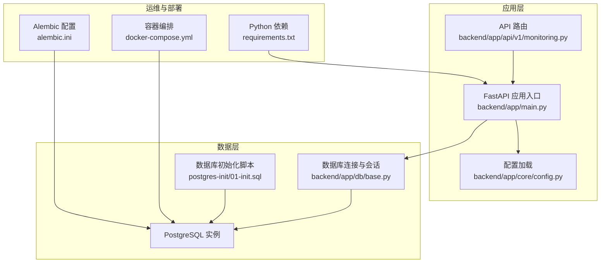
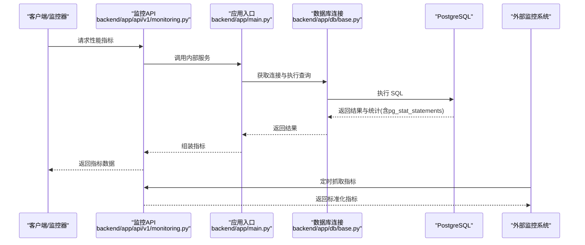
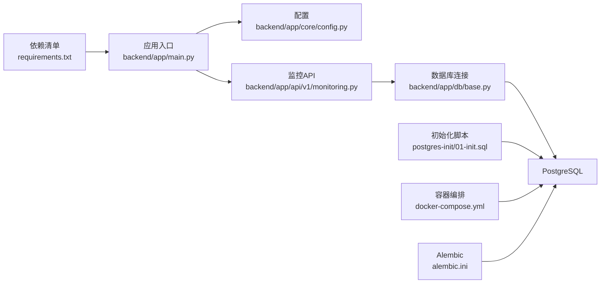

# 性能监控体系

<cite>
**本文引用的文件**   
- [POSTGRESQL_DEPLOYMENT.md](file://docs/POSTGRESQL_DEPLOYMENT.md)
- [docker-compose.yml](file://docker-compose.yml)
- [backend/app/main.py](file://backend/app/main.py)
- [backend/app/core/config.py](file://backend/app/core/config.py)
- [backend/app/db/base.py](file://backend/app/db/base.py)
- [backend/app/api/v1/monitoring.py](file://backend/app/api/v1/monitoring.py)
- [backend/app/services/monitoring/__init__.py](file://backend/app/services/monitoring/__init__.py)
- [postgres-init/01-init.sql](file://postgres-init/01-init.sql)
- [alembic.ini](file://alembic.ini)
- [requirements.txt](file://requirements.txt)
</cite>

## 目录
1. [引言](#引言)
2. [项目结构](#项目结构)
3. [核心组件](#核心组件)
4. [架构总览](#架构总览)
5. [详细组件分析](#详细组件分析)
6. [依赖关系分析](#依赖关系分析)
7. [性能考量](#性能考量)
8. [故障排查指南](#故障排查指南)
9. [结论](#结论)
10. [附录](#附录)

## 引言
本文件面向小说创作代理系统的数据库性能监控，重点围绕 PostgreSQL 的 pg_stat_statements 插件启用与配置、查询统计收集、关键性能指标定义（QPS、响应时间、连接数、锁等待、缓存命中率）、基线建立方法（基准测试、回归检测、容量规划），以及仪表板与告警规则、自动化脚本与报告生成工具进行系统化说明。文档同时结合项目现有后端服务、数据库初始化与部署配置，给出可落地的实施步骤与最佳实践。

## 项目结构
本项目采用前后端分离架构，后端基于 Python 框架提供 API 与服务，使用 Alembic 管理数据库迁移，PostgreSQL 作为主数据存储。监控相关能力集中在后端 API 与数据库初始化脚本中，并通过容器编排统一启动。

图表来源
- [backend/app/api/v1/monitoring.py](file://backend/app/api/v1/monitoring.py)
- [backend/app/main.py](file://backend/app/main.py)
- [backend/app/core/config.py](file://backend/app/core/config.py)
- [backend/app/db/base.py](file://backend/app/db/base.py)
- [postgres-init/01-init.sql](file://postgres-init/01-init.sql)
- [docker-compose.yml](file://docker-compose.yml)
- [alembic.ini](file://alembic.ini)
- [requirements.txt](file://requirements.txt)

章节来源
- [POSTGRESQL_DEPLOYMENT.md](file://docs/POSTGRESQL_DEPLOYMENT.md)
- [docker-compose.yml](file://docker-compose.yml)
- [backend/app/main.py](file://backend/app/main.py)
- [backend/app/core/config.py](file://backend/app/core/config.py)
- [backend/app/db/base.py](file://backend/app/db/base.py)
- [postgres-init/01-init.sql](file://postgres-init/01-init.sql)
- [alembic.ini](file://alembic.ini)
- [requirements.txt](file://requirements.txt)

## 核心组件
- 数据库初始化与扩展：通过初始化脚本安装并启用 pg_stat_statements，确保查询统计可用。
- 应用配置：集中管理数据库连接参数与监控开关，便于环境隔离与动态调整。
- 数据库连接与会话：统一的连接池与会话生命周期管理，保障高并发下的稳定性。
- 监控 API：暴露健康检查与基础性能指标接口，供外部监控系统采集。
- 容器编排：统一拉起数据库与应用，支持环境变量注入与资源限制。

章节来源
- [postgres-init/01-init.sql](file://postgres-init/01-init.sql)
- [backend/app/core/config.py](file://backend/app/core/config.py)
- [backend/app/db/base.py](file://backend/app/db/base.py)
- [backend/app/api/v1/monitoring.py](file://backend/app/api/v1/monitoring.py)
- [docker-compose.yml](file://docker-compose.yml)

## 架构总览
下图展示从请求进入应用到数据库执行、统计收集与监控输出的整体流程。pg_stat_statements 在数据库侧记录语句级统计；应用侧通过监控 API 暴露指标；外部系统（如 Prometheus/Grafana）定期采集并可视化。

图表来源
- [backend/app/api/v1/monitoring.py](file://backend/app/api/v1/monitoring.py)
- [backend/app/main.py](file://backend/app/main.py)
- [backend/app/db/base.py](file://backend/app/db/base.py)
- [postgres-init/01-init.sql](file://postgres-init/01-init.sql)

## 详细组件分析

### pg_stat_statements 启用与配置
- 目标：启用 pg_stat_statements 以收集语句级执行统计，包括调用次数、总耗时、平均耗时、最大耗时、行数影响等。
- 关键点：
  - 在数据库初始化阶段安装扩展并重置统计信息，确保生产环境从零开始收集。
  - 合理设置共享内存与采样阈值，避免过度开销或漏采。
  - 为高频查询创建索引与视图，提升查询效率。
- 建议配置项（概念性说明）：
  - shared_preload_libraries：包含 pg_stat_statements。
  - pg_stat_statements.track：设置为 all 或 top，根据需求选择。
  - pg_stat_statements.max：控制统计条目上限。
  - pg_stat_statements.track_utility：是否统计 DDL/DCL。
  - pg_stat_statements.save：持久化统计到磁盘，重启不丢失。

章节来源
- [postgres-init/01-init.sql](file://postgres-init/01-init.sql)
- [POSTGRESQL_DEPLOYMENT.md](file://docs/POSTGRESQL_DEPLOYMENT.md)

### 查询统计收集与性能指标采集
- 统计维度：
  - 调用频率：每类语句的执行次数与占比。
  - 延迟分布：总耗时、平均耗时、P95/P99 分位。
  - I/O 与缓存：命中/未命中比例、块读取量。
  - 锁与等待：锁等待时间与阻塞链。
- 采集方式：
  - 直接查询 pg_stat_statements 视图。
  - 通过应用监控 API 聚合后输出标准格式（JSON）。
  - 外部监控系统定时拉取并存储。

章节来源
- [backend/app/api/v1/monitoring.py](file://backend/app/api/v1/monitoring.py)
- [backend/app/db/base.py](file://backend/app/db/base.py)

### 关键监控指标定义
- QPS（每秒查询数）：单位时间内执行的查询总数，反映吞吐能力。
- 响应时间：平均、P95、P99 延迟，体现用户体验与瓶颈定位。
- 连接数：活跃连接、空闲连接、最大连接数，评估连接池健康度。
- 锁等待：锁等待时长与阻塞事件数量，识别并发冲突热点。
- 缓存命中率：缓冲命中比例，衡量数据访问局部性与内存压力。

章节来源
- [backend/app/api/v1/monitoring.py](file://backend/app/api/v1/monitoring.py)

### 性能基线建立方法
- 基准测试：
  - 构建代表性工作负载（读多写少、批量导入、复杂关联查询）。
  - 在不同规模数据集上执行，记录延迟、吞吐、资源占用。
- 性能回归检测：
  - 将基线指标纳入持续集成，每次变更自动对比阈值。
  - 触发告警与回滚策略，防止劣化上线。
- 容量规划：
  - 基于历史增长趋势预测资源需求（CPU、内存、IOPS、连接数）。
  - 制定扩容与优化计划，确保 SLA 达成。

章节来源
- [POSTGRESQL_DEPLOYMENT.md](file://docs/POSTGRESQL_DEPLOYMENT.md)

### 监控仪表板与告警规则
- 仪表板建议：
  - 概览页：QPS、延迟分布、连接数、错误率。
  - 语句页：Top N 慢查询、频率变化、扫描行数。
  - 资源页：CPU、内存、I/O、锁等待。
- 告警规则示例：
  - QPS 突降超过阈值（如 30%）持续 5 分钟。
  - P99 延迟超过阈值（如 500ms）持续 3 分钟。
  - 连接数接近最大值（如 90%）持续 2 分钟。
  - 锁等待时长超过阈值（如 1s）且频繁出现。
  - 缓存命中率低于阈值（如 95%）持续 10 分钟。

章节来源
- [backend/app/api/v1/monitoring.py](file://backend/app/api/v1/monitoring.py)

### 自动化监控脚本与报告生成
- 数据采集脚本：
  - 定时拉取 pg_stat_statements 与应用指标。
  - 清洗、聚合、标准化为统一格式。
- 报告生成：
  - 按日/周/月生成性能报告，包含趋势、异常、优化建议。
  - 导出 PDF/HTML，支持邮件分发与归档。

章节来源
- [backend/app/api/v1/monitoring.py](file://backend/app/api/v1/monitoring.py)

## 依赖关系分析
- 应用依赖：
  - FastAPI 应用入口负责路由与中间件。
  - 配置模块集中管理环境变量与默认值。
  - 数据库连接模块封装连接池与会话管理。
- 数据库依赖：
  - PostgreSQL 实例由容器编排启动。
  - 初始化脚本安装扩展并配置统计收集。
- 运维依赖：
  - Alembic 用于迁移与版本管理。
  - requirements.txt 管理 Python 包依赖。

图表来源
- [backend/app/main.py](file://backend/app/main.py)
- [backend/app/core/config.py](file://backend/app/core/config.py)
- [backend/app/api/v1/monitoring.py](file://backend/app/api/v1/monitoring.py)
- [backend/app/db/base.py](file://backend/app/db/base.py)
- [postgres-init/01-init.sql](file://postgres-init/01-init.sql)
- [docker-compose.yml](file://docker-compose.yml)
- [alembic.ini](file://alembic.ini)
- [requirements.txt](file://requirements.txt)

章节来源
- [docker-compose.yml](file://docker-compose.yml)
- [alembic.ini](file://alembic.ini)
- [requirements.txt](file://requirements.txt)

## 性能考量
- 连接池调优：合理设置最小/最大连接数、超时与回收策略，避免连接泄漏与耗尽。
- 查询优化：利用 pg_stat_statements 识别慢查询，添加索引、改写 SQL、减少全表扫描。
- 缓存策略：提高缓冲命中率，必要时引入应用层缓存（如 Redis）分担热点读。
- 资源隔离：为不同业务库或 schema 分配独立资源，避免相互干扰。
- 监控开销：控制 pg_stat_statements 条目上限与采样粒度，平衡准确性与开销。

[本节为通用指导，无需特定文件引用]

## 故障排查指南
- 常见问题：
  - pg_stat_statements 未启用：检查初始化脚本与 shared_preload_libraries。
  - 指标缺失：确认监控 API 可达、权限正确、视图可访问。
  - 延迟突增：查看锁等待、I/O 瓶颈、连接池耗尽。
  - 缓存命中率低：分析热点键、调整缓冲区大小、优化查询模式。
- 排查步骤：
  - 通过监控 API 获取实时指标与 Top N 慢查询。
  - 检查数据库日志与锁等待事件。
  - 对比基线，定位回归点与变更影响。
  - 临时降级或回滚，恢复服务可用性。

章节来源
- [backend/app/api/v1/monitoring.py](file://backend/app/api/v1/monitoring.py)
- [postgres-init/01-init.sql](file://postgres-init/01-init.sql)

## 结论
通过启用 pg_stat_statements 并结合应用监控 API，可实现对 PostgreSQL 的全面性能观测。建立稳定的基线与告警机制，配合自动化脚本与报告工具，能够有效支撑容量规划与性能回归检测。建议在迭代过程中持续优化查询与连接策略，确保系统在高压下保持稳定与高效。

[本节为总结性内容，无需特定文件引用]

## 附录
- 快速检查清单：
  - 确认 pg_stat_statements 已安装并启用。
  - 验证监控 API 返回指标正常。
  - 配置外部监控系统定时采集。
  - 设定告警阈值并通知责任人。
- 参考文档：
  - 部署与配置指南见部署文档。
  - 数据库迁移与版本管理见 Alembic 配置。

章节来源
- [POSTGRESQL_DEPLOYMENT.md](file://docs/POSTGRESQL_DEPLOYMENT.md)
- [alembic.ini](file://alembic.ini)