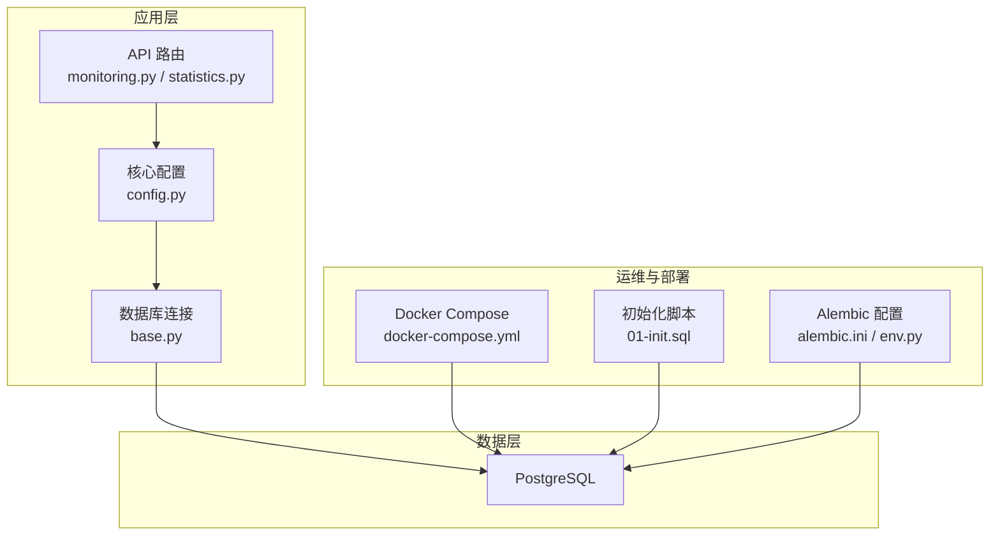
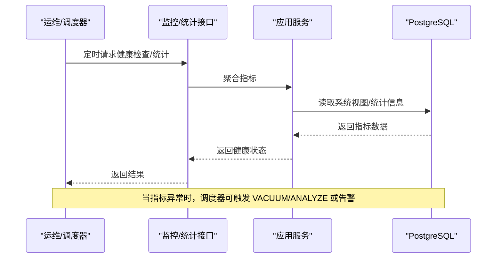
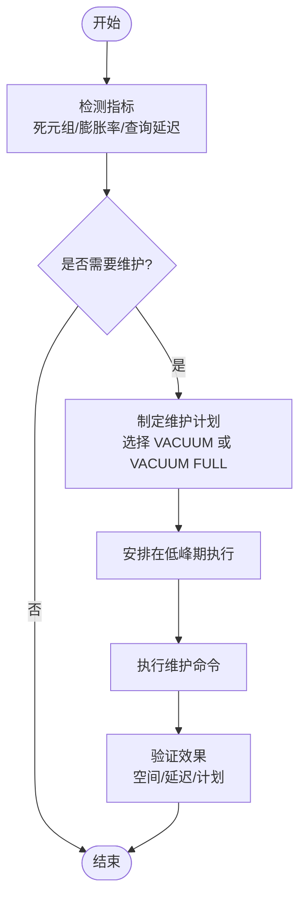
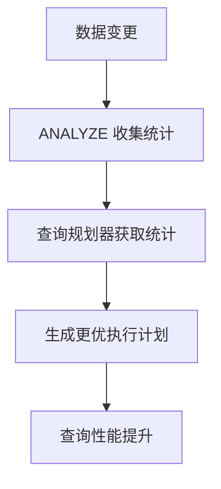
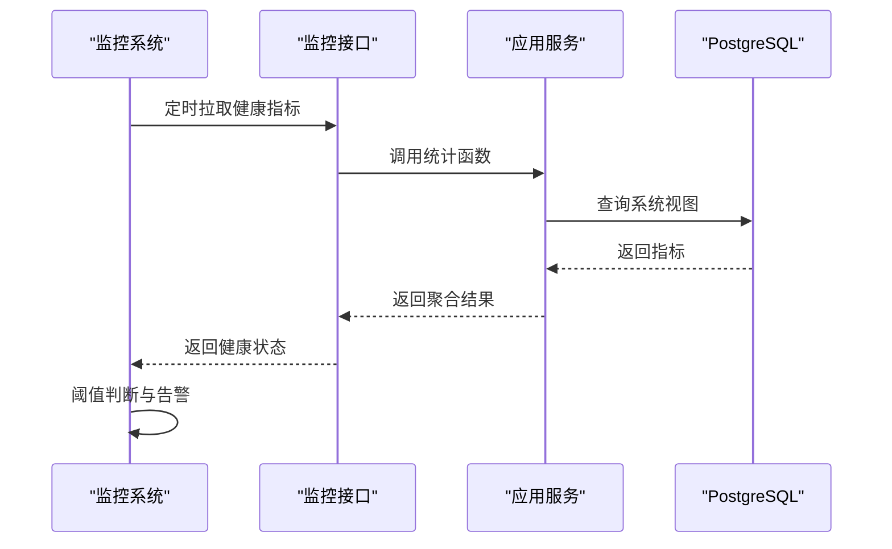
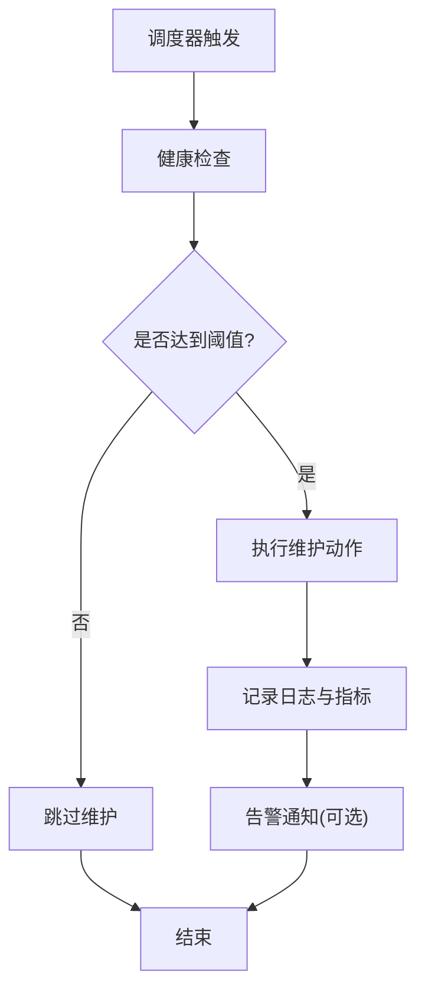
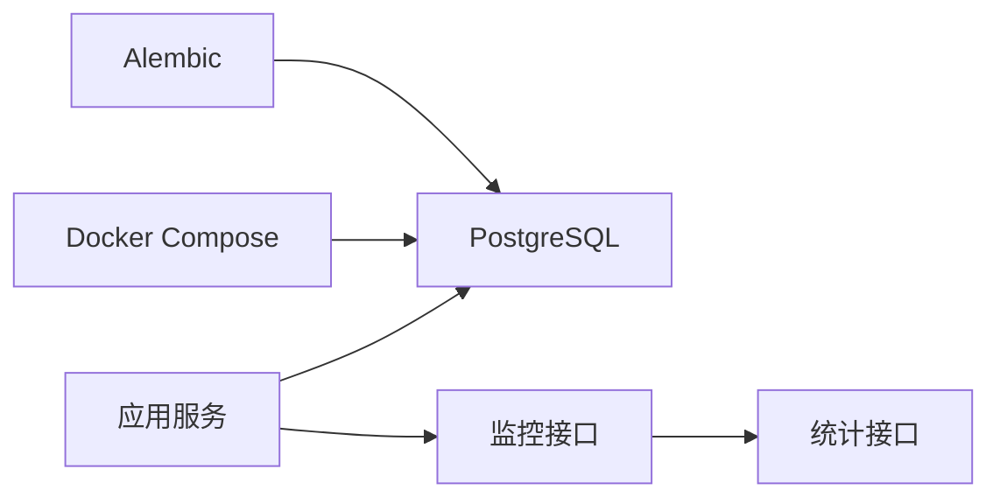

# 数据库维护操作

<cite>
**本文引用的文件**   
- [POSTGRESQL_DEPLOYMENT.md](file://docs/POSTGRESQL_DEPLOYMENT.md)
- [docker-compose.yml](file://docker-compose.yml)
- [alembic.ini](file://backend/alembic.ini)
- [env.py](file://backend/alembic/env.py)
- [base.py](file://backend/app/db/base.py)
- [config.py](file://backend/app/core/config.py)
- [monitoring.py](file://backend/app/api/v1/monitoring.py)
- [statistics.py](file://backend/app/api/v1/statistics.py)
- [01-init.sql](file://postgres-init/01-init.sql)
</cite>

## 目录
1. [简介](#简介)
2. [项目结构](#项目结构)
3. [核心组件](#核心组件)
4. [架构总览](#架构总览)
5. [详细组件分析](#详细组件分析)
6. [依赖关系分析](#依赖关系分析)
7. [性能考量](#性能考量)
8. [故障排查指南](#故障排查指南)
9. [结论](#结论)
10. [附录](#附录)

## 简介
本文件面向小说创作代理系统的数据库维护，聚焦 PostgreSQL 的 VACUUM、ANALYZE 与健康检查。内容涵盖：
- VACUUM 原理与使用：自动 VACUUM 配置、手动执行时机、VACUUM FULL 适用场景
- ANALYZE 的重要性：统计信息更新、查询计划优化、索引统计维护
- 健康检查流程：表空间使用率、索引碎片率、死元组数量监控
- 完整维护脚本与自动化任务配置建议
- 最佳实践与注意事项

## 项目结构
本项目采用后端服务 + Alembic 迁移 + Docker Compose 部署的模式，PostgreSQL 作为持久化存储。与数据库维护相关的要点包括：
- 容器编排中定义数据库服务与参数
- Alembic 用于版本化迁移，确保 schema 演进可追踪
- 应用层提供监控与统计接口，便于集成健康检查
- 初始化 SQL 脚本用于数据库初始对象创建

**图表来源** 
- [docker-compose.yml](file://docker-compose.yml)
- [01-init.sql](file://postgres-init/01-init.sql)
- [alembic.ini](file://backend/alembic.ini)
- [env.py](file://backend/alembic/env.py)
- [base.py](file://backend/app/db/base.py)
- [config.py](file://backend/app/core/config.py)
- [monitoring.py](file://backend/app/api/v1/monitoring.py)
- [statistics.py](file://backend/app/api/v1/statistics.py)

**章节来源**
- [POSTGRESQL_DEPLOYMENT.md](file://docs/POSTGRESQL_DEPLOYMENT.md)
- [docker-compose.yml](file://docker-compose.yml)
- [alembic.ini](file://backend/alembic.ini)
- [env.py](file://backend/alembic/env.py)
- [base.py](file://backend/app/db/base.py)
- [config.py](file://backend/app/core/config.py)
- [monitoring.py](file://backend/app/api/v1/monitoring.py)
- [statistics.py](file://backend/app/api/v1/statistics.py)
- [01-init.sql](file://postgres-init/01-init.sql)

## 核心组件
- 数据库服务与参数：通过容器编排注入环境变量（如共享内存、日志级别、自动清理开关等），影响 VACUUM 行为与性能
- 迁移工具：Alembic 负责 schema 变更，避免在运行期直接修改结构
- 监控与统计：提供健康检查与统计接口，便于外部系统采集指标并触发维护任务
- 初始化脚本：在首次启动时创建必要的数据库对象

**章节来源**
- [docker-compose.yml](file://docker-compose.yml)
- [alembic.ini](file://backend/alembic.ini)
- [env.py](file://backend/alembic/env.py)
- [base.py](file://backend/app/db/base.py)
- [config.py](file://backend/app/core/config.py)
- [monitoring.py](file://backend/app/api/v1/monitoring.py)
- [statistics.py](file://backend/app/api/v1/statistics.py)
- [01-init.sql](file://postgres-init/01-init.sql)

## 架构总览
下图展示从应用到数据库的关键路径，以及维护相关的外部入口（监控、迁移、初始化）。

**图表来源** 
- [monitoring.py](file://backend/app/api/v1/monitoring.py)
- [statistics.py](file://backend/app/api/v1/statistics.py)
- [base.py](file://backend/app/db/base.py)

## 详细组件分析

### VACUUM 原理与使用方法
- 工作原理
  - PostgreSQL 采用 MVCC，删除和更新会产生“死元组”。VACUUM 回收这些空间并更新可见性映射，使后续查询更高效
  - 自动 VACUUM 由后台进程周期性扫描，阈值触发；手动 VACUUM 可在业务低峰期执行
  - VACUUM FULL 会重建表与索引，释放磁盘空间但需要独占锁，适合批量删除后的大规模空间回收
- 自动 VACUUM 配置
  - 关键参数包括 autovacuum、autovacuum_vacuum_threshold、autovacuum_vacuum_scale_factor、autovacuum_analyze_threshold、autvacuum_analyze_scale_factor 等
  - 可通过容器环境变量或配置文件设置，结合工作负载调优
- 手动 VACUUM 时机
  - 大批量写入/删除后、索引膨胀明显、查询变慢、表空间增长过快时
  - 建议在业务低峰期执行，避免对在线事务造成阻塞
- VACUUM FULL 使用场景
  - 大量删除导致表膨胀严重、需要立即释放磁盘空间
  - 注意：会持有排他锁，需评估停机窗口或选择在线替代方案

**图表来源** 
- [monitoring.py](file://backend/app/api/v1/monitoring.py)
- [statistics.py](file://backend/app/api/v1/statistics.py)

**章节来源**
- [POSTGRESQL_DEPLOYMENT.md](file://docs/POSTGRESQL_DEPLOYMENT.md)
- [docker-compose.yml](file://docker-compose.yml)

### ANALYZE 操作的重要性
- 统计信息更新
  - ANALYZE 收集列分布、空值比例、唯一性等信息，供查询规划器估算成本
- 查询计划优化
  - 统计信息准确可减少错误计划，提升 JOIN、过滤、排序效率
- 索引统计维护
  - 索引选择性变化时，ANALYZE 帮助规划器选择更合适的索引策略

**图表来源** 
- [monitoring.py](file://backend/app/api/v1/monitoring.py)
- [statistics.py](file://backend/app/api/v1/statistics.py)

**章节来源**
- [POSTGRESQL_DEPLOYMENT.md](file://docs/POSTGRESQL_DEPLOYMENT.md)

### 数据库健康检查流程
- 表空间使用率
  - 监控数据库与表空间大小、增长趋势，设定阈值告警
- 索引碎片率
  - 通过系统视图计算索引膨胀率，判断是否需要 REINDEX 或 VACUUM
- 死元组数量
  - 监控 dead_tuples 与 live_tuples 比率，过高说明 VACUUM 未跟上
- 健康检查实现
  - 通过应用层监控接口聚合指标，暴露给外部监控系统
  - 结合调度器定期采集并触发维护任务

**图表来源** 
- [monitoring.py](file://backend/app/api/v1/monitoring.py)
- [statistics.py](file://backend/app/api/v1/statistics.py)
- [base.py](file://backend/app/db/base.py)

**章节来源**
- [monitoring.py](file://backend/app/api/v1/monitoring.py)
- [statistics.py](file://backend/app/api/v1/statistics.py)
- [base.py](file://backend/app/db/base.py)

### 维护脚本与自动化任务配置
- 维护脚本建议包含
  - 健康检查：表空间、索引碎片、死元组、查询延迟
  - 维护动作：VACUUM、ANALYZE、必要时 VACUUM FULL
  - 记录与告警：输出日志、推送告警、生成报告
- 自动化任务配置建议
  - 使用系统级调度器（如 cron）或任务队列（Celery）定时执行
  - 将健康检查与维护动作解耦，先检查再决策
  - 为不同环境（开发/测试/生产）设置差异化阈值与频率

**图表来源** 
- [monitoring.py](file://backend/app/api/v1/monitoring.py)
- [statistics.py](file://backend/app/api/v1/statistics.py)

**章节来源**
- [docker-compose.yml](file://docker-compose.yml)
- [alembic.ini](file://backend/alembic.ini)
- [env.py](file://backend/alembic/env.py)

### 最佳实践与注意事项
- 优先使用自动 VACUUM，合理调整阈值与频率
- 手动 VACUUM 仅在明确需求下执行，避免频繁全表扫描
- VACUUM FULL 谨慎使用，评估锁等待与停机窗口
- 定期 ANALYZE，尤其在批量导入/更新后
- 建立健康检查与告警闭环，形成“监测—决策—执行—验证”的闭环
- 在容器环境中，确保数据库参数通过环境变量或配置文件正确注入

**章节来源**
- [POSTGRESQL_DEPLOYMENT.md](file://docs/POSTGRESQL_DEPLOYMENT.md)
- [docker-compose.yml](file://docker-compose.yml)

## 依赖关系分析
- 应用层依赖数据库连接与系统视图，用于健康检查与统计
- 容器编排决定数据库运行参数，直接影响维护行为
- Alembic 与迁移脚本保证 schema 一致性，避免运行期结构变更带来的维护风险

**图表来源** 
- [base.py](file://backend/app/db/base.py)
- [monitoring.py](file://backend/app/api/v1/monitoring.py)
- [statistics.py](file://backend/app/api/v1/statistics.py)
- [docker-compose.yml](file://docker-compose.yml)
- [alembic.ini](file://backend/alembic.ini)

**章节来源**
- [base.py](file://backend/app/db/base.py)
- [monitoring.py](file://backend/app/api/v1/monitoring.py)
- [statistics.py](file://backend/app/api/v1/statistics.py)
- [docker-compose.yml](file://docker-compose.yml)
- [alembic.ini](file://backend/alembic.ini)

## 性能考量
- 自动 VACUUM 阈值与频率需根据写入/删除模式调优
- ANALYZE 频率应与数据变更节奏匹配，避免过度开销
- 健康检查应轻量，避免在高并发时段执行重查询
- 监控指标应覆盖延迟、吞吐、资源占用，形成多维视角

[本节为通用指导，不直接分析具体文件]

## 故障排查指南
- 常见问题
  - 查询变慢：检查统计信息是否过期，执行 ANALYZE
  - 表空间增长快：检查死元组与索引膨胀，执行 VACUUM
  - 锁等待：避免在高峰期执行 VACUUM FULL
- 排查步骤
  - 通过监控接口获取健康指标
  - 定位热点表与索引
  - 制定维护计划并执行
  - 验证效果并记录

**章节来源**
- [monitoring.py](file://backend/app/api/v1/monitoring.py)
- [statistics.py](file://backend/app/api/v1/statistics.py)

## 结论
通过合理的 VACUUM/ANALYZE 策略与健康检查体系，可以显著提升 PostgreSQL 的稳定性和性能。建议将维护动作纳入自动化流程，结合监控与告警形成闭环管理。

[本节为总结性内容，不直接分析具体文件]

## 附录
- 参考文档
  - 部署与参数说明见部署文档
  - 容器编排与环境变量见 docker-compose 配置
  - 迁移与初始化见 Alembic 与初始化脚本

**章节来源**
- [POSTGRESQL_DEPLOYMENT.md](file://docs/POSTGRESQL_DEPLOYMENT.md)
- [docker-compose.yml](file://docker-compose.yml)
- [alembic.ini](file://backend/alembic.ini)
- [env.py](file://backend/alembic/env.py)
- [01-init.sql](file://postgres-init/01-init.sql)