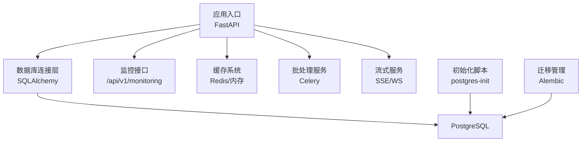
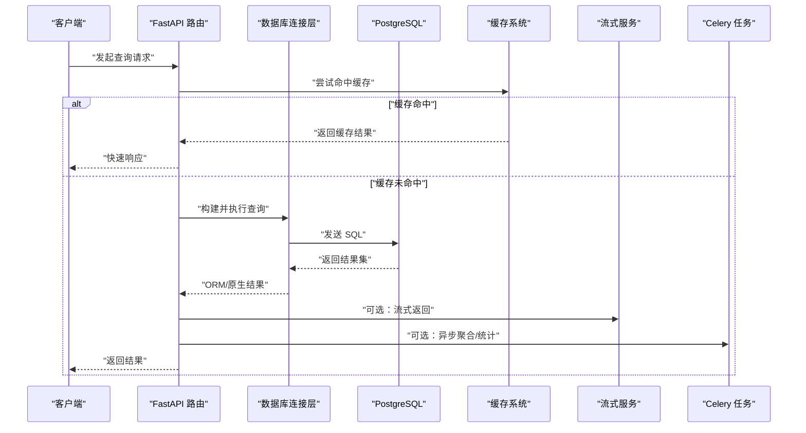
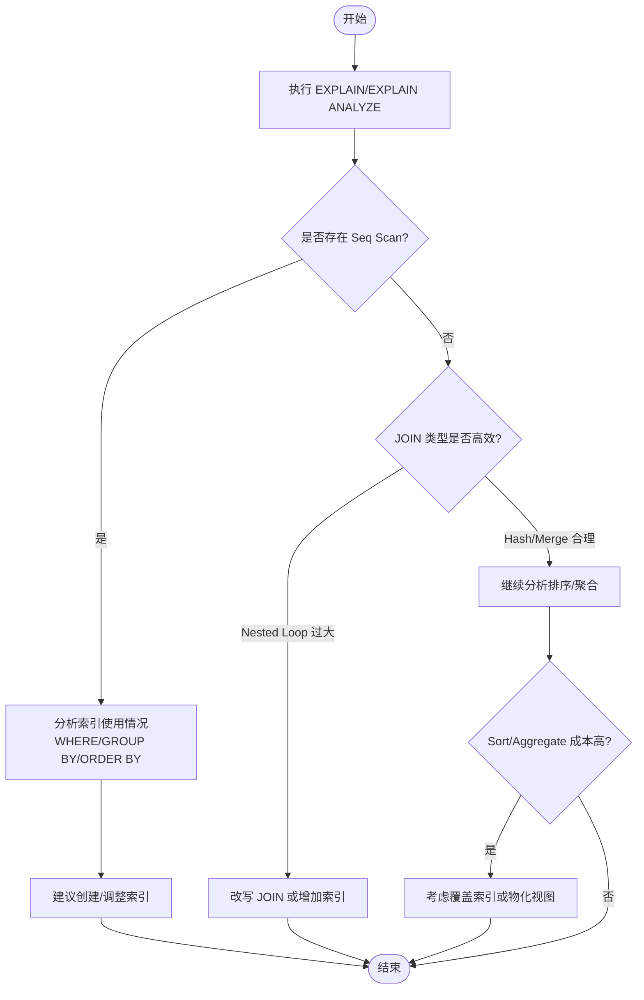
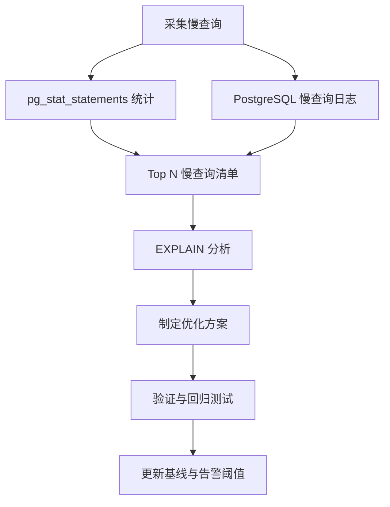
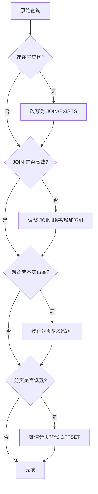
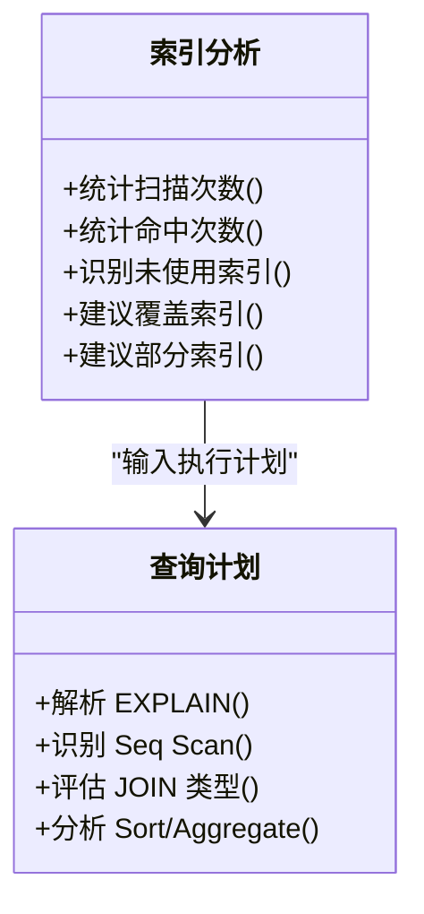
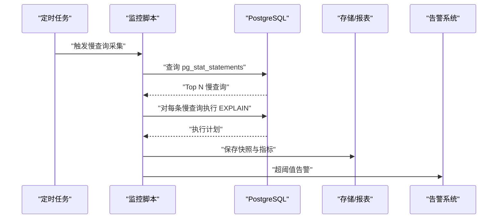
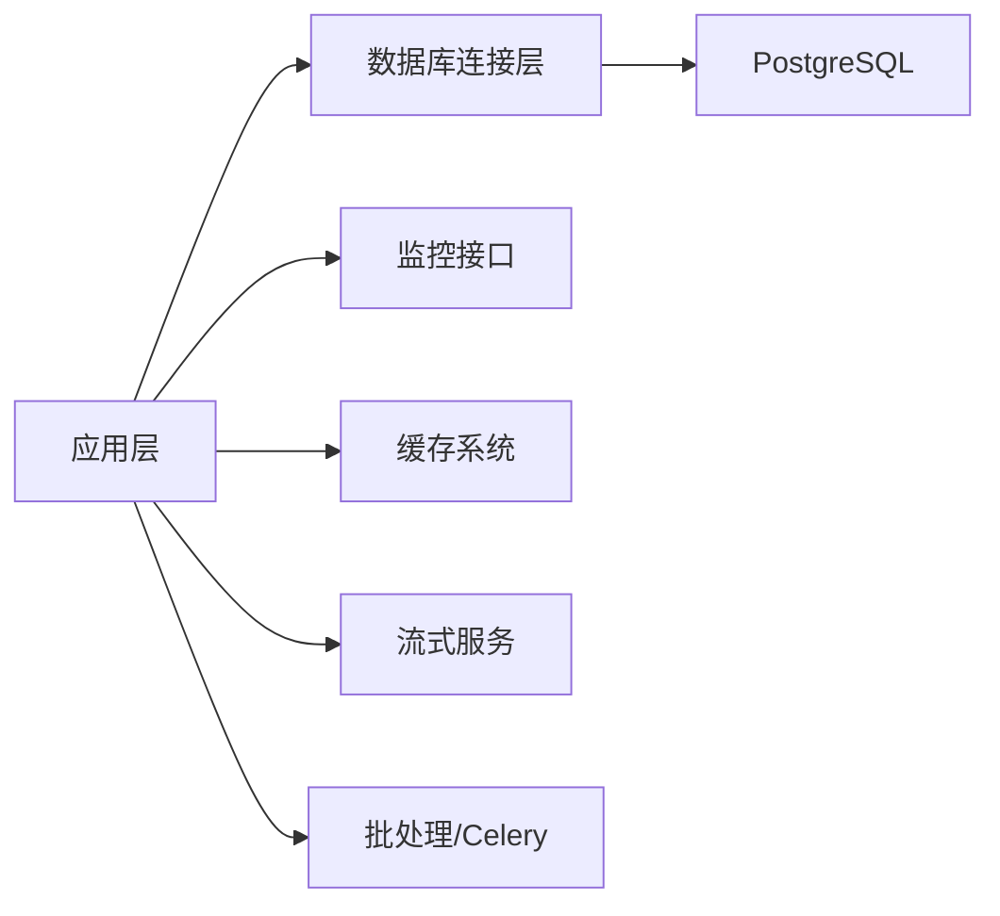

# 查询优化技巧

<cite>
**本文引用的文件**   
- [backend/app/db/base.py](file://backend/app/db/base.py)
- [backend/app/core/config.py](file://backend/app/core/config.py)
- [backend/app/api/v1/monitoring.py](file://backend/app/api/v1/monitoring.py)
- [alembic.ini](file://alembic.ini)
- [postgres-init/01-init.sql](file://postgres-init/01-init.sql)
- [backend/app/utils/sql_validator.py](file://backend/app/utils/sql_validator.py)
- [backend/app/services/cache_system.py](file://backend/app/services/cache_system.py)
- [backend/app/services/batch_processor.py](file://backend/app/services/batch_processor.py)
- [backend/app/services/streaming_service.py](file://backend/app/services/streaming_service.py)
- [backend/app/celery_app.py](file://backend/app/celery_app.py)
- [docker-compose.yml](file://docker-compose.yml)
</cite>

## 目录
1. [简介](#简介)
2. [项目结构](#项目结构)
3. [核心组件](#核心组件)
4. [架构总览](#架构总览)
5. [详细组件分析](#详细组件分析)
6. [依赖关系分析](#依赖关系分析)
7. [性能考量](#性能考量)
8. [故障排查指南](#故障排查指南)
9. [结论](#结论)
10. [附录](#附录)

## 简介
本文件面向小说创作代理系统的数据库查询优化，聚焦 PostgreSQL 的 EXPLAIN 执行计划解读、慢查询识别与治理、索引使用分析与查询重写策略。文档提供可操作的实践方法、监控与基线建立流程，以及常见场景的重写案例与效果评估建议，帮助团队在复杂业务中持续降低延迟、提升吞吐并稳定资源消耗。

## 项目结构
本项目后端基于 FastAPI + SQLAlchemy（Alembic 迁移）+ Celery 异步任务，PostgreSQL 作为主存储。与数据库查询优化相关的代码主要分布在：
- 数据库连接与配置：backend/app/db/base.py、backend/app/core/config.py
- SQL 校验工具：backend/app/utils/sql_validator.py
- 监控接口：backend/app/api/v1/monitoring.py
- 缓存与批处理服务：backend/app/services/cache_system.py、backend/app/services/batch_processor.py
- 流式输出服务：backend/app/services/streaming_service.py
- 异步任务调度：backend/app/celery_app.py
- 初始化脚本与迁移：postgres-init/01-init.sql、alembic.ini
- 容器编排：docker-compose.yml

**图表来源** 
- [backend/app/db/base.py](file://backend/app/db/base.py)
- [backend/app/core/config.py](file://backend/app/core/config.py)
- [backend/app/api/v1/monitoring.py](file://backend/app/api/v1/monitoring.py)
- [backend/app/services/cache_system.py](file://backend/app/services/cache_system.py)
- [backend/app/services/batch_processor.py](file://backend/app/services/batch_processor.py)
- [backend/app/services/streaming_service.py](file://backend/app/services/streaming_service.py)
- [backend/app/celery_app.py](file://backend/app/celery_app.py)
- [postgres-init/01-init.sql](file://postgres-init/01-init.sql)
- [alembic.ini](file://alembic.ini)

**章节来源**
- [backend/app/db/base.py](file://backend/app/db/base.py)
- [backend/app/core/config.py](file://backend/app/core/config.py)
- [backend/app/api/v1/monitoring.py](file://backend/app/api/v1/monitoring.py)
- [postgres-init/01-init.sql](file://postgres-init/01-init.sql)
- [alembic.ini](file://alembic.ini)

## 核心组件
- 数据库连接与会话管理：负责连接池、事务边界、会话生命周期，直接影响查询并发与锁竞争。
- SQL 校验器：用于拦截危险或低效 SQL，辅助上线前质量门禁。
- 监控接口：暴露系统运行指标，便于集成外部监控与告警。
- 缓存系统：通过缓存热点数据减少重复查询，降低数据库压力。
- 批处理服务：将大查询拆分为批次，避免长事务与大结果集。
- 流式服务：对大数据量查询采用流式返回，降低峰值内存占用。
- 异步任务：将耗时查询与聚合计算下沉到后台任务，提升前端响应速度。

**章节来源**
- [backend/app/db/base.py](file://backend/app/db/base.py)
- [backend/app/utils/sql_validator.py](file://backend/app/utils/sql_validator.py)
- [backend/app/api/v1/monitoring.py](file://backend/app/api/v1/monitoring.py)
- [backend/app/services/cache_system.py](file://backend/app/services/cache_system.py)
- [backend/app/services/batch_processor.py](file://backend/app/services/batch_processor.py)
- [backend/app/services/streaming_service.py](file://backend/app/services/streaming_service.py)
- [backend/app/celery_app.py](file://backend/app/celery_app.py)

## 架构总览
下图展示了从请求进入、查询执行到结果返回的关键路径，以及监控、缓存、批处理与异步任务的协作方式。

**图表来源** 
- [backend/app/api/v1/monitoring.py](file://backend/app/api/v1/monitoring.py)
- [backend/app/db/base.py](file://backend/app/db/base.py)
- [backend/app/services/cache_system.py](file://backend/app/services/cache_system.py)
- [backend/app/services/streaming_service.py](file://backend/app/services/streaming_service.py)
- [backend/app/celery_app.py](file://backend/app/celery_app.py)

## 详细组件分析

### EXPLAIN 执行计划解读与全表扫描识别
- 目标：通过 EXPLAIN/EXPLAIN ANALYZE 获取执行计划，识别全表扫描、低效 JOIN、排序与聚合瓶颈。
- 关键指标：
  - Seq Scan（顺序扫描）：通常意味着缺少合适索引或过滤条件无法利用索引。
  - Index Scan/Index Only Scan：表明索引被有效使用。
  - Nested Loop vs Hash Join vs Merge Join：根据数据规模选择不同连接算法。
  - Sort/Aggregate：注意排序与聚合的成本，必要时引入覆盖索引或物化视图。
- 实践步骤：
  - 对慢查询执行 EXPLAIN ANALYZE，关注实际行数与预估行数偏差。
  - 检查 WHERE/HAVING/GROUP BY/ORDER BY 是否命中索引列。
  - 针对大表 JOIN，优先确保关联键有索引且选择性良好。
  - 对分页查询，避免 OFFSET 过大，改用“游标”或“键值分页”。

**图表来源** 
- [backend/app/utils/sql_validator.py](file://backend/app/utils/sql_validator.py)
- [backend/app/db/base.py](file://backend/app/db/base.py)

**章节来源**
- [backend/app/utils/sql_validator.py](file://backend/app/utils/sql_validator.py)
- [backend/app/db/base.py](file://backend/app/db/base.py)

### 慢查询识别：pg_stat_statements、日志记录与基线建立
- pg_stat_statements：
  - 启用扩展后，按 queryid 聚合统计调用次数、总耗时、平均耗时、最大耗时等。
  - 定期导出 Top N 慢查询，结合 EXPLAIN 分析。
- 慢查询日志：
  - 设置 log_min_duration_statement，记录超过阈值的 SQL 及上下文。
  - 配合结构化日志与追踪 ID，定位问题链路。
- 性能基线：
  - 以历史数据建立 P50/P95/P99 延迟基线，监控回归。
  - 对关键接口建立 SLI/SLO，纳入告警体系。

**图表来源** 
- [backend/app/api/v1/monitoring.py](file://backend/app/api/v1/monitoring.py)
- [docker-compose.yml](file://docker-compose.yml)

**章节来源**
- [backend/app/api/v1/monitoring.py](file://backend/app/api/v1/monitoring.py)
- [docker-compose.yml](file://docker-compose.yml)

### 查询重写技巧：子查询、JOIN、聚合与分页
- 子查询优化：
  - 将相关子查询改写为 JOIN 或 EXISTS，减少重复扫描。
  - 避免在 SELECT 中使用非确定性函数导致无法缓存。
- JOIN 优化：
  - 确保关联键有索引；小表驱动大表时优先使用嵌套循环。
  - 对多表 JOIN，先过滤再连接，减少中间结果集大小。
- 聚合查询优化：
  - GROUP BY 字段加索引或使用部分索引。
  - 对频繁聚合结果使用物化视图或增量刷新。
- 分页查询优化：
  - 避免大 OFFSET，改用“上次最后一条记录的键值”进行分页。
  - 对排序字段建立索引，必要时使用复合索引匹配 ORDER BY。

**图表来源** 
- [backend/app/utils/sql_validator.py](file://backend/app/utils/sql_validator.py)
- [backend/app/services/cache_system.py](file://backend/app/services/cache_system.py)

**章节来源**
- [backend/app/utils/sql_validator.py](file://backend/app/utils/sql_validator.py)
- [backend/app/services/cache_system.py](file://backend/app/services/cache_system.py)

### 索引使用情况分析
- 查看索引命中率与扫描次数：
  - 使用 pg_stat_user_indexes 与 pg_statio_user_indexes 评估索引有效性。
- 识别无效/冗余索引：
  - 长期未被使用的索引应评估删除，降低写入开销。
- 覆盖索引与部分索引：
  - 对高频查询的投影列与过滤条件设计覆盖索引。
  - 对特定条件的高频查询使用部分索引减少体积。

**图表来源** 
- [backend/app/utils/sql_validator.py](file://backend/app/utils/sql_validator.py)
- [backend/app/db/base.py](file://backend/app/db/base.py)

**章节来源**
- [backend/app/utils/sql_validator.py](file://backend/app/utils/sql_validator.py)
- [backend/app/db/base.py](file://backend/app/db/base.py)

### 监控与基线脚本（概念性说明）
- 慢查询监控脚本：
  - 定时读取 pg_stat_statements，导出 Top N 慢查询。
  - 对每条慢查询生成 EXPLAIN 快照，保存至对象存储或数据库。
  - 对比历史基线，标记回归趋势。
- 优化建议生成：
  - 基于执行计划与索引统计，自动生成索引建议、改写建议。
  - 输出报告包含：问题描述、影响范围、建议措施、预期收益。

[本图为概念流程图，不直接映射具体源码文件]

## 依赖关系分析
- 应用层依赖数据库连接层，连接层依赖 PostgreSQL。
- 监控接口依赖数据库统计视图与系统指标。
- 缓存系统与流式服务降低数据库负载，提升用户体验。
- 批处理与异步任务分担实时查询压力。

**图表来源** 
- [backend/app/db/base.py](file://backend/app/db/base.py)
- [backend/app/api/v1/monitoring.py](file://backend/app/api/v1/monitoring.py)
- [backend/app/services/cache_system.py](file://backend/app/services/cache_system.py)
- [backend/app/services/streaming_service.py](file://backend/app/services/streaming_service.py)
- [backend/app/services/batch_processor.py](file://backend/app/services/batch_processor.py)
- [backend/app/celery_app.py](file://backend/app/celery_app.py)

**章节来源**
- [backend/app/db/base.py](file://backend/app/db/base.py)
- [backend/app/api/v1/monitoring.py](file://backend/app/api/v1/monitoring.py)
- [backend/app/services/cache_system.py](file://backend/app/services/cache_system.py)
- [backend/app/services/streaming_service.py](file://backend/app/services/streaming_service.py)
- [backend/app/services/batch_processor.py](file://backend/app/services/batch_processor.py)
- [backend/app/celery_app.py](file://backend/app/celery_app.py)

## 性能考量
- 连接池与并发：合理设置连接池大小，避免连接耗尽与锁竞争。
- 事务边界：缩短事务时间，减少锁持有时长。
- 结果集大小：限制返回行数，使用分页与流式传输。
- 缓存策略：热点数据缓存，降低重复查询。
- 异步化：将耗时操作放入后台任务，提升响应速度。
- 索引维护：定期分析索引使用率，清理无用索引，重建碎片索引。

[本节为通用指导，不直接分析具体文件]

## 故障排查指南
- 常见问题：
  - 全表扫描：检查 WHERE 条件与索引设计。
  - 慢 JOIN：确认关联键索引与数据分布。
  - 排序/聚合慢：考虑覆盖索引或物化视图。
  - 分页慢：改用键值分页。
- 排查步骤：
  - 启用慢查询日志与 pg_stat_statements。
  - 收集 EXPLAIN 快照，对比历史基线。
  - 检查索引使用统计，识别缺失或冗余索引。
  - 逐步优化并回归测试，更新基线与告警阈值。

**章节来源**
- [backend/app/api/v1/monitoring.py](file://backend/app/api/v1/monitoring.py)
- [backend/app/utils/sql_validator.py](file://backend/app/utils/sql_validator.py)

## 结论
通过系统化的 EXPLAIN 分析、慢查询治理与查询重写策略，结合缓存、批处理与异步化手段，可以显著提升小说创作代理系统的数据库性能与稳定性。建议建立完善的监控与基线体系，持续迭代优化，确保在高并发与大数据量场景下的服务质量。

[本节为总结，不直接分析具体文件]

## 附录
- 常用命令与视图：
  - EXPLAIN/EXPLAIN ANALYZE
  - pg_stat_statements
  - pg_stat_user_indexes
  - pg_statio_user_indexes
- 最佳实践：
  - 始终对慢查询进行 EXPLAIN 分析。
  - 建立性能基线与回归检测。
  - 谨慎设计索引，避免过度索引。
  - 使用缓存与异步化降低数据库压力。

[本节为补充信息，不直接分析具体文件]