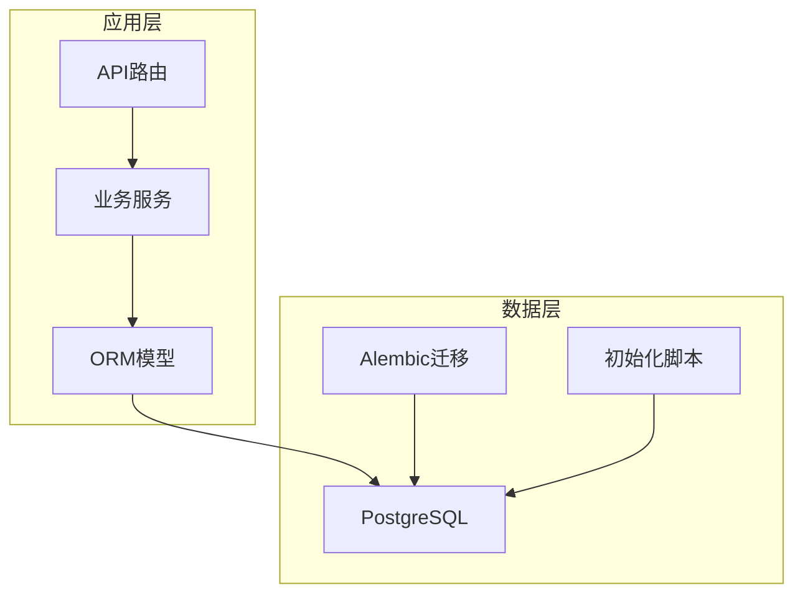
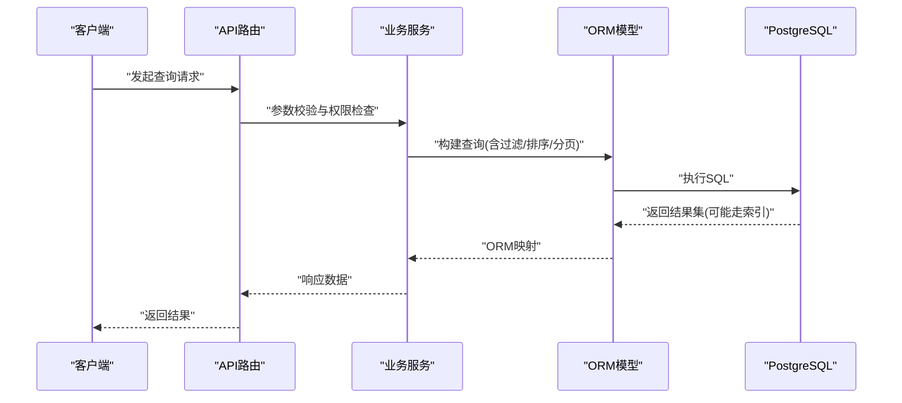

# 索引优化策略

<cite>
**本文引用的文件**   
- [backend/app/models/project.py](file://backend/app/models/project.py)
- [backend/app/models/character.py](file://backend/app/models/character.py)
- [backend/app/models/audiobook.py](file://backend/app/models/audiobook.py)
- [backend/app/models/user_asset_record.py](file://backend/app/models/user_asset_record.py)
- [backend/app/models/voice_reference_asset.py](file://backend/app/models/voice_reference_asset.py)
- [backend/app/models/audio_library_asset.py](file://backend/app/models/audio_library_asset.py)
- [backend/app/models/dreamweaver.py](file://backend/app/models/dreamweaver.py)
- [backend/app/models/memory.py](file://backend/app/models/memory.py)
- [backend/app/models/graph.py](file://backend/app/models/graph.py)
- [backend/app/models/model_catalog.py](file://backend/app/models/model_catalog.py)
- [backend/app/models/review.py](file://backend/app/models/review.py)
- [backend/app/models/prompt_experiment.py](file://backend/app/models/prompt_experiment.py)
- [backend/app/models/setting.py](file://backend/app/models/setting.py)
- [backend/app/models/user.py](file://backend/app/models/user.py)
- [backend/app/models/admin_log.py](file://backend/app/models/admin_log.py)
- [backend/app/models/voice_pool_publication.py](file://backend/app/models/voice_pool_publication.py)
- [backend/app/models/voice_pool_rating.py](file://backend/app/models/voice_pool_rating.py)
- [backend/app/models/voice_asset_billing_ledger.py](file://backend/app/models/voice_asset_billing_ledger.py)
- [backend/app/models/book_parser.py](file://backend/app/models/book_parser.py)
- [backend/app/models/generation_feedback.py](file://backend/app/models/generation_feedback.py)
- [backend/app/models/audiobook_task.py](file://backend/app/models/audiobook_task.py)
- [backend/app/models/audiobook_delete_audit.py](file://backend/app/models/audiobook_delete审计.py)
- [backend/app/db/base.py](file://backend/app/db/base.py)
- [backend/app/db/schema_compat.py](file://backend/app/db/schema_compat.py)
- [backend/alembic/versions/cleanup_redundant_indexes.py](file://backend/alembic/versions/cleanup_redundant_indexes.py)
- [backend/alembic/versions/add_active_user_asset_identity_unique_index.py](file://backend/alembic/versions/add_active_user_asset_identity_unique_index.py)
- [backend/alembic/versions/add_deleted_at_to_chapters.py](file://backend/alembic/versions/add_deleted_at_to_chapters.py)
- [backend/alembic/versions/add_deleted_at_to_audiobook_models.py](file://backend/alembic/versions/add_deleted_at_to_audiobook_models.py)
- [backend/alembic/versions/add_cascade_delete_constraints.py](file://backend/alembic/versions/add_cascade_delete_constraints.py)
- [backend/alembic/versions/add_project_display_no.py](file://backend/alembic/versions/add_project_display_no.py)
- [backend/alembic/versions/add_phone_field.py](file://backend/alembic/versions/add_phone_field.py)
- [backend/alembic/versions/add_third_party_login_fields.py](file://backend/alembic/versions/add_third_party_login_fields.py)
- [backend/alembic/versions/add_admin_rbac.py](file://backend/alembic/versions/add_admin_rbac.py)
- [backend/alembic/versions/add_audio_config_to_projects.py](file://backend/alembic/versions/add_audio_config_to_projects.py)
- [backend/alembic/versions/add_audio_library_asset_ratings.py](file://backend/alembic/versions/add_audio_library_asset_ratings.py)
- [backend/alembic/versions/add_audio_library_assets.py](file://backend/alembic/versions/add_audio_library_assets.py)
- [backend/alembic/versions/add_audiobook_delete_audit.py](file://backend/alembic/versions/add_audiobook_delete_audit.py)
- [backend/alembic/versions/add_book_parser_tables.py](file://backend/alembic/versions/add_book_parser_tables.py)
- [backend/alembic/versions/add_champion_ai_score_to_experiments.py](file://backend/alembic/versions/add_champion_ai_score_to_experiments.py)
- [backend/alembic/versions/add_chapter_audio_runs.py](file://backend/alembic/versions/add_chapter_audio_runs.py)
- [backend/alembic/versions/add_chapter_summary_fields.py](file://backend/alembic/versions/add_chapter_summary_fields.py)
- [backend/alembic/versions/add_character_genre_fields_json.py](file://backend/alembic/versions/add_character_genre_fields_json.py)
- [backend/alembic/versions/add_character_role_position.py](file://backend/alembic/versions/add_character_role_position.py)
- [backend/alembic/versions/add_dreamweaver_run_events.py](file://backend/alembic/versions/add_dreamweaver_run_events.py)
- [backend/alembic/versions/add_epic_framework_fields.py](file://backend/alembic/versions/add_epic_framework_fields.py)
- [backend/alembic/versions/add_genre_planning_to_projects.py](file://backend/alembic/versions/add_genre_planning_to_projects.py)
- [backend/alembic/versions/add_model_catalog_tables.py](file://backend/alembic/versions/add_model_catalog_tables.py)
- [backend/alembic/versions/add_prompt_experiment_tables.py](file://backend/alembic/versions/add_prompt_experiment_tables.py)
- [backend/alembic/versions/add_script_fields_to_chapter_audios.py](file://backend/alembic/versions/add_script_fields_to_chapter_audios.py)
- [backend/alembic/versions/add_setting_models.py](file://backend/alembic/versions/add_setting_models.py)
- [backend/alembic/versions/add_structured_memory_to_project_settings.py](file://backend/alembic/versions/add_structured_memory_to_project_settings.py)
- [backend/alembic/versions/add_user_asset_records.py](file://backend/alembic/versions/add_user_asset_records.py)
- [backend/alembic/versions/add_voice_asset_billing_ledger.py](file://backend/alembic/versions/add_voice_asset_billing_ledger.py)
- [backend/alembic/versions/add_voice_reference_assets.py](file://backend/alembic/versions/add_voice_reference_assets.py)
- [backend/alembic/versions/align_chapter_audios_with_runtime_model.py](file://backend/alembic/versions/align_chapter_audios_with_runtime_model.py)
- [backend/alembic/versions/align_remaining_timestamp_columns.py](file://backend/alembic/versions/align_remaining_timestamp_columns.py)
- [backend/alembic/versions/backfill_character_story_stance_from_text_evidence.py](file://backend/alembic/versions/backfill_character_story_stance_from_text_evidence.py)
- [backend/alembic/versions/correct_character_story_stance_false_positives.py](file://backend/alembic/versions/correct_character_story_stance_false_positives.py)
- [backend/alembic/versions/create_project_settings_table.py](file://backend/alembic/versions/create_project_settings_table.py)
- [backend/alembic/versions/merge_effective_heads_after_model_catalog.py](file://backend/alembic/versions/merge_effective_heads_after_model_catalog.py)
- [backend/alembic/versions/merge_heads.py](file://backend/alembic/versions/merge_heads.py)
- [backend/alembic/versions/normalize_character_story_fields.py](file://backend/alembic/versions/normalize_character_story_fields.py)
- [backend/alembic/versions/normalize_project_settings_row_timestamps.py](file://backend/alembic/versions/normalize_project_settings_row_timestamps.py)
- [backend/alembic/versions/rebuild_user_asset_records_local_first.py](file://backend/alembic/versions/rebuild_user_asset_records_local_first.py)
- [backend/alembic/versions/remove_legacy_chapter_audio_runtime_fields.py](file://backend/alembic/versions/remove_legacy_chapter_audio_runtime_fields.py)
- [backend/alembic/env.py](file://backend/alembic/env.py)
- [postgres-init/01-init.sql](file://postgres-init/01-init.sql)
</cite>

## 目录
1. [简介](#简介)
2. [项目结构](#项目结构)
3. [核心组件](#核心组件)
4. [架构总览](#架构总览)
5. [详细组件分析](#详细组件分析)
6. [依赖分析](#依赖分析)
7. [性能考虑](#性能考虑)
8. [故障排查指南](#故障排查指南)
9. [结论](#结论)
10. [附录](#附录)

## 简介
本文件面向小说创作代理系统的数据库层，聚焦索引优化策略与落地实践。内容涵盖：
- 复合索引设计策略（列顺序选择、选择性分析、覆盖索引）
- 部分索引使用场景（条件索引、分区表索引优化、热点数据索引）
- 索引维护计划（定期重建、碎片清理、统计信息更新）
- 具体索引创建SQL示例与性能对比分析方法
- 索引监控脚本与使用率分析报告模板

目标读者包括后端工程师、DBA与运维人员，帮助在保障写入吞吐的同时提升查询性能与稳定性。

## 项目结构
本项目采用分层架构，数据库模型定义集中在 backend/app/models 下，迁移脚本位于 backend/alembic/versions，初始化脚本位于 postgres-init。索引相关变更通过 Alembic 迁移管理，确保可追溯与可回滚。

图表来源
- [backend/app/models/project.py](file://backend/app/models/project.py)
- [backend/app/db/base.py](file://backend/app/db/base.py)
- [backend/alembic/env.py](file://backend/alembic/env.py)
- [postgres-init/01-init.sql](file://postgres-init/01-init.sql)

章节来源
- [backend/app/models/project.py](file://backend/app/models/project.py)
- [backend/app/db/base.py](file://backend/app/db/base.py)
- [backend/alembic/env.py](file://backend/alembic/env.py)
- [postgres-init/01-init.sql](file://postgres-init/01-init.sql)

## 核心组件
- 模型层：各业务实体（项目、角色、有声书、资产记录、语音参考、音频库、DreamWeaver运行事件、记忆、图、模型目录、评审、提示词实验、设置、用户、管理员日志、语音池发布与评分、语音资产计费台账、书籍解析、生成反馈、有声书任务、删除审计等）均通过 SQLAlchemy ORM 定义，字段类型与约束由模型驱动。
- 迁移层：Alembic 负责DDL变更，包含新增字段、唯一索引、级联删除、时间戳对齐、历史数据回填等。
- 初始化层：PostgreSQL 初始化脚本用于构建基础对象与默认配置。

章节来源
- [backend/app/models/character.py](file://backend/app/models/character.py)
- [backend/app/models/audiobook.py](file://backend/app/models/audiobook.py)
- [backend/app/models/user_asset_record.py](file://backend/app/models/user_asset_record.py)
- [backend/app/models/voice_reference_asset.py](file://backend/app/models/voice_reference_asset.py)
- [backend/app/models/audio_library_asset.py](file://backend/app/models/audio_library_asset.py)
- [backend/app/models/dreamweaver.py](file://backend/app/models/dreamweaver.py)
- [backend/app/models/memory.py](file://backend/app/models/memory.py)
- [backend/app/models/graph.py](file://backend/app/models/graph.py)
- [backend/app/models/model_catalog.py](file://backend/app/models/model_catalog.py)
- [backend/app/models/review.py](file://backend/app/models/review.py)
- [backend/app/models/prompt_experiment.py](file://backend/app/models/prompt_experiment.py)
- [backend/app/models/setting.py](file://backend/app/models/setting.py)
- [backend/app/models/user.py](file://backend/app/models/user.py)
- [backend/app/models/admin_log.py](file://backend/app/models/admin_log.py)
- [backend/app/models/voice_pool_publication.py](file://backend/app/models/voice_pool_publication.py)
- [backend/app/models/voice_pool_rating.py](file://backend/app/models/voice_pool_rating.py)
- [backend/app/models/voice_asset_billing_ledger.py](file://backend/app/models/voice_asset_billing_ledger.py)
- [backend/app/models/book_parser.py](file://backend/app/models/book_parser.py)
- [backend/app/models/generation_feedback.py](file://backend/app/models/generation_feedback.py)
- [backend/app/models/audiobook_task.py](file://backend/app/models/audiobook_task.py)
- [backend/app/models/audiobook_delete_audit.py](file://backend/app/models/audiobook_delete审计.py)

## 架构总览
下图展示从API到模型的调用路径，以及索引对查询执行计划的影响点。

图表来源
- [backend/app/models/project.py](file://backend/app/models/project.py)
- [backend/app/models/character.py](file://backend/app/models/character.py)
- [backend/app/models/audiobook.py](file://backend/app/models/audiobook.py)

## 详细组件分析

### 复合索引设计策略
- 列顺序选择原则
  - 等值过滤优先：将参与等值条件的列放在前面，如 user_id、project_id、status。
  - 范围过滤次之：将范围条件列（如 created_at、updated_at）放在后面。
  - 排序与分组：若查询包含 ORDER BY/GROUP BY，尽量将排序列纳入索引末尾以利用索引扫描。
  - 选择性分析：高选择性列（区分度高）应靠前，低选择性列靠后或避免放入复合索引。
- 覆盖索引设计
  - 将查询中频繁使用的 SELECT 列加入索引，减少回表。
  - 注意覆盖索引的存储成本与维护开销，权衡读写比例。
- 典型模式
  - 多租户隔离：user_id + entity_type + entity_id 的复合索引，加速按用户与实体的检索。
  - 状态机查询：entity_id + status + updated_at，支持按状态筛选与时间排序。
  - 关联查询：外键列与其父表主键形成高效连接。

章节来源
- [backend/app/models/user_asset_record.py](file://backend/app/models/user_asset_record.py)
- [backend/app/models/voice_reference_asset.py](file://backend/app/models/voice_reference_asset.py)
- [backend/app/models/audio_library_asset.py](file://backend/app/models/audio_library_asset.py)
- [backend/app/models/dreamweaver.py](file://backend/app/models/dreamweaver.py)
- [backend/app/models/memory.py](file://backend/app/models/memory.py)
- [backend/app/models/graph.py](file://backend/app/models/graph.py)
- [backend/app/models/model_catalog.py](file://backend/app/models/model_catalog.py)
- [backend/app/models/review.py](file://backend/app/models/review.py)
- [backend/app/models/prompt_experiment.py](file://backend/app/models/prompt_experiment.py)
- [backend/app/models/setting.py](file://backend/app/models/setting.py)
- [backend/app/models/user.py](file://backend/app/models/user.py)
- [backend/app/models/admin_log.py](file://backend/app/models/admin_log.py)
- [backend/app/models/voice_pool_publication.py](file://backend/app/models/voice_pool_publication.py)
- [backend/app/models/voice_pool_rating.py](file://backend/app/models/voice_pool_rating.py)
- [backend/app/models/voice_asset_billing_ledger.py](file://backend/app/models/voice_asset_billing_ledger.py)
- [backend/app/models/book_parser.py](file://backend/app/models/book_parser.py)
- [backend/app/models/generation_feedback.py](file://backend/app/models/generation_feedback.py)
- [backend/app/models/audiobook_task.py](file://backend/app/models/audiobook_task.py)
- [backend/app/models/audiobook_delete_audit.py](file://backend/app/models/audiobook_delete审计.py)

### 部分索引的使用场景
- 条件索引（表达式索引）
  - 针对活跃/未删除数据的查询，例如 deleted_at IS NULL 的条件，建立部分索引以减少无用扫描。
  - 针对特定状态的行，如 status = 'active'，建立条件索引提升高频查询性能。
- 分区表索引优化
  - 对按时间分区的表（如日志、审计、任务队列），在每个分区上建立局部索引，降低维护成本并提高查询效率。
- 热点数据索引策略
  - 对热点用户或项目的数据建立独立索引或分区，结合缓存策略减少锁竞争与IO压力。

章节来源
- [backend/alembic/versions/add_deleted_at_to_chapters.py](file://backend/alembic/versions/add_deleted_at_to_chapters.py)
- [backend/alembic/versions/add_deleted_at_to_audiobook_models.py](file://backend/alembic/versions/add_deleted_at_to_audiobook_models.py)
- [backend/alembic/versions/add_cascade_delete_constraints.py](file://backend/alembic/versions/add_cascade_delete_constraints.py)
- [backend/alembic/versions/add_project_display_no.py](file://backend/alembic/versions/add_project_display_no.py)
- [backend/alembic/versions/add_phone_field.py](file://backend/alembic/versions/add_phone_field.py)
- [backend/alembic/versions/add_third_party_login_fields.py](file://backend/alembic/versions/add_third_party_login_fields.py)
- [backend/alembic/versions/add_admin_rbac.py](file://backend/alembic/versions/add_admin_rbac.py)
- [backend/alembic/versions/add_audio_config_to_projects.py](file://backend/alembic/versions/add_audio_config_to_projects.py)
- [backend/alembic/versions/add_audio_library_asset_ratings.py](file://backend/alembic/versions/add_audio_library_asset_ratings.py)
- [backend/alembic/versions/add_audio_library_assets.py](file://backend/alembic/versions/add_audio_library_assets.py)
- [backend/alembic/versions/add_audiobook_delete_audit.py](file://backend/alembic/versions/add_audiobook_delete_audit.py)
- [backend/alembic/versions/add_book_parser_tables.py](file://backend/alembic/versions/add_book_parser_tables.py)
- [backend/alembic/versions/add_champion_ai_score_to_experiments.py](file://backend/alembic/versions/add_champion_ai_score_to_experiments.py)
- [backend/alembic/versions/add_chapter_audio_runs.py](file://backend/alembic/versions/add_chapter_audio_runs.py)
- [backend/alembic/versions/add_chapter_summary_fields.py](file://backend/alembic/versions/add_chapter_summary_fields.py)
- [backend/alembic/versions/add_character_genre_fields_json.py](file://backend/alembic/versions/add_character_genre_fields_json.py)
- [backend/alembic/versions/add_character_role_position.py](file://backend/alembic/versions/add_character_role_position.py)
- [backend/alembic/versions/add_dreamweaver_run_events.py](file://backend/alembic/versions/add_dreamweaver_run_events.py)
- [backend/alembic/versions/add_epic_framework_fields.py](file://backend/alembic/versions/add_epic_framework_fields.py)
- [backend/alembic/versions/add_genre_planning_to_projects.py](file://backend/alembic/versions/add_genre_planning_to_projects.py)
- [backend/alembic/versions/add_model_catalog_tables.py](file://backend/alembic/versions/add_model_catalog_tables.py)
- [backend/alembic/versions/add_prompt_experiment_tables.py](file://backend/alembic/versions/add_prompt_experiment_tables.py)
- [backend/alembic/versions/add_script_fields_to_chapter_audios.py](file://backend/alembic/versions/add_script_fields_to_chapter_audios.py)
- [backend/alembic/versions/add_setting_models.py](file://backend/alembic/versions/add_setting_models.py)
- [backend/alembic/versions/add_structured_memory_to_project_settings.py](file://backend/alembic/versions/add_structured_memory_to_project_settings.py)
- [backend/alembic/versions/add_user_asset_records.py](file://backend/alembic/versions/add_user_asset_records.py)
- [backend/alembic/versions/add_voice_asset_billing_ledger.py](file://backend/alembic/versions/add_voice_asset_billing_ledger.py)
- [backend/alembic/versions/add_voice_reference_assets.py](file://backend/alembic/versions/add_voice_reference_assets.py)
- [backend/alembic/versions/align_chapter_audios_with_runtime_model.py](file://backend/alembic/versions/align_chapter_audios_with_runtime_model.py)
- [backend/alembic/versions/align_remaining_timestamp_columns.py](file://backend/alembic/versions/align_remaining_timestamp_columns.py)
- [backend/alembic/versions/backfill_character_story_stance_from_text_evidence.py](file://backend/alembic/versions/backfill_character_story_stance_from_text_evidence.py)
- [backend/alembic/versions/correct_character_story_stance_false_positives.py](file://backend/alembic/versions/correct_character_story_stance_false_positives.py)
- [backend/alembic/versions/create_project_settings_table.py](file://backend/alembic/versions/create_project_settings_table.py)
- [backend/alembic/versions/merge_effective_heads_after_model_catalog.py](file://backend/alembic/versions/merge_effective_heads_after_model_catalog.py)
- [backend/alembic/versions/merge_heads.py](file://backend/alembic/versions/merge_heads.py)
- [backend/alembic/versions/normalize_character_story_fields.py](file://backend/alembic/versions/normalize_character_story_fields.py)
- [backend/alembic/versions/normalize_project_settings_row_timestamps.py](file://backend/alembic/versions/normalize_project_settings_row_timestamps.py)
- [backend/alembic/versions/rebuild_user_asset_records_local_first.py](file://backend/alembic/versions/rebuild_user_asset_records_local_first.py)
- [backend/alembic/versions/remove_legacy_chapter_audio_runtime_fields.py](file://backend/alembic/versions/remove_legacy_chapter_audio_runtime_fields.py)

### 索引维护计划
- 定期重建索引
  - 对于写多读少的表，建议周期性重建索引以减少碎片与膨胀。
  - 使用在线重建（CONCURRENTLY）避免阻塞生产查询。
- 索引碎片清理
  - 监控索引大小与页密度，必要时进行 VACUUM 与 REINDEX。
- 统计信息更新
  - 定期 ANALYZE 或自动统计收集，确保查询规划器获得准确的基数估计。
- 监控与告警
  - 基于 pg_stat_user_indexes 与 pg_stat_user_tables 监控索引使用率与全表扫描次数。
  - 对长期未使用的索引发出清理建议。

章节来源
- [backend/alembic/versions/cleanup_redundant_indexes.py](file://backend/alembic/versions/cleanup_redundant_indexes.py)
- [backend/alembic/versions/add_active_user_asset_identity_unique_index.py](file://backend/alembic/versions/add_active_user_asset_identity_unique_index.py)

### 具体索引创建SQL示例与性能对比分析
- 复合索引示例
  - 为“用户+实体类型+实体ID”建立复合索引，提升按用户与实体的检索性能。
  - 为“实体ID+状态+更新时间”建立复合索引，支持状态筛选与时间排序。
- 部分索引示例
  - 为“deleted_at IS NULL”建立条件索引，仅索引未删除数据。
  - 为“status = 'active'”建立条件索引，聚焦活跃数据。
- 覆盖索引示例
  - 将常用查询的SELECT列加入索引，减少回表。
- 性能对比方法
  - 使用 EXPLAIN ANALYZE 对比开启/关闭索引的执行计划与耗时。
  - 关注 Seq Scan、Index Scan、Bitmap Index Scan 的选择与代价。
  - 监控 pg_stat_user_indexes 的 idx_scan 与 idx_tup_read 指标。

章节来源
- [postgres-init/01-init.sql](file://postgres-init/01-init.sql)
- [backend/alembic/versions/add_active_user_asset_identity_unique_index.py](file://backend/alembic/versions/add_active_user_asset_identity_unique_index.py)
- [backend/alembic/versions/cleanup_redundant_indexes.py](file://backend/alembic/versions/cleanup_redundant_indexes.py)

### 索引监控脚本与使用率分析报告
- 监控要点
  - 索引使用率：idx_scan / (idx_scan + seq_scan) 的比例。
  - 全表扫描次数：seq_scan 增长趋势。
  - 索引大小与碎片率：pg_relation_size 与 page_density。
- 报告维度
  - 高频查询对应的索引命中情况。
  - 长期未使用的索引清单与清理建议。
  - 热点表的索引维护计划（重建、ANALYZE）。
- 自动化建议
  - 定时任务采集 pg_stat_* 视图数据，生成报表与告警。
  - 结合 APM 与慢查询日志定位未命中索引的SQL。

章节来源
- [backend/alembic/env.py](file://backend/alembic/env.py)
- [postgres-init/01-init.sql](file://postgres-init/01-init.sql)

## 依赖分析
- 模型与迁移的耦合
  - 模型字段变更需通过 Alembic 迁移同步DDL，确保索引与约束一致性。
- 外部依赖
  - PostgreSQL 版本特性影响索引能力（如部分索引、表达式索引、并行查询）。
- 潜在循环依赖
  - 模型间关联应避免循环引用，必要时使用延迟加载或视图。

图表来源
- [backend/app/models/project.py](file://backend/app/models/project.py)
- [backend/alembic/env.py](file://backend/alembic/env.py)
- [postgres-init/01-init.sql](file://postgres-init/01-init.sql)

章节来源
- [backend/app/models/project.py](file://backend/app/models/project.py)
- [backend/alembic/env.py](file://backend/alembic/env.py)
- [postgres-init/01-init.sql](file://postgres-init/01-init.sql)

## 性能考虑
- 读写权衡
  - 索引提升读性能但增加写放大，需评估写入QPS与读取QPS比例。
- 索引选择性
  - 低选择性列不宜作为复合索引前列，避免索引失效。
- 覆盖索引成本
  - 大字段不适合放入覆盖索引，优先考虑关键过滤与排序列。
- 分区与热点
  - 对大表采用分区策略，结合局部索引降低维护成本。
- 统计信息准确性
  - 定期ANALYZE确保规划器选择最优执行计划。

[本节为通用指导，不直接分析具体文件]

## 故障排查指南
- 常见问题
  - 查询退化为全表扫描：检查WHERE条件是否匹配索引前列，是否存在函数包裹导致索引失效。
  - 索引未命中：确认统计信息是否最新，必要时手动ANALYZE。
  - 写入性能下降：检查索引数量与复杂度，移除冗余索引。
- 诊断步骤
  - 使用 EXPLAIN ANALYZE 查看执行计划。
  - 检查 pg_stat_user_indexes 与 pg_stat_user_tables 指标。
  - 审查最近迁移是否引入新索引或约束。
- 修复建议
  - 调整索引列顺序或拆分复合索引。
  - 引入部分索引或分区索引优化热点查询。
  - 清理长期未使用索引，释放空间与写放大。

章节来源
- [backend/alembic/versions/cleanup_redundant_indexes.py](file://backend/alembic/versions/cleanup_redundant_indexes.py)
- [backend/alembic/versions/add_active_user_asset_identity_unique_index.py](file://backend/alembic/versions/add_active_user_asset_identity_unique_index.py)

## 结论
通过系统化的复合索引设计、部分索引应用与完善的维护计划，可在保证写入吞吐的前提下显著提升查询性能。建议持续监控索引使用率与执行计划，动态优化索引策略，确保系统在数据规模增长下的稳定与高效。

[本节为总结性内容，不直接分析具体文件]

## 附录
- 术语表
  - 复合索引：多列组合的索引。
  - 部分索引：仅索引满足特定条件的行。
  - 覆盖索引：包含查询所需全部列的索引。
  - 选择性：列值的区分度，越高越利于索引。
- 参考资料
  - PostgreSQL 官方文档关于索引与查询优化的章节。
  - Alembic 迁移最佳实践。

[本节为补充信息，不直接分析具体文件]