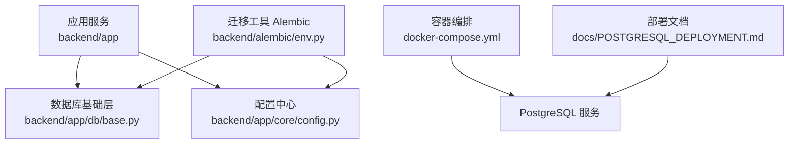
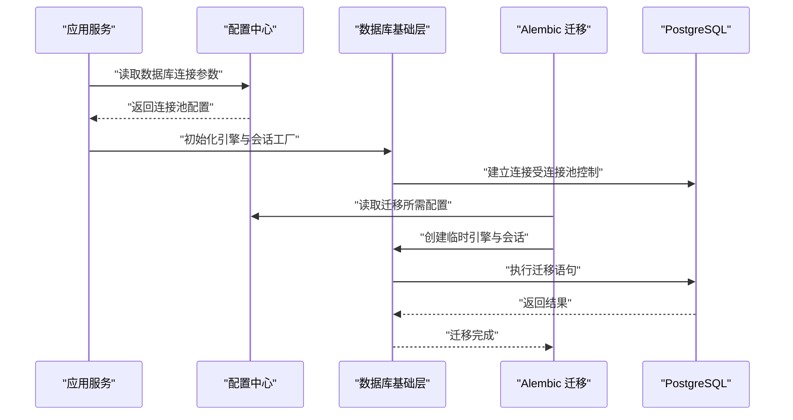
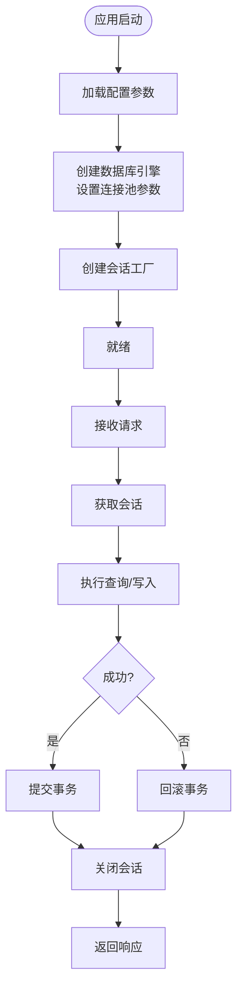
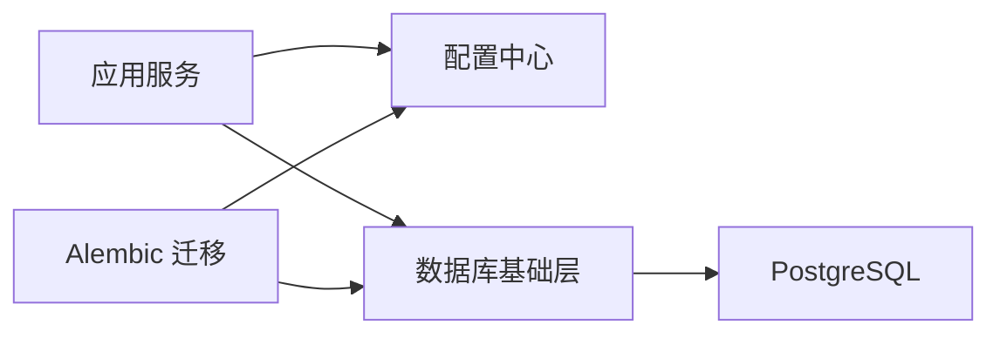

# 连接池配置管理

<cite>
**本文档引用的文件**   
- [backend/app/db/base.py](file://backend/app/db/base.py)
- [backend/app/core/config.py](file://backend/app/core/config.py)
- [backend/alembic/env.py](file://backend/alembic/env.py)
- [docker-compose.yml](file://docker-compose.yml)
- [POSTGRESQL_DEPLOYMENT.md](file://docs/POSTGRESQL_DEPLOYMENT.md)
- [DATABASE_MIGRATION_GUIDE.md](file://DATABASE_MIGRATION_GUIDE.md)
</cite>

## 目录
1. [简介](#简介)
2. [项目结构](#项目结构)
3. [核心组件](#核心组件)
4. [架构总览](#架构总览)
5. [详细组件分析](#详细组件分析)
6. [依赖关系分析](#依赖关系分析)
7. [性能考量](#性能考量)
8. [故障排查指南](#故障排查指南)
9. [结论](#结论)
10. [附录](#附录)

## 简介
本文件面向小说创作代理系统的数据库连接池配置与运维，聚焦以下目标：
- 连接池参数调优：最大连接数、最小连接数、超时时间等关键参数的设置方法与依据。
- 连接泄漏检测：连接状态监控、活跃连接追踪、异常连接清理策略。
- 多环境差异化配置：开发、测试、生产环境的连接池策略与最佳实践。
- 监控指标与告警规则：可观测性指标定义与阈值建议。
- 性能测试与容量规划：压测脚本思路、容量评估方法与扩容建议。

## 项目结构
本项目在后端模块中集中管理数据库连接与迁移：
- 数据库会话与引擎初始化位于后端应用层（db 包）。
- 配置加载与环境变量解析位于核心配置模块。
- Alembic 迁移通过专用入口读取配置并创建引擎与会话。
- 容器编排与部署文档提供运行环境与外部依赖说明。

图表来源
- [backend/app/db/base.py](file://backend/app/db/base.py)
- [backend/app/core/config.py](file://backend/app/core/config.py)
- [backend/alembic/env.py](file://backend/alembic/env.py)
- [docker-compose.yml](file://docker-compose.yml)
- [POSTGRESQL_DEPLOYMENT.md](file://docs/POSTGRESQL_DEPLOYMENT.md)

章节来源
- [backend/app/db/base.py](file://backend/app/db/base.py)
- [backend/app/core/config.py](file://backend/app/core/config.py)
- [backend/alembic/env.py](file://backend/alembic/env.py)
- [docker-compose.yml](file://docker-compose.yml)
- [POSTGRESQL_DEPLOYMENT.md](file://docs/POSTGRESQL_DEPLOYMENT.md)

## 核心组件
- 数据库引擎与会话工厂：负责创建 SQLAlchemy 引擎、会话工厂，以及连接生命周期管理。
- 配置加载器：从环境变量或配置文件读取数据库 URL、连接池大小、超时、重试等参数。
- 迁移入口：在启动时根据配置构建引擎与会话，执行迁移任务。
- 容器化部署：通过 docker-compose 拉起 PostgreSQL 与应用，暴露必要端口与网络。

章节来源
- [backend/app/db/base.py](file://backend/app/db/base.py)
- [backend/app/core/config.py](file://backend/app/core/config.py)
- [backend/alembic/env.py](file://backend/alembic/env.py)
- [docker-compose.yml](file://docker-compose.yml)

## 架构总览
下图展示应用、配置、迁移与数据库之间的交互关系，以及连接池在各环节的作用点。

图表来源
- [backend/app/core/config.py](file://backend/app/core/config.py)
- [backend/app/db/base.py](file://backend/app/db/base.py)
- [backend/alembic/env.py](file://backend/alembic/env.py)

## 详细组件分析

### 数据库基础层（连接池初始化与会话管理）
- 引擎与会话工厂：
  - 使用 SQLAlchemy 的 create_engine 与 sessionmaker 创建连接池与会话。
  - 连接池参数由配置中心注入，包括最大连接数、最小连接数、连接超时、回收周期等。
- 会话生命周期：
  - 请求级会话：每个请求获取独立会话，确保事务隔离与资源释放。
  - 自动回滚与关闭：异常路径确保连接归还到连接池，避免泄漏。
- 健康检查：
  - 连接前探测：可选 ping 机制验证连接有效性。
  - 空闲连接回收：定期清理长时间未使用的连接，降低资源占用。

图表来源
- [backend/app/db/base.py](file://backend/app/db/base.py)

章节来源
- [backend/app/db/base.py](file://backend/app/db/base.py)

### 配置中心（连接池参数与环境变量）
- 参数来源：
  - 环境变量优先：如数据库 URL、连接池大小、超时、重试次数等。
  - 默认值兜底：为不同环境提供合理默认值。
- 参数校验：
  - 类型转换与范围检查，防止非法配置导致运行时错误。
- 多环境支持：
  - 通过环境变量区分开发、测试、生产环境，动态切换连接池策略。

章节来源
- [backend/app/core/config.py](file://backend/app/core/config.py)

### Alembic 迁移入口（迁移时的连接池）
- 迁移引擎与会话：
  - 根据配置创建临时引擎与会话，用于执行迁移脚本。
- 事务与回滚：
  - 迁移失败时自动回滚，保证数据一致性。
- 幂等性与版本控制：
  - 通过 Alembic 版本管理，确保迁移顺序与可重复执行。

章节来源
- [backend/alembic/env.py](file://backend/alembic/env.py)

### 容器化部署（PostgreSQL 与服务编排）
- 服务定义：
  - 定义 PostgreSQL 服务镜像、端口映射、卷挂载与网络。
- 环境变量注入：
  - 将数据库连接信息注入到应用容器中。
- 健康检查与重启策略：
  - 配置服务健康检查与自动重启，提升可用性。

章节来源
- [docker-compose.yml](file://docker-compose.yml)
- [POSTGRESQL_DEPLOYMENT.md](file://docs/POSTGRESQL_DEPLOYMENT.md)

## 依赖关系分析
- 应用服务依赖配置中心读取连接池参数。
- 数据库基础层依赖 SQLAlchemy 实现连接池与会话管理。
- Alembic 依赖配置中心与数据库基础层进行迁移操作。
- 容器编排依赖外部 PostgreSQL 服务。

图表来源
- [backend/app/core/config.py](file://backend/app/core/config.py)
- [backend/app/db/base.py](file://backend/app/db/base.py)
- [backend/alembic/env.py](file://backend/alembic/env.py)

章节来源
- [backend/app/core/config.py](file://backend/app/core/config.py)
- [backend/app/db/base.py](file://backend/app/db/base.py)
- [backend/alembic/env.py](file://backend/alembic/env.py)

## 性能考量
- 连接池大小：
  - 最大连接数应结合数据库服务器 CPU、内存与 I/O 能力设定，避免过度连接导致上下文切换开销。
  - 最小连接数用于预热连接，减少冷启动延迟。
- 超时与重试：
  - 连接超时与查询超时需合理设置，避免长事务占用连接。
  - 重试策略应配合幂等性设计，避免重复写入。
- 连接回收：
  - 空闲连接回收周期需平衡资源占用与连接复用效率。
- 监控与告警：
  - 监控连接池使用率、等待队列长度、超时次数等指标，及时发现问题。

## 故障排查指南
- 连接泄漏检测：
  - 监控活跃连接数与预期并发是否匹配。
  - 记录会话获取与释放日志，定位未关闭会话的代码路径。
- 异常连接清理：
  - 配置连接失效探测与自动重连。
  - 定期扫描并清理僵尸连接。
- 常见错误：
  - 连接池耗尽：检查最大连接数与并发量是否匹配。
  - 超时频繁：优化查询性能或调整超时参数。
  - 迁移失败：检查迁移脚本与数据库状态一致性。

章节来源
- [DATABASE_MIGRATION_GUIDE.md](file://DATABASE_MIGRATION_GUIDE.md)

## 结论
通过合理的连接池参数配置、完善的监控与告警机制、以及针对不同环境的差异化策略，可以有效提升小说创作代理系统的数据库访问稳定性与性能。建议在生产环境中持续压测与容量规划，确保系统在高负载下的可靠性。

## 附录
- 连接池参数调优参考：
  - 最大连接数：根据并发量与数据库能力设定，通常为并发量的 1.5~2 倍。
  - 最小连接数：设置为并发量的 0.5~1 倍，用于预热连接。
  - 超时时间：连接超时建议 5~10 秒，查询超时根据业务需求调整。
- 监控指标建议：
  - 连接池使用率、等待队列长度、超时次数、连接泄漏告警。
- 容量规划方法：
  - 基于压测结果评估峰值 QPS 与连接数，预留 20%~30% 余量。
  - 定期复盘性能指标，动态调整连接池参数。