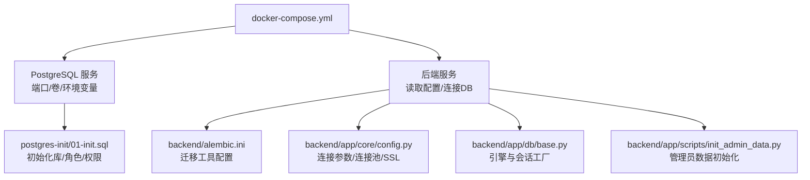
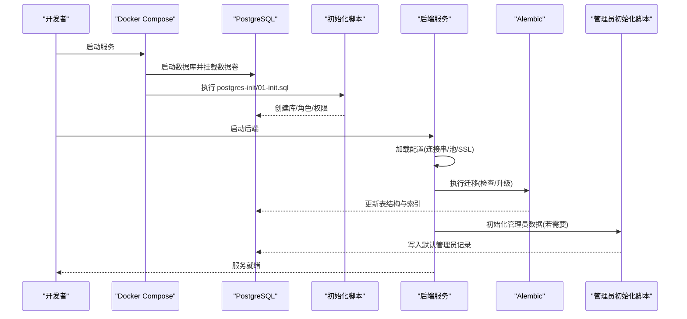
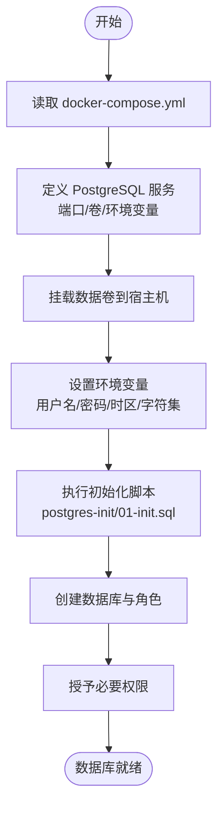
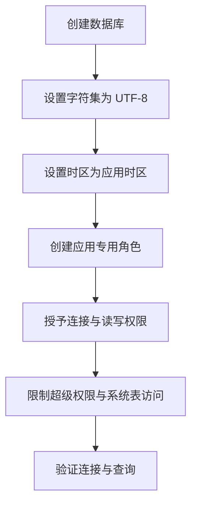
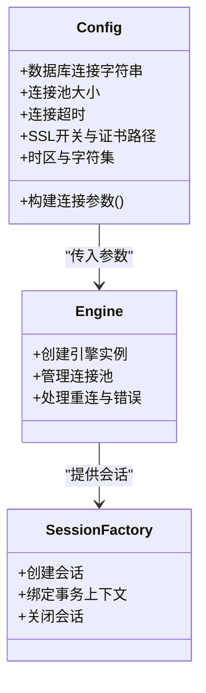
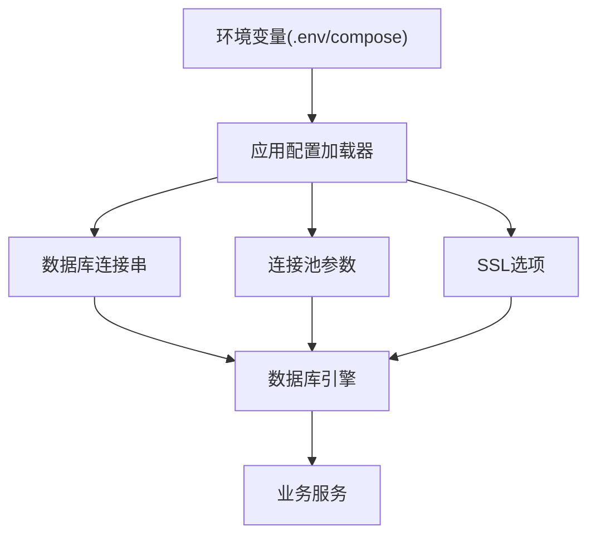
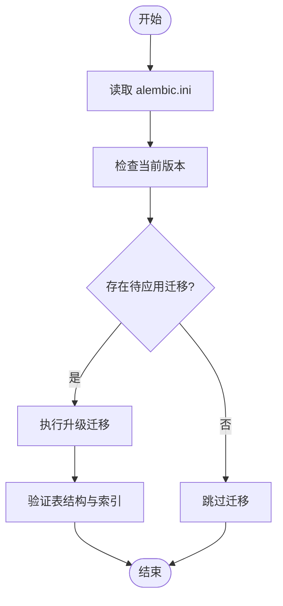
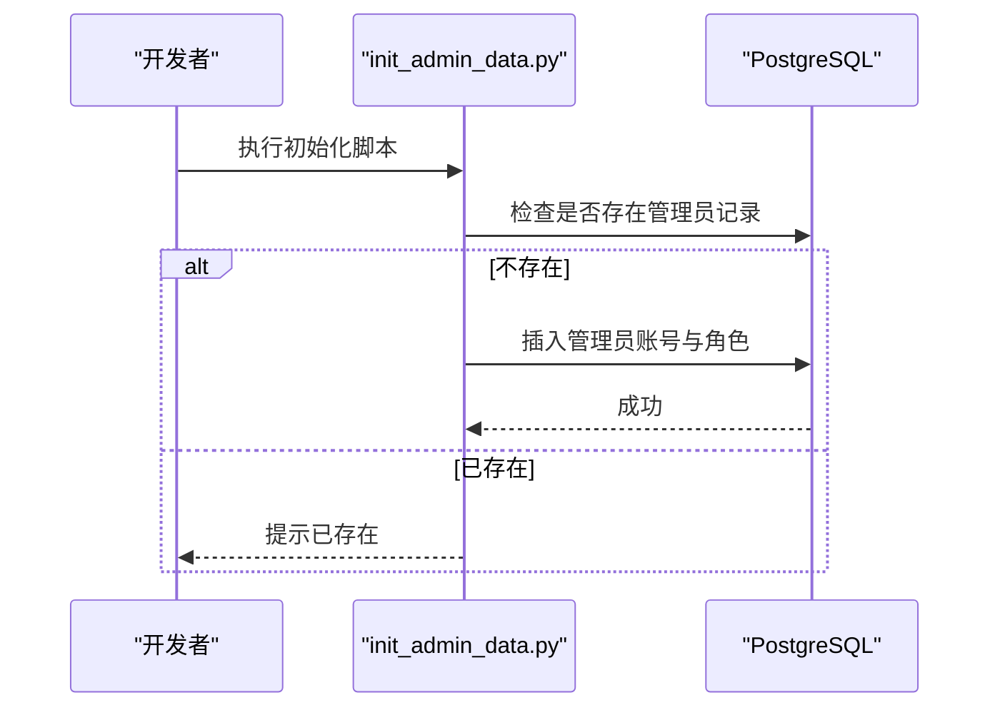
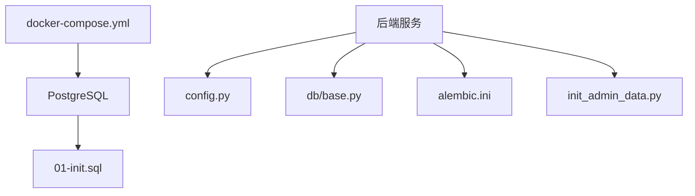

# 数据库初始化与配置

<cite>
**本文引用的文件**   
- [docker-compose.yml](file://docker-compose.yml)
- [postgres-init/01-init.sql](file://postgres-init/01-init.sql)
- [backend/alembic.ini](file://backend/alembic.ini)
- [backend/app/core/config.py](file://backend/app/core/config.py)
- [backend/app/db/base.py](file://backend/app/db/base.py)
- [backend/app/scripts/init_admin_data.py](file://backend/app/scripts/init_admin_data.py)
- [docs/POSTGRESQL_DEPLOYMENT.md](file://docs/POSTGRESQL_DEPLOYMENT.md)
- [ssl/README.md](file://ssl/README.md)
</cite>

## 目录
1. [简介](#简介)
2. [项目结构](#项目结构)
3. [核心组件](#核心组件)
4. [架构总览](#架构总览)
5. [详细组件分析](#详细组件分析)
6. [依赖关系分析](#依赖关系分析)
7. [性能考虑](#性能考虑)
8. [故障排除指南](#故障排除指南)
9. [结论](#结论)
10. [附录](#附录)

## 简介
本文件面向小说创作代理系统的数据库初始化与配置，聚焦 PostgreSQL 的容器化部署、用户权限、字符集与时区设置；说明应用侧连接参数（连接池、超时、SSL）与环境变量管理；并提供性能调优建议、完整配置示例与常见问题排查方法。文档内容基于仓库中的 Docker Compose、Alembic 配置、数据库初始化脚本与应用配置模块整理而成。

## 项目结构
与数据库初始化与配置相关的关键位置：
- 容器编排与启动：docker-compose.yml
- 数据库初始 SQL：postgres-init/01-init.sql
- Alembic 迁移配置：backend/alembic.ini
- 应用配置与数据库引擎：backend/app/core/config.py、backend/app/db/base.py
- 管理员数据初始化脚本：backend/app/scripts/init_admin_data.py
- 官方部署说明：docs/POSTGRESQL_DEPLOYMENT.md
- SSL 证书说明：ssl/README.md



**图表来源**
- [docker-compose.yml](file://docker-compose.yml)
- [postgres-init/01-init.sql](file://postgres-init/01-init.sql)
- [backend/alembic.ini](file://backend/alembic.ini)
- [backend/app/core/config.py](file://backend/app/core/config.py)
- [backend/app/db/base.py](file://backend/app/db/base.py)
- [backend/app/scripts/init_admin_data.py](file://backend/app/scripts/init_admin_data.py)

**章节来源**
- [docker-compose.yml](file://docker-compose.yml)
- [postgres-init/01-init.sql](file://postgres-init/01-init.sql)
- [backend/alembic.ini](file://backend/alembic.ini)
- [backend/app/core/config.py](file://backend/app/core/config.py)
- [backend/app/db/base.py](file://backend/app/db/base.py)
- [backend/app/scripts/init_admin_data.py](file://backend/app/scripts/init_admin_data.py)
- [docs/POSTGRESQL_DEPLOYMENT.md](file://docs/POSTGRESQL_DEPLOYMENT.md)

## 核心组件
- 容器编排（Docker Compose）：定义 PostgreSQL 服务、数据卷挂载、环境变量注入、网络与端口映射，确保可重复部署。
- 数据库初始化脚本：在首次启动时创建数据库、角色与基础权限，保证多环境一致性。
- Alembic 迁移：集中管理数据库模式变更，支持版本化演进与回滚。
- 应用配置层：统一加载环境变量，构建数据库连接字符串、连接池与 SSL 参数。
- 管理员数据初始化：提供默认管理员账号与基础权限数据，便于快速上手。

**章节来源**
- [docker-compose.yml](file://docker-compose.yml)
- [postgres-init/01-init.sql](file://postgres-init/01-init.sql)
- [backend/alembic.ini](file://backend/alembic.ini)
- [backend/app/core/config.py](file://backend/app/core/config.py)
- [backend/app/db/base.py](file://backend/app/db/base.py)
- [backend/app/scripts/init_admin_data.py](file://backend/app/scripts/init_admin_data.py)

## 架构总览
下图展示从容器启动到应用连接数据库的端到端流程，包括初始化脚本执行、迁移运行与管理员数据初始化。



**图表来源**
- [docker-compose.yml](file://docker-compose.yml)
- [postgres-init/01-init.sql](file://postgres-init/01-init.sql)
- [backend/alembic.ini](file://backend/alembic.ini)
- [backend/app/core/config.py](file://backend/app/core/config.py)
- [backend/app/db/base.py](file://backend/app/db/base.py)
- [backend/app/scripts/init_admin_data.py](file://backend/app/scripts/init_admin_data.py)

## 详细组件分析

### PostgreSQL 容器化部署与初始化
- 使用 docker-compose 定义 PostgreSQL 服务，包含端口映射、数据持久化卷、时区与字符集等关键参数。
- 通过初始化脚本在首次启动时完成库、角色与权限的创建，避免手动操作带来的不一致。
- 推荐将敏感信息（如密码）以环境变量形式注入，避免硬编码。



**图表来源**
- [docker-compose.yml](file://docker-compose.yml)
- [postgres-init/01-init.sql](file://postgres-init/01-init.sql)

**章节来源**
- [docker-compose.yml](file://docker-compose.yml)
- [postgres-init/01-init.sql](file://postgres-init/01-init.sql)

### 用户权限与字符集、时区配置
- 字符集：建议在数据库与客户端均使用 UTF-8，确保中文等多语言文本正确存储与显示。
- 时区：统一设置为应用所在时区，避免时间戳不一致问题。
- 权限模型：为应用账户授予最小必要权限，避免使用超级用户；对特定库或表进行精细化授权。



**图表来源**
- [postgres-init/01-init.sql](file://postgres-init/01-init.sql)

**章节来源**
- [postgres-init/01-init.sql](file://postgres-init/01-init.sql)

### 数据库连接配置与连接池
- 连接字符串：由环境变量拼接生成，包含协议、主机、端口、数据库名、用户名与密码。
- 连接池：根据并发需求调整最大连接数、空闲连接数与回收策略，避免连接耗尽或资源浪费。
- 超时设置：合理配置连接建立、查询执行与事务超时，提升稳定性与可观测性。
- SSL：生产环境建议启用 SSL 加密传输，并校验服务器证书。



**图表来源**
- [backend/app/core/config.py](file://backend/app/core/config.py)
- [backend/app/db/base.py](file://backend/app/db/base.py)

**章节来源**
- [backend/app/core/config.py](file://backend/app/core/config.py)
- [backend/app/db/base.py](file://backend/app/db/base.py)

### 环境变量与多环境配置管理
- 统一通过环境变量注入数据库连接串、密码与功能开关，避免配置文件泄露。
- 不同环境（开发/测试/生产）通过不同的 compose 文件或 .env 文件切换。
- 敏感信息建议使用密钥管理服务或容器编排平台的 Secret 机制。



**图表来源**
- [backend/app/core/config.py](file://backend/app/core/config.py)

**章节来源**
- [backend/app/core/config.py](file://backend/app/core/config.py)

### Alembic 迁移与版本控制
- 使用 alembic.ini 指定数据库 URL 与迁移目录，统一管理模式变更。
- 迁移脚本按版本顺序执行，支持回滚与分支合并。
- 在 CI/CD 中集成迁移步骤，确保部署前后数据库状态一致。



**图表来源**
- [backend/alembic.ini](file://backend/alembic.ini)

**章节来源**
- [backend/alembic.ini](file://backend/alembic.ini)

### 管理员数据初始化
- 提供脚本用于插入默认管理员账号与基础权限数据，便于快速搭建与演示。
- 建议在首次启动后执行一次，后续通过权限管理系统维护。



**图表来源**
- [backend/app/scripts/init_admin_data.py](file://backend/app/scripts/init_admin_data.py)

**章节来源**
- [backend/app/scripts/init_admin_data.py](file://backend/app/scripts/init_admin_data.py)

### SSL 配置与证书管理
- 生产环境建议启用 SSL，配置证书路径与校验策略。
- 证书可通过自动续期方案管理，确保持续可用。
- 客户端连接需开启 SSL 并信任服务器证书。

```mermaid
flowchart TD
Cert["SSL 证书文件"] --> App["应用配置"]
App --> DBConn["启用 SSL 的连接串"]
DBConn --> PG["PostgreSQL 服务端"]
PG --> >App["加密通道建立"]
```

**图表来源**
- [ssl/README.md](file://ssl/README.md)
- [backend/app/core/config.py](file://backend/app/core/config.py)

**章节来源**
- [ssl/README.md](file://ssl/README.md)
- [backend/app/core/config.py](file://backend/app/core/config.py)

## 依赖关系分析
- 容器编排依赖 PostgreSQL 镜像与数据卷，确保数据持久化。
- 应用依赖配置模块与数据库引擎，统一加载环境变量并构建连接。
- Alembic 依赖数据库 URL 与迁移脚本，保障模式演进。
- 管理员初始化脚本依赖数据库连接与权限模型。



**图表来源**
- [docker-compose.yml](file://docker-compose.yml)
- [backend/app/core/config.py](file://backend/app/core/config.py)
- [backend/app/db/base.py](file://backend/app/db/base.py)
- [backend/alembic.ini](file://backend/alembic.ini)
- [backend/app/scripts/init_admin_data.py](file://backend/app/scripts/init_admin_data.py)
- [postgres-init/01-init.sql](file://postgres-init/01-init.sql)

**章节来源**
- [docker-compose.yml](file://docker-compose.yml)
- [backend/app/core/config.py](file://backend/app/core/config.py)
- [backend/app/db/base.py](file://backend/app/db/base.py)
- [backend/alembic.ini](file://backend/alembic.ini)
- [backend/app/scripts/init_admin_data.py](file://backend/app/scripts/init_admin_data.py)
- [postgres-init/01-init.sql](file://postgres-init/01-init.sql)

## 性能考虑
- 共享内存与缓冲区：根据内存容量调整共享内存与缓存命中率，减少磁盘 I/O。
- 查询缓存与索引：合理使用索引与查询计划，避免全表扫描与锁竞争。
- 并发连接优化：依据 CPU 与内存上限设定最大连接数与连接池大小，避免连接风暴。
- 日志与监控：开启慢查询日志与性能指标采集，定位瓶颈与优化点。

[本节为通用指导，不直接分析具体文件]

## 故障排除指南
- 连接失败：检查环境变量是否正确、防火墙与端口是否开放、SSL 证书是否有效。
- 权限错误：确认应用角色具备所需库与表的读写权限，避免使用超级用户。
- 字符集异常：确认数据库与客户端均使用 UTF-8，必要时重建数据库或转换编码。
- 迁移失败：核对 alembic.ini 配置与迁移脚本兼容性，查看错误日志并回滚至稳定版本。
- 管理员数据缺失：执行管理员初始化脚本并确保数据库连接正常。

**章节来源**
- [backend/alembic.ini](file://backend/alembic.ini)
- [backend/app/core/config.py](file://backend/app/core/config.py)
- [postgres-init/01-init.sql](file://postgres-init/01-init.sql)

## 结论
通过容器化部署、标准化初始化脚本、统一的配置管理与 Alembic 迁移，可实现 PostgreSQL 的可重复、安全与高性能部署。结合合理的连接池、超时与 SSL 配置，以及持续的性能调优与监控，可为小说创作代理系统提供稳定可靠的数据库支撑。

[本节为总结性内容，不直接分析具体文件]

## 附录
- 参考部署文档：docs/POSTGRESQL_DEPLOYMENT.md
- 完整配置示例与最佳实践请参考各配置文件与脚本注释。

**章节来源**
- [docs/POSTGRESQL_DEPLOYMENT.md](file://docs/POSTGRESQL_DEPLOYMENT.md)