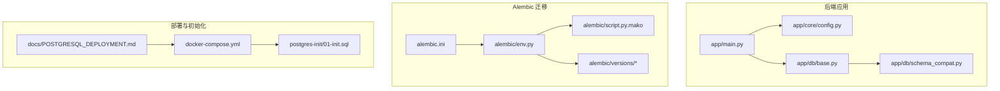
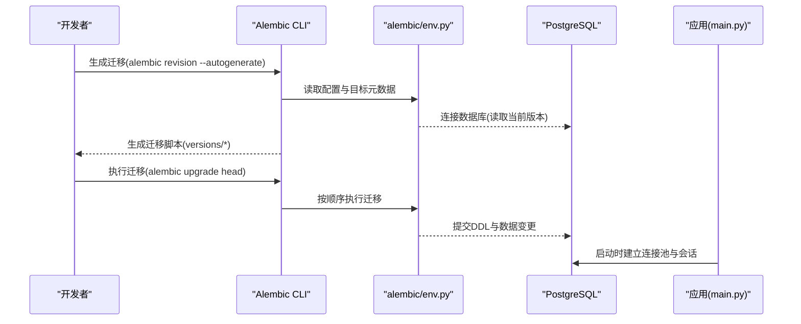
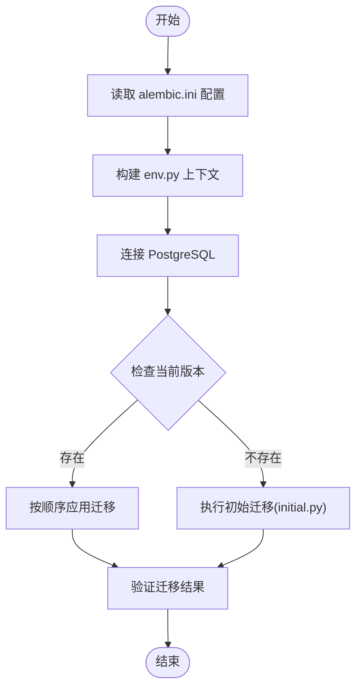
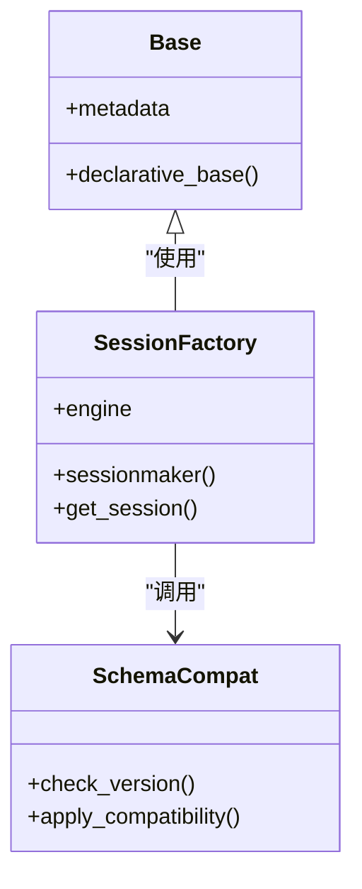
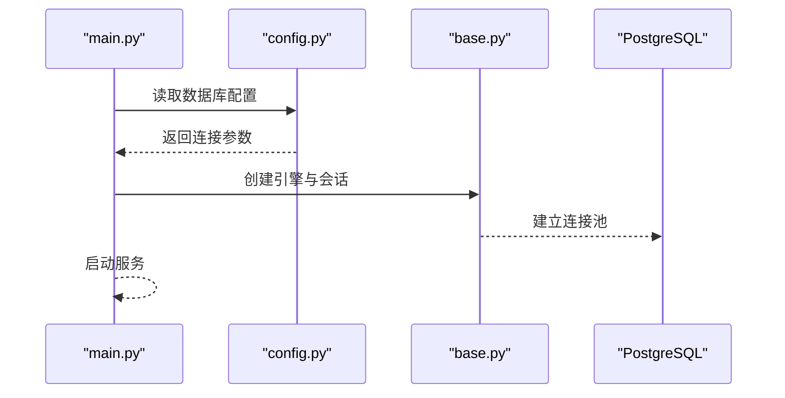
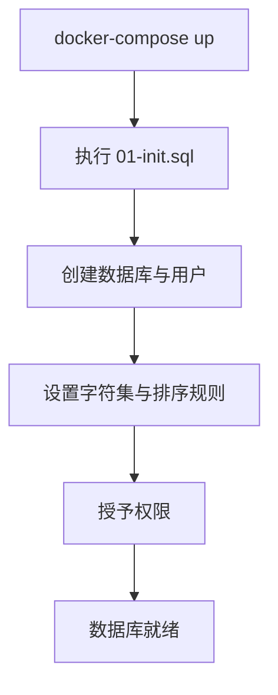
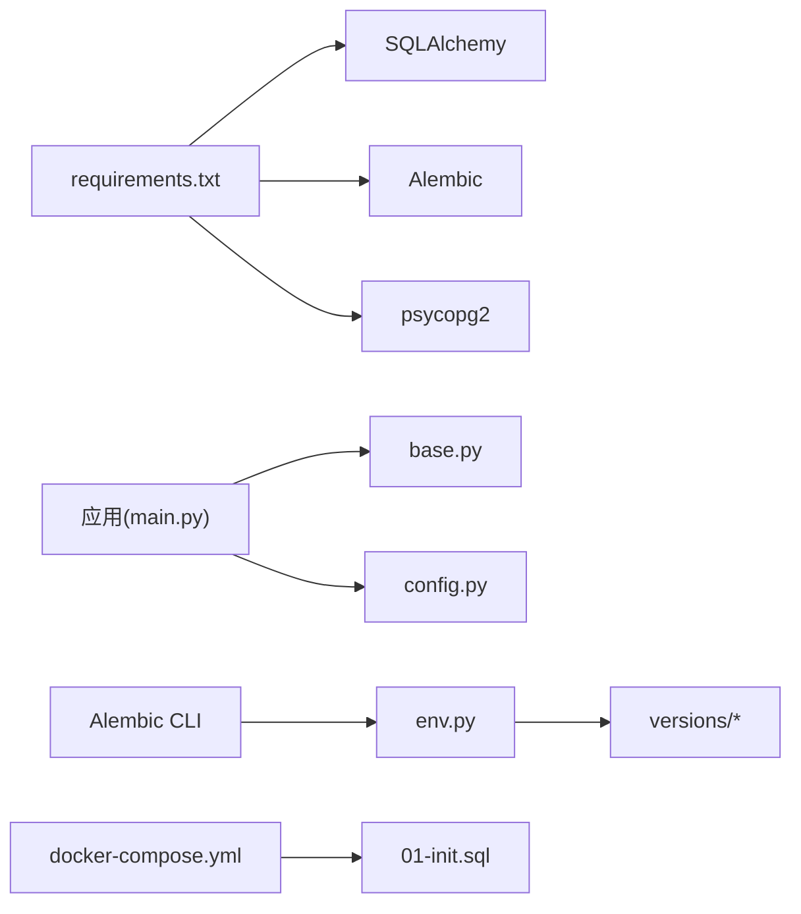

# 数据库管理

<cite>
**本文引用的文件**   
- [alembic.ini](file://backend/alembic.ini)
- [env.py](file://backend/alembic/env.py)
- [script.mako](file://backend/alembic/script.py.mako)
- [initial.py](file://backend/alembic/versions/initial.py)
- [POSTGRESQL_DEPLOYMENT.md](file://docs/POSTGRESQL_DEPLOYMENT.md)
- [DATABASE_MIGRATION_GUIDE.md](file://DATABASE_MIGRATION_GUIDE.md)
- [docker-compose.yml](file://docker-compose.yml)
- [01-init.sql](file://postgres-init/01-init.sql)
- [base.py](file://backend/app/db/base.py)
- [schema_compat.py](file://backend/app/db/schema_compat.py)
- [main.py](file://backend/app/main.py)
- [config.py](file://backend/app/core/config.py)
- [requirements.txt](file://backend/requirements.txt)
</cite>

## 目录
1. [简介](#简介)
2. [项目结构](#项目结构)
3. [核心组件](#核心组件)
4. [架构总览](#架构总览)
5. [详细组件分析](#详细组件分析)
6. [依赖关系分析](#依赖关系分析)
7. [性能优化与调优](#性能优化与调优)
8. [备份与恢复策略](#备份与恢复策略)
9. [监控与维护最佳实践](#监控与维护最佳实践)
10. [故障排查指南](#故障排查指南)
11. [结论](#结论)

## 简介
本文件面向小说创作代理系统的数据库管理，聚焦 PostgreSQL 的初始化与配置、Alembic 迁移体系、备份恢复方案、性能优化与监控维护。文档以仓库中的 Alembic 配置、模型与迁移脚本、部署说明为核心依据，提供从开发到生产的全链路数据库管理指南。

## 项目结构
与数据库相关的代码主要分布在以下位置：
- Alembic 迁移工具链：backend/alembic（含 env.py、script.mako、versions）
- 应用数据库基础：backend/app/db（base.py、schema_compat.py）
- 应用入口与配置：backend/app/main.py、backend/app/core/config.py
- 部署与初始化：docs/POSTGRESQL_DEPLOYMENT.md、docker-compose.yml、postgres-init/01-init.sql
- 迁移指南：DATABASE_MIGRATION_GUIDE.md、backend/alembic.ini

**图表来源** 
- [main.py](file://backend/app/main.py)
- [config.py](file://backend/app/core/config.py)
- [base.py](file://backend/app/db/base.py)
- [schema_compat.py](file://backend/app/db/schema_compat.py)
- [alembic.ini](file://backend/alembic.ini)
- [env.py](file://backend/alembic/env.py)
- [script.mako](file://backend/alembic/script.py.mako)
- [initial.py](file://backend/alembic/versions/initial.py)
- [docker-compose.yml](file://docker-compose.yml)
- [01-init.sql](file://postgres-init/01-init.sql)
- [POSTGRESQL_DEPLOYMENT.md](file://docs/POSTGRESQL_DEPLOYMENT.md)

**章节来源**
- [alembic.ini](file://backend/alembic.ini)
- [env.py](file://backend/alembic/env.py)
- [script.mako](file://backend/alembic/script.py.mako)
- [initial.py](file://backend/alembic/versions/initial.py)
- [POSTGRESQL_DEPLOYMENT.md](file://docs/POSTGRESQL_DEPLOYMENT.md)
- [DATABASE_MIGRATION_GUIDE.md](file://DATABASE_MIGRATION_GUIDE.md)
- [docker-compose.yml](file://docker-compose.yml)
- [01-init.sql](file://postgres-init/01-init.sql)
- [base.py](file://backend/app/db/base.py)
- [schema_compat.py](file://backend/app/db/schema_compat.py)
- [main.py](file://backend/app/main.py)
- [config.py](file://backend/app/core/config.py)

## 核心组件
- Alembic 迁移引擎：通过 alembic.ini 与 env.py 驱动版本化迁移，生成并执行 SQL 变更脚本。
- SQLAlchemy ORM 基础：base.py 定义引擎、会话工厂与基类；schema_compat.py 提供兼容性处理。
- 应用集成：main.py 启动时加载配置与数据库连接；config.py 集中管理数据库连接参数与环境变量。
- 部署与初始化：docker-compose.yml 编排 PostgreSQL 服务；postgres-init/01-init.sql 用于容器启动时的初始化。

**章节来源**
- [alembic.ini](file://backend/alembic.ini)
- [env.py](file://backend/alembic/env.py)
- [base.py](file://backend/app/db/base.py)
- [schema_compat.py](file://backend/app/db/schema_compat.py)
- [main.py](file://backend/app/main.py)
- [config.py](file://backend/app/core/config.py)
- [docker-compose.yml](file://docker-compose.yml)
- [01-init.sql](file://postgres-init/01-init.sql)

## 架构总览
系统采用“应用层 + ORM + 迁移层 + 数据库”的分层架构。应用通过 main.py 启动，读取 config.py 中的数据库配置，使用 base.py 提供的引擎与会话访问数据。Alembic 负责在开发/测试/生产环境中对数据库进行版本化管理与变更执行。

**图表来源** 
- [alembic.ini](file://backend/alembic.ini)
- [env.py](file://backend/alembic/env.py)
- [initial.py](file://backend/alembic/versions/initial.py)
- [main.py](file://backend/app/main.py)
- [config.py](file://backend/app/core/config.py)

## 详细组件分析

### Alembic 迁移体系
- 配置文件：backend/alembic.ini 指定数据库 URL、脚本目录、版本存储表等。
- 运行环境：backend/alembic/env.py 负责加载配置、构建引擎、设置目标元数据、执行迁移脚本。
- 模板：backend/alembic/script.py.mako 控制迁移脚本生成格式。
- 版本历史：backend/alembic/versions 下包含初始与多次迭代迁移，如 initial.py 及后续功能扩展。

**图表来源** 
- [alembic.ini](file://backend/alembic.ini)
- [env.py](file://backend/alembic/env.py)
- [script.mako](file://backend/alembic/script.py.mako)
- [initial.py](file://backend/alembic/versions/initial.py)

**章节来源**
- [alembic.ini](file://backend/alembic.ini)
- [env.py](file://backend/alembic/env.py)
- [script.mako](file://backend/alembic/script.py.mako)
- [initial.py](file://backend/alembic/versions/initial.py)
- [DATABASE_MIGRATION_GUIDE.md](file://DATABASE_MIGRATION_GUIDE.md)

### 数据库模型与兼容性
- base.py：定义 SQLAlchemy 引擎、会话工厂、基类模型，统一事务与连接管理。
- schema_compat.py：提供跨版本兼容逻辑，确保迁移前后数据结构一致性。

**图表来源** 
- [base.py](file://backend/app/db/base.py)
- [schema_compat.py](file://backend/app/db/schema_compat.py)

**章节来源**
- [base.py](file://backend/app/db/base.py)
- [schema_compat.py](file://backend/app/db/schema_compat.py)

### 应用集成与配置
- main.py：应用启动入口，加载配置、注册路由、初始化数据库连接。
- config.py：集中管理数据库连接字符串、连接池参数、字符集与超时等环境变量。

**图表来源** 
- [main.py](file://backend/app/main.py)
- [config.py](file://backend/app/core/config.py)
- [base.py](file://backend/app/db/base.py)

**章节来源**
- [main.py](file://backend/app/main.py)
- [config.py](file://backend/app/core/config.py)
- [base.py](file://backend/app/db/base.py)

### 部署与初始化
- docker-compose.yml：编排 PostgreSQL 服务，挂载初始化脚本与数据卷。
- postgres-init/01-init.sql：容器首次启动时执行的初始化 SQL（用户、权限、字符集等）。
- docs/POSTGRESQL_DEPLOYMENT.md：PostgreSQL 部署与配置指南。

**图表来源** 
- [docker-compose.yml](file://docker-compose.yml)
- [01-init.sql](file://postgres-init/01-init.sql)
- [POSTGRESQL_DEPLOYMENT.md](file://docs/POSTGRESQL_DEPLOYMENT.md)

**章节来源**
- [docker-compose.yml](file://docker-compose.yml)
- [01-init.sql](file://postgres-init/01-init.sql)
- [POSTGRESQL_DEPLOYMENT.md](file://docs/POSTGRESQL_DEPLOYMENT.md)

## 依赖关系分析
- 运行时依赖：backend/requirements.txt 列出 SQLAlchemy、Alembic、psycopg2 等数据库相关包。
- 模块耦合：应用层依赖 base.py 与 config.py；Alembic 依赖 env.py 与 versions 脚本；部署依赖 docker-compose.yml 与初始化脚本。

**图表来源** 
- [requirements.txt](file://backend/requirements.txt)
- [main.py](file://backend/app/main.py)
- [base.py](file://backend/app/db/base.py)
- [config.py](file://backend/app/core/config.py)
- [env.py](file://backend/alembic/env.py)
- [initial.py](file://backend/alembic/versions/initial.py)
- [docker-compose.yml](file://docker-compose.yml)
- [01-init.sql](file://postgres-init/01-init.sql)

**章节来源**
- [requirements.txt](file://backend/requirements.txt)
- [main.py](file://backend/app/main.py)
- [base.py](file://backend/app/db/base.py)
- [config.py](file://backend/app/core/config.py)
- [env.py](file://backend/alembic/env.py)
- [initial.py](file://backend/alembic/versions/initial.py)
- [docker-compose.yml](file://docker-compose.yml)
- [01-init.sql](file://postgres-init/01-init.sql)

## 性能优化与调优
- 索引设计
  - 为高频查询字段添加合适索引（如外键、过滤条件列、排序列）。
  - 避免过度索引导致写入性能下降，定期评估无用索引。
- 查询优化
  - 使用 EXPLAIN/EXPLAIN ANALYZE 分析慢查询，关注全表扫描与低效连接。
  - 合理拆分复杂查询，利用子查询或临时表提升可读性与性能。
- 连接池配置
  - 在 config.py 中调整连接池大小、超时与回收策略，匹配并发需求。
  - 监控连接泄漏与等待队列，避免资源耗尽。
- 慢查询分析
  - 启用 pg_stat_statements 统计，定位热点 SQL。
  - 结合日志与监控平台，持续跟踪性能指标。

[本节为通用指导，不直接分析具体文件]

## 备份与恢复策略
- 全量备份
  - 使用 pg_dump 对数据库进行完整导出，适用于定期归档与灾难恢复。
- 增量备份
  - 基于 WAL 归档与时间点恢复（PITR），实现细粒度恢复能力。
- 定时备份任务
  - 通过 cron 或调度器定期执行备份脚本，保留多份历史副本。
- 恢复流程
  - 先恢复全量备份，再回放增量 WAL 至目标时间点。
  - 恢复后校验数据一致性与完整性。

[本节为通用指导，不直接分析具体文件]

## 监控与维护最佳实践
- 空间管理
  - 监控表与索引大小，清理历史数据与临时对象。
  - 定期 VACUUM 与 REINDEX 维护健康度。
- 统计信息更新
  - 确保 autovacuum 与 analyze 正常运行，保持查询计划准确。
- 故障诊断
  - 查看 PostgreSQL 日志与错误码，定位锁冲突、连接失败等问题。
  - 使用 pg_stat_activity 监控活跃会话与阻塞链。

[本节为通用指导，不直接分析具体文件]

## 故障排查指南
- 迁移失败
  - 检查 alembic.ini 与 env.py 配置是否正确，确认数据库版本状态。
  - 回滚到上一版本并修复迁移脚本后重试。
- 连接问题
  - 验证连接字符串、用户名密码与网络可达性。
  - 检查连接池上限与超时设置是否合理。
- 权限错误
  - 确认数据库用户具备所需权限（DDL/DML）。
  - 审查 01-init.sql 中的授权语句是否生效。

**章节来源**
- [alembic.ini](file://backend/alembic.ini)
- [env.py](file://backend/alembic/env.py)
- [01-init.sql](file://postgres-init/01-init.sql)

## 结论
本数据库管理文档围绕 PostgreSQL 初始化、Alembic 迁移、备份恢复、性能优化与监控维护展开，结合仓库中的实际配置与脚本，提供了从开发到生产的可操作指南。建议在生产环境严格遵循版本化迁移、定期备份与性能监控的最佳实践，确保系统稳定与数据安全。