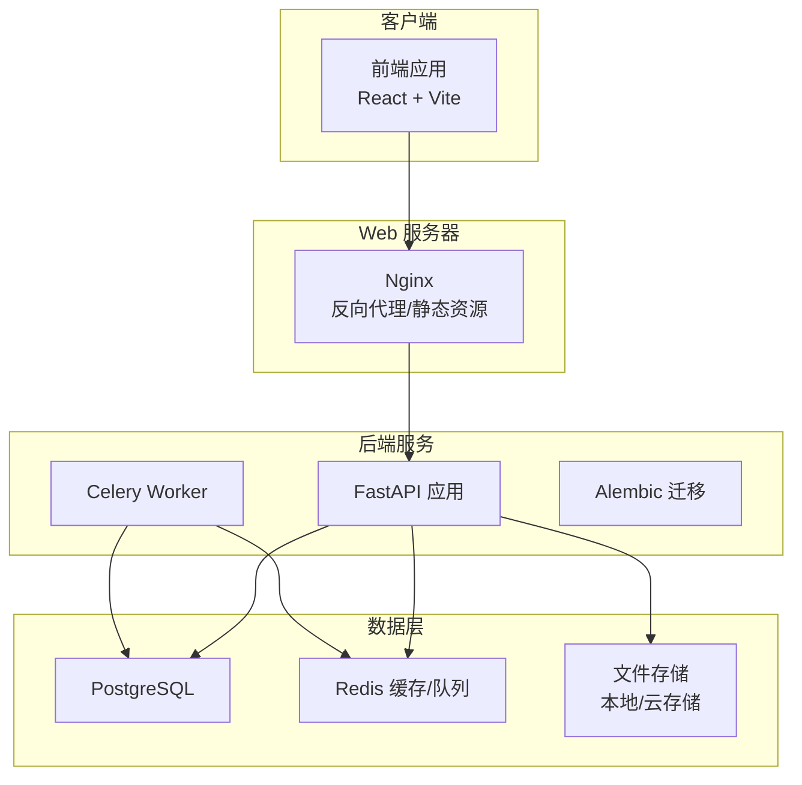
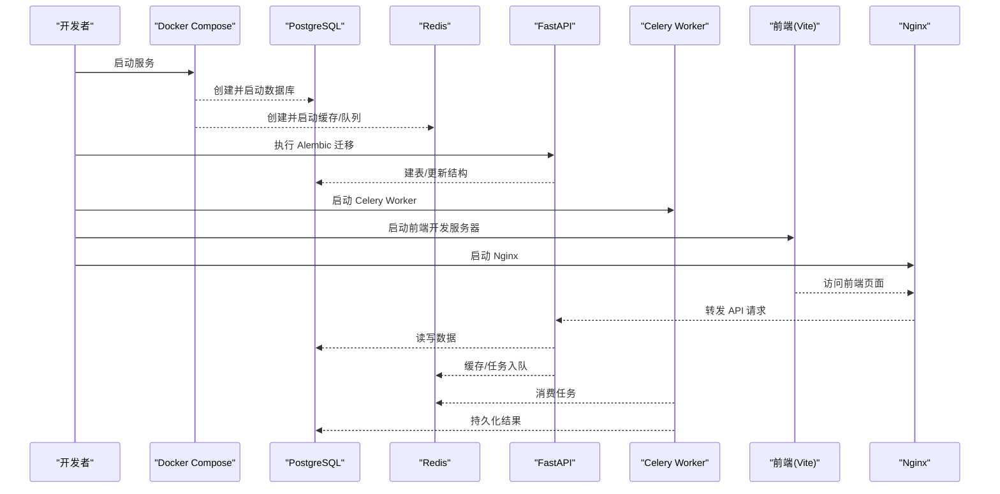
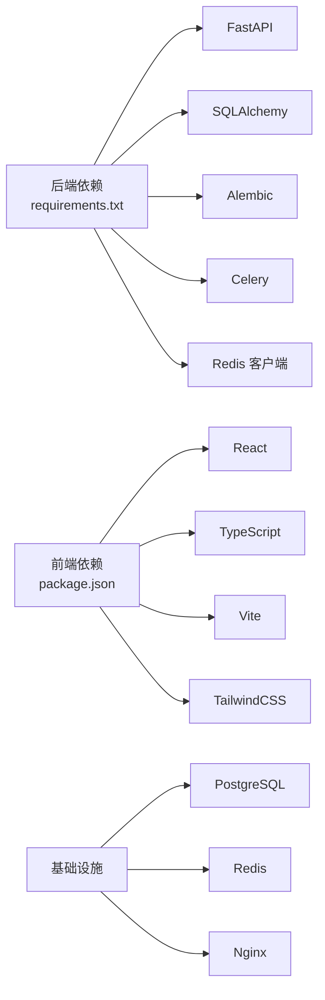

# 环境搭建

<cite>
**本文引用的文件**   
- [README.md](file://README.md)
- [docker-compose.yml](file://docker-compose.yml)
- [backend/requirements.txt](file://backend/requirements.txt)
- [backend/install_deps.bat](file://backend/install_deps.bat)
- [frontend/package.json](file://frontend/package.json)
- [backend/app/core/config.py](file://backend/app/core/config.py)
- [backend/app/core/env_loader.py](file://backend/app/core/env_loader.py)
- [postgres-init/01-init.sql](file://postgres-init/01-init.sql)
- [redis.conf](file://redis.conf)
- [nginx.conf](file://nginx.conf)
- [nginx-dev.conf](file://nginx-dev.conf)
- [install.bat](file://install.bat)
- [dev.bat](file://dev.bat)
- [start_backend.py](file://start_backend.py)
- [alembic.ini](file://alembic.ini)
- [backend/alembic.ini](file://backend/alembic.ini)
</cite>

## 目录
1. [简介](#简介)
2. [项目结构](#项目结构)
3. [核心组件](#核心组件)
4. [架构总览](#架构总览)
5. [详细组件分析](#详细组件分析)
6. [依赖分析](#依赖分析)
7. [性能考虑](#性能考虑)
8. [故障排查指南](#故障排查指南)
9. [结论](#结论)
10. [附录](#附录)

## 简介
本环境搭建文档面向小说创作代理系统的开发与本地运行，覆盖以下目标：
- 安装并配置 Python 3.8+、Node.js 与 npm
- 部署 PostgreSQL 数据库与 Redis 缓存服务
- 安装后端（FastAPI + SQLAlchemy + Celery）与前端（React + Vite）依赖
- 配置环境变量（数据库连接、AI 服务 API 密钥、文件存储路径等）
- 提供 Windows、Linux、macOS 的安装脚本使用说明
- 常见环境问题解决方案与安装验证方法

## 项目结构
本项目采用前后端分离架构：
- 后端位于 backend 目录，使用 FastAPI 提供 REST API，SQLAlchemy 进行 ORM 管理，Alembic 负责数据库迁移，Celery 处理异步任务
- 前端位于 frontend 目录，基于 React + TypeScript + Vite
- 基础设施通过 docker-compose.yml 编排 PostgreSQL 与 Redis
- Nginx 用于反向代理与静态资源托管
- 根目录提供跨平台安装与开发脚本

图表来源
- [docker-compose.yml](file://docker-compose.yml)
- [nginx.conf](file://nginx.conf)
- [backend/app/core/config.py](file://backend/app/core/config.py)

章节来源
- [README.md](file://README.md)
- [docker-compose.yml](file://docker-compose.yml)

## 核心组件
- 后端服务
  - Web 框架：FastAPI
  - ORM：SQLAlchemy
  - 迁移：Alembic
  - 异步任务：Celery + Redis
  - 配置与环境变量：集中式加载器
- 前端服务
  - React + TypeScript + Vite
  - 包管理：npm
- 基础设施
  - 数据库：PostgreSQL
  - 缓存/消息队列：Redis
  - 反向代理：Nginx

章节来源
- [backend/requirements.txt](file://backend/requirements.txt)
- [frontend/package.json](file://frontend/package.json)
- [docker-compose.yml](file://docker-compose.yml)
- [backend/app/core/config.py](file://backend/app/core/config.py)
- [backend/app/core/env_loader.py](file://backend/app/core/env_loader.py)

## 架构总览
系统启动流程概览：
- 启动 Docker 容器（PostgreSQL、Redis）
- 初始化数据库（Alembic 迁移）
- 启动后端 FastAPI 服务
- 启动 Celery Worker
- 构建并启动前端开发服务器或生产静态资源
- Nginx 将前端请求转发到后端 API

图表来源
- [docker-compose.yml](file://docker-compose.yml)
- [alembic.ini](file://alembic.ini)
- [backend/alembic.ini](file://backend/alembic.ini)
- [nginx.conf](file://nginx.conf)

## 详细组件分析

### 环境与依赖安装（Python、Node.js、npm）
- Python 3.8+
  - 建议使用 venv 或 conda 创建虚拟环境
  - 安装后端依赖：参考 requirements.txt
- Node.js 与 npm
  - 推荐 LTS 版本
  - 进入 frontend 目录，使用 npm 安装依赖

章节来源
- [backend/requirements.txt](file://backend/requirements.txt)
- [frontend/package.json](file://frontend/package.json)

### 数据库与缓存服务（PostgreSQL、Redis）
- 使用 docker-compose.yml 一键启动
- 数据库初始化脚本位于 postgres-init/01-init.sql
- Redis 配置文件 redis.conf 可调整内存策略、持久化等参数

章节来源
- [docker-compose.yml](file://docker-compose.yml)
- [postgres-init/01-init.sql](file://postgres-init/01-init.sql)
- [redis.conf](file://redis.conf)

### 后端服务（FastAPI、SQLAlchemy、Celery）
- 入口与配置
  - 应用主入口与路由在 backend/app 下
  - 配置与环境变量由 config.py 与 env_loader.py 统一加载
- 数据库迁移
  - 使用 Alembic 管理迁移，配置文件 alembic.ini
- 异步任务
  - Celery Worker 通过 Redis 队列执行任务

章节来源
- [backend/app/core/config.py](file://backend/app/core/config.py)
- [backend/app/core/env_loader.py](file://backend/app/core/env_loader.py)
- [alembic.ini](file://alembic.ini)
- [backend/alembic.ini](file://backend/alembic.ini)

### 前端服务（React + Vite）
- 包管理与构建脚本定义于 package.json
- 开发模式使用 Vite 热重载
- 生产模式构建静态资源并通过 Nginx 托管

章节来源
- [frontend/package.json](file://frontend/package.json)

### 反向代理（Nginx）
- 生产与开发分别提供 nginx.conf 与 nginx-dev.conf
- 将前端静态资源与后端 API 路由进行分离与转发

章节来源
- [nginx.conf](file://nginx.conf)
- [nginx-dev.conf](file://nginx-dev.conf)

### 跨平台安装脚本
- Windows
  - install.bat：一键安装依赖与初始化
  - dev.bat：启动开发环境
  - backend/install_deps.bat：后端依赖安装
- Linux/macOS
  - 可使用等效的 shell 脚本（如 install.sh、dev.sh），或直接按步骤执行命令

章节来源
- [install.bat](file://install.bat)
- [dev.bat](file://dev.bat)
- [backend/install_deps.bat](file://backend/install_deps.bat)

## 依赖分析
- 后端依赖
  - Web：FastAPI、Uvicorn/Gunicorn
  - ORM：SQLAlchemy、Alembic
  - 异步：Celery、Redis
  - 其他：加密、日志、HTTP 客户端等
- 前端依赖
  - React、TypeScript、Vite、TailwindCSS 等
- 基础设施依赖
  - PostgreSQL、Redis、Nginx

图表来源
- [backend/requirements.txt](file://backend/requirements.txt)
- [frontend/package.json](file://frontend/package.json)

章节来源
- [backend/requirements.txt](file://backend/requirements.txt)
- [frontend/package.json](file://frontend/package.json)

## 性能考虑
- 数据库连接池：合理设置 SQLAlchemy 连接池大小与超时
- Redis 缓存：启用合适的过期策略与内存上限
- Celery Worker：根据 CPU/内存调整并发数与队列优先级
- Nginx：开启 gzip、静态资源缓存与连接复用
- 前端：按需加载与代码分割，减少首屏体积

[本节为通用建议，不直接分析具体文件]

## 故障排查指南
- 数据库连接失败
  - 检查 PostgreSQL 是否启动、端口与凭据是否正确
  - 确认环境变量中的数据库连接字符串
- Redis 连接失败
  - 检查 Redis 服务状态与网络可达性
  - 核对 Redis 地址与密码
- 迁移失败
  - 查看 Alembic 日志，确保迁移脚本与模型一致
- 前端无法访问后端
  - 检查 Nginx 配置与 CORS 设置
  - 确认后端服务监听端口与域名解析
- 常见验证方法
  - 访问健康检查接口（若存在）
  - 查看 Celery Worker 日志是否正常消费任务
  - 使用 curl 或浏览器测试关键 API

章节来源
- [backend/app/core/config.py](file://backend/app/core/config.py)
- [backend/app/core/env_loader.py](file://backend/app/core/env_loader.py)
- [alembic.ini](file://alembic.ini)
- [backend/alembic.ini](file://backend/alembic.ini)
- [nginx.conf](file://nginx.conf)
- [nginx-dev.conf](file://nginx-dev.conf)

## 结论
通过本环境搭建文档，您可以完成从基础环境准备到服务启动的全流程。建议在生产环境中严格管理环境变量与密钥，结合容器化与 CI/CD 提升部署效率与稳定性。

[本节为总结性内容，不直接分析具体文件]

## 附录

### 环境变量配置清单
以下为关键环境变量及其作用说明（请根据实际部署调整）：
- 数据库
  - DATABASE_URL：PostgreSQL 连接字符串（含用户名、密码、主机、端口、库名）
  - DB_POOL_SIZE：连接池大小
  - DB_MAX_OVERFLOW：最大溢出连接数
- 缓存与队列
  - REDIS_URL：Redis 连接字符串（含认证信息）
  - CELERY_BROKER_URL：Celery 消息代理（通常为 Redis）
  - CELERY_RESULT_BACKEND：任务结果存储（通常为 Redis）
- AI 服务
  - LLM_API_KEY：大模型 API 密钥
  - IMAGE_API_KEY：图像生成 API 密钥
  - TTS_API_KEY：语音合成 API 密钥
  - VIDEO_API_KEY：视频生成 API 密钥
- 文件存储
  - STORAGE_PATH：本地文件存储根路径
  - CLOUD_STORAGE_CONFIG：云存储配置（如 S3/OSS，按格式填写）
- 应用与服务
  - APP_ENV：运行环境（development/production）
  - SECRET_KEY：应用签名密钥
  - ALLOWED_HOSTS：允许的域名/IP 列表
  - LOG_LEVEL：日志级别（DEBUG/INFO/WARNING/ERROR）

章节来源
- [backend/app/core/config.py](file://backend/app/core/config.py)
- [backend/app/core/env_loader.py](file://backend/app/core/env_loader.py)

### 操作系统安装脚本使用说明
- Windows
  - 双击 install.bat 完成依赖安装与初始化
  - 运行 dev.bat 启动开发环境（包含前端与后端）
  - 如需单独安装后端依赖，运行 backend/install_deps.bat
- Linux/macOS
  - 推荐使用 shell 脚本（如 install.sh、dev.sh）或手动执行命令
  - 使用 docker-compose up -d 启动数据库与缓存
  - 执行 Alembic 迁移后启动后端与 Celery Worker
  - 启动前端开发服务器或构建生产静态资源

章节来源
- [install.bat](file://install.bat)
- [dev.bat](file://dev.bat)
- [backend/install_deps.bat](file://backend/install_deps.bat)
- [docker-compose.yml](file://docker-compose.yml)
- [alembic.ini](file://alembic.ini)
- [backend/alembic.ini](file://backend/alembic.ini)

### 安装验证步骤
- 验证数据库连接
  - 使用 psql 或数据库客户端连接 PostgreSQL
  - 检查表结构与初始数据是否存在
- 验证 Redis 连接
  - 使用 redis-cli 连接并执行 ping
- 验证后端服务
  - 启动 FastAPI 服务，访问健康检查或根路径
  - 查看日志无报错
- 验证 Celery Worker
  - 启动 Worker，观察任务入队与消费情况
- 验证前端服务
  - 访问前端页面，确认能正常加载并调用后端 API
- 验证 Nginx
  - 访问域名或 IP，确认静态资源与 API 转发正确

章节来源
- [docker-compose.yml](file://docker-compose.yml)
- [nginx.conf](file://nginx.conf)
- [nginx-dev.conf](file://nginx-dev.conf)
- [start_backend.py](file://start_backend.py)