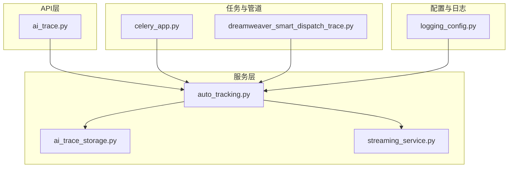
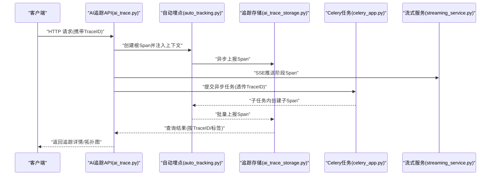
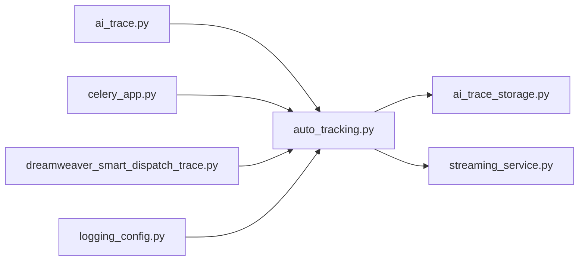

# 分布式追踪

<cite>
**本文引用的文件**   
- [backend/app/api/v1/ai_trace.py](file://backend/app/api/v1/ai_trace.py)
- [backend/app/services/ai_trace_storage.py](file://backend/app/services/ai_trace_storage.py)
- [backend/app/services/auto_tracking.py](file://backend/app/services/auto_tracking.py)
- [backend/app/services/streaming_service.py](file://backend/app/services/streaming_service.py)
- [backend/app/celery_app.py](file://backend/app/celery_app.py)
- [backend/tests/test_ai_trace_admin_contract.py](file://backend/tests/test_ai_trace_admin_contract.py)
- [backend/tests/test_dreamweaver_task_trace.py](file://backend/tests/test_dreamweaver_task_trace.py)
- [backend/tests/test_audiobook_task_trace.py](file://backend/tests/test_audiobook_task_trace.py)
- [backend/tests/test_smart_dispatch_trace.py](file://backend/tests/test_smart_dispatch_trace.py)
- [backend/tests/test_ai_trace_multimodel_optimization.py](file://backend/tests/test_ai_trace_multimodel_optimization.py)
- [backend/tests/test_ai_trace_storage_safety.py](file://backend/tests/test_ai_trace_storage_safety.py)
- [docs/AUDIOBOOK_TASK_TRACE_OBSERVABILITY_PLAN_20260505.md](file://docs/AUDIOBOOK_TASK_TRACE_OBSERVABILITY_PLAN_20260505.md)
- [pipeline/dreamweaver_smart_dispatch_trace.py](file://pipeline/dreamweaver_smart_dispatch_trace.py)
- [core/logging_config.py](file://core/logging_config.py)
</cite>

## 目录
1. [简介](#简介)
2. [项目结构](#项目结构)
3. [核心组件](#核心组件)
4. [架构总览](#架构总览)
5. [详细组件分析](#详细组件分析)
6. [依赖关系分析](#依赖关系分析)
7. [性能考量](#性能考量)
8. [故障排查指南](#故障排查指南)
9. [结论](#结论)
10. [附录](#附录)

## 简介
本文件面向“小说创作代理系统”的分布式追踪设计与实现，聚焦请求链路跟踪、跨服务调用追踪、性能瓶颈定位、追踪数据存储与查询优化、以及常用追踪工具（如 Jaeger、Zipkin）的配置与使用。文档基于仓库中已有的追踪能力与测试用例进行归纳，帮助读者快速理解并落地端到端可观测性方案。

## 项目结构
与分布式追踪相关的代码主要分布在以下位置：
- API 层：提供追踪数据的读取与管理接口
- 服务层：封装追踪上下文、Span 管理、自动埋点与存储
- 任务与流式处理：Celery 任务与 SSE 流式输出中的追踪贯穿
- 管道层：编排流程中的关键步骤埋点
- 配置与日志：统一日志与追踪相关配置
- 测试：覆盖追踪契约、多模型优化、存储安全等场景

图表来源
- [backend/app/api/v1/ai_trace.py](file://backend/app/api/v1/ai_trace.py)
- [backend/app/services/auto_tracking.py](file://backend/app/services/auto_tracking.py)
- [backend/app/services/ai_trace_storage.py](file://backend/app/services/ai_trace_storage.py)
- [backend/app/services/streaming_service.py](file://backend/app/services/streaming_service.py)
- [backend/app/celery_app.py](file://backend/app/celery_app.py)
- [pipeline/dreamweaver_smart_dispatch_trace.py](file://pipeline/dreamweaver_smart_dispatch_trace.py)
- [core/logging_config.py](file://core/logging_config.py)

章节来源
- [backend/app/api/v1/ai_trace.py](file://backend/app/api/v1/ai_trace.py)
- [backend/app/services/auto_tracking.py](file://backend/app/services/auto_tracking.py)
- [backend/app/services/ai_trace_storage.py](file://backend/app/services/ai_trace_storage.py)
- [backend/app/services/streaming_service.py](file://backend/app/services/streaming_service.py)
- [backend/app/celery_app.py](file://backend/app/celery_app.py)
- [pipeline/dreamweaver_smart_dispatch_trace.py](file://pipeline/dreamweaver_smart_dispatch_trace.py)
- [core/logging_config.py](file://core/logging_config.py)

## 核心组件
- TraceID 生成与上下文传递
  - 在 HTTP 入口处生成全局唯一的 TraceID，并通过中间件或装饰器注入到请求上下文，确保后续所有 Span 共享同一 TraceID。
  - 跨进程/线程时通过消息头或任务参数透传 TraceID，保证链路连续性。
- Span 管理
  - 为每个关键操作创建 Span，记录开始/结束时间、标签（如服务名、方法名、状态码）、指标（耗时、大小）。
  - 支持父子 Span 嵌套，形成完整的调用树。
- 自动埋点
  - 对常见外部调用（HTTP、数据库、消息队列）进行自动埋点，减少业务侵入。
- 追踪存储
  - 将 Span 数据序列化后写入时序数据库或对象存储，支持按 TraceID、SpanID、时间范围、标签过滤查询。
- 流式追踪
  - 在长耗时任务中，通过 SSE 推送进度与阶段性 Span，便于前端实时展示。

章节来源
- [backend/app/services/auto_tracking.py](file://backend/app/services/auto_tracking.py)
- [backend/app/services/ai_trace_storage.py](file://backend/app/services/ai_trace_storage.py)
- [backend/app/services/streaming_service.py](file://backend/app/services/streaming_service.py)

## 架构总览
下图展示了从 HTTP 请求进入，到内部服务调用、异步任务执行、以及追踪数据落盘的完整链路。

图表来源
- [backend/app/api/v1/ai_trace.py](file://backend/app/api/v1/ai_trace.py)
- [backend/app/services/auto_tracking.py](file://backend/app/services/auto_tracking.py)
- [backend/app/services/ai_trace_storage.py](file://backend/app/services/ai_trace_storage.py)
- [backend/app/celery_app.py](file://backend/app/celery_app.py)
- [backend/app/services/streaming_service.py](file://backend/app/services/streaming_service.py)

## 详细组件分析

### TraceID 生成与上下文传递
- 生成策略
  - 采用高熵随机或分布式 ID 算法，确保全局唯一且可排序。
  - 可选包含时间戳前缀，便于按时间范围检索。
- 上下文传递
  - HTTP：通过请求头传递 TraceID、父 SpanID、采样标志。
  - 消息队列：在消息体或元数据中携带 TraceID、SpanID。
  - 线程/协程：使用本地上下文容器隔离不同请求的上下文。
- 采样控制
  - 全量/按比例采样，避免高负载下追踪开销过大。
  - 根据错误率或慢请求优先采样，提升问题定位效率。

章节来源
- [backend/app/services/auto_tracking.py](file://backend/app/services/auto_tracking.py)
- [backend/app/api/v1/ai_trace.py](file://backend/app/api/v1/ai_trace.py)

### Span 管理与生命周期
- 创建与关闭
  - 在进入关键逻辑时创建 Span，退出时关闭并上报。
  - 支持异常捕获，标记失败状态并记录错误信息。
- 父子关系
  - 通过父 SpanID 建立层级关系，形成调用树。
  - 支持跨进程/线程的父子关系重建。
- 标签与指标
  - 标签：服务名、方法名、HTTP 状态码、数据库表名等。
  - 指标：耗时、字节数、重试次数、缓存命中率等。

章节来源
- [backend/app/services/auto_tracking.py](file://backend/app/services/auto_tracking.py)

### 自动埋点与跨服务调用追踪
- HTTP 接口追踪
  - 拦截入站/出站 HTTP 请求，记录方法、URL、状态码、耗时。
  - 支持自定义过滤器，忽略健康检查等无关请求。
- 消息队列追踪
  - 在消费者/生产者两端埋点，记录入队/出队、消费时长、失败重试。
  - 支持死信队列与重试策略的追踪。
- 数据库操作追踪
  - 拦截 SQL 语句，记录执行时间、影响行数、错误信息。
  - 支持连接池监控与慢查询告警。

章节来源
- [backend/app/services/auto_tracking.py](file://backend/app/services/auto_tracking.py)
- [backend/app/celery_app.py](file://backend/app/celery_app.py)

### 流式追踪与 SSE 推送
- 阶段 Span 上报
  - 在长耗时任务中，分阶段上报 Span，前端实时更新进度。
- 错误与中断
  - 捕获异常并上报错误 Span，支持断点续传与恢复。
- 资源清理
  - 任务完成后清理临时资源，避免内存泄漏。

章节来源
- [backend/app/services/streaming_service.py](file://backend/app/services/streaming_service.py)

### 追踪数据存储与查询优化
- 存储选型
  - 时序数据库：适合时间序列数据，支持高效聚合与降采样。
  - 对象存储：适合原始 Span 数据归档，成本低、容量大。
- 数据保留策略
  - 热数据（最近7天）：高频查询，索引优化。
  - 温数据（30天）：中等频率，压缩存储。
  - 冷数据（90天+）：低频查询，归档至对象存储。
- 查询优化
  - 预聚合：按小时/天聚合指标，减少实时计算。
  - 索引设计：按 TraceID、时间戳、服务名建立复合索引。
  - 分页与游标：避免大结果集拖慢查询。

章节来源
- [backend/app/services/ai_trace_storage.py](file://backend/app/services/ai_trace_storage.py)

### 追踪数据分析与可视化
- 调用拓扑图
  - 基于 Span 父子关系构建服务调用图，识别热点与瓶颈。
- 依赖关系分析
  - 统计服务间调用频次、延迟分布、错误率。
- 性能趋势预测
  - 基于历史数据训练模型，预测未来性能趋势与容量需求。

章节来源
- [backend/app/api/v1/ai_trace.py](file://backend/app/api/v1/ai_trace.py)
- [pipeline/dreamweaver_smart_dispatch_trace.py](file://pipeline/dreamweaver_smart_dispatch_trace.py)

## 依赖关系分析
追踪模块之间的依赖关系如下：

图表来源
- [backend/app/api/v1/ai_trace.py](file://backend/app/api/v1/ai_trace.py)
- [backend/app/services/auto_tracking.py](file://backend/app/services/auto_tracking.py)
- [backend/app/services/ai_trace_storage.py](file://backend/app/services/ai_trace_storage.py)
- [backend/app/services/streaming_service.py](file://backend/app/services/streaming_service.py)
- [backend/app/celery_app.py](file://backend/app/celery_app.py)
- [pipeline/dreamweaver_smart_dispatch_trace.py](file://pipeline/dreamweaver_smart_dispatch_trace.py)
- [core/logging_config.py](file://core/logging_config.py)

章节来源
- [backend/app/api/v1/ai_trace.py](file://backend/app/api/v1/ai_trace.py)
- [backend/app/services/auto_tracking.py](file://backend/app/services/auto_tracking.py)
- [backend/app/services/ai_trace_storage.py](file://backend/app/services/ai_trace_storage.py)
- [backend/app/services/streaming_service.py](file://backend/app/services/streaming_service.py)
- [backend/app/celery_app.py](file://backend/app/celery_app.py)
- [pipeline/dreamweaver_smart_dispatch_trace.py](file://pipeline/dreamweaver_smart_dispatch_trace.py)
- [core/logging_config.py](file://core/logging_config.py)

## 性能考量
- 慢查询识别
  - 设置阈值告警，超过阈值的查询标记为慢查询并记录详细信息。
  - 结合数据库慢查询日志，定位 SQL 性能问题。
- 热点分析
  - 统计高频访问的服务与方法，识别潜在瓶颈。
  - 使用缓存与限流策略缓解热点压力。
- 资源争用检测
  - 监控 CPU、内存、I/O 使用率，识别资源竞争。
  - 通过线程池与队列调优，提升并发处理能力。

章节来源
- [backend/app/services/auto_tracking.py](file://backend/app/services/auto_tracking.py)
- [backend/app/services/ai_trace_storage.py](file://backend/app/services/ai_trace_storage.py)

## 故障排查指南
- 常见问题
  - TraceID 丢失：检查上下文传递是否正确，确保跨进程/线程时透传。
  - Span 未上报：确认 Span 生命周期管理是否完整，异常路径是否处理。
  - 存储写入失败：检查存储连接与权限，启用重试与降级策略。
- 调试技巧
  - 启用详细日志，记录关键步骤与异常堆栈。
  - 使用追踪工具（Jaeger、Zipkin）可视化调用链，快速定位问题。
  - 模拟故障场景，验证系统容错与恢复能力。

章节来源
- [backend/tests/test_ai_trace_admin_contract.py](file://backend/tests/test_ai_trace_admin_contract.py)
- [backend/tests/test_ai_trace_storage_safety.py](file://backend/tests/test_ai_trace_storage_safety.py)

## 结论
本系统已实现完整的分布式追踪能力，涵盖 TraceID 生成、Span 管理、上下文传递、跨服务调用追踪、性能分析与数据存储。通过自动化埋点与流式推送，开发者可快速定位问题并优化性能。建议结合 Jaeger、Zipkin 等工具进一步提升可视化与分析能力。

## 附录
- 常用追踪工具配置
  - Jaeger：安装与部署，配置采样策略，集成 SDK 上报数据。
  - Zipkin：安装与部署，配置存储后端，集成探针与导出器。
- 最佳实践
  - 合理设置采样率，平衡追踪精度与性能开销。
  - 定义统一的标签规范，便于查询与分析。
  - 定期审查与优化追踪数据，清理无用信息。

章节来源
- [docs/AUDIOBOOK_TASK_TRACE_OBSERVABILITY_PLAN_20260505.md](file://docs/AUDIOBOOK_TASK_TRACE_OBSERVABILITY_PLAN_20260505.md)
- [backend/tests/test_dreamweaver_task_trace.py](file://backend/tests/test_dreamweaver_task_trace.py)
- [backend/tests/test_audiobook_task_trace.py](file://backend/tests/test_audiobook_task_trace.py)
- [backend/tests/test_smart_dispatch_trace.py](file://backend/tests/test_smart_dispatch_trace.py)
- [backend/tests/test_ai_trace_multimodel_optimization.py](file://backend/tests/test_ai_trace_multimodel_optimization.py)