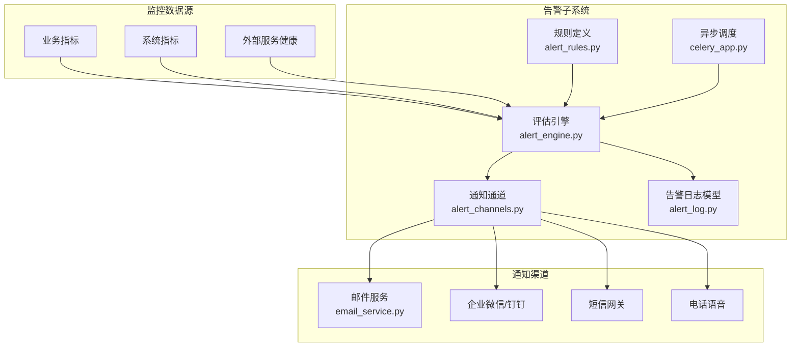
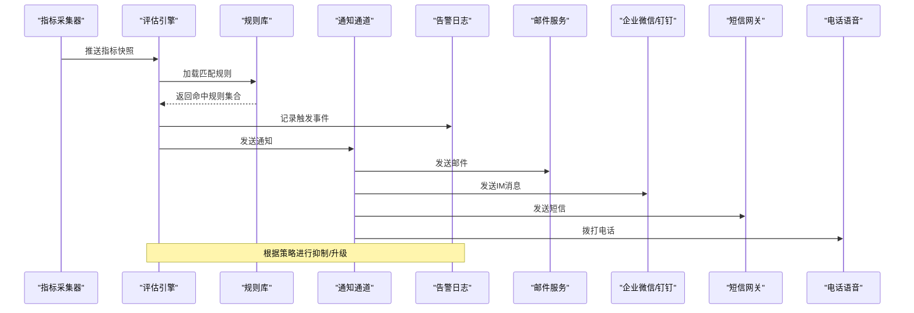
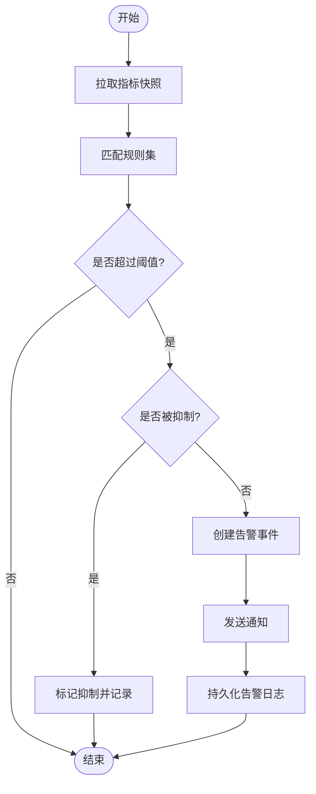
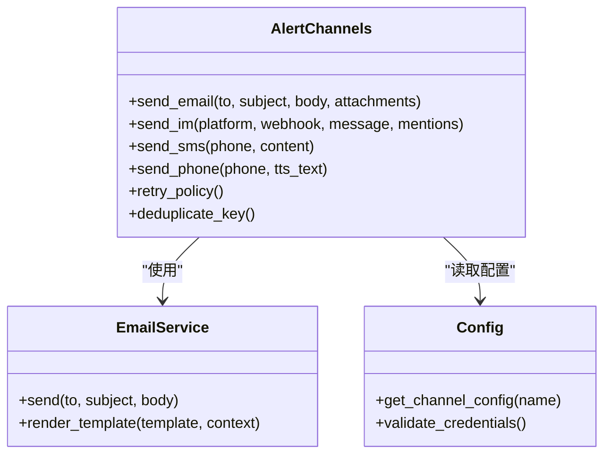
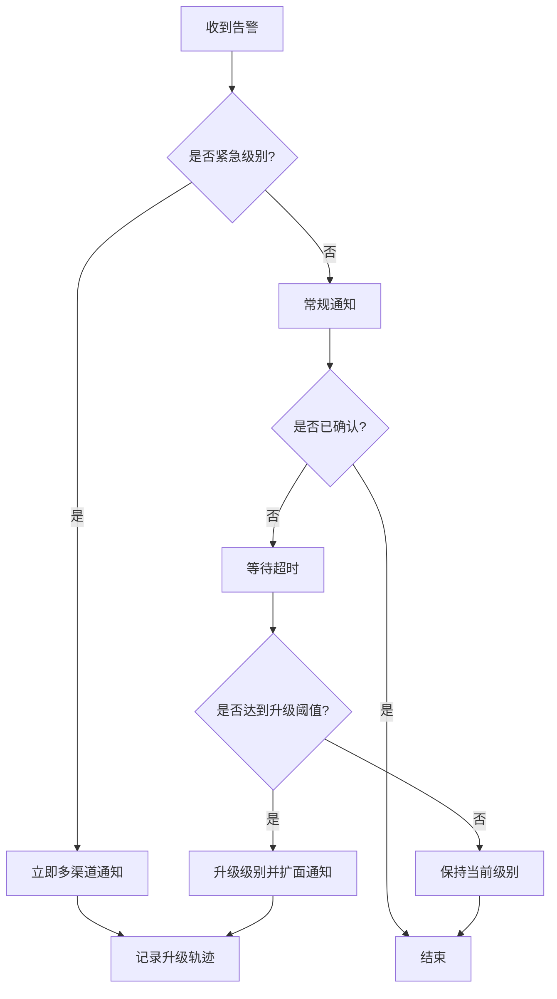
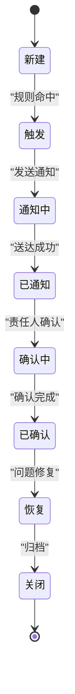
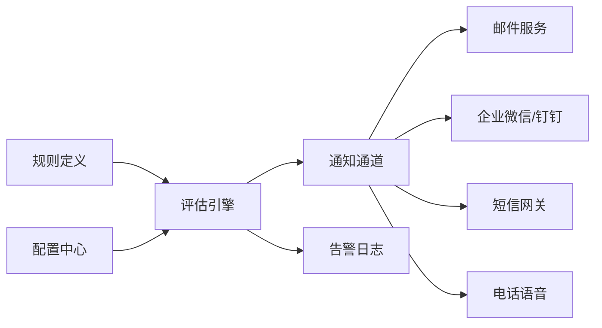

# 告警配置

<cite>
**本文引用的文件**   
- [backend/app/services/monitoring/alert_rules.py](file://backend/app/services/monitoring/alert_rules.py)
- [backend/app/services/monitoring/alert_engine.py](file://backend/app/services/monitoring/alert_engine.py)
- [backend/app/services/monitoring/alert_channels.py](file://backend/app/services/monitoring/alert_channels.py)
- [backend/app/services/email_service.py](file://backend/app/services/email_service.py)
- [backend/app/core/config.py](file://backend/app/core/config.py)
- [backend/app/api/v1/monitoring.py](file://backend/app/api/v1/monitoring.py)
- [backend/app/models/alert_log.py](file://backend/app/models/alert_log.py)
- [backend/app/services/auto_tracking.py](file://backend/app/services/auto_tracking.py)
- [backend/app/celery_app.py](file://backend/app/celery_app.py)
</cite>

## 目录
1. [简介](#简介)
2. [项目结构](#项目结构)
3. [核心组件](#核心组件)
4. [架构总览](#架构总览)
5. [详细组件分析](#详细组件分析)
6. [依赖关系分析](#依赖关系分析)
7. [性能考量](#性能考量)
8. [故障排查指南](#故障排查指南)
9. [结论](#结论)
10. [附录](#附录)

## 简介
本文件为小说创作代理系统的“告警配置”专项文档，面向运维与研发人员，系统化说明告警规则设计原则、阈值设置方法、告警分级策略、误报率控制；详述通知渠道（邮件、企业微信/钉钉、短信、电话）的配置要点；解释告警升级机制（未响应自动升级、紧急事件快速响应、抑制策略）；规范告警状态管理（确认流程、历史追踪、统计分析）；并给出优化建议（动态阈值、智能降噪、避免告警疲劳）。

## 项目结构
告警子系统位于后端服务中，围绕“规则—引擎—通道—存储—调度”分层组织：
- 规则层：定义指标、阈值、分组与抑制策略
- 引擎层：采集指标、评估规则、生成告警事件
- 通道层：统一封装邮件、IM、短信、电话等通知能力
- 存储层：持久化告警日志与状态
- 调度层：异步任务与定时任务驱动评估与通知

图表来源
- [backend/app/services/monitoring/alert_rules.py](file://backend/app/services/monitoring/alert_rules.py)
- [backend/app/services/monitoring/alert_engine.py](file://backend/app/services/monitoring/alert_engine.py)
- [backend/app/services/monitoring/alert_channels.py](file://backend/app/services/monitoring/alert_channels.py)
- [backend/app/services/email_service.py](file://backend/app/services/email_service.py)
- [backend/app/models/alert_log.py](file://backend/app/models/alert_log.py)
- [backend/app/celery_app.py](file://backend/app/celery_app.py)

章节来源
- [backend/app/services/monitoring/alert_rules.py](file://backend/app/services/monitoring/alert_rules.py)
- [backend/app/services/monitoring/alert_engine.py](file://backend/app/services/monitoring/alert_engine.py)
- [backend/app/services/monitoring/alert_channels.py](file://backend/app/services/monitoring/alert_channels.py)
- [backend/app/services/email_service.py](file://backend/app/services/email_service.py)
- [backend/app/models/alert_log.py](file://backend/app/models/alert_log.py)
- [backend/app/celery_app.py](file://backend/app/celery_app.py)

## 核心组件
- 规则定义模块：集中维护指标、阈值、分组标签、抑制策略与升级策略
- 评估引擎：周期性或事件驱动地计算指标，匹配规则，产出告警事件
- 通知通道：统一抽象多种通知方式，支持重试、去重、模板渲染
- 告警日志：记录告警生命周期（触发、升级、确认、恢复、抑制）
- 异步调度：基于任务队列执行耗时操作（如批量通知、统计汇总）

章节来源
- [backend/app/services/monitoring/alert_rules.py](file://backend/app/services/monitoring/alert_rules.py)
- [backend/app/services/monitoring/alert_engine.py](file://backend/app/services/monitoring/alert_engine.py)
- [backend/app/services/monitoring/alert_channels.py](file://backend/app/services/monitoring/alert_channels.py)
- [backend/app/models/alert_log.py](file://backend/app/models/alert_log.py)
- [backend/app/celery_app.py](file://backend/app/celery_app.py)

## 架构总览
告警子系统采用“规则驱动+事件流”的架构。指标由上游采集器提供，评估引擎按时间窗口与条件判断是否触发；触发的告警进入通道层进行多渠道分发，同时写入告警日志用于追踪与分析。

图表来源
- [backend/app/services/monitoring/alert_engine.py](file://backend/app/services/monitoring/alert_engine.py)
- [backend/app/services/monitoring/alert_rules.py](file://backend/app/services/monitoring/alert_rules.py)
- [backend/app/services/monitoring/alert_channels.py](file://backend/app/services/monitoring/alert_channels.py)
- [backend/app/services/email_service.py](file://backend/app/services/email_service.py)
- [backend/app/models/alert_log.py](file://backend/app/models/alert_log.py)

## 详细组件分析

### 告警规则设计与阈值设置
- 指标维度：CPU、内存、磁盘、请求延迟、错误率、队列积压、第三方调用失败率、内容安全审核通过率等
- 阈值方法：固定阈值、同比/环比波动、分位数（P95/P99）、滑动窗口异常检测
- 分组与标签：按项目、章节、媒体类型、模型提供方、环境（dev/staging/prod）分组
- 抑制策略：同组内重复抑制、静默时段、依赖故障级联抑制
- 升级策略：未响应N分钟自动升级至更高级别与更多接收人

图表来源
- [backend/app/services/monitoring/alert_rules.py](file://backend/app/services/monitoring/alert_rules.py)
- [backend/app/services/monitoring/alert_engine.py](file://backend/app/services/monitoring/alert_engine.py)

章节来源
- [backend/app/services/monitoring/alert_rules.py](file://backend/app/services/monitoring/alert_rules.py)
- [backend/app/services/monitoring/alert_engine.py](file://backend/app/services/monitoring/alert_engine.py)

### 告警分级策略与误报率控制
- 分级标准：信息（I）、警告（W）、严重（C）、致命（F），对应不同响应SLA与升级节奏
- 误报控制：多指标联合判定、基线自适应、抖动过滤（最小持续时间）、白名单与排除规则
- 质量度量：误报率、漏报率、平均修复时间（MTTR）、通知到达率

章节来源
- [backend/app/services/monitoring/alert_rules.py](file://backend/app/services/monitoring/alert_rules.py)

### 通知渠道配置
- 邮件通知：SMTP配置、收件人列表、模板变量、附件（可选）、重试与退信处理
- 企业微信/钉钉：Webhook地址、签名校验、消息卡片、@指定人员、群机器人
- 短信告警：服务商密钥、号码白名单、频率限制、敏感词过滤
- 电话通知：TTS文本转语音、拨号策略、忙线重试、录音归档

图表来源
- [backend/app/services/monitoring/alert_channels.py](file://backend/app/services/monitoring/alert_channels.py)
- [backend/app/services/email_service.py](file://backend/app/services/email_service.py)
- [backend/app/core/config.py](file://backend/app/core/config.py)

章节来源
- [backend/app/services/monitoring/alert_channels.py](file://backend/app/services/monitoring/alert_channels.py)
- [backend/app/services/email_service.py](file://backend/app/services/email_service.py)
- [backend/app/core/config.py](file://backend/app/core/config.py)

### 告警升级机制
- 未响应自动升级：首次通知后N分钟未确认则升级级别并扩大受众
- 紧急事件快速响应：致命级别跳过抑制、直拨电话并@负责人
- 告警抑制策略：同组重复抑制、维护期静默、依赖故障级联抑制

图表来源
- [backend/app/services/monitoring/alert_engine.py](file://backend/app/services/monitoring/alert_engine.py)
- [backend/app/services/monitoring/alert_rules.py](file://backend/app/services/monitoring/alert_rules.py)

章节来源
- [backend/app/services/monitoring/alert_engine.py](file://backend/app/services/monitoring/alert_engine.py)
- [backend/app/services/monitoring/alert_rules.py](file://backend/app/services/monitoring/alert_rules.py)

### 告警状态管理与追踪
- 状态机：新建→触发→通知中→已通知→确认中→已确认→恢复→关闭
- 确认流程：责任人确认、批量确认、备注与处置动作
- 历史追踪：全链路审计日志、变更时间线、关联工单
- 统计分析：按级别/分组/渠道统计，趋势与报表导出

图表来源
- [backend/app/models/alert_log.py](file://backend/app/models/alert_log.py)
- [backend/app/services/monitoring/alert_engine.py](file://backend/app/services/monitoring/alert_engine.py)

章节来源
- [backend/app/models/alert_log.py](file://backend/app/models/alert_log.py)
- [backend/app/services/monitoring/alert_engine.py](file://backend/app/services/monitoring/alert_engine.py)

### API与集成点
- 监控API：查询告警列表、确认/取消确认、导出统计
- 配置接口：更新规则、渠道配置、抑制策略
- 回调接口：第三方平台回调（如IM回执、短信送达）

章节来源
- [backend/app/api/v1/monitoring.py](file://backend/app/api/v1/monitoring.py)

### 异步调度与任务编排
- 任务类型：指标评估、通知发送、统计汇总、清理过期数据
- 重试与死信：指数退避、最大重试次数、失败入死信队列
- 限流与背压：按渠道限流、按租户隔离

章节来源
- [backend/app/celery_app.py](file://backend/app/celery_app.py)

## 依赖关系分析
- 内部依赖：评估引擎依赖规则库与配置中心；通道层依赖邮件服务与各类网关；日志模型依赖数据库
- 外部依赖：SMTP、IM Webhook、短信网关、电话语音服务
- 耦合度：通道层通过抽象接口解耦具体实现；规则与引擎松耦合便于扩展

图表来源
- [backend/app/services/monitoring/alert_rules.py](file://backend/app/services/monitoring/alert_rules.py)
- [backend/app/services/monitoring/alert_engine.py](file://backend/app/services/monitoring/alert_engine.py)
- [backend/app/services/monitoring/alert_channels.py](file://backend/app/services/monitoring/alert_channels.py)
- [backend/app/services/email_service.py](file://backend/app/services/email_service.py)
- [backend/app/models/alert_log.py](file://backend/app/models/alert_log.py)

章节来源
- [backend/app/services/monitoring/alert_rules.py](file://backend/app/services/monitoring/alert_rules.py)
- [backend/app/services/monitoring/alert_engine.py](file://backend/app/services/monitoring/alert_engine.py)
- [backend/app/services/monitoring/alert_channels.py](file://backend/app/services/monitoring/alert_channels.py)
- [backend/app/services/email_service.py](file://backend/app/services/email_service.py)
- [backend/app/models/alert_log.py](file://backend/app/models/alert_log.py)

## 性能考量
- 评估周期：按指标重要性设置不同评估间隔，热点指标高频、冷指标低频
- 批处理：批量拉取指标、批量发送通知，降低IO开销
- 缓存与去重：对频繁告警进行键值去重，减少重复通知
- 资源隔离：按租户/项目隔离任务队列，避免相互影响
- 降级策略：通道不可用时切换备用通道或延迟重试

## 故障排查指南
- 常见问题
  - 通知未送达：检查渠道配置、网络连通性、配额与限流
  - 告警风暴：启用抑制策略、调整阈值、增加抖动过滤
  - 升级不生效：核对升级阈值、责任人绑定、确认超时设置
- 诊断步骤
  - 查看告警日志时间线与状态流转
  - 检查规则命中与抑制命中情况
  - 验证渠道凭证与回调回执
  - 定位任务队列堆积与失败重试

章节来源
- [backend/app/models/alert_log.py](file://backend/app/models/alert_log.py)
- [backend/app/services/monitoring/alert_engine.py](file://backend/app/services/monitoring/alert_engine.py)
- [backend/app/services/monitoring/alert_channels.py](file://backend/app/services/monitoring/alert_channels.py)

## 结论
通过“规则驱动+事件流”的告警体系，结合多级通知与升级机制，可有效提升小说创作代理系统的可观测性与稳定性。建议持续完善动态阈值与智能降噪，建立告警治理闭环，降低告警疲劳，提高MTTR改善效果。

## 附录
- 最佳实践清单
  - 明确告警目标与SLA，避免过度告警
  - 合理分组与标签，确保可定位与可聚合
  - 多渠道冗余，关键事件电话直达
  - 定期复盘告警质量，优化阈值与抑制策略
  - 自动化演练与回归测试，保障通道可用性