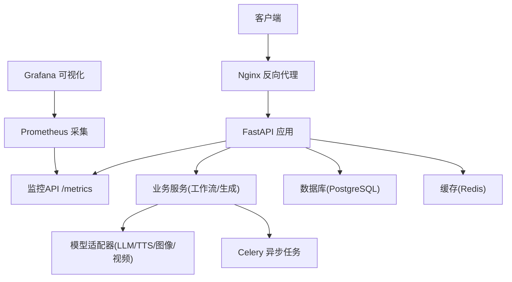
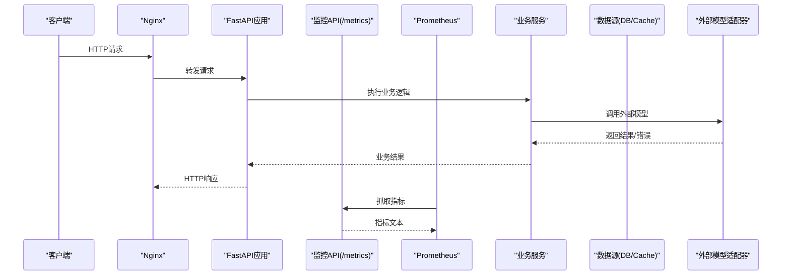
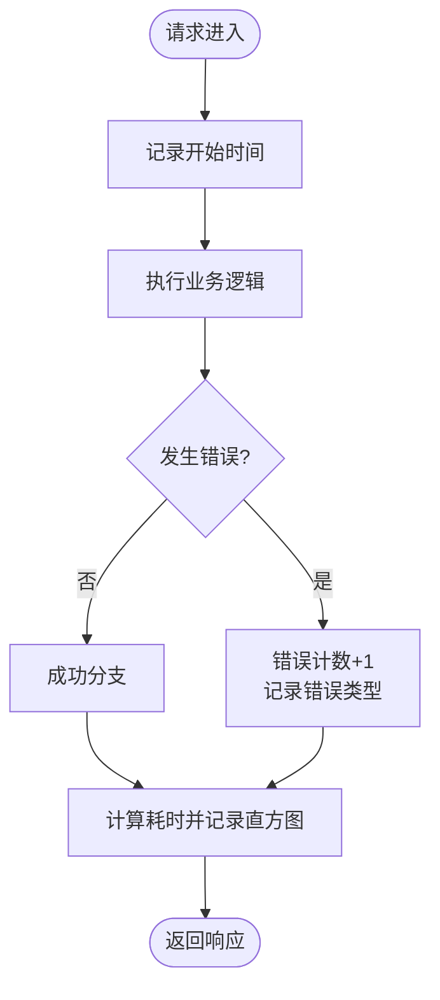
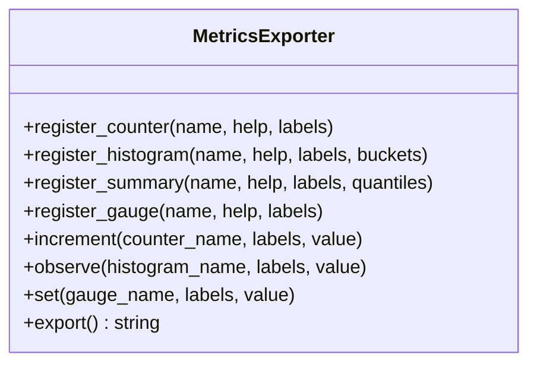
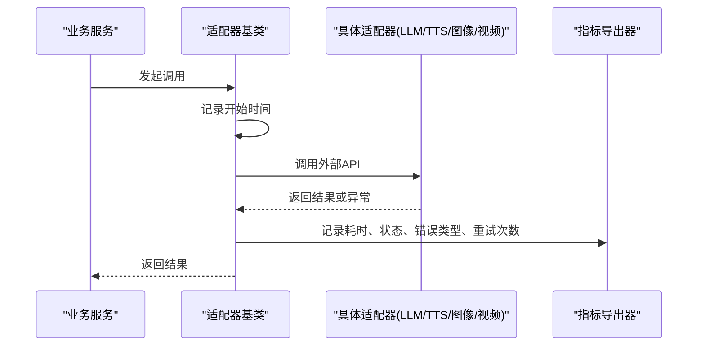
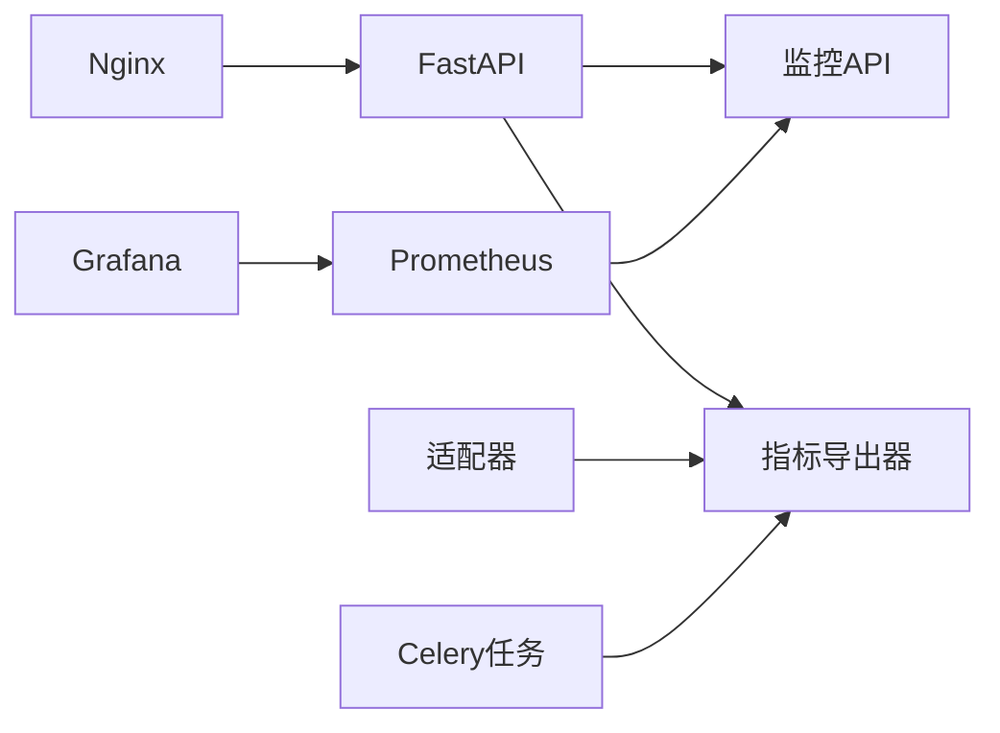

# 性能监控

<cite>
**本文引用的文件**   
- [backend/app/main.py](file://backend/app/main.py)
- [backend/app/api/v1/monitoring.py](file://backend/app/api/v1/monitoring.py)
- [backend/app/services/monitoring/metrics_exporter.py](file://backend/app/services/monitoring/metrics_exporter.py)
- [backend/app/core/config.py](file://backend/app/core/config.py)
- [backend/app/celery_app.py](file://backend/app/celery_app.py)
- [adapters/base.py](file://adapters/base.py)
- [adapters/rate_limiter.py](file://adapters/rate_limiter.py)
- [core/telemetry/__init__.py](file://core/telemetry/__init__.py)
- [scripts/story_expansion_benchmark.py](file://scripts/story_expansion_benchmark.py)
- [docker-compose.yml](file://docker-compose.yml)
- [nginx.conf](file://nginx.conf)
</cite>

## 目录
1. [简介](#简介)
2. [项目结构](#项目结构)
3. [核心组件](#核心组件)
4. [架构总览](#架构总览)
5. [详细组件分析](#详细组件分析)
6. [依赖关系分析](#依赖关系分析)
7. [性能考量](#性能考量)
8. [故障排查指南](#故障排查指南)
9. [结论](#结论)
10. [附录](#附录)

## 简介
本文件为小说创作代理系统的性能监控与基准测试文档，覆盖以下目标：
- 定义关键性能指标（KPI）：API响应时间、吞吐量、错误率、资源使用率（CPU、内存、磁盘I/O）。
- 说明自定义监控点的埋点实现：业务指标定义、数据采集、指标聚合。
- 解释Prometheus指标暴露配置：命名规范、标签设计、采样策略。
- 提供性能基准测试方法：负载测试、压力测试、性能回归检测。
- 给出性能优化建议：瓶颈识别、缓存策略、数据库查询优化、异步处理优化。

## 项目结构
系统采用后端FastAPI服务 + Celery异步任务 + Nginx反向代理 + Prometheus/Grafana观测的常见架构。监控相关代码主要分布在：
- API层：监控端点与中间件埋点
- 服务层：指标导出器、限流器、Celery任务追踪
- 适配器层：外部模型调用耗时与错误统计
- 配置层：Prometheus暴露开关、端口与路径
- 基础设施：Nginx访问日志、Docker容器资源限制

**图表来源** 
- [backend/app/main.py](file://backend/app/main.py)
- [backend/app/api/v1/monitoring.py](file://backend/app/api/v1/monitoring.py)
- [backend/app/services/monitoring/metrics_exporter.py](file://backend/app/services/monitoring/metrics_exporter.py)
- [adapters/base.py](file://adapters/base.py)
- [adapters/rate_limiter.py](file://adapters/rate_limiter.py)
- [backend/app/celery_app.py](file://backend/app/celery_app.py)
- [nginx.conf](file://nginx.conf)
- [docker-compose.yml](file://docker-compose.yml)

**章节来源**
- [backend/app/main.py](file://backend/app/main.py)
- [backend/app/api/v1/monitoring.py](file://backend/app/api/v1/monitoring.py)
- [backend/app/services/monitoring/metrics_exporter.py](file://backend/app/services/monitoring/metrics_exporter.py)
- [backend/app/core/config.py](file://backend/app/core/config.py)
- [adapters/base.py](file://adapters/base.py)
- [adapters/rate_limiter.py](file://adapters/rate_limiter.py)
- [backend/app/celery_app.py](file://backend/app/celery_app.py)
- [core/telemetry/__init__.py](file://core/telemetry/__init__.py)
- [scripts/story_expansion_benchmark.py](file://scripts/story_expansion_benchmark.py)
- [docker-compose.yml](file://docker-compose.yml)
- [nginx.conf](file://nginx.conf)

## 核心组件
- 监控API与中间件：统一记录请求生命周期、状态码、耗时、错误分类；暴露Prometheus指标端点。
- 指标导出器：封装Prometheus计数器、直方图、摘要等类型，提供统一的命名与标签约定。
- 适配器埋点：在外部模型调用前后记录耗时、重试次数、失败原因、配额限制等。
- 限流器埋点：记录被拒绝的请求数、触发阈值、IP/用户维度。
- Celery任务埋点：任务入队/执行/完成/失败时长、队列长度、重试次数。
- 配置项：是否启用Prometheus、指标端口、路径、采样间隔、标签白名单。

**章节来源**
- [backend/app/api/v1/monitoring.py](file://backend/app/api/v1/monitoring.py)
- [backend/app/services/monitoring/metrics_exporter.py](file://backend/app/services/monitoring/metrics_exporter.py)
- [adapters/base.py](file://adapters/base.py)
- [adapters/rate_limiter.py](file://adapters/rate_limiter.py)
- [backend/app/celery_app.py](file://backend/app/celery_app.py)
- [backend/app/core/config.py](file://backend/app/core/config.py)

## 架构总览
下图展示从请求进入Nginx到返回响应的全链路监控视角，以及Prometheus对指标的采集路径。

**图表来源** 
- [nginx.conf](file://nginx.conf)
- [backend/app/main.py](file://backend/app/main.py)
- [backend/app/api/v1/monitoring.py](file://backend/app/api/v1/monitoring.py)
- [backend/app/services/monitoring/metrics_exporter.py](file://backend/app/services/monitoring/metrics_exporter.py)
- [adapters/base.py](file://adapters/base.py)

## 详细组件分析

### 监控API与中间件
- 职责：记录HTTP请求的起止时间、状态码、路径、方法、用户标识（脱敏）、错误类别；暴露Prometheus指标端点。
- 关键指标：
  - 请求总数（计数器）
  - 响应时延分布（直方图/摘要）
  - 错误计数（按状态码、错误类型）
  - 并发/队列长度（可选）
- 标签设计：method、path、status_code、error_class、user_id（可选）、region（可选）

**图表来源** 
- [backend/app/api/v1/monitoring.py](file://backend/app/api/v1/monitoring.py)
- [backend/app/services/monitoring/metrics_exporter.py](file://backend/app/services/monitoring/metrics_exporter.py)

**章节来源**
- [backend/app/api/v1/monitoring.py](file://backend/app/api/v1/monitoring.py)
- [backend/app/services/monitoring/metrics_exporter.py](file://backend/app/services/monitoring/metrics_exporter.py)

### 指标导出器（Prometheus）
- 职责：封装Prometheus客户端，提供统一的指标注册、更新、导出接口。
- 指标类型：Counter（累计计数）、Histogram（延迟分布）、Summary（分位数）、Gauge（瞬时值）。
- 命名规范：模块_子模块_指标名，单位后缀（如_seconds、_total），避免特殊字符。
- 标签约束：固定白名单（如method、path、status_code、error_class、model_name、provider），禁止高基数标签（如随机ID）。
- 采样策略：直方图分位选择（如0.5/0.9/0.95/0.99），摘要采样窗口与分辨率。

**图表来源** 
- [backend/app/services/monitoring/metrics_exporter.py](file://backend/app/services/monitoring/metrics_exporter.py)

**章节来源**
- [backend/app/services/monitoring/metrics_exporter.py](file://backend/app/services/monitoring/metrics_exporter.py)
- [backend/app/core/config.py](file://backend/app/core/config.py)

### 适配器埋点（外部模型调用）
- 职责：在LLM/TTS/图像/视频等适配器调用前后记录耗时、重试、失败原因、速率限制、超时。
- 关键指标：
  - 调用次数（按provider/model）
  - 调用耗时分布
  - 失败计数（按错误类型：超时、限流、鉴权失败、内容安全拦截）
  - 重试次数与成功率
- 标签设计：provider、model_name、task_type、error_type、retry_count

**图表来源** 
- [adapters/base.py](file://adapters/base.py)
- [adapters/rate_limiter.py](file://adapters/rate_limiter.py)
- [backend/app/services/monitoring/metrics_exporter.py](file://backend/app/services/monitoring/metrics_exporter.py)

**章节来源**
- [adapters/base.py](file://adapters/base.py)
- [adapters/rate_limiter.py](file://adapters/rate_limiter.py)
- [backend/app/services/monitoring/metrics_exporter.py](file://backend/app/services/monitoring/metrics_exporter.py)

### 限流器埋点
- 职责：记录被拒绝的请求数量、触发阈值、来源（IP/用户）、时间段。
- 关键指标：rate_limit_rejected_total、rate_limit_window_seconds、rate_limit_max_requests。
- 标签设计：policy、source_ip、user_id（可选）、endpoint。

**章节来源**
- [adapters/rate_limiter.py](file://adapters/rate_limiter.py)
- [backend/app/services/monitoring/metrics_exporter.py](file://backend/app/services/monitoring/metrics_exporter.py)

### Celery任务埋点
- 职责：记录任务入队、执行、完成、失败、重试的时长与计数。
- 关键指标：celery_task_enqueued_total、celery_task_duration_seconds、celery_task_failed_total、celery_queue_length。
- 标签设计：task_name、queue、worker、error_type、retry_count。

**章节来源**
- [backend/app/celery_app.py](file://backend/app/celery_app.py)
- [backend/app/services/monitoring/metrics_exporter.py](file://backend/app/services/monitoring/metrics_exporter.py)

### 配置与暴露
- 配置项：
  - 是否启用Prometheus导出
  - 指标端口与路径（默认/export或/metrics）
  - 采样间隔（拉取周期）
  - 标签白名单与黑名单
- 暴露方式：
  - FastAPI路由暴露指标端点
  - Nginx可透传或单独监听指标端口
  - Docker容器端口映射

**章节来源**
- [backend/app/core/config.py](file://backend/app/core/config.py)
- [backend/app/api/v1/monitoring.py](file://backend/app/api/v1/monitoring.py)
- [nginx.conf](file://nginx.conf)
- [docker-compose.yml](file://docker-compose.yml)

## 依赖关系分析
- FastAPI应用依赖监控API与指标导出器，用于记录HTTP请求与业务指标。
- 适配器依赖指标导出器，用于记录外部调用性能与错误。
- Celery任务依赖指标导出器，用于记录任务生命周期指标。
- Nginx作为入口，可记录访问日志并转发至FastAPI。
- Prometheus通过拉取指标端点获取指标，Grafana进行可视化。

**图表来源** 
- [backend/app/main.py](file://backend/app/main.py)
- [backend/app/api/v1/monitoring.py](file://backend/app/api/v1/monitoring.py)
- [backend/app/services/monitoring/metrics_exporter.py](file://backend/app/services/monitoring/metrics_exporter.py)
- [adapters/base.py](file://adapters/base.py)
- [backend/app/celery_app.py](file://backend/app/celery_app.py)
- [nginx.conf](file://nginx.conf)
- [docker-compose.yml](file://docker-compose.yml)

**章节来源**
- [backend/app/main.py](file://backend/app/main.py)
- [backend/app/api/v1/monitoring.py](file://backend/app/api/v1/monitoring.py)
- [backend/app/services/monitoring/metrics_exporter.py](file://backend/app/services/monitoring/metrics_exporter.py)
- [adapters/base.py](file://adapters/base.py)
- [backend/app/celery_app.py](file://backend/app/celery_app.py)
- [nginx.conf](file://nginx.conf)
- [docker-compose.yml](file://docker-compose.yml)

## 性能考量
- 指标开销控制：
  - 使用直方图而非摘要以降低内存占用
  - 限制标签基数，避免高基数导致存储爆炸
  - 合理设置分位与桶边界，平衡精度与开销
- 采集频率：
  - Prometheus拉取间隔建议15-30秒
  - 长耗时任务使用增量上报，避免频繁写盘
- 资源使用率：
  - CPU：进程级与线程池利用率
  - 内存：RSS、堆分配、GC停顿
  - 磁盘I/O：读写吞吐、延迟、缓存命中率
  - 网络：连接数、带宽、重传率
- 错误率：
  - 按状态码、错误类型、模块维度统计
  - 区分可恢复错误与致命错误

[本节为通用指导，不直接分析具体文件]

## 故障排查指南
- 常见问题定位：
  - 高延迟：检查适配器超时、数据库慢查询、缓存未命中、队列堆积
  - 高错误率：查看错误分类、限流触发、鉴权失败、内容安全拦截
  - 资源耗尽：CPU饱和、内存泄漏、磁盘IO瓶颈、连接池耗尽
- 排查步骤：
  - 查看监控API与指标端点，确认指标是否正常暴露
  - 检查Nginx访问日志与错误日志
  - 检查Celery任务队列长度与失败重试
  - 检查数据库慢查询与索引使用情况
  - 检查缓存命中率与连接池状态
- 工具建议：
  - Prometheus告警规则（延迟P95/P99、错误率阈值）
  - Grafana看板（请求量、延迟分布、错误分类、资源使用）
  - 分布式追踪（可选）关联请求链路

**章节来源**
- [backend/app/api/v1/monitoring.py](file://backend/app/api/v1/monitoring.py)
- [backend/app/services/monitoring/metrics_exporter.py](file://backend/app/services/monitoring/metrics_exporter.py)
- [nginx.conf](file://nginx.conf)
- [backend/app/celery_app.py](file://backend/app/celery_app.py)

## 结论
通过统一的监控API、指标导出器与适配器埋点，系统能够全面采集API响应时间、吞吐量、错误率与资源使用率等关键指标。结合Prometheus与Grafana，可实现实时可视化与告警。配合基准测试与持续性能回归检测，有助于快速定位瓶颈并实施优化。

[本节为总结性内容，不直接分析具体文件]

## 附录

### 关键性能指标定义与采集方法
- API响应时间：
  - 定义：从请求进入FastAPI到返回响应的总耗时
  - 采集：中间件记录起止时间，写入直方图
  - 分位：P50/P90/P95/P99
- 吞吐量：
  - 定义：单位时间内处理的请求数（QPS）
  - 采集：计数器每秒增量
- 错误率：
  - 定义：错误请求数/总请求数
  - 采集：按状态码与错误类型计数
- 资源使用率：
  - CPU：进程CPU百分比
  - 内存：RSS、堆大小、GC停顿
  - 磁盘I/O：读写吞吐、延迟、缓存命中率
  - 网络：连接数、带宽、重传率

[本节为通用指导，不直接分析具体文件]

### 自定义监控点埋点实现
- 业务指标定义：
  - 生成任务：创建、编辑、审核、发布各阶段耗时与成功率
  - 语音合成：TTS调用耗时、失败率、重试次数
  - 图像/视频：模型调用耗时、失败率、内容安全拦截率
- 数据采集：
  - 在关键函数入口/出口记录时间戳
  - 使用指标导出器记录计数器、直方图、摘要
- 指标聚合计算：
  - 按模块、任务类型、提供者维度聚合
  - 计算分位、均值、标准差、错误率

**章节来源**
- [backend/app/services/monitoring/metrics_exporter.py](file://backend/app/services/monitoring/metrics_exporter.py)
- [adapters/base.py](file://adapters/base.py)
- [adapters/rate_limiter.py](file://adapters/rate_limiter.py)

### Prometheus指标暴露配置
- 命名规范：
  - 模块_子模块_指标名_单位（如http_request_duration_seconds_total）
  - 避免特殊字符与中文
- 标签设计：
  - 固定白名单：method、path、status_code、error_class、provider、model_name
  - 禁止高基数标签：用户ID、随机字符串
- 采样策略：
  - 直方图分位：0.5/0.9/0.95/0.99
  - 摘要窗口：1分钟/5分钟
  - 拉取间隔：15-30秒

**章节来源**
- [backend/app/api/v1/monitoring.py](file://backend/app/api/v1/monitoring.py)
- [backend/app/services/monitoring/metrics_exporter.py](file://backend/app/services/monitoring/metrics_exporter.py)
- [backend/app/core/config.py](file://backend/app/core/config.py)

### 性能基准测试方法
- 负载测试：
  - 模拟正常流量，验证系统稳定性与容量
  - 工具：wrk、locust、jmeter
- 压力测试：
  - 逐步增加并发，寻找系统瓶颈与崩溃点
  - 关注CPU、内存、磁盘I/O、网络带宽
- 性能回归检测：
  - 每次变更运行基准脚本，对比关键指标
  - 工具：内置基准脚本、CI集成

**章节来源**
- [scripts/story_expansion_benchmark.py](file://scripts/story_expansion_benchmark.py)

### 性能优化建议
- 瓶颈识别：
  - 使用APM或分布式追踪定位热点函数
  - 数据库慢查询分析与索引优化
  - 缓存命中率提升与预热
- 缓存策略：
  - 热点数据Redis缓存，设置合理过期时间
  - 多级缓存（本地+分布式）
- 数据库查询优化：
  - 减少N+1查询，使用批量查询
  - 分页与游标优化
- 异步处理优化：
  - Celery任务拆分与并行化
  - 队列优先级与限流

[本节为通用指导，不直接分析具体文件]