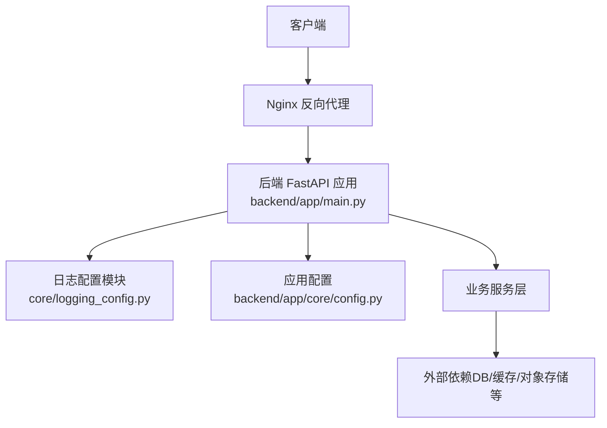
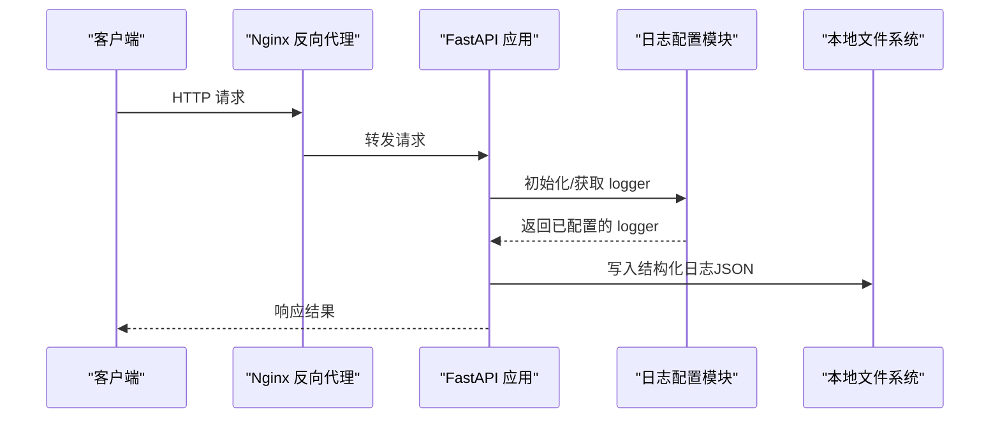
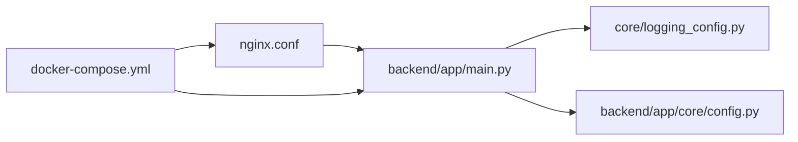

# 日志系统

<cite>
**本文引用的文件**   
- [core/logging_config.py](file://core/logging_config.py)
- [backend/app/main.py](file://backend/app/main.py)
- [backend/app/core/config.py](file://backend/app/core/config.py)
- [docker-compose.yml](file://docker-compose.yml)
- [nginx.conf](file://nginx.conf)
- [backend/requirements.txt](file://backend/requirements.txt)
</cite>

## 目录
1. [简介](#简介)
2. [项目结构](#项目结构)
3. [核心组件](#核心组件)
4. [架构总览](#架构总览)
5. [详细组件分析](#详细组件分析)
6. [依赖关系分析](#依赖关系分析)
7. [性能考量](#性能考量)
8. [故障排查指南](#故障排查指南)
9. [结论](#结论)
10. [附录](#附录)

## 简介
本文件为小说创作代理系统的日志管理文档，聚焦结构化日志格式设计、本地与集中式收集、索引优化、分析与安全最佳实践。目标读者包括开发者、运维工程师与合规审计人员。文档基于仓库中的日志配置与应用入口进行梳理，并给出可落地的工程化建议。

## 项目结构
本项目采用前后端分离与多服务编排的架构：
- 后端应用（FastAPI）通过统一入口启动，并在启动阶段加载日志配置。
- 前端通过 Nginx 反向代理对外暴露接口。
- 容器编排使用 docker-compose 管理服务与依赖（如数据库、缓存等）。
- 日志相关代码集中在 core/logging_config.py，应用主入口在 backend/app/main.py，配置中心在 backend/app/core/config.py。

**图表来源** 
- [backend/app/main.py](file://backend/app/main.py)
- [core/logging_config.py](file://core/logging_config.py)
- [backend/app/core/config.py](file://backend/app/core/config.py)
- [nginx.conf](file://nginx.conf)
- [docker-compose.yml](file://docker-compose.yml)

**章节来源**
- [backend/app/main.py](file://backend/app/main.py)
- [core/logging_config.py](file://core/logging_config.py)
- [backend/app/core/config.py](file://backend/app/core/config.py)
- [nginx.conf](file://nginx.conf)
- [docker-compose.yml](file://docker-compose.yml)

## 核心组件
- 日志配置模块：负责初始化 Python logging、设置格式化器、输出目标（控制台/文件）、级别控制与线程安全策略。
- 应用主入口：在进程启动时加载配置并注册中间件、路由，确保日志框架在请求处理前就绪。
- 应用配置：提供运行时开关（如是否启用结构化日志、输出路径、轮转参数），供日志模块读取。

关键职责边界：
- 日志配置模块不耦合业务逻辑，仅关注“如何记录”和“输出到哪里”。
- 应用主入口保证生命周期内日志可用，避免首次写入时的竞态。
- 配置模块将环境差异（开发/测试/生产）抽象为环境变量或配置文件项。

**章节来源**
- [core/logging_config.py](file://core/logging_config.py)
- [backend/app/main.py](file://backend/app/main.py)
- [backend/app/core/config.py](file://backend/app/core/config.py)

## 架构总览
下图展示从请求进入 Nginx 到后端应用记录结构化日志，再到本地文件输出的整体流程。后续可扩展至集中式采集（Fluentd/Logstash）与 ELK 分析。

**图表来源** 
- [nginx.conf](file://nginx.conf)
- [backend/app/main.py](file://backend/app/main.py)
- [core/logging_config.py](file://core/logging_config.py)

## 详细组件分析

### 结构化日志格式设计
- 推荐字段清单（JSON）：
  - timestamp：ISO 8601 时间戳（UTC）
  - level：日志级别（DEBUG、INFO、WARNING、ERROR、CRITICAL）
  - logger：模块/类名
  - message：人类可读消息
  - trace_id：链路追踪 ID（跨服务关联）
  - span_id：当前调用片段 ID
  - service：服务名称（如 novel-backend）
  - env：运行环境（dev/test/prod）
  - host：主机名或实例标识
  - pid/tid：进程/线程标识
  - request_id：HTTP 请求 ID（便于定位一次请求）
  - user_id：用户标识（可选，需脱敏）
  - duration_ms：耗时（毫秒，可选）
  - error_code：错误码（可选）
  - stack_trace：堆栈信息（ERROR/CRITICAL 时附加）
- 字段约束：
  - 所有字符串字段禁止包含换行符；必要时转义或截断。
  - 数值字段保持类型一致（如 duration_ms 为整数）。
  - 敏感字段必须脱敏（手机号、身份证、密钥、Token 等）。
- 输出目标：
  - 开发环境：控制台 + 本地文件
  - 生产环境：本地文件 + 异步采集器（Fluentd/Logstash）

**章节来源**
- [core/logging_config.py](file://core/logging_config.py)
- [backend/app/core/config.py](file://backend/app/core/config.py)

### 日志级别划分
- DEBUG：调试信息，仅在开发/测试开启，避免生产噪音。
- INFO：正常业务流程事件（请求开始/结束、任务完成）。
- WARNING：潜在问题（重试、降级、限流触发）。
- ERROR：可恢复异常（下游超时、参数校验失败）。
- CRITICAL：不可恢复异常（进程崩溃、数据损坏）。

使用建议：
- 对每次 HTTP 请求至少记录 INFO 级别的开始与结束事件，附带 trace_id、request_id、duration_ms。
- 对异常捕获统一打 ERROR，并附带 error_code 与必要上下文。
- 谨慎使用 CRITICAL，仅用于需要立即告警的场景。

**章节来源**
- [core/logging_config.py](file://core/logging_config.py)

### 本地日志文件管理与轮转
- 文件命名：按服务与环境组织，例如 logs/{service}/{env}/app.log。
- 轮转策略：
  - 按大小：单文件超过阈值（如 100MB）自动轮转。
  - 按时间：每日/每小时滚动，保留固定数量（如 7 天）。
  - 压缩：旧文件 gzip 压缩以节省空间。
- 权限与安全：
  - 限制日志目录读写权限（仅应用用户）。
  - 禁止写入敏感明文。

实现要点：
- 使用 Python logging.handlers.RotatingFileHandler 或 TimedRotatingFileHandler。
- 结合环境变量控制轮转参数（maxBytes、backupCount、when、interval）。

**章节来源**
- [core/logging_config.py](file://core/logging_config.py)

### 集中式日志收集方案（ELK + Fluentd/Logstash）
- 采集器：
  - Fluentd：轻量、插件丰富，适合容器化部署。
  - Logstash：功能强大，适合复杂过滤与解析。
- 索引设计：
  - 按日期分片：index-{service}-{YYYY.MM.DD}
  - 字段映射：timestamp/date、level/keyword、trace_id/keyword、message/text
  - 别名：latest-index -> 最新日期的索引
- 管道处理：
  - 解析 JSON 原始日志，提取字段。
  - 脱敏规则：正则替换敏感字段。
  - 富化：补充服务版本、主机标签。
- 存储与查询：
  - Elasticsearch 集群横向扩展。
  - Kibana 可视化与告警。

部署建议：
- 在 docker-compose 中编排 Fluentd/Logstash、Elasticsearch、Kibana。
- 应用侧通过 Filebeat/Fluentd Agent 推送本地日志。

**章节来源**
- [docker-compose.yml](file://docker-compose.yml)

### 日志分析工具（Kibana）
- 基础查询语法：
  - 关键字搜索：message:"超时"
  - 字段过滤：level:ERROR AND service:novel-backend
  - 范围查询：duration_ms:[100 TO 1000]
  - 时间范围：@timestamp:[now-24h TO now]
- 高级技巧：
  - 使用 trace_id 串联分布式调用链。
  - 聚合统计：按 level、error_code、user_id 分组计数。
  - 异常模式识别：匹配常见错误码与堆栈关键词，建立告警规则。
- 仪表盘：
  - 错误率趋势、P95/P99 延迟、热点错误 TopN、服务健康度。

**章节来源**
- [docker-compose.yml](file://docker-compose.yml)

### 日志安全最佳实践
- 敏感信息脱敏：
  - 输入拦截：在请求进入时清理 headers/body 中的敏感字段。
  - 输出过滤：在日志格式化阶段替换手机号、邮箱、Token、密码等。
- 访问控制：
  - 日志文件最小权限原则。
  - 集中式平台启用认证与 RBAC。
- 合规性：
  - 遵循数据最小化与留存策略（如 30 天自动清理）。
  - 审计日志独立存储，防篡改。

**章节来源**
- [core/logging_config.py](file://core/logging_config.py)
- [backend/app/core/config.py](file://backend/app/core/config.py)

## 依赖关系分析
- 应用入口依赖日志配置模块，确保在请求处理前完成初始化。
- 日志配置模块依赖应用配置，读取环境变量或配置文件。
- Nginx 作为反向代理，可将访问日志与业务日志解耦。
- 容器编排统一管理各组件生命周期与网络。

**图表来源** 
- [backend/app/main.py](file://backend/app/main.py)
- [core/logging_config.py](file://core/logging_config.py)
- [backend/app/core/config.py](file://backend/app/core/config.py)
- [nginx.conf](file://nginx.conf)
- [docker-compose.yml](file://docker-compose.yml)

**章节来源**
- [backend/app/main.py](file://backend/app/main.py)
- [core/logging_config.py](file://core/logging_config.py)
- [backend/app/core/config.py](file://backend/app/core/config.py)
- [nginx.conf](file://nginx.conf)
- [docker-compose.yml](file://docker-compose.yml)

## 性能考量
- 异步写入：在高并发场景下，使用队列缓冲日志写入，降低阻塞。
- 采样策略：对高频 DEBUG/INFO 日志进行采样，减少 I/O 压力。
- 批量发送：集中式采集器支持批量提交，提高吞吐。
- 磁盘 IO：合理设置轮转大小与压缩算法，避免频繁 GC 与锁竞争。
- 监控指标：记录日志丢弃率、延迟分布、队列长度等。

[本节为通用指导，无需特定文件引用]

## 故障排查指南
- 常见问题：
  - 日志未输出：检查日志级别、输出目标、权限。
  - 日志丢失：确认采集器状态、磁盘空间、网络连通性。
  - 性能下降：评估同步写入、序列化开销、GC 压力。
- 诊断步骤：
  - 查看本地日志文件是否存在与可写。
  - 验证采集器连接与索引写入成功。
  - 使用 Kibana 检索 trace_id 定位完整链路。
- 告警建议：
  - 错误率突增、延迟 P99 升高、采集器离线、磁盘使用率超阈值。

**章节来源**
- [core/logging_config.py](file://core/logging_config.py)

## 结论
通过统一的日志配置、严格的结构化规范与完善的采集分析体系，本系统可实现高可靠、可观测、易排障的运行保障。建议在生产环境逐步落地集中式采集与告警，持续优化索引与查询性能，并强化数据安全与合规。

[本节为总结，无需特定文件引用]

## 附录
- 环境变量参考：
  - LOG_LEVEL：日志级别（DEBUG/INFO/WARNING/ERROR/CRITICAL）
  - LOG_DIR：本地日志目录
  - LOG_MAX_BYTES：轮转文件大小
  - LOG_BACKUP_COUNT：保留文件数
  - LOG_COMPRESS：是否压缩旧日志
  - COLLECTOR_TYPE：采集器类型（fluentd/logstash）
  - COLLECTOR_ENDPOINT：采集器地址
- 快速命令：
  - 查看最近错误：grep -i "error" app.log
  - 按时间筛选：awk '/2024-01-01T/,/2024-01-02T/' app.log
  - 统计错误码：awk '{print $NF}' app.log | sort | uniq -c

[本节为补充信息，无需特定文件引用]