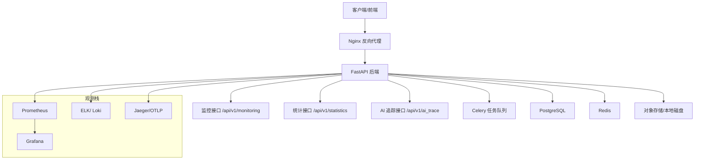
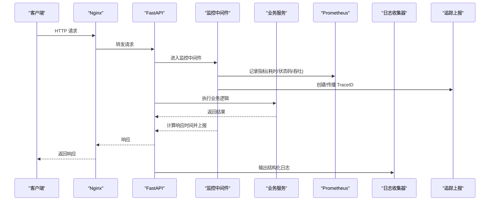
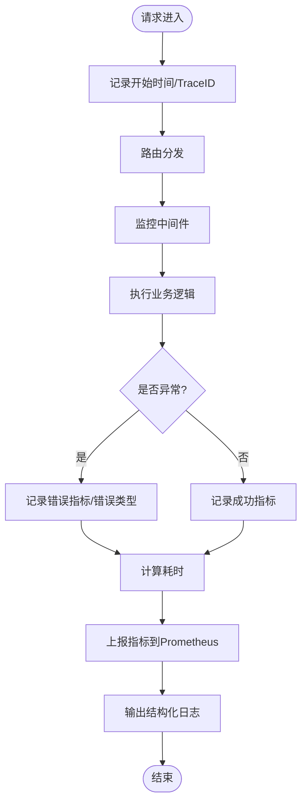
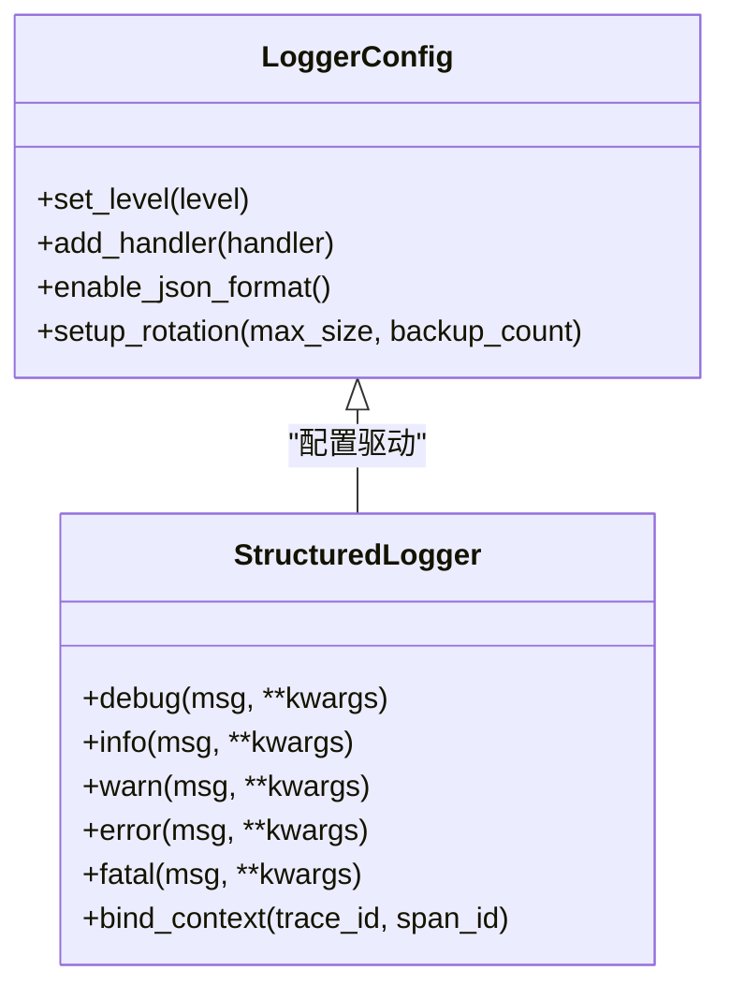
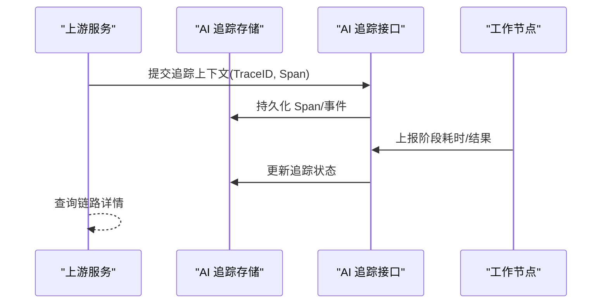
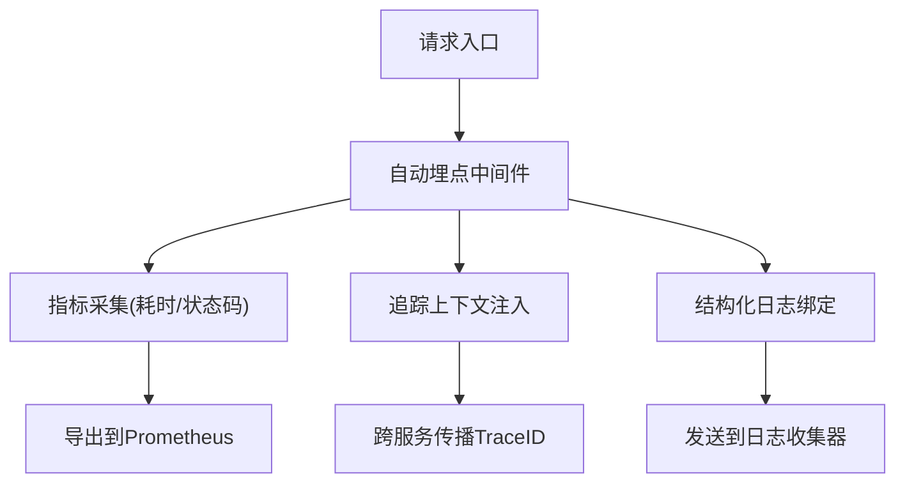
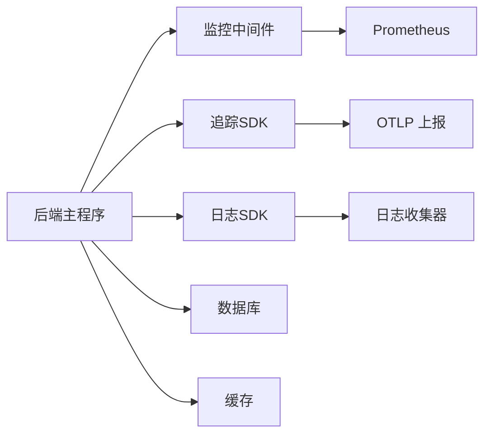

# 监控日志

<cite>
**本文引用的文件**   
- [backend/app/main.py](file://backend/app/main.py)
- [backend/app/api/v1/monitoring.py](file://backend/app/api/v1/monitoring.py)
- [core/logging_config.py](file://core/logging_config.py)
- [core/config.py](file://core/config.py)
- [backend/app/core/config.py](file://backend/app/core/config.py)
- [backend/app/services/auto_tracking.py](file://backend/app/services/auto_tracking.py)
- [backend/app/services/ai_trace_storage.py](file://backend/app/services/ai_trace_storage.py)
- [backend/app/api/v1/ai_trace.py](file://backend/app/api/v1/ai_trace.py)
- [backend/app/celery_app.py](file://backend/app/celery_app.py)
- [docker-compose.yml](file://docker-compose.yml)
- [nginx.conf](file://nginx.conf)
- [backend/app/api/v1/statistics.py](file://backend/app/api/v1/statistics.py)
</cite>

## 目录
1. [简介](#简介)
2. [项目结构](#项目结构)
3. [核心组件](#核心组件)
4. [架构总览](#架构总览)
5. [详细组件分析](#详细组件分析)
6. [依赖关系分析](#依赖关系分析)
7. [性能考量](#性能考量)
8. [故障排查指南](#故障排查指南)
9. [结论](#结论)
10. [附录](#附录)

## 简介
本文件面向小说创作代理系统的监控与日志管理，覆盖应用性能监控（APM）配置、关键指标采集（响应时间、吞吐量、错误率）、业务指标定义、自定义埋点方案；日志收集与分析（结构化日志、级别管理、轮转策略、集中式收集）；告警规则（阈值、通知渠道、升级机制）；分布式追踪（请求链路、跨服务调用、瓶颈定位）；以及监控仪表板（Grafana面板设计、关键指标可视化、实时监控大屏）。文档同时给出代码级映射与可操作建议，便于快速落地。

## 项目结构
本项目采用前后端分离与多模块后端架构：
- 后端以 FastAPI 提供 API，包含监控接口、AI 追踪存储与统计接口等。
- 核心日志配置位于 core/logging_config.py，统一输出结构化日志。
- Celery 异步任务通过 backend/app/celery_app.py 启动，需接入统一日志与追踪。
- 容器编排使用 docker-compose.yml，便于集成 Prometheus/Grafana/ELK 等观测栈。
- Nginx 作为反向代理，可配合访问日志与限流策略。

图表来源
- [backend/app/main.py:1-200](file://backend/app/main.py#L1-L200)
- [backend/app/api/v1/monitoring.py:1-200](file://backend/app/api/v1/monitoring.py#L1-L200)
- [backend/app/api/v1/statistics.py:1-200](file://backend/app/api/v1/statistics.py#L1-L200)
- [backend/app/api/v1/ai_trace.py:1-200](file://backend/app/api/v1/ai_trace.py#L1-L200)
- [backend/app/celery_app.py:1-200](file://backend/app/celery_app.py#L1-L200)
- [docker-compose.yml:1-200](file://docker-compose.yml#L1-L200)
- [nginx.conf:1-200](file://nginx.conf#L1-L200)

章节来源
- [backend/app/main.py:1-200](file://backend/app/main.py#L1-L200)
- [backend/app/api/v1/monitoring.py:1-200](file://backend/app/api/v1/monitoring.py#L1-L200)
- [backend/app/api/v1/statistics.py:1-200](file://backend/app/api/v1/statistics.py#L1-L200)
- [backend/app/api/v1/ai_trace.py:1-200](file://backend/app/api/v1/ai_trace.py#L1-L200)
- [backend/app/celery_app.py:1-200](file://backend/app/celery_app.py#L1-L200)
- [docker-compose.yml:1-200](file://docker-compose.yml#L1-L200)
- [nginx.conf:1-200](file://nginx.conf#L1-L200)

## 核心组件
- 监控接口：暴露系统健康、资源使用、关键业务指标与自定义埋点查询能力。
- 统计接口：聚合业务指标（如生成成功率、平均耗时、错误分类）。
- AI 追踪存储：持久化分布式追踪数据，支持按请求ID检索与导出。
- 自动追踪：基于中间件或装饰器对关键路径进行无侵入埋点。
- 日志配置：统一结构化输出，支持分级与轮转。
- 配置中心：集中管理监控开关、采样率、上报地址等。

章节来源
- [backend/app/api/v1/monitoring.py:1-200](file://backend/app/api/v1/monitoring.py#L1-L200)
- [backend/app/api/v1/statistics.py:1-200](file://backend/app/api/v1/statistics.py#L1-L200)
- [backend/app/api/v1/ai_trace.py:1-200](file://backend/app/api/v1/ai_trace.py#L1-L200)
- [backend/app/services/auto_tracking.py:1-200](file://backend/app/services/auto_tracking.py#L1-L200)
- [backend/app/services/ai_trace_storage.py:1-200](file://backend/app/services/ai_trace_storage.py#L1-L200)
- [core/logging_config.py:1-200](file://core/logging_config.py#L1-L200)
- [core/config.py:1-200](file://core/config.py#L1-L200)
- [backend/app/core/config.py:1-200](file://backend/app/core/config.py#L1-L200)

## 架构总览
整体观测架构遵循“采集—传输—存储—展示—告警”闭环：
- 采集层：HTTP 中间件、SDK、Celery 钩子、数据库/缓存探针。
- 传输层：Prometheus 拉取指标、OpenTelemetry/OTLP 上报追踪、结构化日志经 Filebeat/Loki 收集。
- 存储层：Prometheus 时序库、Jaeger/OTLP 后端、ELK/Loki 日志库。
- 展示层：Grafana 统一看板、告警规则引擎。
- 告警层：阈值触发、多渠道通知、升级与抑制策略。

图表来源
- [backend/app/main.py:1-200](file://backend/app/main.py#L1-L200)
- [backend/app/api/v1/monitoring.py:1-200](file://backend/app/api/v1/monitoring.py#L1-L200)
- [backend/app/services/auto_tracking.py:1-200](file://backend/app/services/auto_tracking.py#L1-L200)
- [backend/app/services/ai_trace_storage.py:1-200](file://backend/app/services/ai_trace_storage.py#L1-L200)
- [core/logging_config.py:1-200](file://core/logging_config.py#L1-L200)

## 详细组件分析

### 监控接口与指标采集
- 健康检查：进程存活、依赖可用性（DB、缓存、外部模型服务）。
- 系统指标：CPU、内存、GC、线程池、连接池、I/O。
- 业务指标：请求量、延迟分位（p50/p90/p99）、错误率、队列积压、任务完成数。
- 自定义埋点：通过 SDK 在关键路径打点，支持维度标签（用户、模型、版本、区域）。

图表来源
- [backend/app/api/v1/monitoring.py:1-200](file://backend/app/api/v1/monitoring.py#L1-L200)
- [backend/app/services/auto_tracking.py:1-200](file://backend/app/services/auto_tracking.py#L1-L200)

章节来源
- [backend/app/api/v1/monitoring.py:1-200](file://backend/app/api/v1/monitoring.py#L1-L200)
- [backend/app/api/v1/statistics.py:1-200](file://backend/app/api/v1/statistics.py#L1-L200)

### 日志系统与结构化输出
- 格式：JSON 结构化字段（timestamp、level、service、trace_id、span_id、msg、metrics、tags）。
- 级别：DEBUG/INFO/WARN/ERROR/FATAL，按环境控制输出粒度。
- 轮转：按大小/时间切分，保留周期与压缩策略。
- 集中式：Filebeat/Loki/ES 收集，统一索引与查询。

图表来源
- [core/logging_config.py:1-200](file://core/logging_config.py#L1-L200)

章节来源
- [core/logging_config.py:1-200](file://core/logging_config.py#L1-L200)

### 分布式追踪与AI追踪存储
- 链路跟踪：为每个请求分配唯一 TraceID，跨服务传递，Span 粒度细化至各阶段。
- 存储：将 Span/事件写入持久化存储，支持按 TraceID 检索与导出。
- 性能瓶颈定位：通过耗时分布、错误堆栈、下游依赖延迟对比定位热点。

图表来源
- [backend/app/api/v1/ai_trace.py:1-200](file://backend/app/api/v1/ai_trace.py#L1-L200)
- [backend/app/services/ai_trace_storage.py:1-200](file://backend/app/services/ai_trace_storage.py#L1-L200)

章节来源
- [backend/app/api/v1/ai_trace.py:1-200](file://backend/app/api/v1/ai_trace.py#L1-L200)
- [backend/app/services/ai_trace_storage.py:1-200](file://backend/app/services/ai_trace_storage.py#L1-L200)

### 自动埋点与中间件
- 自动埋点：对 HTTP 请求、Celery 任务、数据库/缓存访问进行无侵入埋点。
- 中间件：统一拦截、计时、错误捕获、指标上报与日志绑定。
- 可插拔：按路由/方法/标签选择性开启，避免过度开销。

图表来源
- [backend/app/services/auto_tracking.py:1-200](file://backend/app/services/auto_tracking.py#L1-L200)
- [backend/app/main.py:1-200](file://backend/app/main.py#L1-L200)

章节来源
- [backend/app/services/auto_tracking.py:1-200](file://backend/app/services/auto_tracking.py#L1-L200)
- [backend/app/main.py:1-200](file://backend/app/main.py#L1-L200)

### 配置与环境管理
- 监控开关：启用/禁用指标、追踪、日志级别。
- 采样率：高负载时降低上报频率，保障稳定性。
- 上报地址：Prometheus、OTLP、日志收集器地址。
- 安全：敏感信息脱敏、白名单标签。

章节来源
- [core/config.py:1-200](file://core/config.py#L1-L200)
- [backend/app/core/config.py:1-200](file://backend/app/core/config.py#L1-L200)

### 异步任务与队列监控
- Celery 任务生命周期：入队、执行、重试、失败、完成。
- 指标：队列长度、消费速率、失败率、重试次数、超时率。
- 追踪：任务级 TraceID，关联主请求链路。

章节来源
- [backend/app/celery_app.py:1-200](file://backend/app/celery_app.py#L1-L200)

## 依赖关系分析
- 后端与观测栈：通过 SDK/中间件对接 Prometheus、OTLP、日志收集器。
- 配置依赖：环境变量与配置文件驱动监控行为。
- 存储依赖：PostgreSQL/Redis 用于业务数据与缓存，追踪存储可能独立。

图表来源
- [backend/app/main.py:1-200](file://backend/app/main.py#L1-L200)
- [backend/app/services/auto_tracking.py:1-200](file://backend/app/services/auto_tracking.py#L1-L200)
- [core/logging_config.py:1-200](file://core/logging_config.py#L1-L200)

章节来源
- [backend/app/main.py:1-200](file://backend/app/main.py#L1-L200)
- [backend/app/services/auto_tracking.py:1-200](file://backend/app/services/auto_tracking.py#L1-L200)
- [core/logging_config.py:1-200](file://core/logging_config.py#L1-L200)

## 性能考量
- 指标上报：批量上报、异步落盘、采样降频，避免阻塞主流程。
- 日志输出：异步写入、缓冲合并、按需开启 DEBUG。
- 追踪开销：限制 Span 数量与深度，关键路径精细化。
- 资源隔离：监控相关进程与业务进程资源配额分离。
- 容量规划：根据 QPS 与数据保留策略评估存储与带宽。

## 故障排查指南
- 常见问题：
  - 指标缺失：检查中间件注册、上报地址、网络连通性。
  - 日志丢失：确认 Filebeat/Loki 配置、权限与磁盘空间。
  - 追踪断裂：确保 TraceID 正确传播，跨服务边界未丢弃。
  - 告警风暴：设置抑制与去抖，合理分组与升级。
- 诊断步骤：
  - 从 Grafana 看板定位异常时间段与热点接口。
  - 通过 TraceID 拉取完整链路，查看各阶段耗时与错误堆栈。
  - 结合日志关键词过滤，定位具体调用链路与参数。
  - 复现实验环境，逐步缩小范围验证修复。

## 结论
通过统一的监控、日志与追踪体系，小说创作代理系统可实现端到端的可观测性。建议在上线前完成指标定义、埋点校验、告警演练与看板搭建，持续优化采样与上报策略，保障在高负载下的稳定性与可维护性。

## 附录

### 关键指标定义与采集建议
- 响应时间：p50/p90/p99，按路由与模型维度拆分。
- 吞吐量：QPS、并发度、队列积压。
- 错误率：HTTP 状态码分布、异常类型、重试率。
- 业务指标：生成成功率、平均时长、素材命中率、审核通过率。
- 资源指标：CPU/内存/IO、连接池利用率、GC 停顿。

### 告警规则与升级机制
- 阈值：基于历史基线与动态阈值（如同比/环比）。
- 渠道：邮件、企业微信、钉钉、短信、电话。
- 升级：首次警告→二次升级→紧急处理，附带上下文与自愈建议。
- 抑制：同因重复告警抑制、维护窗口静默。

### 分布式追踪实现要点
- 链路贯穿：HTTP/Celery/DB/缓存/外部 API 均注入 TraceID。
- 采样策略：全量/按比例/按优先级采样。
- 存储与查询：按 TraceID 检索、Span 树可视化、热点分析。
- 性能定位：慢调用、错误热点、资源争用识别。

### 监控仪表板（Grafana）设计
- 概览页：系统健康、核心指标趋势、告警摘要。
- 业务页：生成成功率、耗时分布、错误分类、队列状态。
- 追踪页：Trace 列表、链路详情、热点接口排行。
- 日志页：实时滚动、关键字搜索、错误堆栈聚合。