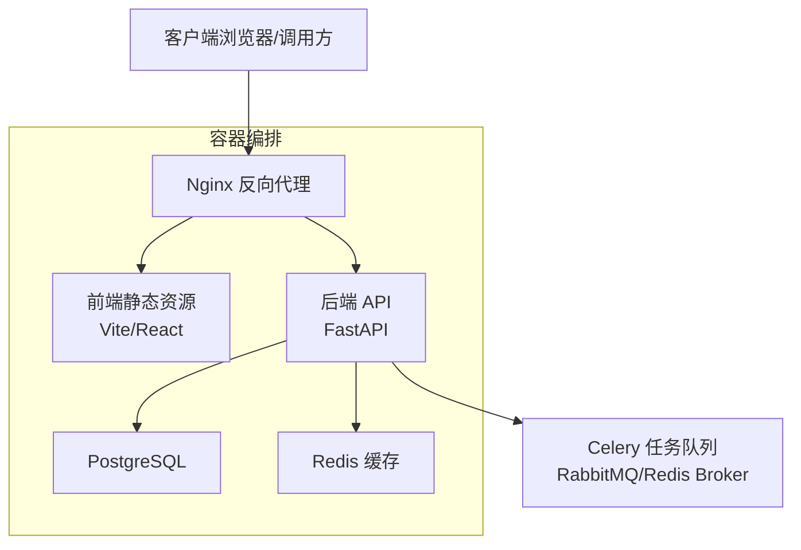
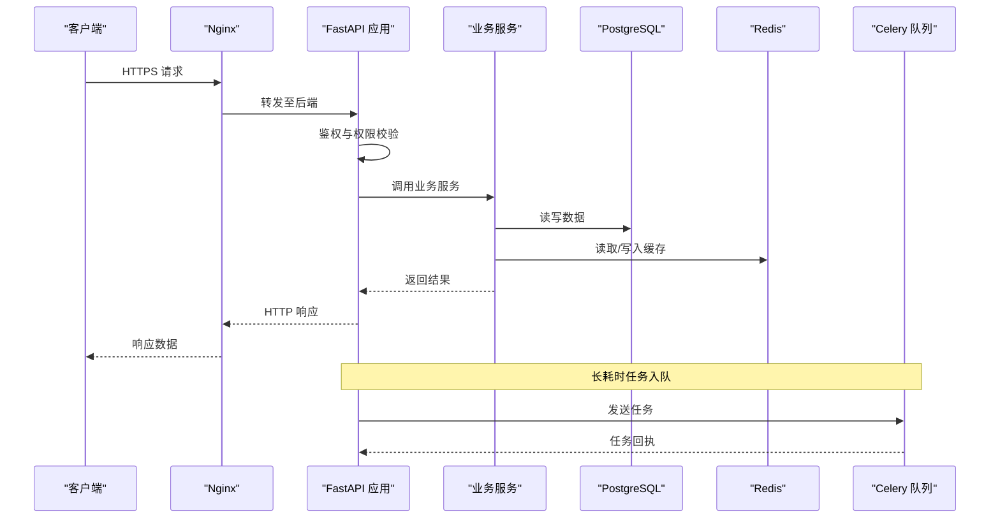
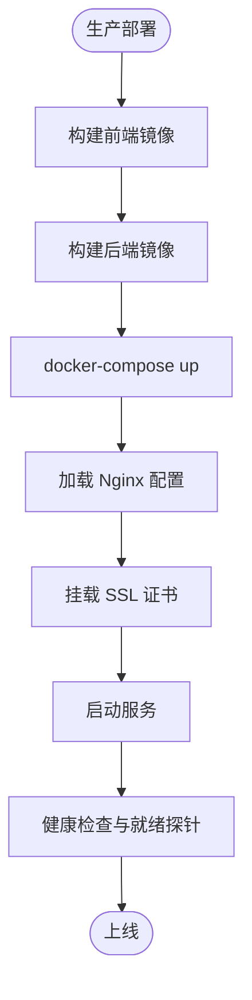
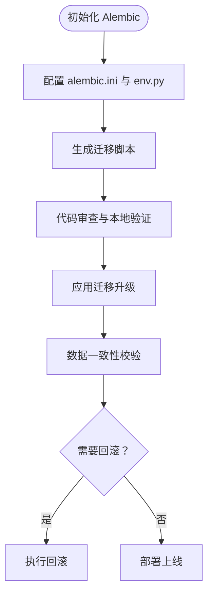
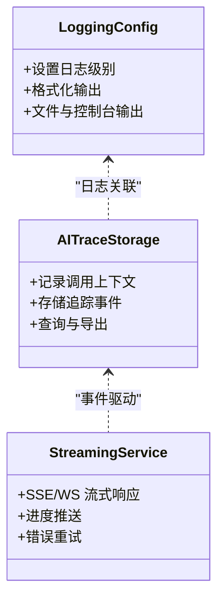
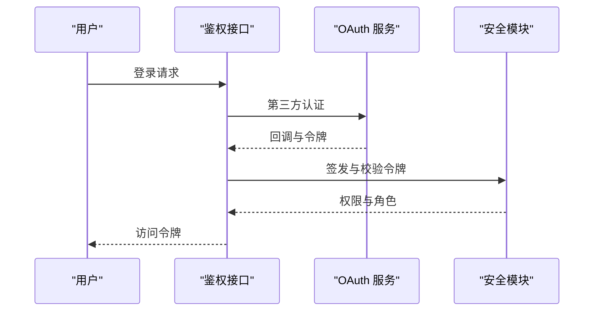
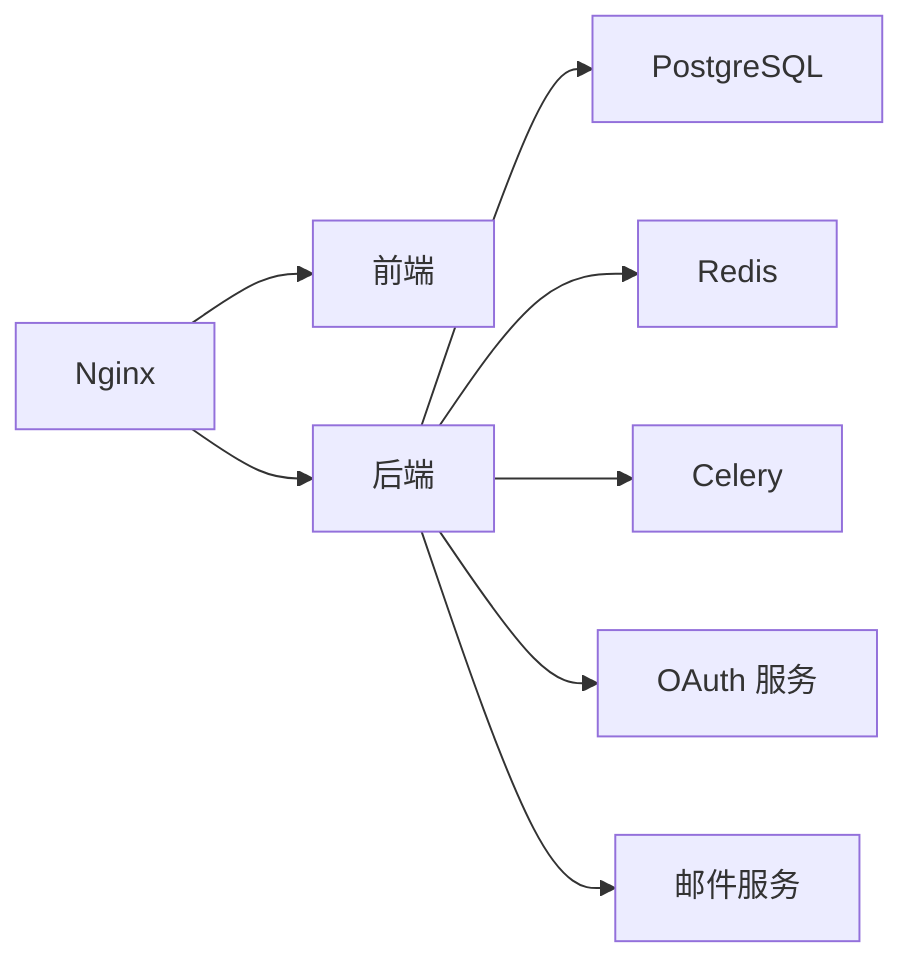

# 部署运维

<cite>
**本文引用的文件**   
- [docker-compose.yml](file://docker-compose.yml)
- [nginx.conf](file://nginx.conf)
- [nginx-prod.conf](file://nginx-prod.conf)
- [nginx-dev.conf](file://nginx-dev.conf)
- [frontend.nginx.conf](file://frontend/nginx.conf)
- [ssl/README.md](file://ssl/README.md)
- [SSL_CERTIFICATE_GUIDE.md](file://SSL_CERTIFICATE_GUIDE.md)
- [SSL_AUTO_RENEW_GUIDE.md](file://SSL_AUTO_RENEW_GUIDE.md)
- [backend/Dockerfile](file://backend/Dockerfile)
- [frontend/Dockerfile](file://frontend/Dockerfile)
- [alembic.ini](file://alembic.ini)
- [backend/alembic.ini](file://backend/alembic.ini)
- [backend/alembic/env.py](file://backend/alembic/env.py)
- [backend/alembic/script.py.mako](file://backend/alembic/script.py.mako)
- [backend/alembic/versions/initial.py](file://backend/alembic/versions/initial.py)
- [postgres-init/01-init.sql](file://postgres-init/01-init.sql)
- [redis.conf](file://redis.conf)
- [backend/app/main.py](file://backend/app/main.py)
- [backend/app/celery_app.py](file://backend/app/celery_app.py)
- [backend/app/core/config.py](file://backend/app/core/config.py)
- [backend/app/core/env_loader.py](file://backend/app/core/env_loader.py)
- [backend/app/core/security.py](file://backend/app/core/security.py)
- [backend/app/api/v1/auth.py](file://backend/app/api/v1/auth.py)
- [backend/app/services/cache_system.py](file://backend/app/services/cache_system.py)
- [backend/app/services/streaming_service.py](file://backend/app/services/streaming_service.py)
- [backend/app/services/email_service.py](file://backend/app/services/email_service.py)
- [backend/app/services/oauth_service.py](file://backend/app/services/oauth_service.py)
- [backend/app/services/monitoring/ai_trace_storage.py](file://backend/app/services/monitoring/ai_trace_storage.py)
- [core/logging_config.py](file://core/logging_config.py)
- [deploy_config.json](file://deploy_config.json)
- [start_production.bat](file://start_production.bat)
- [install.bat](file://install.bat)
- [dev.bat](file://dev.bat)
- [QUICK_START_GUIDE.md](file://QUICK_START_GUIDE.md)
- [DATABASE_MIGRATION_GUIDE.md](file://DATABASE_MIGRATION_GUIDE.md)
- [POSTGRESQL_DEPLOYMENT.md](file://POSTGRESQL_DEPLOYMENT.md)
</cite>

## 目录
1. [简介](#简介)
2. [项目结构](#项目结构)
3. [核心组件](#核心组件)
4. [架构总览](#架构总览)
5. [详细组件分析](#详细组件分析)
6. [依赖关系分析](#依赖关系分析)
7. [性能考虑](#性能考虑)
8. [故障排除指南](#故障排除指南)
9. [结论](#结论)
10. [附录](#附录)

## 简介
本文件面向小说创作代理系统的部署与运维，覆盖开发环境搭建、生产环境容器化与反向代理配置、数据库迁移管理（Alembic）、监控与日志收集、备份恢复与灾难恢复、安全加固以及故障排除与性能调优。文档以仓库中的实际配置文件和脚本为依据，确保可操作性与可追溯性。

## 项目结构
系统由后端服务（FastAPI + Celery）、前端（Vite/React）、Nginx 反向代理、PostgreSQL 数据库、Redis 缓存组成，并通过 Docker Compose 编排。关键入口与配置如下：
- 应用入口与生命周期：后端主应用启动、Celery 任务队列初始化
- 配置加载与环境变量：集中式配置与环境注入
- 反向代理与静态资源：Nginx 多环境配置与 SSL 证书管理
- 数据层：PostgreSQL 初始化脚本、Alembic 迁移工具链
- 缓存与会话：Redis 配置与缓存服务集成
- 监控与日志：统一日志配置、AI 追踪存储

**图表来源**
- [docker-compose.yml](file://docker-compose.yml)
- [nginx.conf](file://nginx.conf)
- [backend/app/main.py](file://backend/app/main.py)
- [backend/app/celery_app.py](file://backend/app/celery_app.py)

**章节来源**
- [docker-compose.yml](file://docker-compose.yml)
- [QUICK_START_GUIDE.md](file://QUICK_START_GUIDE.md)

## 核心组件
- 后端服务（FastAPI）：提供 RESTful API、WebSocket 流式响应、鉴权与权限控制、业务服务编排
- 任务队列（Celery）：异步处理长耗时任务（如音频生成、视频处理、批量导入导出）
- 数据库（PostgreSQL）：持久化业务数据，通过 Alembic 进行版本化管理
- 缓存（Redis）：会话、限流、热点数据缓存、任务状态与结果暂存
- 反向代理（Nginx）：HTTPS 终止、静态资源加速、负载均衡与健康检查
- 监控与日志：结构化日志、AI 追踪埋点、错误上报与聚合

**章节来源**
- [backend/app/main.py](file://backend/app/main.py)
- [backend/app/celery_app.py](file://backend/app/celery_app.py)
- [backend/app/core/config.py](file://backend/app/core/config.py)
- [backend/app/services/cache_system.py](file://backend/app/services/cache_system.py)
- [core/logging_config.py](file://core/logging_config.py)

## 架构总览
下图展示从请求到响应的主流程，包括鉴权、路由、业务服务、数据库与缓存交互，以及异步任务的入队与执行。

**图表来源**
- [nginx.conf](file://nginx.conf)
- [backend/app/main.py](file://backend/app/main.py)
- [backend/app/api/v1/auth.py](file://backend/app/api/v1/auth.py)
- [backend/app/services/cache_system.py](file://backend/app/services/cache_system.py)
- [backend/app/celery_app.py](file://backend/app/celery_app.py)

## 详细组件分析

### 开发环境搭建
- Python 环境
  - 使用虚拟环境与依赖安装脚本快速初始化
  - 参考安装脚本与快速开始指南完成依赖安装与基础配置
- Node.js 环境
  - 前端构建与开发服务器启动
  - 通过包管理器安装依赖并运行开发模式
- 数据库与缓存
  - PostgreSQL 初始化脚本用于创建初始对象与权限
  - Redis 配置文件调整内存与持久化策略
- 环境变量与配置
  - 集中式配置加载与环境变量注入
  - 敏感信息通过安全模块管理

**章节来源**
- [install.bat](file://install.bat)
- [dev.bat](file://dev.bat)
- [QUICK_START_GUIDE.md](file://QUICK_START_GUIDE.md)
- [postgres-init/01-init.sql](file://postgres-init/01-init.sql)
- [redis.conf](file://redis.conf)
- [backend/app/core/config.py](file://backend/app/core/config.py)
- [backend/app/core/env_loader.py](file://backend/app/core/env_loader.py)
- [backend/app/core/security.py](file://backend/app/core/security.py)

### 生产环境部署（Docker 与 Nginx）
- 容器化
  - 后端镜像构建与运行参数
  - 前端镜像构建与静态资源输出
  - 通过 docker-compose 编排多服务
- Nginx 反向代理
  - 生产与开发环境的不同配置
  - 静态资源路径与后端 API 转发规则
  - WebSocket 支持（如需）
- SSL 证书
  - 证书放置与自动续期指南
  - HTTPS 终止与重定向策略

**图表来源**
- [backend/Dockerfile](file://backend/Dockerfile)
- [frontend/Dockerfile](file://frontend/Dockerfile)
- [docker-compose.yml](file://docker-compose.yml)
- [nginx-prod.conf](file://nginx-prod.conf)
- [ssl/README.md](file://ssl/README.md)
- [SSL_CERTIFICATE_GUIDE.md](file://SSL_CERTIFICATE_GUIDE.md)
- [SSL_AUTO_RENEW_GUIDE.md](file://SSL_AUTO_RENEW_GUIDE.md)

**章节来源**
- [backend/Dockerfile](file://backend/Dockerfile)
- [frontend/Dockerfile](file://frontend/Dockerfile)
- [docker-compose.yml](file://docker-compose.yml)
- [nginx-prod.conf](file://nginx-prod.conf)
- [nginx-dev.conf](file://nginx-dev.conf)
- [frontend/nginx.conf](file://frontend/nginx.conf)
- [ssl/README.md](file://ssl/README.md)
- [SSL_CERTIFICATE_GUIDE.md](file://SSL_CERTIFICATE_GUIDE.md)
- [SSL_AUTO_RENEW_GUIDE.md](file://SSL_AUTO_RENEW_GUIDE.md)

### 数据库迁移管理（Alembic）
- 迁移工具链
  - alembic.ini 配置连接与迁移目录
  - env.py 初始化 SQLAlchemy 引擎与上下文
  - script.py.mako 模板生成迁移脚本骨架
- 版本控制与回滚
  - 新增字段或表时生成迁移脚本
  - 按版本顺序升级与回滚
  - 合并分支头与冲突解决
- 最佳实践
  - 迁移脚本幂等性与数据回填
  - 测试环境预演与灰度发布

**图表来源**
- [alembic.ini](file://alembic.ini)
- [backend/alembic.ini](file://backend/alembic.ini)
- [backend/alembic/env.py](file://backend/alembic/env.py)
- [backend/alembic/script.py.mako](file://backend/alembic/script.py.mako)
- [backend/alembic/versions/initial.py](file://backend/alembic/versions/initial.py)

**章节来源**
- [DATABASE_MIGRATION_GUIDE.md](file://DATABASE_MIGRATION_GUIDE.md)
- [alembic.ini](file://alembic.ini)
- [backend/alembic.ini](file://backend/alembic.ini)
- [backend/alembic/env.py](file://backend/alembic/env.py)
- [backend/alembic/script.py.mako](file://backend/alembic/script.py.mako)
- [backend/alembic/versions/initial.py](file://backend/alembic/versions/initial.py)

### 监控与日志收集
- 日志配置
  - 统一日志格式与级别
  - 结构化输出便于聚合与分析
- AI 追踪与埋点
  - 记录模型调用、参数与耗时
  - 错误与异常上报
- 指标与告警
  - 服务健康、延迟、错误率
  - 队列积压与任务失败率

**图表来源**
- [core/logging_config.py](file://core/logging_config.py)
- [backend/app/services/monitoring/ai_trace_storage.py](file://backend/app/services/monitoring/ai_trace_storage.py)
- [backend/app/services/streaming_service.py](file://backend/app/services/streaming_service.py)

**章节来源**
- [core/logging_config.py](file://core/logging_config.py)
- [backend/app/services/monitoring/ai_trace_storage.py](file://backend/app/services/monitoring/ai_trace_storage.py)
- [backend/app/services/streaming_service.py](file://backend/app/services/streaming_service.py)

### 备份恢复与灾难恢复
- 数据库备份
  - 定期全量与增量备份
  - 异地容灾与加密存储
- 文件与缓存
  - 静态资源与媒体文件的备份策略
  - Redis 持久化与快照恢复
- 灾难恢复演练
  - 恢复流程与时间目标（RTO/RPO）
  - 回滚与切换预案

[本节为通用指导，不直接分析具体文件]

### 安全加固
- 认证与授权
  - JWT/OAuth 集成与令牌刷新
  - RBAC 权限模型与最小权限原则
- 传输与存储安全
  - HTTPS 强制与 HSTS
  - 敏感配置与密钥管理
- 输入校验与防护
  - 请求参数校验与 SQL 注入防护
  - 速率限制与防刷

**图表来源**
- [backend/app/api/v1/auth.py](file://backend/app/api/v1/auth.py)
- [backend/app/services/oauth_service.py](file://backend/app/services/oauth_service.py)
- [backend/app/core/security.py](file://backend/app/core/security.py)

**章节来源**
- [backend/app/api/v1/auth.py](file://backend/app/api/v1/auth.py)
- [backend/app/services/oauth_service.py](file://backend/app/services/oauth_service.py)
- [backend/app/core/security.py](file://backend/app/core/security.py)

## 依赖关系分析
- 服务间依赖
  - FastAPI 依赖 SQLAlchemy、Alembic、Redis、Celery
  - Nginx 依赖上游后端与静态资源
- 外部依赖
  - 第三方认证与邮件服务
  - 向量检索与模型目录（按需）

**图表来源**
- [docker-compose.yml](file://docker-compose.yml)
- [backend/app/celery_app.py](file://backend/app/celery_app.py)
- [backend/app/services/email_service.py](file://backend/app/services/email_service.py)
- [backend/app/services/oauth_service.py](file://backend/app/services/oauth_service.py)

**章节来源**
- [docker-compose.yml](file://docker-compose.yml)
- [backend/app/celery_app.py](file://backend/app/celery_app.py)
- [backend/app/services/email_service.py](file://backend/app/services/email_service.py)
- [backend/app/services/oauth_service.py](file://backend/app/services/oauth_service.py)

## 性能考虑
- 数据库优化
  - 索引设计与慢查询分析
  - 连接池与事务隔离级别
- 缓存策略
  - 热点数据与过期策略
  - 缓存穿透与雪崩防护
- 任务队列
  - 并发与消费者数量调优
  - 任务优先级与重试机制
- 反向代理
  - 静态资源压缩与缓存
  - 超时与限流配置

[本节为通用指导，不直接分析具体文件]

## 故障排除指南
- 常见问题
  - 端口冲突与服务无法启动
  - 数据库连接失败与迁移错误
  - Redis 连接与缓存失效
  - Nginx 502/504 与证书问题
- 诊断步骤
  - 查看容器日志与应用日志
  - 检查环境变量与配置文件
  - 验证网络连通性与防火墙规则
- 性能调优建议
  - 调整 Celery 并发与队列大小
  - 优化数据库查询与索引
  - 合理设置 Nginx 缓冲区与超时

**章节来源**
- [start_production.bat](file://start_production.bat)
- [deploy_config.json](file://deploy_config.json)
- [nginx-prod.conf](file://nginx-prod.conf)
- [nginx-dev.conf](file://nginx-dev.conf)
- [core/logging_config.py](file://core/logging_config.py)

## 结论
本部署运维文档基于仓库现有配置与脚本，提供了从开发到生产的完整落地方案。通过容器化编排、Nginx 反向代理、Alembic 迁移管理、监控与日志体系、备份与灾难恢复、安全加固与故障排除，保障系统稳定、可扩展与安全。建议在变更前进行充分测试与演练，确保回滚与恢复能力。

## 附录
- 快速开始与安装脚本
- 数据库部署与迁移指南
- SSL 证书与自动续期指南

**章节来源**
- [QUICK_START_GUIDE.md](file://QUICK_START_GUIDE.md)
- [POSTGRESQL_DEPLOYMENT.md](file://POSTGRESQL_DEPLOYMENT.md)
- [DATABASE_MIGRATION_GUIDE.md](file://DATABASE_MIGRATION_GUIDE.md)
- [SSL_CERTIFICATE_GUIDE.md](file://SSL_CERTIFICATE_GUIDE.md)
- [SSL_AUTO_RENEW_GUIDE.md](file://SSL_AUTO_RENEW_GUIDE.md)