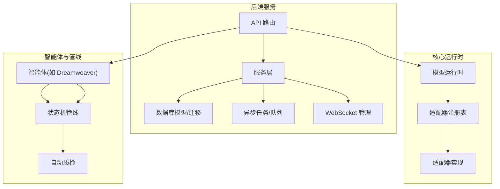
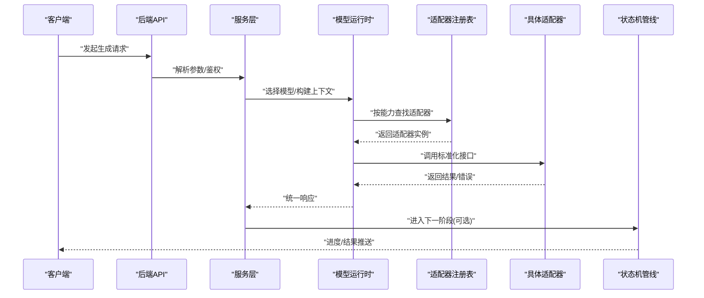
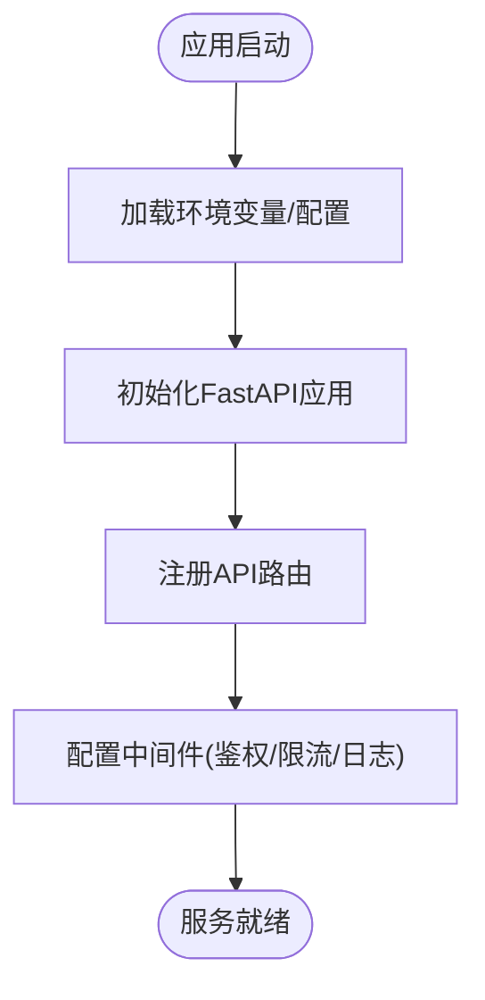
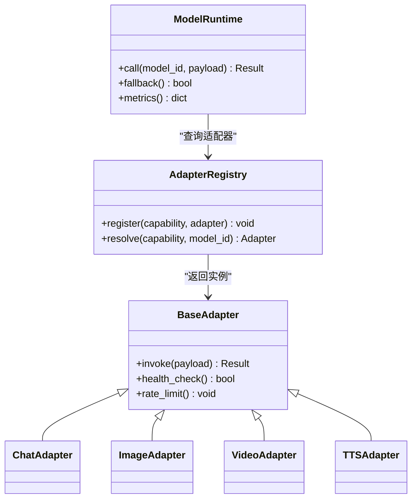
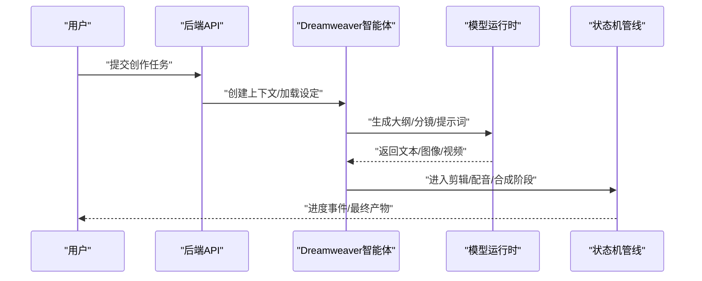
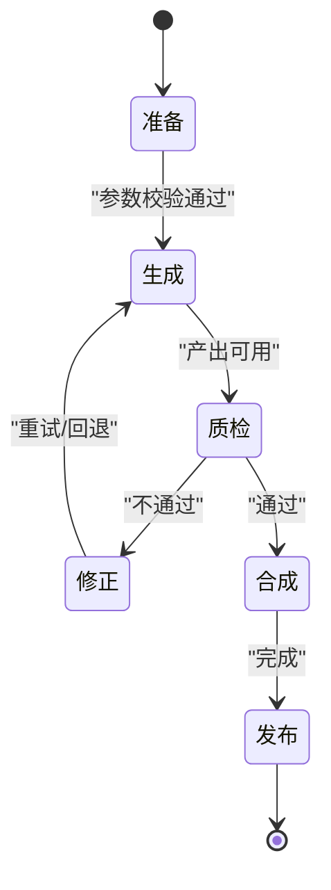
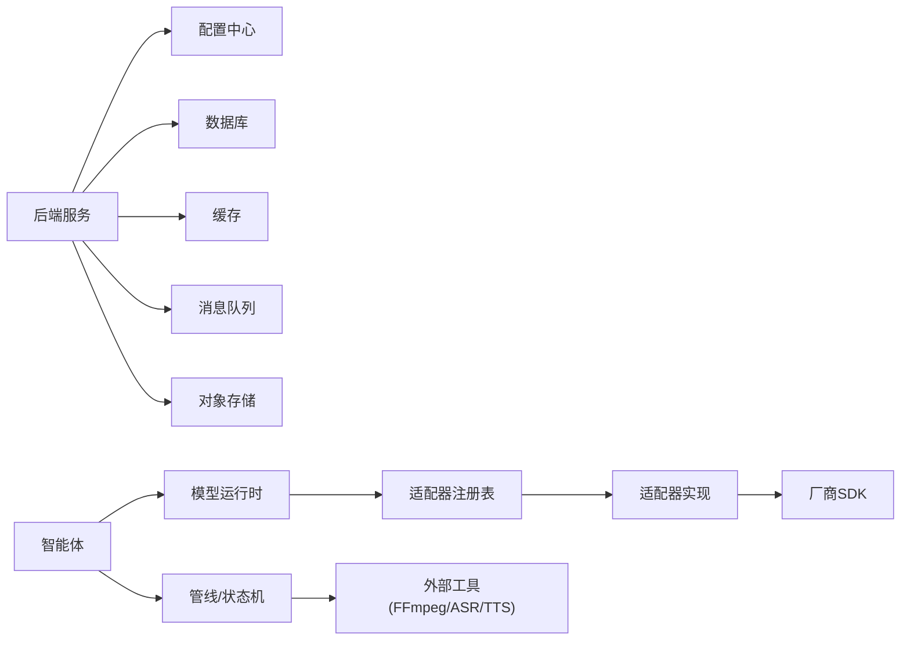

# 开发指南

<cite>
**本文引用的文件**   
- [README.md](file://README.md)
- [docker-compose.yml](file://docker-compose.yml)
- [backend/app/main.py](file://backend/app/main.py)
- [backend/app/core/config.py](file://backend/app/core/config.py)
- [core/model_runtime.py](file://core/model_runtime.py)
- [adapters/base.py](file://adapters/base.py)
- [adapters/registry.py](file://adapters/registry.py)
- [agents/dreamweaver.py](file://agents/dreamweaver.py)
- [pipeline/state_machine.py](file://pipeline/state_machine.py)
- [scripts/test_all_models.py](file://scripts/test_all_models.py)
- [tests/test_full_chain.py](file://tests/test_full_chain.py)
</cite>

## 目录
1. [简介](#简介)
2. [项目结构](#项目结构)
3. [核心组件](#核心组件)
4. [架构总览](#架构总览)
5. [详细组件分析](#详细组件分析)
6. [依赖关系分析](#依赖关系分析)
7. [性能考量](#性能考量)
8. [故障排查指南](#故障排查指南)
9. [结论](#结论)
10. [附录](#附录)

## 简介
本指南面向开发者，帮助快速理解并上手“小说创作代理”项目的后端与多模态生成管线。项目采用模块化设计：后端服务提供统一 API、模型路由与任务编排；适配器层对接多种大模型与媒体能力；Agent 层封装业务智能体（如梦境编织者）；管道层负责状态机驱动的多阶段处理与质量保障。通过容器化部署与脚本工具，支持本地开发与生产环境的一体化运行。

## 项目结构
仓库采用前后端分离与多模块组织：
- backend：FastAPI 后端服务，包含路由、服务层、数据模型、迁移、任务与 WebSocket 等
- core：统一的模型运行时、路由与适配桥接、配置与验证等
- adapters：各厂商/模型的适配器实现与注册表
- agents：业务智能体（如 dreamweaver、painter、storyboarder 等）
- pipeline：状态机驱动的媒体处理与自动质检流水线
- scripts：测试、校验与运维脚本
- tests：单元测试与集成测试
- frontend：前端工程（React/Vite/Tailwind）
- docs：设计与契约文档
- 根目录：启动脚本、Docker Compose、Nginx 配置等

[无图表来源，因为该图为概念性结构示意]

## 核心组件
- 后端入口与配置：应用初始化、环境变量加载、中间件与安全策略
- 模型运行时与路由：统一调用抽象、模型选择与降级、速率限制
- 适配器层：多厂商 LLM/图像/视频/TTS 等能力接入与标准化接口
- 智能体：面向业务的 Agent（如梦境编织者），编排提示词、工具与流程
- 管线与状态机：分阶段处理、质量控制、重试与回滚
- 脚本与测试：模型连通性检查、端到端链路验证

章节来源
- [backend/app/main.py:1-200](file://backend/app/main.py#L1-L200)
- [backend/app/core/config.py:1-200](file://backend/app/core/config.py#L1-L200)
- [core/model_runtime.py:1-200](file://core/model_runtime.py#L1-L200)
- [adapters/base.py:1-200](file://adapters/base.py#L1-L200)
- [adapters/registry.py:1-200](file://adapters/registry.py#L1-L200)
- [agents/dreamweaver.py:1-200](file://agents/dreamweaver.py#L1-L200)
- [pipeline/state_machine.py:1-200](file://pipeline/state_machine.py#L1-L200)

## 架构总览
系统以 FastAPI 为入口，服务层协调模型运行时与智能体，适配器将请求标准化后转发至具体厂商实现。管线基于状态机驱动，串联文本、图像、音频、视频等多模态处理步骤，并通过自动质检与审计保障质量。

图表来源
- [backend/app/main.py:1-200](file://backend/app/main.py#L1-L200)
- [core/model_runtime.py:1-200](file://core/model_runtime.py#L1-L200)
- [adapters/registry.py:1-200](file://adapters/registry.py#L1-L200)
- [adapters/base.py:1-200](file://adapters/base.py#L1-L200)
- [pipeline/state_machine.py:1-200](file://pipeline/state_machine.py#L1-L200)

## 详细组件分析

### 后端服务与配置
- 应用初始化：注册路由、中间件、CORS、日志、监控
- 配置加载：从环境变量与配置文件合并，提供强类型访问
- 安全与权限：鉴权、RBAC、限流、审计

图表来源
- [backend/app/main.py:1-200](file://backend/app/main.py#L1-L200)
- [backend/app/core/config.py:1-200](file://backend/app/core/config.py#L1-L200)

章节来源
- [backend/app/main.py:1-200](file://backend/app/main.py#L1-L200)
- [backend/app/core/config.py:1-200](file://backend/app/core/config.py#L1-L200)

### 模型运行时与适配器注册
- 运行时：统一封装模型调用、重试、超时、降级与指标上报
- 注册表：按能力维度（chat/image/video/tts）维护适配器映射
- 适配器基类：定义标准化接口与通用行为（鉴权、限流、错误码转换）

图表来源
- [core/model_runtime.py:1-200](file://core/model_runtime.py#L1-L200)
- [adapters/registry.py:1-200](file://adapters/registry.py#L1-L200)
- [adapters/base.py:1-200](file://adapters/base.py#L1-L200)

章节来源
- [core/model_runtime.py:1-200](file://core/model_runtime.py#L1-L200)
- [adapters/registry.py:1-200](file://adapters/registry.py#L1-L200)
- [adapters/base.py:1-200](file://adapters/base.py#L1-L200)

### 智能体：Dreamweaver（梦境编织者）
- 职责：编排多模态生成流程（文本→分镜→图像/视频→配音→合成）
- 输入：项目/章节/角色设定/风格约束
- 输出：结构化素材与成品片段，附带质量评分与审计信息

图表来源
- [agents/dreamweaver.py:1-200](file://agents/dreamweaver.py#L1-L200)
- [pipeline/state_machine.py:1-200](file://pipeline/state_machine.py#L1-L200)

章节来源
- [agents/dreamweaver.py:1-200](file://agents/dreamweaver.py#L1-L200)
- [pipeline/state_machine.py:1-200](file://pipeline/state_machine.py#L1-L200)

### 管线与状态机
- 状态机：定义阶段（准备、生成、质检、合成、发布）、转换条件与回退策略
- 执行器：并行/串行调度、幂等性、断点续跑
- 质检：语义一致性、画面/音频质量、合规检测

图表来源
- [pipeline/state_machine.py:1-200](file://pipeline/state_machine.py#L1-L200)

章节来源
- [pipeline/state_machine.py:1-200](file://pipeline/state_machine.py#L1-L200)

## 依赖关系分析
- 后端服务依赖：配置、数据库、缓存、消息队列、对象存储
- 运行时依赖：适配器注册表、厂商 SDK、速率限制、指标采集
- 智能体依赖：运行时、管线、外部工具（FFmpeg、ASR、TTS）
- 测试与脚本：覆盖单测、集成测试、模型连通性校验

图表来源
- [backend/app/main.py:1-200](file://backend/app/main.py#L1-L200)
- [core/model_runtime.py:1-200](file://core/model_runtime.py#L1-L200)
- [adapters/registry.py:1-200](file://adapters/registry.py#L1-L200)
- [pipeline/state_machine.py:1-200](file://pipeline/state_machine.py#L1-L200)

章节来源
- [backend/app/main.py:1-200](file://backend/app/main.py#L1-L200)
- [core/model_runtime.py:1-200](file://core/model_runtime.py#L1-L200)
- [adapters/registry.py:1-200](file://adapters/registry.py#L1-L200)
- [pipeline/state_machine.py:1-200](file://pipeline/state_machine.py#L1-L200)

## 性能考量
- 并发与限流：对高并发请求启用速率限制与熔断，避免下游过载
- 缓存策略：热点提示词、模型元数据、预览资源缓存
- 异步任务：长耗时任务入队，SSE/WebSocket 推送进度
- 资源隔离：不同能力通道独立线程池/连接池
- 观测性：指标、追踪、日志分级与采样

[本节为通用指导，无需特定文件引用]

## 故障排查指南
- 模型不可用：检查适配器健康检查、密钥与配额、网络连通
- 生成失败：查看错误码与重试次数，确认输入格式与约束
- 管线卡住：检查状态机当前阶段、依赖任务是否阻塞
- 性能问题：定位慢调用链、数据库锁、缓存命中率

章节来源
- [scripts/test_all_models.py:1-200](file://scripts/test_all_models.py#L1-L200)
- [tests/test_full_chain.py:1-200](file://tests/test_full_chain.py#L1-L200)

## 结论
本项目以清晰的层次划分与标准化接口，实现了多模型、多模态的统一接入与编排。通过状态机驱动的管线与完善的观测性，支撑从文本到音视频的完整创作流程。建议在新功能扩展时遵循现有适配器与运行时约定，确保可替换性与可观测性。

[本节为总结，无需特定文件引用]

## 附录
- 部署与环境
  - 使用 docker-compose 一键拉起后端、数据库、缓存与 Nginx
  - 环境变量参考：模型密钥、存储路径、队列地址、调试开关
- 常用脚本
  - 模型连通性测试、端到端链路验证、TTS 声音校验
- 文档与契约
  - 模型目录、评测报告、前后端契约与数据结构说明

章节来源
- [docker-compose.yml:1-200](file://docker-compose.yml#L1-L200)
- [scripts/test_all_models.py:1-200](file://scripts/test_all_models.py#L1-L200)
- [tests/test_full_chain.py:1-200](file://tests/test_full_chain.py#L1-L200)