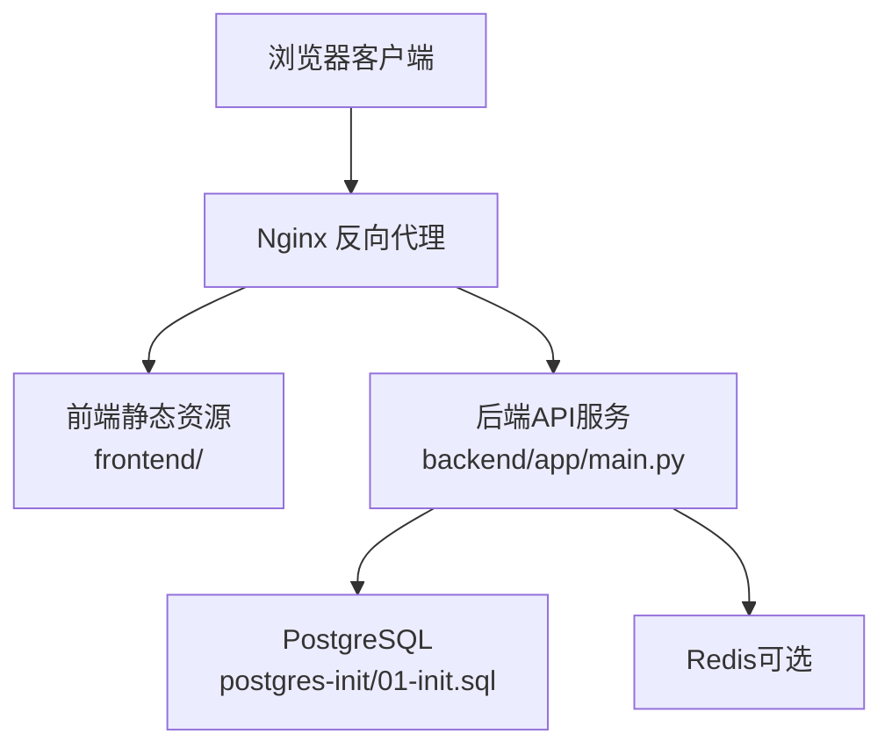
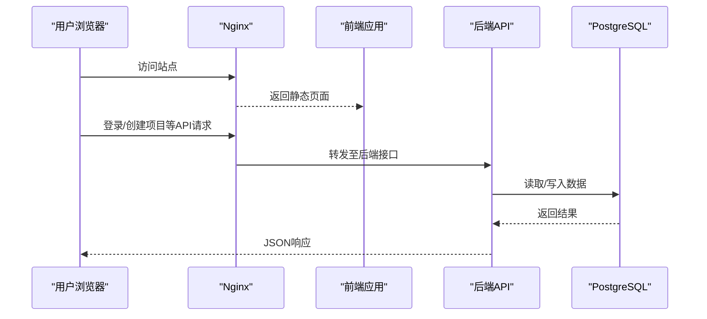
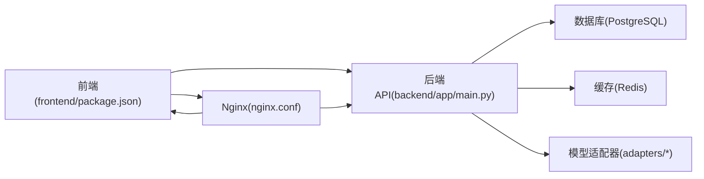

# 快速开始

<cite>
**本文引用的文件**   
- [README.md](file://README.md)
- [QUICK_START_GUIDE.md](file://QUICK_START_GUIDE.md)
- [docker-compose.yml](file://docker-compose.yml)
- [backend/requirements.txt](file://backend/requirements.txt)
- [frontend/package.json](file://frontend/package.json)
- [backend/app/main.py](file://backend/app/main.py)
- [backend/alembic.ini](file://backend/alembic.ini)
- [postgres-init/01-init.sql](file://postgres-init/01-init.sql)
- [nginx.conf](file://nginx.conf)
- [nginx-prod.conf](file://nginx-prod.conf)
- [start_backend.py](file://start_backend.py)
- [install.bat](file://install.bat)
- [dev.bat](file://dev.bat)
- [start_production.bat](file://start_production.bat)
</cite>

## 目录
1. [简介](#简介)
2. [项目结构](#项目结构)
3. [核心组件](#核心组件)
4. [架构总览](#架构总览)
5. [详细组件分析](#详细组件分析)
6. [依赖关系分析](#依赖关系分析)
7. [性能注意事项](#性能注意事项)
8. [故障排除指南](#故障排除指南)
9. [结论](#结论)
10. [附录](#附录)

## 简介
本快速开始指南面向首次接触“小说创作代理系统”的用户，目标是在30分钟内完成环境准备、安装配置、数据库初始化与基础使用，帮助你顺利启动后端服务、创建第一个项目并体验核心功能。文档同时提供开发环境与生产环境的搭建要点，以及常见问题排查建议。

## 项目结构
仓库采用前后端分离与多语言混合架构：
- 后端（Python/FastAPI）：位于 backend/app，提供REST API、任务队列、数据库迁移等能力
- 前端（React/Vite）：位于 frontend，提供Web界面
- 容器编排：docker-compose.yml 统一编排后端、数据库、缓存与Nginx
- 数据库初始化脚本：postgres-init/01-init.sql
- Nginx反向代理：nginx.conf（开发）、nginx-prod.conf（生产）
- 启动脚本：start_backend.py（后端）、install.bat/dev.bat/start_production.bat（Windows快捷脚本）

图表来源
- [docker-compose.yml](file://docker-compose.yml)
- [backend/app/main.py](file://backend/app/main.py)
- [postgres-init/01-init.sql](file://postgres-init/01-init.sql)
- [nginx.conf](file://nginx.conf)

章节来源
- [README.md](file://README.md)
- [QUICK_START_GUIDE.md](file://QUICK_START_GUIDE.md)

## 核心组件
- 后端服务：FastAPI应用入口与路由组织，负责业务逻辑、模型调用、任务调度与数据持久化
- 数据库层：Alembic迁移管理，PostgreSQL存储项目、章节、角色、资产等核心实体
- 前端界面：基于React+Vite的Web UI，用于项目管理、内容编辑与生成结果查看
- 反向代理：Nginx统一入口，处理静态资源与API转发
- 容器编排：Docker Compose一键拉起所有依赖服务

章节来源
- [backend/app/main.py](file://backend/app/main.py)
- [backend/alembic.ini](file://backend/alembic.ini)
- [frontend/package.json](file://frontend/package.json)
- [nginx.conf](file://nginx.conf)
- [docker-compose.yml](file://docker-compose.yml)

## 架构总览
下图展示了从浏览器到后端、数据库与外部服务的整体交互流程，包括API请求、静态资源访问与数据库读写路径。

图表来源
- [nginx.conf](file://nginx.conf)
- [backend/app/main.py](file://backend/app/main.py)
- [postgres-init/01-init.sql](file://postgres-init/01-init.sql)

## 详细组件分析

### 环境要求
- Python：建议使用3.10或3.11（后端依赖）
- Node.js：建议使用18.x或20.x（前端构建）
- PostgreSQL：推荐14+（数据库）
- Redis：推荐7+（可选，用于缓存与任务队列）
- Docker与Docker Compose：用于一键部署（推荐）
- FFmpeg：媒体处理（按需）

章节来源
- [backend/requirements.txt](file://backend/requirements.txt)
- [frontend/package.json](file://frontend/package.json)
- [docker-compose.yml](file://docker-compose.yml)

### 安装步骤（推荐：Docker Compose）
- 克隆仓库并进入根目录
- 准备环境变量（如数据库连接、密钥等），可参考示例模板
- 执行 docker compose up -d 拉起服务
- 等待数据库初始化完成后，访问前端地址进行注册与登录
- 通过API或前端创建第一个项目，体验核心功能

章节来源
- [docker-compose.yml](file://docker-compose.yml)
- [postgres-init/01-init.sql](file://postgres-init/01-init.sql)

### 安装步骤（本地开发）
- 安装Python与Node.js，创建虚拟环境并安装后端依赖
- 安装前端依赖并构建静态资源
- 启动PostgreSQL与Redis（或使用Docker）
- 运行数据库迁移（Alembic）
- 启动后端服务与前端开发服务器

章节来源
- [backend/requirements.txt](file://backend/requirements.txt)
- [frontend/package.json](file://frontend/package.json)
- [backend/alembic.ini](file://backend/alembic.ini)
- [start_backend.py](file://start_backend.py)

### Windows快捷脚本
- install.bat：一键安装依赖（Python/Node）
- dev.bat：启动开发环境（后端+前端）
- start_production.bat：启动生产模式（含Nginx）

章节来源
- [install.bat](file://install.bat)
- [dev.bat](file://dev.bat)
- [start_production.bat](file://start_production.bat)

### 配置文件设置
- 数据库连接：在环境变量中配置PostgreSQL连接串
- 安全密钥：配置JWT签名、会话密钥等
- 第三方服务：如需LLM/TTS/图像/视频等能力，按提示配置对应Key
- Nginx：根据部署方式选择开发或生产配置文件

章节来源
- [nginx.conf](file://nginx.conf)
- [nginx-prod.conf](file://nginx-prod.conf)

### 数据库初始化
- 使用Alembic进行迁移与版本管理
- 首次运行需执行迁移命令以创建表结构
- 可通过初始化脚本填充基础数据（管理员账号等）

章节来源
- [backend/alembic.ini](file://backend/alembic.ini)
- [postgres-init/01-init.sql](file://postgres-init/01-init.sql)

### 基本使用示例
- 启动服务后，打开前端页面进行注册与登录
- 创建新项目，填写基本信息（名称、类型、风格等）
- 使用“章节生成”、“角色设定”、“素材库”等功能体验AI辅助创作
- 通过API直接调用后端接口（例如创建项目、获取章节列表）

章节来源
- [backend/app/main.py](file://backend/app/main.py)

## 依赖关系分析
- 后端依赖：FastAPI、SQLAlchemy、Alembic、Celery（可选）、各种模型适配器SDK
- 前端依赖：React、TypeScript、Vite、TailwindCSS
- 基础设施：PostgreSQL、Redis、Nginx、FFmpeg（媒体处理）

图表来源
- [frontend/package.json](file://frontend/package.json)
- [backend/app/main.py](file://backend/app/main.py)
- [nginx.conf](file://nginx.conf)

章节来源
- [backend/requirements.txt](file://backend/requirements.txt)
- [frontend/package.json](file://frontend/package.json)

## 性能注意事项
- 数据库索引：确保常用查询字段建立索引（项目ID、章节ID、角色名等）
- 缓存策略：对热点数据启用Redis缓存，减少数据库压力
- 异步任务：长耗时操作（如音频生成、视频合成）放入任务队列
- 静态资源：使用CDN或Nginx缓存优化前端加载速度
- 媒体处理：合理配置FFmpeg参数，避免CPU瓶颈

## 故障排除指南
- 无法连接数据库：检查PostgreSQL是否启动、连接串是否正确、权限是否足够
- 端口冲突：修改Nginx或后端监听端口，避免占用
- 前端无法访问：确认Nginx配置正确、静态资源路径无误
- 迁移失败：检查Alembic版本与环境一致性，回滚或修复迁移脚本
- 第三方服务不可用：核对API Key、网络连通性与配额限制

章节来源
- [docker-compose.yml](file://docker-compose.yml)
- [nginx.conf](file://nginx.conf)
- [backend/alembic.ini](file://backend/alembic.ini)

## 结论
通过本指南，你已掌握系统的环境要求、安装步骤、基础使用与常见问题解决方案。建议在熟悉开发环境后，逐步探索高级功能（如工作流编排、模型调优、监控告警），并根据实际业务需求定制配置与扩展。

## 附录
- 生产部署要点：使用nginx-prod.conf、配置HTTPS证书、启用日志轮转与监控
- 开发调试技巧：开启详细日志、使用断点调试、模拟第三方服务响应
- 备份与恢复：定期备份数据库与媒体文件，制定灾难恢复计划