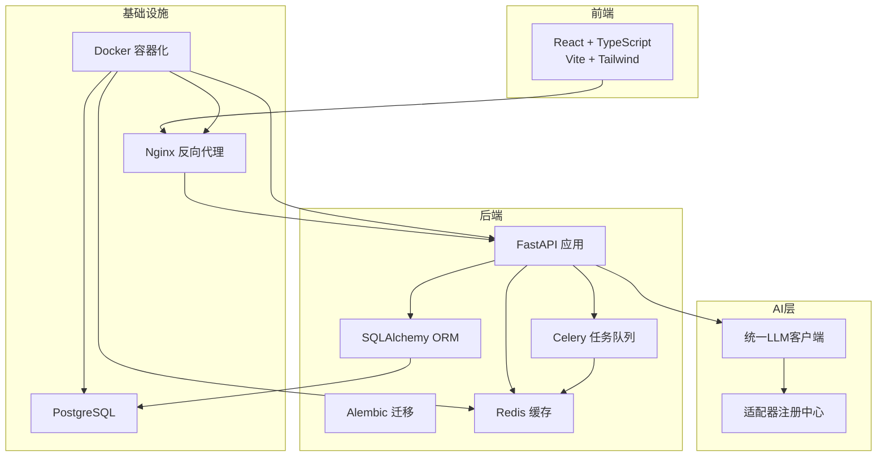
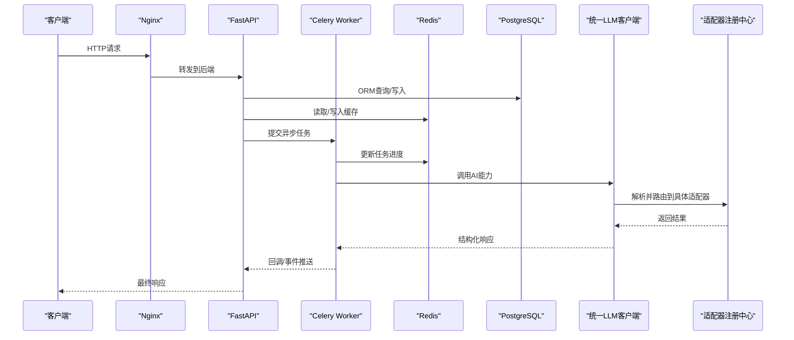
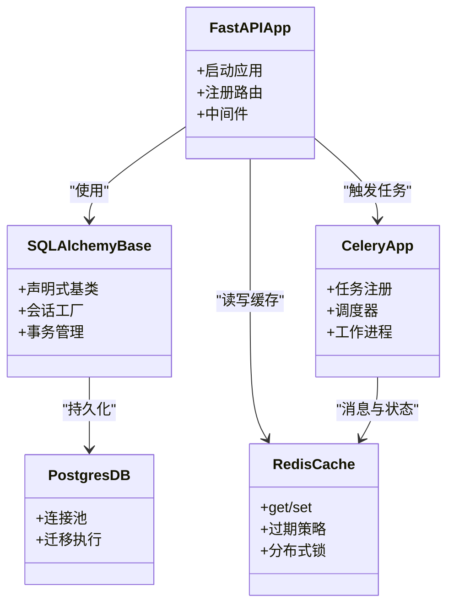
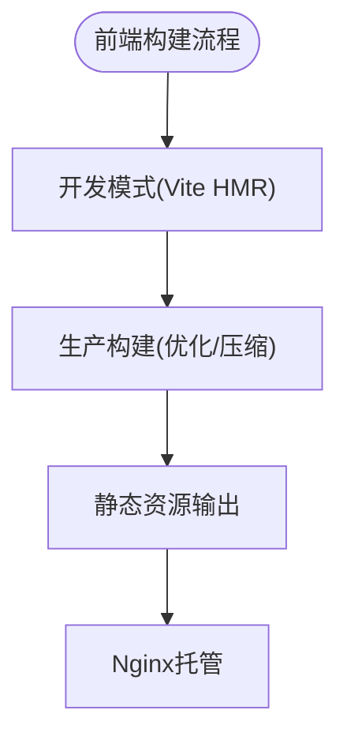
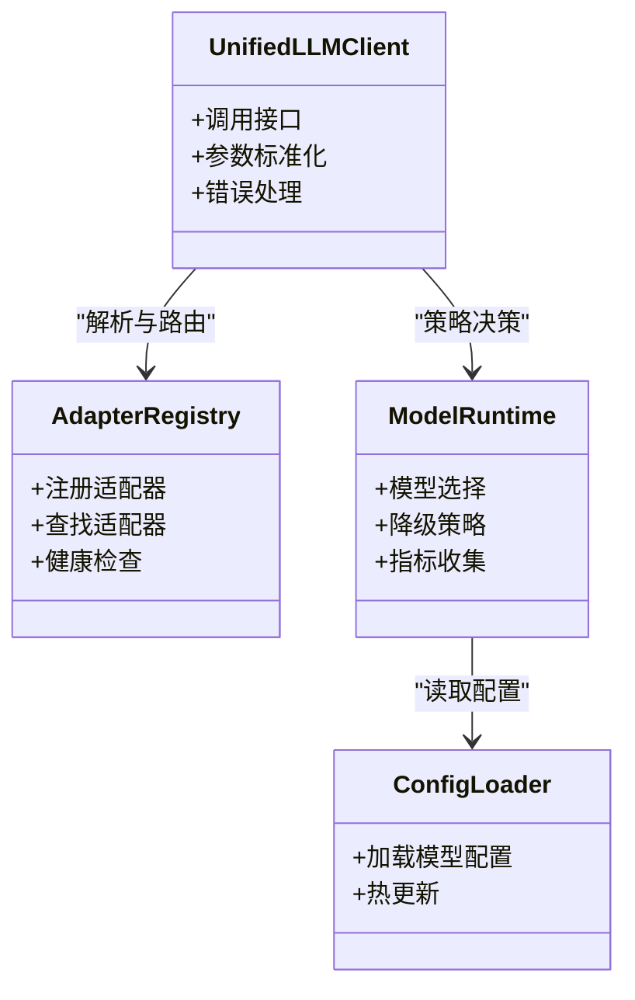
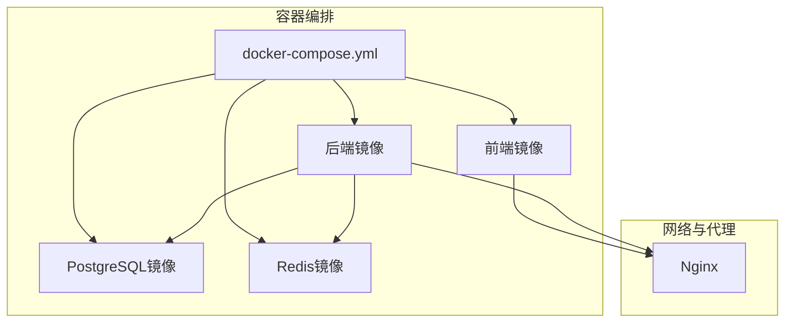
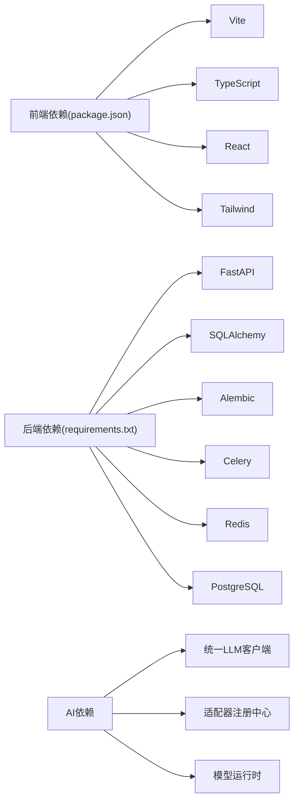

# 技术栈

<cite>
**本文引用的文件**   
- [README.md](file://README.md)
- [docker-compose.yml](file://docker-compose.yml)
- [nginx.conf](file://nginx.conf)
- [backend/Dockerfile](file://backend/Dockerfile)
- [frontend/Dockerfile](file://frontend/Dockerfile)
- [backend/requirements.txt](file://backend/requirements.txt)
- [backend/backend/app/main.py](file://backend/backend/app/main.py)
- [backend/backend/app/celery_app.py](file://backend/backend/app/celery_app.py)
- [backend/backend/app/core/config.py](file://backend/backend/app/core/config.py)
- [backend/backend/app/db/base.py](file://backend/backend/app/db/base.py)
- [backend/backend/app/services/cache_system.py](file://backend/backend/app/services/cache_system.py)
- [adapters/base.py](file://adapters/base.py)
- [adapters/registry.py](file://adapters/registry.py)
- [core/unified_llm_client.py](file://core/unified_llm_client.py)
- [core/model_runtime.py](file://core/model_runtime.py)
- [config/llm_models.yaml](file://config/llm_models.yaml)
- [frontend/package.json](file://frontend/package.json)
- [frontend/vite.config.ts](file://frontend/vite.config.ts)
- [frontend/tailwind.config.js](file://frontend/tailwind.config.js)
- [postgres-init/01-init.sql](file://postgres-init/01-init.sql)
- [redis.conf](file://redis.conf)
</cite>

## 目录
1. [简介](#简介)
2. [项目结构](#项目结构)
3. [核心组件](#核心组件)
4. [架构总览](#架构总览)
5. [详细组件分析](#详细组件分析)
6. [依赖关系分析](#依赖关系分析)
7. [性能考量](#性能考量)
8. [故障排查指南](#故障排查指南)
9. [结论](#结论)
10. [附录](#附录)

## 简介
本技术栈文档面向“小说创作代理系统”的后端、前端、AI集成与基础设施，系统性梳理FastAPI、SQLAlchemy ORM、Celery异步任务、PostgreSQL、Redis、Docker、Nginx、React+TypeScript+Vite+Tailwind等技术选型与协作方式，并给出版本兼容性与升级策略建议。

## 项目结构
仓库采用前后端分离与多服务编排：
- 后端（Python/FastAPI）：REST API、ORM模型、Alembic迁移、Celery任务、缓存与配置管理
- 前端（React/TS/Vite/Tailwind）：构建产物由Nginx托管
- AI适配层：统一LLM客户端与多厂商适配器注册中心
- 基础设施：Docker Compose编排、Nginx反向代理、PostgreSQL初始化脚本、Redis配置

**图示来源** 
- [docker-compose.yml](file://docker-compose.yml)
- [nginx.conf](file://nginx.conf)
- [backend/Dockerfile](file://backend/Dockerfile)
- [frontend/Dockerfile](file://frontend/Dockerfile)

**章节来源**
- [README.md](file://README.md)
- [docker-compose.yml](file://docker-compose.yml)

## 核心组件
- 后端框架：FastAPI提供高性能异步API与自动OpenAPI文档
- 数据持久化：SQLAlchemy ORM + Alembic进行数据库建模与迁移
- 异步任务：Celery处理耗时任务（如音频生成、视频合成、批量处理）
- 缓存：Redis用于会话、限流、结果缓存与任务中间状态
- 数据库：PostgreSQL作为主存储
- 前端：React + TypeScript + Vite + Tailwind CSS
- AI集成：统一LLM客户端与适配器注册中心，支持多模型路由与降级
- 部署：Docker容器化，Nginx反向代理与静态资源托管

**章节来源**
- [backend/backend/app/main.py](file://backend/backend/app/main.py)
- [backend/backend/app/db/base.py](file://backend/backend/app/db/base.py)
- [backend/backend/app/celery_app.py](file://backend/backend/app/celery_app.py)
- [backend/backend/app/services/cache_system.py](file://backend/backend/app/services/cache_system.py)
- [core/unified_llm_client.py](file://core/unified_llm_client.py)
- [adapters/registry.py](file://adapters/registry.py)
- [frontend/package.json](file://frontend/package.json)
- [frontend/vite.config.ts](file://frontend/vite.config.ts)
- [frontend/tailwind.config.js](file://frontend/tailwind.config.js)

## 架构总览
系统以FastAPI为入口，通过Nginx对外暴露HTTP/HTTPS；业务逻辑调用SQLAlchemy访问PostgreSQL，使用Celery执行异步任务并通过Redis做消息总线与缓存；AI能力通过统一客户端接入多种LLM与媒体生成适配器，按策略选择最优模型或回退路径。

**图示来源** 
- [nginx.conf](file://nginx.conf)
- [backend/backend/app/main.py](file://backend/backend/app/main.py)
- [backend/backend/app/celery_app.py](file://backend/backend/app/celery_app.py)
- [backend/backend/app/services/cache_system.py](file://backend/backend/app/services/cache_system.py)
- [core/unified_llm_client.py](file://core/unified_llm_client.py)
- [adapters/registry.py](file://adapters/registry.py)

## 详细组件分析

### 后端技术栈（FastAPI + SQLAlchemy + Celery + PostgreSQL + Redis）
- FastAPI：定义路由、依赖注入、请求校验与自动文档
- SQLAlchemy：声明式模型、会话管理、事务控制
- Alembic：数据库版本管理与迁移脚本
- Celery：任务定义、调度、重试与监控
- Redis：缓存、限流、分布式锁与任务状态
- PostgreSQL：关系型数据存储，配合初始化脚本完成库表准备

**图示来源** 
- [backend/backend/app/main.py](file://backend/backend/app/main.py)
- [backend/backend/app/db/base.py](file://backend/backend/app/db/base.py)
- [backend/backend/app/celery_app.py](file://backend/backend/app/celery_app.py)
- [backend/backend/app/services/cache_system.py](file://backend/backend/app/services/cache_system.py)

**章节来源**
- [backend/backend/app/main.py](file://backend/backend/app/main.py)
- [backend/backend/app/db/base.py](file://backend/backend/app/db/base.py)
- [backend/backend/app/celery_app.py](file://backend/backend/app/celery_app.py)
- [backend/backend/app/services/cache_system.py](file://backend/backend/app/services/cache_system.py)
- [postgres-init/01-init.sql](file://postgres-init/01-init.sql)

### 前端技术栈（React + TypeScript + Vite + Tailwind CSS）
- React：组件化UI与状态管理
- TypeScript：类型安全与开发体验提升
- Vite：快速构建与热更新
- Tailwind CSS：原子化样式与主题定制

**图示来源** 
- [frontend/package.json](file://frontend/package.json)
- [frontend/vite.config.ts](file://frontend/vite.config.ts)
- [frontend/tailwind.config.js](file://frontend/tailwind.config.js)

**章节来源**
- [frontend/package.json](file://frontend/package.json)
- [frontend/vite.config.ts](file://frontend/vite.config.ts)
- [frontend/tailwind.config.js](file://frontend/tailwind.config.js)

### AI集成技术（统一LLM客户端与多适配器）
- 统一LLM客户端：屏蔽底层差异，提供一致的调用接口
- 适配器注册中心：集中管理各厂商适配器，支持动态加载与路由
- 模型运行时：根据策略选择模型、处理降级与重试
- 配置文件：集中维护模型元数据与路由规则

**图示来源** 
- [core/unified_llm_client.py](file://core/unified_llm_client.py)
- [adapters/registry.py](file://adapters/registry.py)
- [core/model_runtime.py](file://core/model_runtime.py)
- [config/llm_models.yaml](file://config/llm_models.yaml)

**章节来源**
- [core/unified_llm_client.py](file://core/unified_llm_client.py)
- [adapters/registry.py](file://adapters/registry.py)
- [core/model_runtime.py](file://core/model_runtime.py)
- [config/llm_models.yaml](file://config/llm_models.yaml)

### 基础设施技术（Docker + Nginx + Redis + PostgreSQL）
- Docker：容器化后端与前端，统一运行环境
- Nginx：反向代理、静态资源托管、SSL终止
- Redis：缓存、限流、任务队列与状态同步
- PostgreSQL：主数据库，配合初始化脚本完成库表准备

**图示来源** 
- [docker-compose.yml](file://docker-compose.yml)
- [nginx.conf](file://nginx.conf)
- [backend/Dockerfile](file://backend/Dockerfile)
- [frontend/Dockerfile](file://frontend/Dockerfile)
- [postgres-init/01-init.sql](file://postgres-init/01-init.sql)
- [redis.conf](file://redis.conf)

**章节来源**
- [docker-compose.yml](file://docker-compose.yml)
- [nginx.conf](file://nginx.conf)
- [backend/Dockerfile](file://backend/Dockerfile)
- [frontend/Dockerfile](file://frontend/Dockerfile)
- [postgres-init/01-init.sql](file://postgres-init/01-init.sql)
- [redis.conf](file://redis.conf)

## 依赖关系分析
- 后端依赖：FastAPI、SQLAlchemy、Alembic、Celery、Redis、PostgreSQL驱动、日志与配置模块
- 前端依赖：React、TypeScript、Vite、Tailwind、构建插件
- AI依赖：统一客户端与适配器实现，模型配置与运行时策略
- 基础设施依赖：Docker、Nginx、PostgreSQL、Redis

**图示来源** 
- [backend/requirements.txt](file://backend/requirements.txt)
- [frontend/package.json](file://frontend/package.json)
- [core/unified_llm_client.py](file://core/unified_llm_client.py)
- [adapters/registry.py](file://adapters/registry.py)
- [core/model_runtime.py](file://core/model_runtime.py)

**章节来源**
- [backend/requirements.txt](file://backend/requirements.txt)
- [frontend/package.json](file://frontend/package.json)

## 性能考量
- 数据库：连接池、索引优化、慢查询分析与分页策略
- 缓存：热点数据缓存、缓存失效策略、分布式锁避免击穿
- 异步：长耗时任务下沉至Celery，SSE/WebSocket实时反馈
- 前端：代码分割、懒加载、图片与资源优化
- AI：模型选择与降级、并发限制与重试退避、结果缓存

[本节为通用指导，不直接分析具体文件]

## 故障排查指南
- 后端启动失败：检查环境变量、数据库连接、Redis连通性、端口占用
- 任务执行异常：查看Celery worker日志、任务重试次数、适配器限流与配额
- 缓存问题：确认Redis键空间、TTL设置、序列化兼容性
- 前端构建失败：清理node_modules、检查依赖版本冲突、Vite配置项
- 代理与SSL：验证Nginx配置、证书路径、域名解析

**章节来源**
- [backend/backend/app/core/config.py](file://backend/backend/app/core/config.py)
- [backend/backend/app/celery_app.py](file://backend/backend/app/celery_app.py)
- [backend/backend/app/services/cache_system.py](file://backend/backend/app/services/cache_system.py)
- [nginx.conf](file://nginx.conf)
- [frontend/vite.config.ts](file://frontend/vite.config.ts)

## 结论
本系统以FastAPI为核心，结合SQLAlchemy、Celery、Redis与PostgreSQL构建高内聚、低耦合的后端服务；前端采用React+TS+Vite+Tailwind提升开发效率与用户体验；AI层通过统一客户端与适配器注册中心实现多模型灵活接入与智能路由；基础设施通过Docker与Nginx保障可移植性与稳定性。建议在版本管理中建立严格的依赖锁定与灰度发布流程，确保升级过程可控与可回滚。

[本节为总结性内容，不直接分析具体文件]

## 附录
- 版本兼容性与升级策略
  - Python与依赖：锁定requirements版本，定期评估安全补丁与新特性
  - Node与前端：固定package-lock版本，分阶段升级Vite与Tailwind
  - 数据库：Alembic迁移脚本需向后兼容，灰度发布前在预发环境验证
  - Redis与PostgreSQL：保持小版本一致，关注大版本弃用特性
  - AI适配器：新增适配器需通过统一接口测试与回归用例
  - 容器与代理：镜像分层优化，Nginx配置变更需自动化校验

[本节为通用指导，不直接分析具体文件]