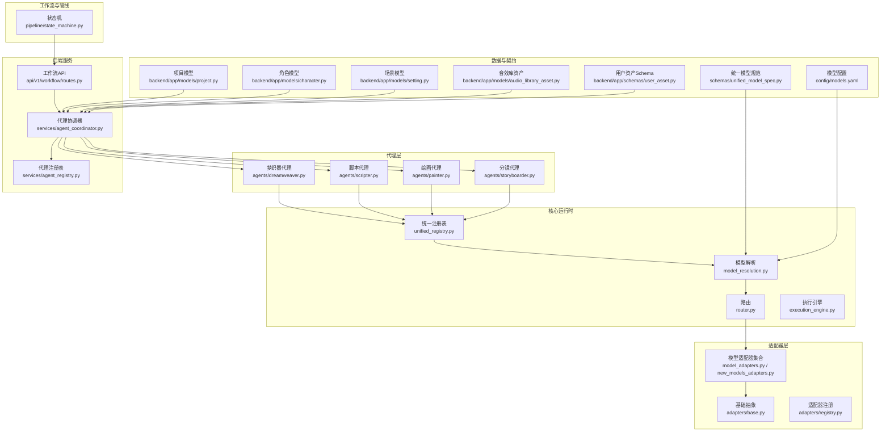
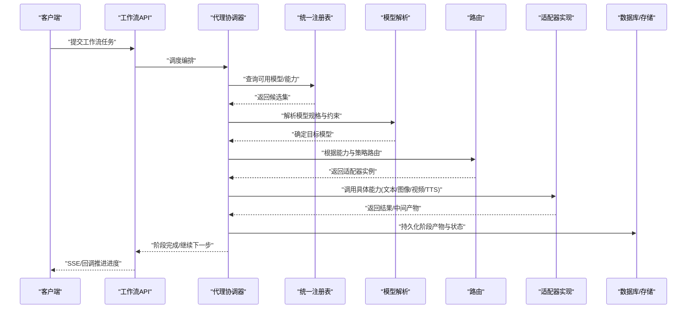
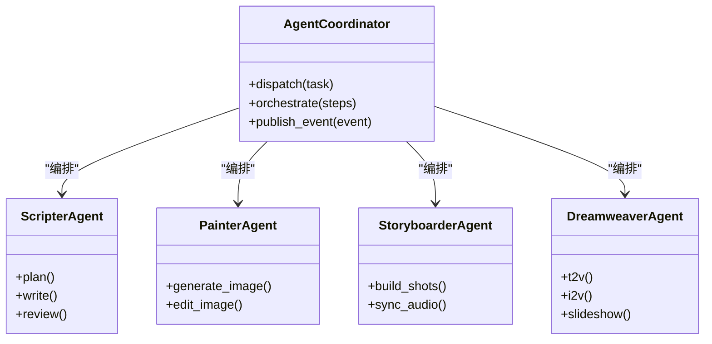
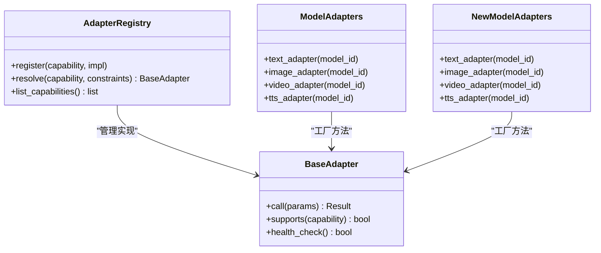
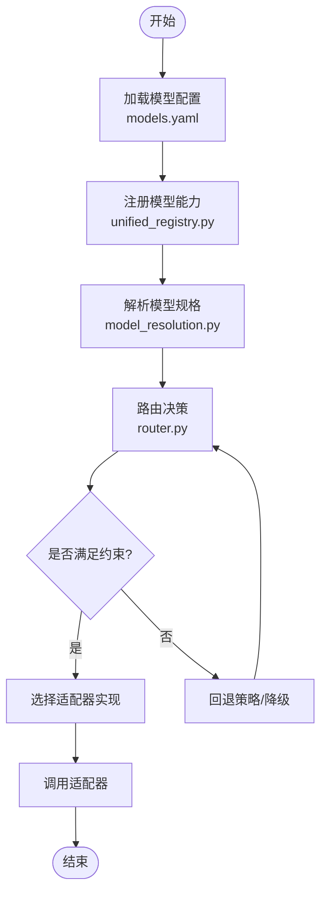
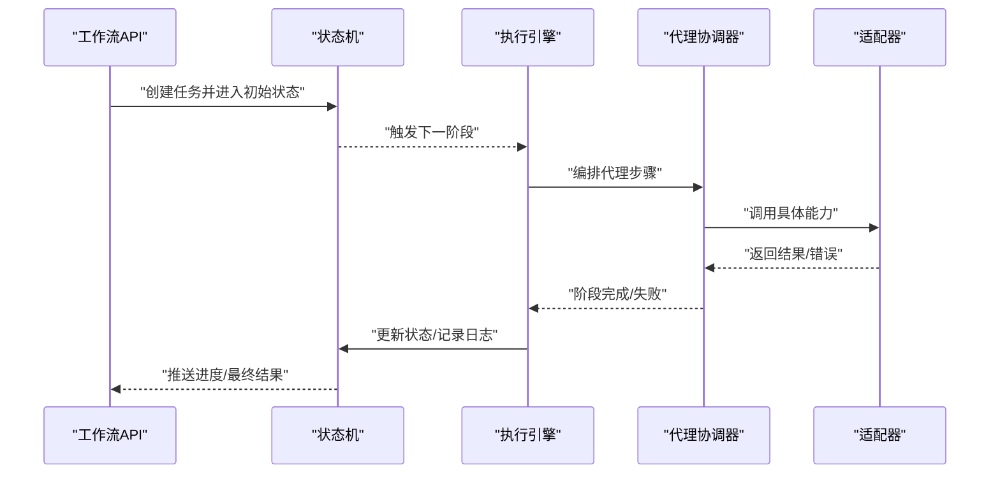
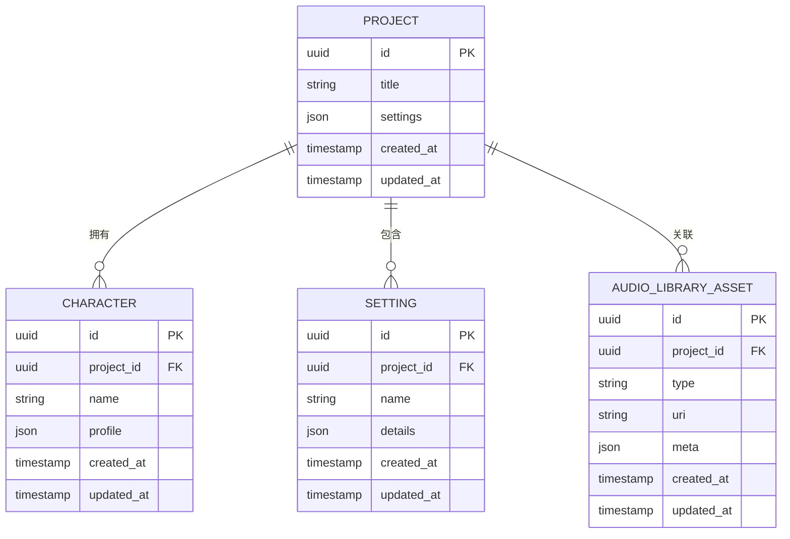
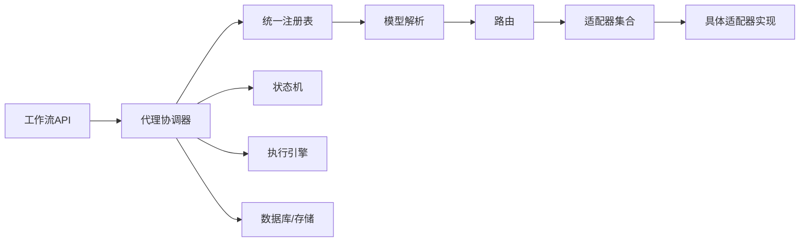

# 核心概念

<cite>
**本文引用的文件**   
- [README.md](file://README.md)
- [core/unified_registry.py](file://core/unified_registry.py)
- [core/model_resolution.py](file://core/model_resolution.py)
- [core/router.py](file://core/router.py)
- [adapters/base.py](file://adapters/base.py)
- [adapters/registry.py](file://adapters/registry.py)
- [adapters/_shared.py](file://adapters/_shared.py)
- [adapters/model_adapters.py](file://adapters/model_adapters.py)
- [adapters/new_models_adapters.py](file://adapters/new_models_adapters.py)
- [agents/dreamweaver.py](file://agents/dreamweaver.py)
- [agents/scripter.py](file://agents/scripter.py)
- [agents/painter.py](file://agents/painter.py)
- [agents/storyboarder.py](file://agents/storyboarder.py)
- [backend/app/services/agent_coordinator.py](file://backend/app/services/agent_coordinator.py)
- [backend/app/services/agent_registry.py](file://backend/app/services/agent_registry.py)
- [backend/app/api/v1/workflow/routes.py](file://backend/app/api/v1/workflow/routes.py)
- [pipeline/state_machine.py](file://pipeline/state_machine.py)
- [core/execution_engine.py](file://core/execution_engine.py)
- [schemas/unified_model_spec.py](file://schemas/unified_model_spec.py)
- [config/models.yaml](file://config/models.yaml)
- [backend/app/models/project.py](file://backend/app/models/project.py)
- [backend/app/models/character.py](file://backend/app/models/character.py)
- [backend/app/models/setting.py](file://backend/app/models/setting.py)
- [backend/app/models/audio_library_asset.py](file://backend/app/models/audio_library_asset.py)
- [backend/app/schemas/user_asset.py](file://backend/app/schemas/user_asset.py)
</cite>

## 目录
1. [简介](#简介)
2. [项目结构](#项目结构)
3. [核心组件](#核心组件)
4. [架构总览](#架构总览)
5. [详细组件分析](#详细组件分析)
6. [依赖关系分析](#依赖关系分析)
7. [性能考量](#性能考量)
8. [故障排查指南](#故障排查指南)
9. [结论](#结论)
10. [附录](#附录)

## 简介
本文件为“小说创作代理系统”的核心概念文档，面向开发者与产品工程师，系统性阐述以下主题：
- AI 代理的概念、生命周期、通信机制与协作模式
- 适配器模式的实现与多模型统一接口
- 统一模型系统的注册、发现与路由
- 工作流引擎的任务编排与执行流程
- 资产管理（角色、场景、音效等数字资产）的组织方式
- 实践示例与最佳实践，帮助将概念落地到工程代码中

## 项目结构
系统采用分层与模块化组织：
- core：统一的运行时能力（模型解析、路由、执行引擎、统一注册表）
- adapters：各AI服务适配层（LLM、图像、视频、TTS等），提供一致接口
- agents：领域代理（编剧、分镜、绘画、梦织器等）
- backend：Web API、服务层、数据模型、迁移与任务
- pipeline：状态机与工作流执行管线
- schemas：统一模型规范与契约
- config：模型与意图配置

**图表来源** 
- [core/unified_registry.py](file://core/unified_registry.py)
- [core/model_resolution.py](file://core/model_resolution.py)
- [core/router.py](file://core/router.py)
- [adapters/base.py](file://adapters/base.py)
- [adapters/registry.py](file://adapters/registry.py)
- [adapters/model_adapters.py](file://adapters/model_adapters.py)
- [adapters/new_models_adapters.py](file://adapters/new_models_adapters.py)
- [agents/dreamweaver.py](file://agents/dreamweaver.py)
- [agents/scripter.py](file://agents/scripter.py)
- [agents/painter.py](file://agents/painter.py)
- [agents/storyboarder.py](file://agents/storyboarder.py)
- [backend/app/services/agent_coordinator.py](file://backend/app/services/agent_coordinator.py)
- [backend/app/services/agent_registry.py](file://backend/app/services/agent_registry.py)
- [backend/app/api/v1/workflow/routes.py](file://backend/app/api/v1/workflow/routes.py)
- [pipeline/state_machine.py](file://pipeline/state_machine.py)
- [core/execution_engine.py](file://core/execution_engine.py)
- [schemas/unified_model_spec.py](file://schemas/unified_model_spec.py)
- [config/models.yaml](file://config/models.yaml)
- [backend/app/models/project.py](file://backend/app/models/project.py)
- [backend/app/models/character.py](file://backend/app/models/character.py)
- [backend/app/models/setting.py](file://backend/app/models/setting.py)
- [backend/app/models/audio_library_asset.py](file://backend/app/models/audio_library_asset.py)
- [backend/app/schemas/user_asset.py](file://backend/app/schemas/user_asset.py)

**章节来源**
- [README.md](file://README.md)

## 核心组件
- 统一注册表与模型解析：集中管理模型能力、版本与元数据，支持按能力维度发现与选择。
- 路由与适配器：基于能力与约束将请求路由至具体适配器实现，屏蔽底层差异。
- 代理层：以业务目标为中心编排调用（如剧本生成、分镜构建、图像绘制、视频合成）。
- 工作流与状态机：定义端到端任务编排、阶段流转与回滚策略。
- 资产管理：对角色、场景、音效等数字资产进行结构化建模与检索。

**章节来源**
- [core/unified_registry.py](file://core/unified_registry.py)
- [core/model_resolution.py](file://core/model_resolution.py)
- [core/router.py](file://core/router.py)
- [adapters/base.py](file://adapters/base.py)
- [adapters/registry.py](file://adapters/registry.py)
- [adapters/model_adapters.py](file://adapters/model_adapters.py)
- [adapters/new_models_adapters.py](file://adapters/new_models_adapters.py)
- [agents/dreamweaver.py](file://agents/dreamweaver.py)
- [agents/scripter.py](file://agents/scripter.py)
- [agents/painter.py](file://agents/painter.py)
- [agents/storyboarder.py](file://agents/storyboarder.py)
- [pipeline/state_machine.py](file://pipeline/state_machine.py)
- [backend/app/models/project.py](file://backend/app/models/project.py)
- [backend/app/models/character.py](file://backend/app/models/character.py)
- [backend/app/models/setting.py](file://backend/app/models/setting.py)
- [backend/app/models/audio_library_asset.py](file://backend/app/models/audio_library_asset.py)
- [backend/app/schemas/user_asset.py](file://backend/app/schemas/user_asset.py)

## 架构总览
系统遵循“协议优先、适配器解耦、注册驱动、工作流编排”的设计原则：
- 协议优先：通过统一模型规范与适配器基类定义稳定契约。
- 适配器解耦：不同厂商/模型的实现被隔离在适配器层。
- 注册驱动：模型与代理均通过注册表动态发现与装配。
- 工作流编排：状态机驱动任务阶段流转，保障可观测性与可恢复性。

**图表来源** 
- [backend/app/api/v1/workflow/routes.py](file://backend/app/api/v1/workflow/routes.py)
- [backend/app/services/agent_coordinator.py](file://backend/app/services/agent_coordinator.py)
- [core/unified_registry.py](file://core/unified_registry.py)
- [core/model_resolution.py](file://core/model_resolution.py)
- [core/router.py](file://core/router.py)
- [adapters/base.py](file://adapters/base.py)

## 详细组件分析

### AI 代理：概念、生命周期、通信与协作
- 概念：代理是以业务目标为导向的独立单元，封装了提示词、工具调用、重试与回退策略。
- 生命周期：初始化→上下文准备→步骤执行→结果校验→归档/回滚。
- 通信：通过消息对象与事件总线（SSE/回调）向外部暴露进度与结果。
- 协作：由协调器编排多个代理顺序或并行执行，共享上下文与资产。

**图表来源** 
- [backend/app/services/agent_coordinator.py](file://backend/app/services/agent_coordinator.py)
- [agents/scripter.py](file://agents/scripter.py)
- [agents/painter.py](file://agents/painter.py)
- [agents/storyboarder.py](file://agents/storyboarder.py)
- [agents/dreamweaver.py](file://agents/dreamweaver.py)

**章节来源**
- [backend/app/services/agent_coordinator.py](file://backend/app/services/agent_coordinator.py)
- [agents/scripter.py](file://agents/scripter.py)
- [agents/painter.py](file://agents/painter.py)
- [agents/storyboarder.py](file://agents/storyboarder.py)
- [agents/dreamweaver.py](file://agents/dreamweaver.py)

### 适配器模式：统一不同AI服务的接口
- 设计要点：
  - 基类定义统一能力接口（文本、图像、视频、TTS等）。
  - 每个厂商/模型实现一个适配器，屏蔽差异。
  - 注册表维护能力到实现的映射，支持热插拔。
- 关键文件：
  - 基类与共享逻辑
  - 适配器注册与发现
  - 模型适配器集合（新旧两套）

**图表来源** 
- [adapters/base.py](file://adapters/base.py)
- [adapters/registry.py](file://adapters/registry.py)
- [adapters/_shared.py](file://adapters/_shared.py)
- [adapters/model_adapters.py](file://adapters/model_adapters.py)
- [adapters/new_models_adapters.py](file://adapters/new_models_adapters.py)

**章节来源**
- [adapters/base.py](file://adapters/base.py)
- [adapters/registry.py](file://adapters/registry.py)
- [adapters/_shared.py](file://adapters/_shared.py)
- [adapters/model_adapters.py](file://adapters/model_adapters.py)
- [adapters/new_models_adapters.py](file://adapters/new_models_adapters.py)

### 统一模型系统：注册、发现与路由
- 注册：模型元数据（能力、版本、配额、价格、限制）集中登记。
- 发现：按能力与约束筛选候选模型。
- 路由：结合策略（成本、延迟、质量、合规）选择最优实现。

**图表来源** 
- [config/models.yaml](file://config/models.yaml)
- [core/unified_registry.py](file://core/unified_registry.py)
- [core/model_resolution.py](file://core/model_resolution.py)
- [core/router.py](file://core/router.py)
- [schemas/unified_model_spec.py](file://schemas/unified_model_spec.py)

**章节来源**
- [core/unified_registry.py](file://core/unified_registry.py)
- [core/model_resolution.py](file://core/model_resolution.py)
- [core/router.py](file://core/router.py)
- [schemas/unified_model_spec.py](file://schemas/unified_model_spec.py)
- [config/models.yaml](file://config/models.yaml)

### 工作流引擎：任务编排与执行流程
- 设计理念：以状态机为核心，将复杂创作过程分解为可观测、可恢复的阶段。
- 编排：API接收任务→协调器解析→阶段调度→适配器调用→状态推进。
- 执行：执行引擎负责并发控制、超时、重试与幂等。

**图表来源** 
- [backend/app/api/v1/workflow/routes.py](file://backend/app/api/v1/workflow/routes.py)
- [pipeline/state_machine.py](file://pipeline/state_machine.py)
- [core/execution_engine.py](file://core/execution_engine.py)
- [backend/app/services/agent_coordinator.py](file://backend/app/services/agent_coordinator.py)

**章节来源**
- [backend/app/api/v1/workflow/routes.py](file://backend/app/api/v1/workflow/routes.py)
- [pipeline/state_machine.py](file://pipeline/state_machine.py)
- [core/execution_engine.py](file://core/execution_engine.py)
- [backend/app/services/agent_coordinator.py](file://backend/app/services/agent_coordinator.py)

### 资产管理：角色、场景、音效等数字资产的组织
- 模型与Schema：
  - 项目、角色、场景、音频库资产等实体建模
  - 用户资产Schema用于统一输入输出契约
- 使用方式：
  - 代理在执行过程中读取/写入资产，确保一致性
  - 工作流阶段间传递资产引用，避免重复生成

**图表来源** 
- [backend/app/models/project.py](file://backend/app/models/project.py)
- [backend/app/models/character.py](file://backend/app/models/character.py)
- [backend/app/models/setting.py](file://backend/app/models/setting.py)
- [backend/app/models/audio_library_asset.py](file://backend/app/models/audio_library_asset.py)
- [backend/app/schemas/user_asset.py](file://backend/app/schemas/user_asset.py)

**章节来源**
- [backend/app/models/project.py](file://backend/app/models/project.py)
- [backend/app/models/character.py](file://backend/app/models/character.py)
- [backend/app/models/setting.py](file://backend/app/models/setting.py)
- [backend/app/models/audio_library_asset.py](file://backend/app/models/audio_library_asset.py)
- [backend/app/schemas/user_asset.py](file://backend/app/schemas/user_asset.py)

### 实践示例与最佳实践
- 新增适配器：
  - 继承基类，实现统一接口；在注册表中登记能力与约束；在模型适配器工厂中暴露选择方法。
  - 参考路径：[adapters/base.py](file://adapters/base.py)、[adapters/registry.py](file://adapters/registry.py)、[adapters/model_adapters.py](file://adapters/model_adapters.py)、[adapters/new_models_adapters.py](file://adapters/new_models_adapters.py)
- 接入新模型：
  - 在统一模型规范中声明能力与参数；在配置文件中登记元数据；通过解析与路由自动生效。
  - 参考路径：[schemas/unified_model_spec.py](file://schemas/unified_model_spec.py)、[config/models.yaml](file://config/models.yaml)、[core/model_resolution.py](file://core/model_resolution.py)、[core/router.py](file://core/router.py)
- 编排代理工作流：
  - 在协调器中定义步骤序列与条件分支；利用状态机推进阶段并持久化中间产物。
  - 参考路径：[backend/app/services/agent_coordinator.py](file://backend/app/services/agent_coordinator.py)、[pipeline/state_machine.py](file://pipeline/state_machine.py)、[core/execution_engine.py](file://core/execution_engine.py)
- 资产管理最佳实践：
  - 使用Schema校验输入；为资产建立索引与版本；跨阶段仅传递引用，减少冗余IO。
  - 参考路径：[backend/app/schemas/user_asset.py](file://backend/app/schemas/user_asset.py)、[backend/app/models/audio_library_asset.py](file://backend/app/models/audio_library_asset.py)

**章节来源**
- [adapters/base.py](file://adapters/base.py)
- [adapters/registry.py](file://adapters/registry.py)
- [adapters/model_adapters.py](file://adapters/model_adapters.py)
- [adapters/new_models_adapters.py](file://adapters/new_models_adapters.py)
- [schemas/unified_model_spec.py](file://schemas/unified_model_spec.py)
- [config/models.yaml](file://config/models.yaml)
- [core/model_resolution.py](file://core/model_resolution.py)
- [core/router.py](file://core/router.py)
- [backend/app/services/agent_coordinator.py](file://backend/app/services/agent_coordinator.py)
- [pipeline/state_machine.py](file://pipeline/state_machine.py)
- [core/execution_engine.py](file://core/execution_engine.py)
- [backend/app/schemas/user_asset.py](file://backend/app/schemas/user_asset.py)
- [backend/app/models/audio_library_asset.py](file://backend/app/models/audio_library_asset.py)

## 依赖关系分析
- 低耦合高内聚：适配器与代理通过注册表与路由解耦；工作流与执行引擎职责清晰。
- 潜在循环依赖：应避免在适配器中直接依赖上层代理，保持单向依赖流向。
- 外部依赖：数据库、缓存、消息队列与第三方AI服务。

**图表来源** 
- [backend/app/api/v1/workflow/routes.py](file://backend/app/api/v1/workflow/routes.py)
- [backend/app/services/agent_coordinator.py](file://backend/app/services/agent_coordinator.py)
- [core/unified_registry.py](file://core/unified_registry.py)
- [core/model_resolution.py](file://core/model_resolution.py)
- [core/router.py](file://core/router.py)
- [adapters/model_adapters.py](file://adapters/model_adapters.py)
- [adapters/new_models_adapters.py](file://adapters/new_models_adapters.py)
- [pipeline/state_machine.py](file://pipeline/state_machine.py)
- [core/execution_engine.py](file://core/execution_engine.py)

**章节来源**
- [backend/app/api/v1/workflow/routes.py](file://backend/app/api/v1/workflow/routes.py)
- [backend/app/services/agent_coordinator.py](file://backend/app/services/agent_coordinator.py)
- [core/unified_registry.py](file://core/unified_registry.py)
- [core/model_resolution.py](file://core/model_resolution.py)
- [core/router.py](file://core/router.py)
- [adapters/model_adapters.py](file://adapters/model_adapters.py)
- [adapters/new_models_adapters.py](file://adapters/new_models_adapters.py)
- [pipeline/state_machine.py](file://pipeline/state_machine.py)
- [core/execution_engine.py](file://core/execution_engine.py)

## 性能考量
- 模型选择策略：结合延迟、成本与质量指标进行加权选择，必要时启用缓存与预热。
- 并发与限流：在适配器层实施速率限制与熔断，避免下游过载。
- I/O优化：批量处理与异步I/O，减少阻塞；中间产物落盘时采用增量更新。
- 资源隔离：按租户/项目隔离配额，防止热点干扰。

[本节为通用指导，不直接分析具体文件]

## 故障排查指南
- 常见问题定位：
  - 模型未注册或能力不匹配：检查注册表与模型配置，确认能力声明与约束。
  - 路由失败：查看路由策略与约束条件，确认优先级与回退链。
  - 适配器异常：核对适配器健康检查与错误码映射，定位上游依赖问题。
  - 工作流卡住：检查状态机转换条件与事件发布，确认幂等与重试策略。
- 建议手段：
  - 启用链路追踪与审计日志，记录阶段产物与耗时。
  - 使用最小复现用例与断点调试，逐步缩小范围。
  - 对关键路径增加告警与熔断保护。

**章节来源**
- [core/unified_registry.py](file://core/unified_registry.py)
- [core/model_resolution.py](file://core/model_resolution.py)
- [core/router.py](file://core/router.py)
- [adapters/base.py](file://adapters/base.py)
- [pipeline/state_machine.py](file://pipeline/state_machine.py)
- [core/execution_engine.py](file://core/execution_engine.py)

## 结论
本系统通过“统一注册+适配器解耦+工作流编排”的架构，实现了多模型、多能力的灵活组合与稳定运行。开发者可在不侵入业务的前提下扩展新的AI服务与代理，借助状态机与执行引擎获得可观测、可恢复的生产级能力。建议在迭代中持续完善模型规范、适配器契约与工作流模板，以提升整体稳定性与可维护性。

[本节为总结性内容，不直接分析具体文件]

## 附录
- 术语表：
  - 代理：以业务目标为中心的AI单元
  - 适配器：屏蔽底层差异的统一接口实现
  - 统一模型：跨厂商/版本的标准化模型描述
  - 工作流：阶段化的任务编排与执行流程
  - 资产：角色、场景、音效等数字资源的结构化表示

[本节为补充说明，不直接分析具体文件]