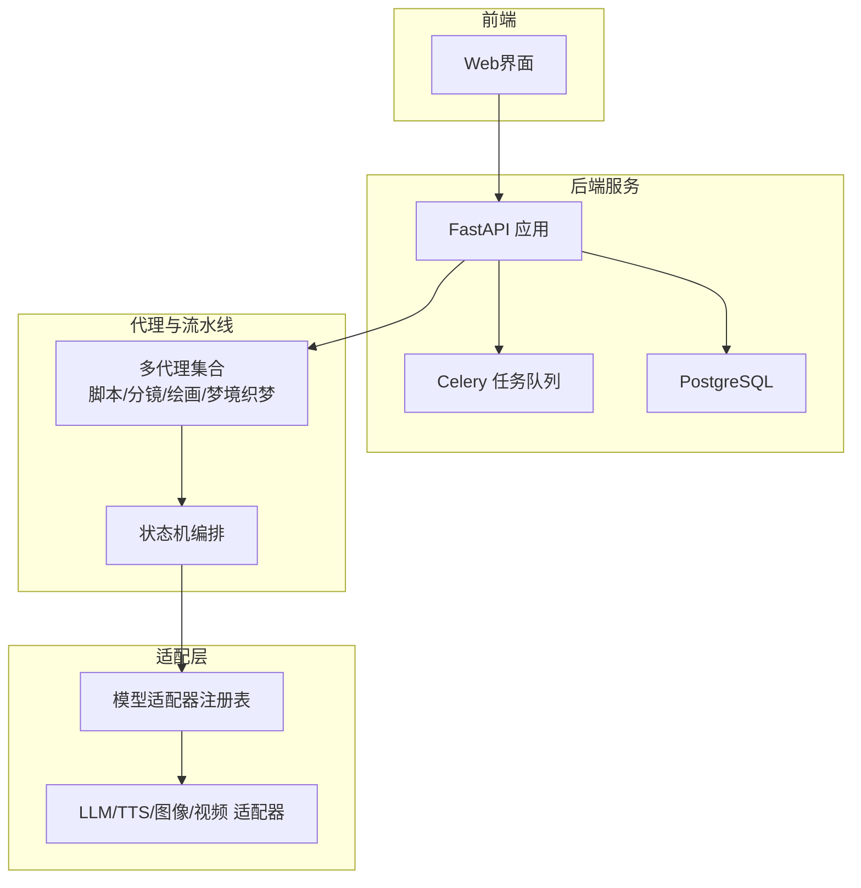
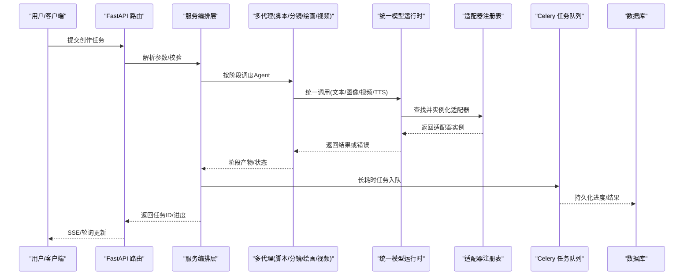
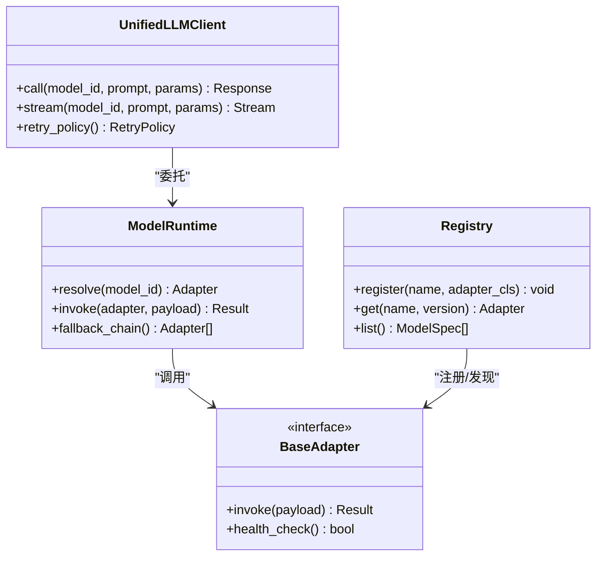
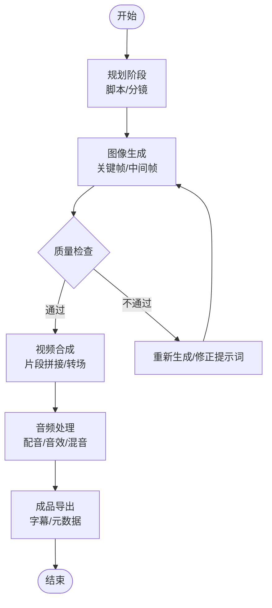
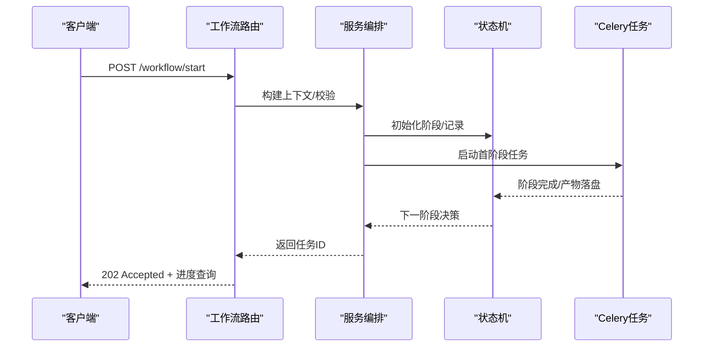
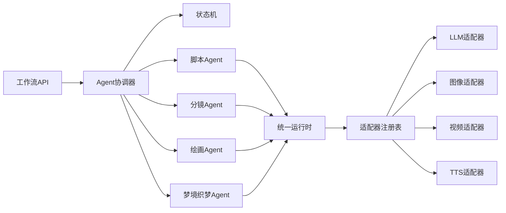

# 项目介绍

<cite>
**本文引用的文件**   
- [README.md](file://README.md)
- [backend/app/main.py](file://backend/app/main.py)
- [backend/app/celery_app.py](file://backend/app/celery_app.py)
- [core/unified_llm_client.py](file://core/unified_llm_client.py)
- [core/model_runtime.py](file://core/model_runtime.py)
- [adapters/base.py](file://adapters/base.py)
- [adapters/registry.py](file://adapters/registry.py)
- [agents/scripter.py](file://agents/scripter.py)
- [agents/painter.py](file://agents/painter.py)
- [agents/storyboarder.py](file://agents/storyboarder.py)
- [agents/dreamweaver.py](file://agents/dreamweaver.py)
- [pipeline/state_machine.py](file://pipeline/state_machine.py)
- [backend/app/services/agent_coordinator.py](file://backend/app/services/agent_coordinator.py)
- [backend/app/api/v1/workflow/routes.py](file://backend/app/api/v1/workflow/routes.py)
- [backend/app/schemas/common.py](file://backend/app/schemas/common.py)
- [config/models.yaml](file://config/models.yaml)
- [docker-compose.yml](file://docker-compose.yml)
</cite>

## 目录
1. [简介](#简介)
2. [项目结构](#项目结构)
3. [核心组件](#核心组件)
4. [架构总览](#架构总览)
5. [详细组件分析](#详细组件分析)
6. [依赖关系分析](#依赖关系分析)
7. [性能考量](#性能考量)
8. [故障排查指南](#故障排查指南)
9. [结论](#结论)
10. [附录](#附录)

## 简介
本系统是一个AI驱动的多模态内容创作平台，面向小说与有声书的全链路自动化生产。其核心价值在于将“文本创作—角色设计—分镜制作—图像生成—视频合成—音频处理”串联为端到端工作流，通过多代理协调、统一模型管理与适配器模式，显著降低跨工具链集成成本，提升产出效率与一致性。目标用户包括专业作家、内容创作者、有声书制作团队及影视前期制作人员。

## 项目结构
仓库采用前后端分离与模块化组织：
- 后端服务：FastAPI应用、Celery异步任务、数据库迁移、API路由与服务层
- 代理与流水线：文本、图像、视频、音频等能力以Agent封装，并通过状态机编排
- 适配层：对各类LLM、TTS、图像与视频模型的统一抽象与注册
- 前端：React/Vite界面，提供可视化编辑与流程监控
- 配置与部署：模型目录、Docker编排、Nginx反向代理

**图表来源** 
- [backend/app/main.py](file://backend/app/main.py)
- [backend/app/celery_app.py](file://backend/app/celery_app.py)
- [pipeline/state_machine.py](file://pipeline/state_machine.py)
- [adapters/registry.py](file://adapters/registry.py)

**章节来源**
- [README.md](file://README.md)
- [docker-compose.yml](file://docker-compose.yml)

## 核心组件
- 统一LLM客户端与模型运行时：屏蔽不同厂商差异，提供一致的调用接口与重试/限流策略
- 适配器注册中心：集中管理各模型适配器（对话、图像、视频、TTS），支持动态发现与版本切换
- 多代理体系：脚本撰写、分镜规划、角色与资产库、图像绘制、梦境织梦（视频生成）等Agent各司其职
- 流水线状态机：定义从文本到音视频的完整阶段与流转条件，保证可恢复与可观测
- 工作流API与服务编排：对外暴露REST接口，内部由服务层协调Agent与任务队列

**章节来源**
- [core/unified_llm_client.py](file://core/unified_llm_client.py)
- [core/model_runtime.py](file://core/model_runtime.py)
- [adapters/base.py](file://adapters/base.py)
- [adapters/registry.py](file://adapters/registry.py)
- [agents/scripter.py](file://agents/scripter.py)
- [agents/painter.py](file://agents/painter.py)
- [agents/storyboarder.py](file://agents/storyboarder.py)
- [agents/dreamweaver.py](file://agents/dreamweaver.py)
- [pipeline/state_machine.py](file://pipeline/state_machine.py)
- [backend/app/services/agent_coordinator.py](file://backend/app/services/agent_coordinator.py)

## 架构总览
系统采用“API网关 + 服务编排 + 多代理 + 适配器层 + 任务队列”的分层架构。请求进入后由路由分发至服务层，服务层根据业务阶段调度对应Agent；Agent通过统一运行时访问适配器，最终调用具体模型。长耗时任务入队执行，结果回写数据库并推送前端。

**图表来源** 
- [backend/app/api/v1/workflow/routes.py](file://backend/app/api/v1/workflow/routes.py)
- [backend/app/services/agent_coordinator.py](file://backend/app/services/agent_coordinator.py)
- [core/model_runtime.py](file://core/model_runtime.py)
- [adapters/registry.py](file://adapters/registry.py)
- [backend/app/celery_app.py](file://backend/app/celery_app.py)

## 详细组件分析

### 统一模型管理与适配器模式
- 统一LLM客户端提供一致的方法签名、上下文注入、重试与限流
- 模型运行时负责选择具体适配器、缓存与降级策略
- 适配器基类定义标准接口，注册中心维护命名空间与版本映射，便于热插拔

**图表来源** 
- [core/unified_llm_client.py](file://core/unified_llm_client.py)
- [core/model_runtime.py](file://core/model_runtime.py)
- [adapters/base.py](file://adapters/base.py)
- [adapters/registry.py](file://adapters/registry.py)

**章节来源**
- [core/unified_llm_client.py](file://core/unified_llm_client.py)
- [core/model_runtime.py](file://core/model_runtime.py)
- [adapters/base.py](file://adapters/base.py)
- [adapters/registry.py](file://adapters/registry.py)
- [config/models.yaml](file://config/models.yaml)

### 多代理协调与工作流编排
- 脚本撰写Agent：基于大纲与设定生成章节文本，维护角色与世界观一致性
- 分镜规划Agent：将文本拆解为镜头序列，输出画面描述、时长与转场信息
- 绘画Agent：依据分镜提示词生成关键帧与中间帧，支持风格预设与质量检查
- 梦境织梦Agent：将分镜与素材合成为视频片段，支持多种视频模型接入
- 服务编排层：根据状态机推进阶段，协调资源与重试，保障幂等与可恢复

**图表来源** 
- [agents/scripter.py](file://agents/scripter.py)
- [agents/storyboarder.py](file://agents/storyboarder.py)
- [agents/painter.py](file://agents/painter.py)
- [agents/dreamweaver.py](file://agents/dreamweaver.py)
- [pipeline/state_machine.py](file://pipeline/state_machine.py)

**章节来源**
- [agents/scripter.py](file://agents/scripter.py)
- [agents/storyboarder.py](file://agents/storyboarder.py)
- [agents/painter.py](file://agents/painter.py)
- [agents/dreamweaver.py](file://agents/dreamweaver.py)
- [pipeline/state_machine.py](file://pipeline/state_machine.py)

### 工作流API与服务编排
- 路由层接收请求，校验输入并创建任务上下文
- 服务层组合多个Agent步骤，写入状态机节点，触发异步任务
- 任务完成后回调更新状态，前端通过SSE或轮询获取进度

**图表来源** 
- [backend/app/api/v1/workflow/routes.py](file://backend/app/api/v1/workflow/routes.py)
- [backend/app/services/agent_coordinator.py](file://backend/app/services/agent_coordinator.py)
- [pipeline/state_machine.py](file://pipeline/state_machine.py)
- [backend/app/celery_app.py](file://backend/app/celery_app.py)

**章节来源**
- [backend/app/api/v1/workflow/routes.py](file://backend/app/api/v1/workflow/routes.py)
- [backend/app/services/agent_coordinator.py](file://backend/app/services/agent_coordinator.py)
- [backend/app/schemas/common.py](file://backend/app/schemas/common.py)

## 依赖关系分析
- 外部依赖：PostgreSQL、Redis、Celery、FFmpeg、各类云模型API（LLM/TTS/图像/视频）
- 内部耦合：服务编排强依赖状态机与Agent；Agent依赖统一运行时与适配器注册表；适配器之间解耦，通过注册表隔离
- 潜在风险：适配器实现不一致、模型限流与配额、长任务超时与重试风暴

**图表来源** 
- [backend/app/api/v1/workflow/routes.py](file://backend/app/api/v1/workflow/routes.py)
- [backend/app/services/agent_coordinator.py](file://backend/app/services/agent_coordinator.py)
- [pipeline/state_machine.py](file://pipeline/state_machine.py)
- [core/model_runtime.py](file://core/model_runtime.py)
- [adapters/registry.py](file://adapters/registry.py)

**章节来源**
- [docker-compose.yml](file://docker-compose.yml)
- [backend/app/celery_app.py](file://backend/app/celery_app.py)

## 性能考量
- 并发与队列：Celery多Worker并行处理长任务，结合Redis做消息缓冲与去重
- 缓存与复用：提示词与中间产物缓存，减少重复计算；模型预热与连接池
- 限流与降级：适配器层统一限流，失败自动降级到备用模型或重试策略
- I/O优化：大文件分块上传/下载，FFmpeg批处理与硬件加速（可选）

[本节为通用指导，无需特定文件引用]

## 故障排查指南
- 常见问题定位
  - 模型调用失败：检查适配器健康检查、密钥与配额、网络连通性
  - 任务卡住：查看Celery日志、队列堆积、状态机节点是否死锁
  - 资源不足：磁盘空间、内存峰值、GPU显存占用
- 诊断手段
  - 启用追踪与审计：记录每次调用的模型ID、提示词摘要、耗时与错误码
  - 健康检查探针：定期探测适配器可用性，异常时自动摘除
  - 回放与复现：保存阶段产物与上下文，便于离线复现问题

**章节来源**
- [adapters/base.py](file://adapters/base.py)
- [adapters/registry.py](file://adapters/registry.py)
- [backend/app/celery_app.py](file://backend/app/celery_app.py)

## 结论
本系统以多代理协调与统一模型管理为核心，打通了从文本到音视频的完整创作链路。通过适配器模式与状态机编排，既保证了扩展性与稳定性，又降低了使用门槛。对于专业创作者与团队而言，可在保持风格一致性的同时显著提升产能，适用于小说有声书、短视频脚本、动画分镜等多种场景。

[本节为总结性内容，无需特定文件引用]

## 附录
- 技术栈概览
  - 后端：Python/FastAPI、Celery、SQLAlchemy/Alembic、PostgreSQL、Redis
  - 媒体处理：FFmpeg、WebSocket/SSE实时推送
  - 前端：React/Vite、TypeScript、Tailwind
  - 部署：Docker Compose、Nginx反向代理
- 快速上手
  - 环境准备：安装依赖、配置模型密钥、启动服务与Worker
  - 首次运行：创建项目、导入大纲、启动工作流、查看进度与导出成品

[本节为补充说明，无需特定文件引用]