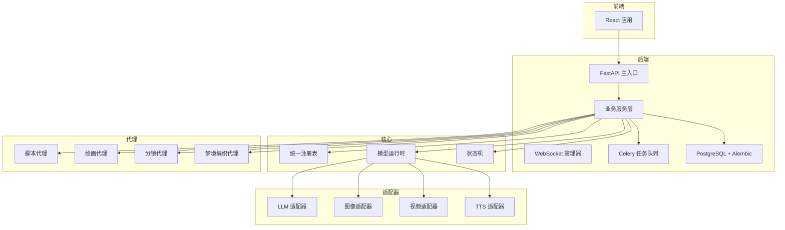
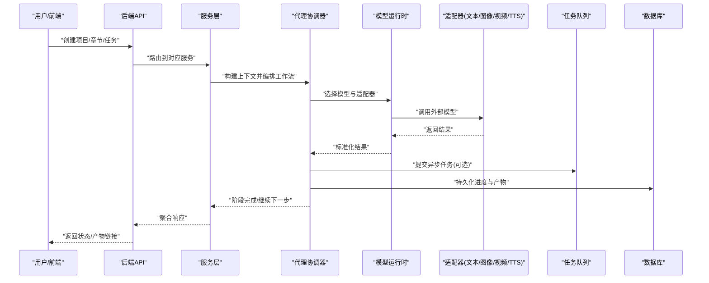
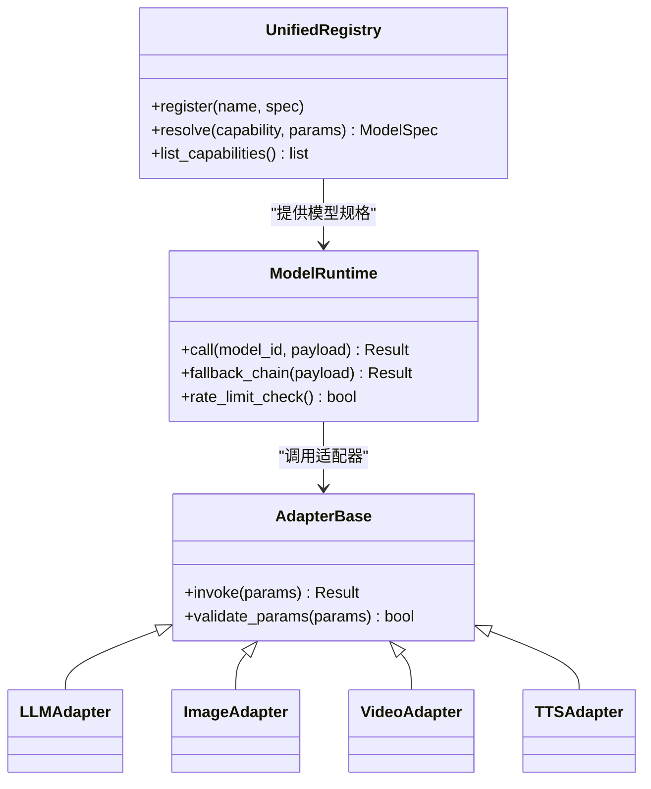
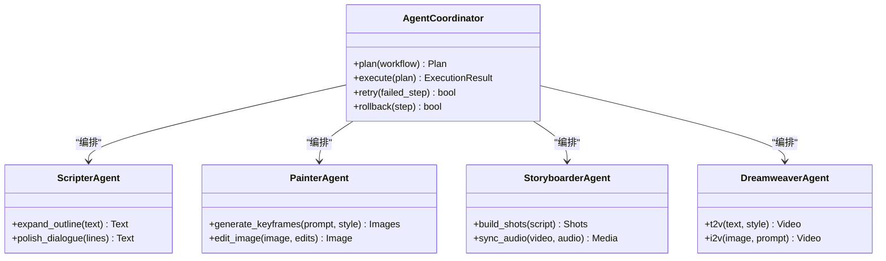
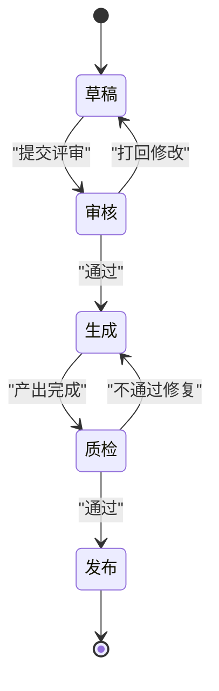
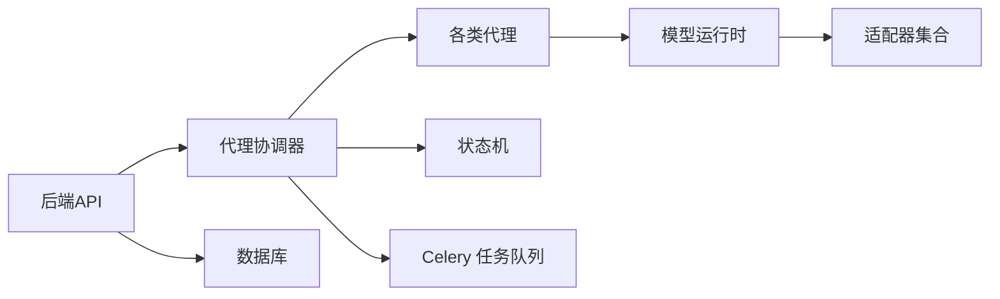

# 项目概述

<cite>
**本文引用的文件**   
- [README.md](file://README.md)
- [QUICK_START_GUIDE.md](file://QUICK_START_GUIDE.md)
- [docker-compose.yml](file://docker-compose.yml)
- [backend/app/main.py](file://backend/app/main.py)
- [backend/app/celery_app.py](file://backend/app/celery_app.py)
- [core/unified_registry.py](file://core/unified_registry.py)
- [core/model_runtime.py](file://core/model_runtime.py)
- [adapters/base.py](file://adapters/base.py)
- [adapters/registry.py](file://adapters/registry.py)
- [agents/dreamweaver.py](file://agents/dreamweaver.py)
- [agents/scripter.py](file://agents/scripter.py)
- [agents/painter.py](file://agents/painter.py)
- [agents/storyboarder.py](file://agents/storyboarder.py)
- [backend/app/services/agent_coordinator.py](file://backend/app/services/agent_coordinator.py)
- [backend/app/services/workflow_context_builder.py](file://backend/app/services/workflow_context_builder.py)
- [pipeline/state_machine.py](file://pipeline/state_machine.py)
- [config/models.yaml](file://config/models.yaml)
- [schemas/unified_model_spec.py](file://schemas/unified_model_spec.py)
</cite>

## 目录
1. [简介](#简介)
2. [项目结构](#项目结构)
3. [核心组件](#核心组件)
4. [架构总览](#架构总览)
5. [详细组件分析](#详细组件分析)
6. [依赖关系分析](#依赖关系分析)
7. [性能考量](#性能考量)
8. [故障排查指南](#故障排查指南)
9. [结论](#结论)
10. [附录：快速开始与最佳实践](#附录快速开始与最佳实践)

## 简介
本项目是一个AI驱动的多模态内容创作平台，面向“小说创作到有声书制作”的端到端工作流。系统通过统一的模型系统与代理协调模式，整合文本、图像、视频、音频生成能力，提供从剧本创作、分镜设计、角色与场景资产管理、画面生成、配音合成、字幕与后期处理的一体化体验。其核心价值在于：
- 统一接入多厂商模型（LLM、TTS、图像、视频），屏蔽差异，提升可替换性与扩展性
- 以“代理”为单元组织能力，通过协调器编排复杂工作流，支持异步任务与状态机驱动
- 提供前后端分离架构与REST/WebSocket接口，便于集成与二次开发
- 内置质量门禁、审计追踪与计费结算，满足生产级需求

## 项目结构
仓库采用分层与按功能域结合的目录组织方式：
- core：统一模型运行时、注册表、路由、语义匹配等基础设施
- adapters：各模型厂商适配器（文本、图像、视频、TTS）与通用工具
- agents：领域代理（脚本、绘画、分镜、梦境编织器等）
- backend：FastAPI后端服务、Celery任务、数据库模型、API路由与服务层
- pipeline：工作流状态机、自动质检、媒体处理管线
- frontend：React前端应用
- config/schemas：配置与统一模型规范定义
- scripts：运维与验证脚本

图表来源
- [backend/app/main.py:1-200](file://backend/app/main.py#L1-L200)
- [backend/app/celery_app.py:1-120](file://backend/app/celery_app.py#L1-L120)
- [core/unified_registry.py:1-150](file://core/unified_registry.py#L1-L150)
- [core/model_runtime.py:1-150](file://core/model_runtime.py#L1-L150)
- [adapters/base.py:1-120](file://adapters/base.py#L1-L120)
- [pipeline/state_machine.py:1-120](file://pipeline/state_machine.py#L1-L120)

章节来源
- [README.md:1-200](file://README.md#L1-L200)
- [QUICK_START_GUIDE.md:1-200](file://QUICK_START_GUIDE.md#L1-L200)
- [docker-compose.yml:1-200](file://docker-compose.yml#L1-L200)

## 核心组件
- 统一模型系统：通过统一注册表与运行时，抽象不同厂商的LLM、图像、视频、TTS能力，提供一致的调用接口与参数映射
- 代理协调模式：以领域代理封装具体能力，由协调器编排跨代理的任务序列，支持并发、重试与回退
- 适配器模式：每个外部模型提供方实现统一接口，便于热插拔与灰度切换
- 工作流与状态机：基于状态机的流水线控制，确保阶段产物校验、审计与可恢复性
- 任务队列与异步执行：Celery负责长耗时任务（如视频生成、批量转码），保障响应时效
- 数据与权限：PostgreSQL存储项目、章节、资产、评测与计费；RBAC与审计日志支撑生产治理

章节来源
- [core/unified_registry.py:1-150](file://core/unified_registry.py#L1-L150)
- [core/model_runtime.py:1-150](file://core/model_runtime.py#L1-L150)
- [adapters/base.py:1-120](file://adapters/base.py#L1-L120)
- [adapters/registry.py:1-120](file://adapters/registry.py#L1-L120)
- [pipeline/state_machine.py:1-120](file://pipeline/state_machine.py#L1-L120)
- [backend/app/celery_app.py:1-120](file://backend/app/celery_app.py#L1-L120)

## 架构总览
系统采用“前端—后端—核心—适配器—代理—任务队列—数据库”的分层架构。请求进入后端API后，由服务层解析意图并构建工作流上下文，协调器调度相应代理执行，并通过模型运行时选择具体适配器调用外部模型。关键流程包括：
- 文本生成：LLM适配器根据提示词与上下文生成剧情、对白、旁白
- 视觉生成：图像/视频适配器依据分镜与风格预设产出关键帧或片段
- 音频生成：TTS适配器将文本转为语音，结合音效库完成混音
- 质量门禁：自动质检与人工评审闭环，保证输出一致性

图表来源
- [backend/app/main.py:1-200](file://backend/app/main.py#L1-L200)
- [backend/app/services/agent_coordinator.py:1-200](file://backend/app/services/agent_coordinator.py#L1-L200)
- [core/model_runtime.py:1-150](file://core/model_runtime.py#L1-L150)
- [adapters/base.py:1-120](file://adapters/base.py#L1-L120)
- [pipeline/state_machine.py:1-120](file://pipeline/state_machine.py#L1-L120)

## 详细组件分析

### 统一模型系统与注册表
- 统一注册表集中管理模型能力、版本与元数据，支持按能力维度检索与降级策略
- 模型运行时负责参数归一化、错误处理、速率限制与缓存
- 统一模型规范定义输入输出契约，确保跨适配器的兼容性

图表来源
- [core/unified_registry.py:1-150](file://core/unified_registry.py#L1-L150)
- [core/model_runtime.py:1-150](file://core/model_runtime.py#L1-L150)
- [adapters/base.py:1-120](file://adapters/base.py#L1-L120)
- [schemas/unified_model_spec.py:1-120](file://schemas/unified_model_spec.py#L1-L120)

章节来源
- [core/unified_registry.py:1-150](file://core/unified_registry.py#L1-L150)
- [core/model_runtime.py:1-150](file://core/model_runtime.py#L1-L150)
- [adapters/base.py:1-120](file://adapters/base.py#L1-L120)
- [adapters/registry.py:1-120](file://adapters/registry.py#L1-L120)
- [schemas/unified_model_spec.py:1-120](file://schemas/unified_model_spec.py#L1-L120)

### 代理与协调器
- 脚本代理：负责大纲生成、章节扩写、对白润色
- 绘画代理：关键帧生成、风格迁移、图像编辑
- 分镜代理：镜头规划、时长估算、音视频同步
- 梦境编织代理：视频生成、转场、素材拼装
- 协调器：串联上述代理，维护上下文、重试与回退策略

图表来源
- [backend/app/services/agent_coordinator.py:1-200](file://backend/app/services/agent_coordinator.py#L1-L200)
- [agents/scripter.py:1-150](file://agents/scripter.py#L1-L150)
- [agents/painter.py:1-150](file://agents/painter.py#L1-L150)
- [agents/storyboarder.py:1-150](file://agents/storyboarder.py#L1-L150)
- [agents/dreamweaver.py:1-150](file://agents/dreamweaver.py#L1-L150)

章节来源
- [backend/app/services/agent_coordinator.py:1-200](file://backend/app/services/agent_coordinator.py#L1-L200)
- [agents/scripter.py:1-150](file://agents/scripter.py#L1-L150)
- [agents/painter.py:1-150](file://agents/painter.py#L1-L150)
- [agents/storyboarder.py:1-150](file://agents/storyboarder.py#L1-L150)
- [agents/dreamweaver.py:1-150](file://agents/dreamweaver.py#L1-L150)

### 工作流与状态机
- 状态机驱动章节/项目生命周期，包含草稿、审核、生成、质检、发布等阶段
- 每步可配置前置条件、后置处理与失败策略
- 与任务队列结合，支持断点续跑与进度上报

图表来源
- [pipeline/state_machine.py:1-120](file://pipeline/state_machine.py#L1-L120)

章节来源
- [pipeline/state_machine.py:1-120](file://pipeline/state_machine.py#L1-L120)

### 任务队列与异步执行
- Celery作为任务中心，承载视频生成、批量转码、索引重建等耗时操作
- 任务可带优先级、重试与超时控制，配合WebSocket推送进度
- 与数据库持久化任务状态，支持查询与审计

章节来源
- [backend/app/celery_app.py:1-120](file://backend/app/celery_app.py#L1-L120)

## 依赖关系分析
- 后端依赖核心模块（统一注册表、模型运行时）、适配器与代理
- 适配器依赖外部模型SDK与鉴权配置
- 工作流依赖状态机与任务队列
- 前端依赖后端API与WebSocket通道

图表来源
- [backend/app/main.py:1-200](file://backend/app/main.py#L1-L200)
- [backend/app/services/agent_coordinator.py:1-200](file://backend/app/services/agent_coordinator.py#L1-L200)
- [core/model_runtime.py:1-150](file://core/model_runtime.py#L1-L150)
- [adapters/base.py:1-120](file://adapters/base.py#L1-L120)
- [pipeline/state_machine.py:1-120](file://pipeline/state_machine.py#L1-L120)
- [backend/app/celery_app.py:1-120](file://backend/app/celery_app.py#L1-L120)

章节来源
- [backend/app/main.py:1-200](file://backend/app/main.py#L1-L200)
- [backend/app/services/agent_coordinator.py:1-200](file://backend/app/services/agent_coordinator.py#L1-L200)
- [core/model_runtime.py:1-150](file://core/model_runtime.py#L1-L150)
- [adapters/base.py:1-120](file://adapters/base.py#L1-L120)
- [pipeline/state_machine.py:1-120](file://pipeline/state_machine.py#L1-L120)
- [backend/app/celery_app.py:1-120](file://backend/app/celery_app.py#L1-L120)

## 性能考量
- 模型调用优化：启用缓存、批处理与并发限制，避免超频与限流
- 异步优先：长耗时任务入队，前端通过WebSocket获取实时进度
- 资源隔离：不同代理与适配器使用独立连接池与线程池
- 存储与IO：大文件对象存储与CDN加速，减少后端压力
- 监控与观测：全链路追踪、指标采集与告警，定位瓶颈

[本节为通用指导，无需引用具体文件]

## 故障排查指南
- 模型调用失败：检查适配器鉴权、网络连通与配额；查看运行时日志与重试策略
- 任务堆积：检查Celery Worker数量与队列积压；调整优先级与超时
- 状态卡住：核对状态机前置条件与后置处理；确认数据库事务与锁
- 产物不一致：对比适配器输出契约与运行时归一化逻辑；启用回放与快照
- 前端无响应：确认WebSocket连接与事件订阅；检查后端健康检查接口

章节来源
- [backend/app/main.py:1-200](file://backend/app/main.py#L1-L200)
- [backend/app/celery_app.py:1-120](file://backend/app/celery_app.py#L1-L120)
- [pipeline/state_machine.py:1-120](file://pipeline/state_machine.py#L1-L120)

## 结论
本系统以统一模型系统与代理协调为核心，结合适配器模式与工作流状态机，构建了从文本到音视频的全链路创作平台。通过模块化设计与生产级治理能力，既满足初学者快速上手，也为高级开发者提供了深度定制空间。建议在生产环境中完善监控、备份与扩容策略，持续优化模型选择与成本效益。

[本节为总结，无需引用具体文件]

## 附录：快速开始与最佳实践

### 环境要求
- Python环境与依赖管理（参考requirements文件）
- PostgreSQL数据库与Alembic迁移
- Redis用于任务队列与缓存
- FFmpeg用于媒体处理
- Docker与docker-compose用于一键部署

章节来源
- [QUICK_START_GUIDE.md:1-200](file://QUICK_START_GUIDE.md#L1-L200)
- [docker-compose.yml:1-200](file://docker-compose.yml#L1-L200)

### 安装步骤
- 克隆仓库并安装依赖
- 初始化数据库与迁移
- 配置环境变量（模型密钥、存储路径等）
- 启动后端与Worker
- 启动前端并访问控制台

章节来源
- [QUICK_START_GUIDE.md:1-200](file://QUICK_START_GUIDE.md#L1-L200)
- [docker-compose.yml:1-200](file://docker-compose.yml#L1-L200)

### 基本使用示例
- 创建项目与章节，上传或导入文本
- 运行“脚本代理”生成大纲与对白
- 使用“绘画/分镜代理”生成关键帧与镜头规划
- 通过“梦境编织代理”生成视频片段
- 使用“TTS适配器”合成配音，导出字幕与成品

章节来源
- [agents/scripter.py:1-150](file://agents/scripter.py#L1-L150)
- [agents/painter.py:1-150](file://agents/painter.py#L1-L150)
- [agents/storyboarder.py:1-150](file://agents/storyboarder.py#L1-L150)
- [agents/dreamweaver.py:1-150](file://agents/dreamweaver.py#L1-L150)

### 最佳实践
- 合理拆分任务粒度，避免单次调用过大
- 使用统一模型规范与适配器，便于灰度与回滚
- 开启质量门禁与人工复核，确保内容合规与一致性
- 利用缓存与预热降低冷启动延迟
- 建立完善的日志与审计，便于问题定位与合规审查

章节来源
- [core/unified_registry.py:1-150](file://core/unified_registry.py#L1-L150)
- [adapters/base.py:1-120](file://adapters/base.py#L1-L120)
- [pipeline/state_machine.py:1-120](file://pipeline/state_machine.py#L1-L120)