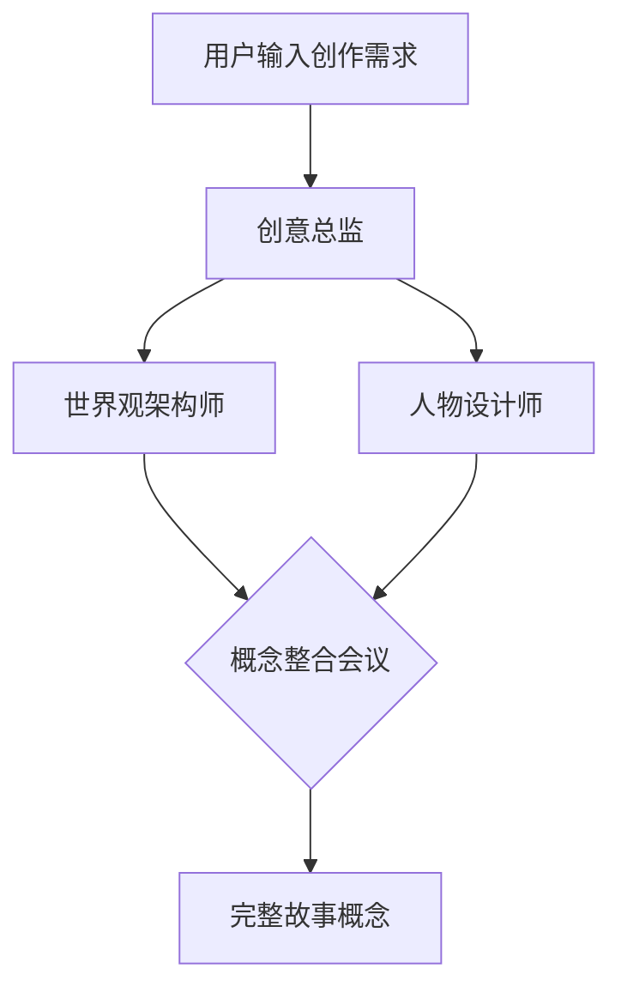
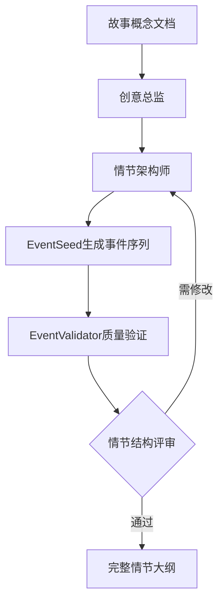
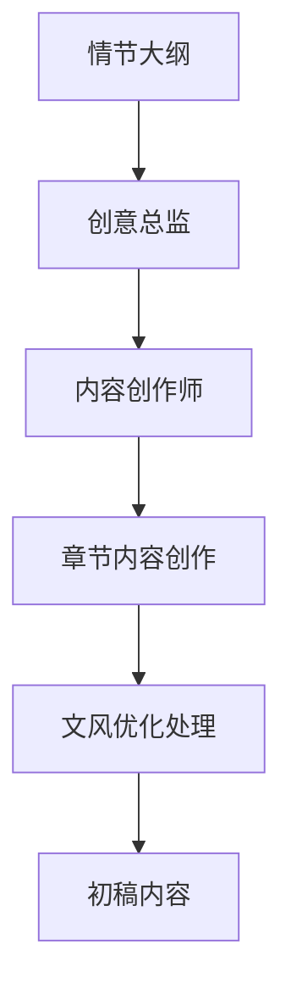
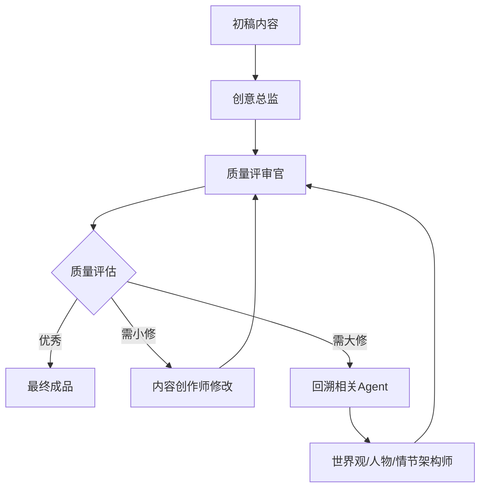
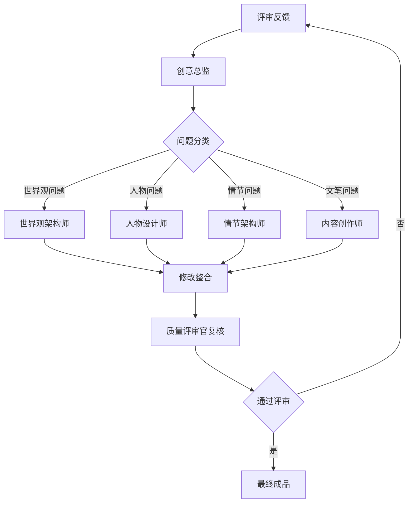

# 多Agent小说写作框架 - 完整指南

## 概述

这是一个基于LangChain和DeepSeek的**多Agent协作框架**，用于完成复杂的小说创作任务。框架采用分工明确的Agent设计，让多个专业化的AI Agent相互协作，共同完成一部小说的创作。

## 架构设计

### 核心Agent（6个）

#### 1. 创意总监（Creative Director）

**核心职责**：整体创作方向把控与工作流程协调

**主要功能**：
- **主题开发**：基于主题和类型创作完整故事概念，包括核心冲突、主题思想、目标读者
- **流程管理**：接收用户指令，分解任务，按优先级调用相应Agent
- **决策整合**：综合各Agent输出，生成连贯的最终建议
- **上下文维护**：维护项目整体上下文和工作流程日志

#### 2. 世界观架构师（World Architect）

**核心职责**：世界观体系构建与逻辑一致性维护

**主要功能**：
- **体系设计**：设计和完善世界观设定（物理规则、社会结构、历史文化等）
- **逻辑验证**：确保设定逻辑一致性和科学性
- **冲突检测**：检查新设定与已有设定的冲突
- **选项提供**：提出多个世界观选项供作者选择

#### 3. 人物设计师（Character Designer）

**核心职责**：角色体系构建与人物关系网络设计

**主要功能**：
- **角色创建**：基于故事概念设计主要角色完整档案
- **心理分析**：分析人物心理特征、动机和成长弧光
- **关系构建**：设计人物之间的关系网络和互动模式
- **一致性维护**：确保人物性格和行为的一致性

#### 4. 情节架构师（Plot Architect）

**核心职责**：故事结构设计与情节质量把控

**主要功能**：
- **结构设计**：采用三幕式等叙事框架设计完整情节结构
- **事件生成**：基于故事前提生成包含关键要素的事件序列
- **转折设计**：创建引人入胜的情节转折和冲突设计
- **质量验证**：监控评估事件合理性，确保叙事逻辑连贯顺畅

#### 5. 内容创作师（Content Creator）

**核心职责**：具体内容创作与语言风格优化

**主要功能**：
- **章节创作**：根据情节大纲和人物设定创作各章节内容
- **场景构建**：创作具体场景描述和对话内容
- **风格统一**：通过文风模仿、一致性维护确保语言风格连贯
- **文学优化**：运用修辞手法和文学技巧提升文笔质量

#### 6. 质量评审官（Quality Reviewer）

**核心职责**：作品质量审核与改进建议

**主要功能**：
- **逻辑审查**：指出逻辑漏洞、人物不一致和设定冲突
- **质量评估**：评估故事吸引力、可信度和节奏把控
- **细节检查**：检查错别字、语法错误和文笔质量问题
- **改进建议**：提出具体的修改和优化建议

## 工作流程

### 多Agent小说创作工作流程

#### 阶段一：概念开发阶段



**流程说明**：
1. 创意总监接收用户输入，分析创作需求
2. 并行调用世界观架构师和人物设计师
3. 三方进行"概念整合会议"，确保世界观与人物设定协调
4. 输出完整的故事概念文档

#### 阶段二：结构设计阶段



**流程说明**：
1. 创意总监将故事概念传递给情节架构师
2. 情节架构师启动EventSeed生成事件序列
3. EventValidator对生成内容进行质量验证
4. 通过评审后输出完整情节大纲

#### 阶段三：内容创作阶段



**流程说明**：
1. 创意总监基于情节大纲制定章节创作计划
2. 内容创作师按章节进行具体内容创作
3. 同时进行文风优化，确保语言风格统一
4. 输出章节初稿

#### 阶段四：质量评审阶段



**流程说明**：
1. 质量评审官对初稿进行全面评审
2. 根据问题严重程度决定处理路径：
   - 小问题：直接由内容创作师修改
   - 中等问题：可能需要文风优化
   - 重大问题：回溯到相关设计Agent重新调整

#### 阶段五：迭代优化循环



### 完整端到端工作流程

#### 启动阶段
1. 用户输入 → 创意总监（接收需求）
2. 创意总监 → 并行启动世界观架构师 + 人物设计师

#### 设计阶段
1. 世界观+人物设定 → 情节架构师（生成故事结构）
2. 情节大纲 → 创意总监审核

#### 创作阶段
1. 批准的大纲 → 内容创作师（分章节创作）
2. 章节初稿 → 质量评审官

#### 评审优化阶段
1. 评审反馈 → 创意总监（问题分类）
2. 分类问题 → 相应Agent修改
3. 修改内容 → 质量评审官复核
4. 通过 → 输出最终成品 | 不通过 → 继续迭代

### 关键协作机制

#### 1. 上下文共享池
- 所有Agent共享统一的创作上下文
- 实时更新设定变更，确保一致性

#### 2. 决策权限层级
- **创意总监**：最高决策权，流程控制
- **专业Agent**：领域内专业决策
- **质量评审官**：质量否决权

#### 3. 迭代终止条件
- 质量评审评分 ≥ 阈值
- 用户满意确认
- 迭代次数达到上限

## 使用指南

### 基本使用

```python
from multi_agent_framework import MultiAgentNovelWritingFramework

# 初始化框架
framework = MultiAgentNovelWritingFramework()

# 启动项目
response = framework.start_project(
    project_title="机器人的情感",
    genre="科幻短篇",
    initial_concept="一个获得情感的AI机器人的冒险故事"
)

# 构建世界观
response = framework.build_world(
    world_description="近未来地球，AI已普遍应用。请提供几个科技背景选项。"
)

# 创建人物
response = framework.create_characters(
    character_requirements="创建主角机器人的详细人物卡"
)

# 设计情节
response = framework.design_plot(
    plot_requirements="基于以上设定，设计三幕剧大纲"
)

# 撰写章节
response = framework.write_chapter(
    chapter_num=1,
    chapter_requirements="撰写第一章"
)

# 审阅内容
response = framework.review_content(
    content_to_review=response
)

# 修改内容
response = framework.revise_content(
    original_content=response,
    feedback="根据批评意见进行修改"
)
```

### 交互式会话

```python
framework = MultiAgentNovelWritingFramework()
framework.interactive_session()

# 然后你可以自由地与主编对话：
# 你: 我想写一个关于魔法学院的奇幻小说
# 主编: [协调各Agent提供建议]
# 你: 主角应该是什么样的人物?
# 主编: [人物设计师提供详细设计]
```

### 获取项目信息

```python
# 获取项目摘要
summary = framework.get_project_summary()
print(summary['context'])  # 项目上下文
print(summary['state'])    # 项目状态
print(summary['workflow_log'])  # 工作流程日志
```

## 文件结构

```
novel_writing_agent/
├── agents.py                    # 各个专业化Agent的定义
├── agent_coordinator.py         # 主编Agent协调器
├── multi_agent_framework.py     # 多Agent框架核心
├── multi_agent_example.py       # 使用示例
├── MULTI_AGENT_GUIDE.md        # 本文档
├── novel_agent.py              # 原始单Agent实现
├── knowledge_base.py           # 知识库管理
├── memory_manager.py           # 记忆管理
├── config.py                   # 配置管理
└── requirements.txt            # 依赖包
```

## 高级功能

### 自定义Agent

你可以继承 `BaseAgent` 类创建自定义Agent：

```python
from agents import BaseAgent

class MyCustomAgent(BaseAgent):
    def __init__(self, knowledge_base=None, memory_manager=None):
        super().__init__("我的Agent", "custom_agent", knowledge_base, memory_manager)
    
    def get_system_prompt(self) -> str:
        return "你是一个自定义的Agent..."
```

### 扩展主编Agent

在 `agent_coordinator.py` 中添加新的Agent：

```python
self.my_custom_agent = MyCustomAgent(self.knowledge_base, self.memory_manager)
```

### 自定义工作流程

继承 `MultiAgentNovelWritingFramework` 并重写方法：

```python
class CustomFramework(MultiAgentNovelWritingFramework):
    def custom_workflow(self):
        # 自定义工作流程
        pass
```

## 最佳实践

1. **明确的任务分解**: 让主编清楚地理解用户需求，分解成具体的子任务
2. **充分的上下文**: 确保每个Agent都有足够的项目上下文信息
3. **迭代完善**: 利用批评家Agent的反馈进行多轮迭代
4. **保持一致性**: 定期检查各Agent的输出是否一致
5. **记录工作流程**: 使用工作流程日志追踪项目进展

## 故障排除

### 问题：Agent之间的输出不一致

**解决方案**:
- 确保所有Agent都有相同的项目上下文
- 让批评家Agent检查一致性
- 使用主编Agent进行协调和综合

### 问题：生成的内容质量不高

**解决方案**:
- 提供更详细的需求描述
- 使用批评家Agent进行多轮迭代
- 调整各Agent的temperature参数

### 问题：工作流程太慢

**解决方案**:
- 减少不必要的Agent调用
- 使用并行处理（如果支持）
- 优化Prompt以减少生成时间

## 扩展方向

1. **Agent间通信**: 实现Agent之间的直接通信，而不仅仅通过主编
2. **并行处理**: 支持多个Agent并行工作
3. **持久化**: 将项目数据保存到数据库
4. **版本控制**: 追踪内容的多个版本
5. **协作编辑**: 支持多个用户同时编辑
6. **评分系统**: 为各Agent的输出评分，优化Agent选择

## 许可证

MIT License

