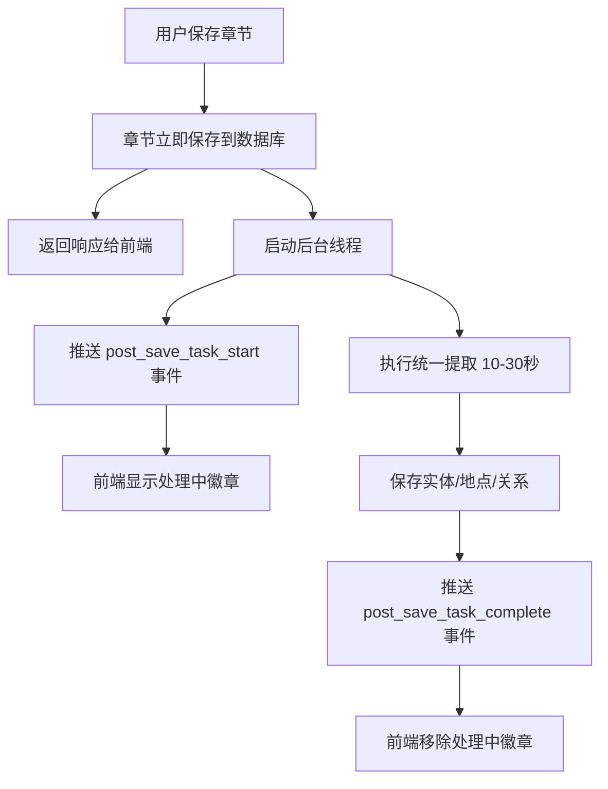

# 后台任务状态指示器功能

## 📝 功能概述

为章节保存后的后台任务（统一提取）添加实时状态指示器，让用户清楚了解后台正在处理的章节。

---

## 🎯 功能特性

### 1. 实时状态推送
- **后台任务开始**：章节保存后立即推送 `post_save_task_start` 事件
- **后台任务完成**：提取完成后推送 `post_save_task_complete` 事件

### 2. 可视化指示
- **章节列表**：正在处理的章节显示 "处理中..." 徽章
- **颜色标识**：使用主题色（蓝色）Chip组件

### 3. 安全提示
用户可以清楚知道哪些章节正在后台处理，避免：
- ✅ 编辑正在提取的章节（可能导致数据不一致）
- ✅ 删除正在处理的章节（后台任务会失败）
- ✅ 修改正在提取的实体（可能被覆盖）

---

## 🛠️ 技术实现

### 后端修改

#### 文件：`backend/app/services/chapter_post_save.py`

**添加任务开始事件推送**（第54-66行）：
```python
# 🔔 推送任务开始事件
try:
    from app.websocket.manager import ws_manager
    await ws_manager.broadcast_to_project(
        project_id=project_id,
        event='post_save_task_start',
        data={
            'chapter_id': chapter_id,
            'chapter_number': chapter_number,
            'status': 'processing'
        }
    )
    logger.info(f"📡 已推送任务开始事件")
except Exception as ws_error:
    logger.warning(f"⚠️ WebSocket 推送失败: {ws_error}")
```

**添加任务完成事件推送**（第212-224行）：
```python
# 🔔 推送任务完成事件
try:
    from app.websocket.manager import ws_manager
    await ws_manager.broadcast_to_project(
        project_id=project_id,
        event='post_save_task_complete',
        data={
            'chapter_id': chapter_id,
            'chapter_number': chapter_number,
            'status': 'completed'
        }
    )
    logger.info(f"📡 已推送任务完成事件")
except Exception as ws_error:
    logger.warning(f"⚠️ WebSocket 推送失败: {ws_error}")
```

---

### 前端修改

#### 文件：`frontend/src/pages/DashboardPage.tsx`

**1. 添加状态管理**（第120行）：
```typescript
// 后台任务状态（章节ID -> 是否正在处理）
const [postSaveProcessing, setPostSaveProcessing] = useState<Set<number>>(new Set())
```

**2. 添加WebSocket监听**（第271-315行）：
```typescript
// 监听 WebSocket 事件（后台任务状态）
useEffect(() => {
  if (!selectedProjectId) return

  const { workflowWebSocket } = require('@/services/websocket')

  // 连接并加入项目房间
  workflowWebSocket.connect().then(() => {
    workflowWebSocket.joinProject(selectedProjectId)
  })

  // 监听任务开始
  const handleTaskStart = (data: any) => {
    if (data.chapter_id) {
      setPostSaveProcessing(prev => new Set(prev).add(data.chapter_id))
    }
  }

  // 监听任务完成
  const handleTaskComplete = (data: any) => {
    if (data.chapter_id) {
      setPostSaveProcessing(prev => {
        const newSet = new Set(prev)
        newSet.delete(data.chapter_id)
        return newSet
      })
    }
  }

  // 注册监听器
  workflowWebSocket.on('post_save_task_start', handleTaskStart)
  workflowWebSocket.on('post_save_task_complete', handleTaskComplete)

  // 清理
  return () => {
    workflowWebSocket.off('post_save_task_start', handleTaskStart)
    workflowWebSocket.off('post_save_task_complete', handleTaskComplete)
  }
}, [selectedProjectId])
```

**3. 在章节列表中显示状态**（第1318-1334行）：
```typescript
<ListItemText
  primary={(
    <Box sx={{ display: 'flex', alignItems: 'center', gap: 1 }}>
      <span>{chapter.title}</span>
      {postSaveProcessing.has(chapter.id) && (
        <Chip
          label="处理中..."
          size="small"
          color="primary"
          sx={{ height: 20, fontSize: '0.7rem' }}
        />
      )}
    </Box>
  )}
  secondary={`📝 ${chapter.word_count || 0} 字`}
/>
```

**4. 添加Chip组件导入**（第34行）：
```typescript
import { ..., Chip } from '@mui/material'
```

---

## 📊 数据流程



---

## 🎨 UI 效果

### 章节列表（处理中）
```
┌─────────────────────────────────────────┐
│ 📚 章节列表                   排序: ↑ ↓ │
├─────────────────────────────────────────┤
│ 第1章 标题                              │
│ 📝 3000 字                              │
├─────────────────────────────────────────┤
│ 第2章 标题  [处理中...]                 │  ← 蓝色徽章
│ 📝 2500 字                              │
└─────────────────────────────────────────┘
```

---

## ⚡ 性能特性

1. **非阻塞**：章节保存 <1秒返回，后台异步处理
2. **实时更新**：通过WebSocket推送状态，延迟 <100ms
3. **自动清理**：任务完成后自动移除状态标记
4. **容错处理**：WebSocket推送失败不影响后台任务执行

---

## 🔒 用户操作安全性

### ✅ 安全操作（后台任务运行时）
- 查看其他章节
- 编辑其他章节
- 创建新章节
- 查看知识库
- 生成下一章

### ⚠️ 潜在风险操作
- **编辑正在处理的章节**：提取的实体可能与新内容不匹配
  - **状态指示**：徽章提醒用户该章节正在处理
  
- **删除正在处理的章节**：后台任务会失败（但不会崩溃）
  - **状态指示**：徽章提醒用户该章节正在处理
  
- **手动修改实体**：可能被后台任务覆盖
  - **建议**：等待处理完成后再修改

---

## 🧪 测试步骤

### 1. 启动后端
```bash
cd backend
uvicorn app.main:app --reload
```

### 2. 启动前端
```bash
cd frontend
npm run dev
```

### 3. 测试场景

#### 场景1：手动保存章节
1. 打开项目详情页
2. 编辑章节内容
3. 点击保存
4. **预期**：章节列表中该章节显示"处理中..."徽章
5. 等待10-30秒
6. **预期**：徽章自动消失

#### 场景2：工作流生成章节
1. 进入工作流页面
2. 点击"生成下一章"
3. 等待章节生成完成
4. 打开章节列表
5. **预期**：新生成的章节显示"处理中..."徽章
6. 等待10-30秒
7. **预期**：徽章自动消失

#### 场景3：多章节并发处理
1. 快速保存3个不同章节
2. 打开章节列表
3. **预期**：3个章节都显示"处理中..."徽章
4. 等待处理完成
5. **预期**：徽章逐个消失

---

## 📝 日志示例

### 后端日志
```
📡 开始后台处理章节 10（第10章）...
📡 已推送任务开始事件
   🚀 统一提取（1次AI调用）...
   ✅ 统一提取成功，耗时: 12.34 秒
   💾 保存地点层级...
   💾 归类并保存实体...
   💾 保存关系...
✅ 后台处理完成：章节 10
📡 已推送任务完成事件
```

### 前端控制台
```
📡 收到后台任务开始: { chapter_id: 10, chapter_number: 10, status: 'processing' }
✅ 收到后台任务完成: { chapter_id: 10, chapter_number: 10, status: 'completed' }
```

---

## 🔮 未来改进

1. **进度估算**：显示大致剩余时间（"还需约15秒"）
2. **详细状态**：区分提取阶段（"提取实体中..." → "提取关系中..."）
3. **失败提示**：后台任务失败时显示错误徽章
4. **批量状态**：支持查看所有项目的后台任务状态

---

## ✅ 完成清单

- [x] 后端推送任务开始事件
- [x] 后端推送任务完成事件
- [x] 前端监听WebSocket事件
- [x] 前端显示处理中徽章
- [x] 添加状态管理（Set）
- [x] 自动清理完成任务
- [x] 编写功能文档

---

## 🎉 总结

此功能通过WebSocket实时推送和可视化指示器，让用户清楚了解后台任务状态，避免潜在的数据冲突问题。实现简洁高效，不影响现有功能性能。
